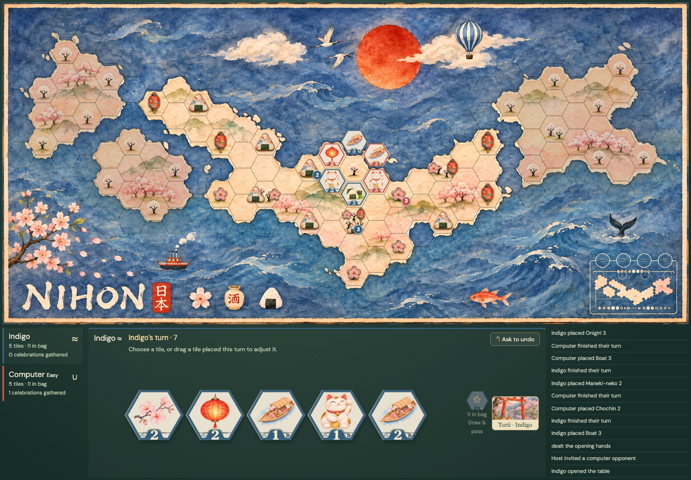
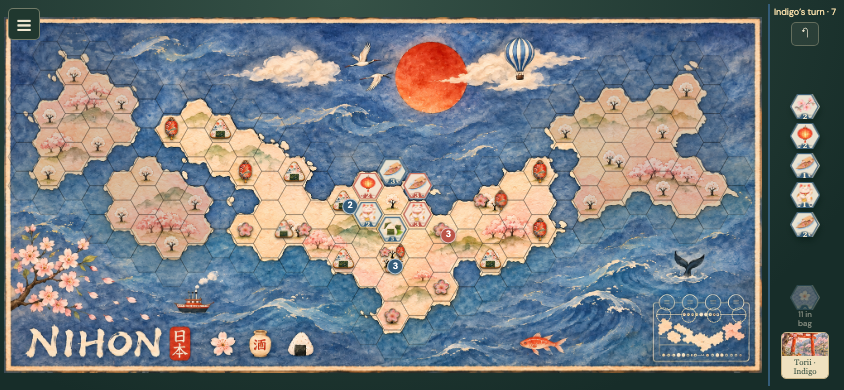
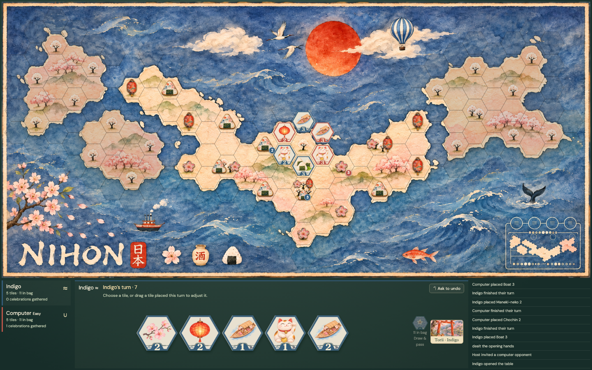
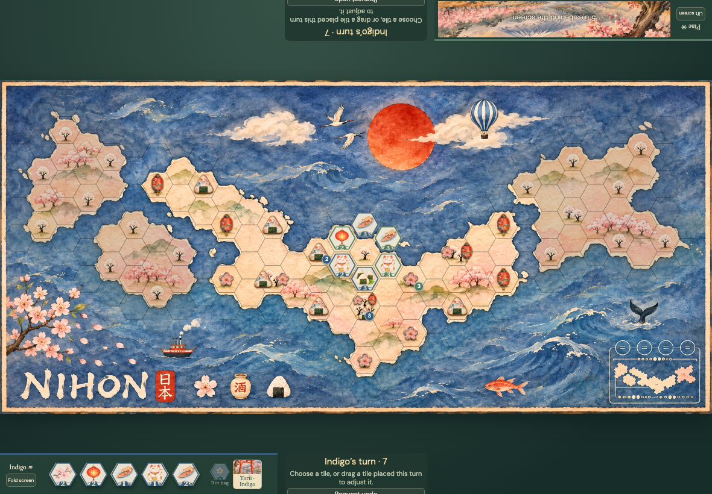
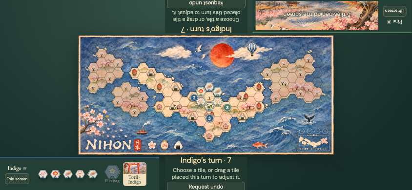

# Current production-route layout baselines

Generated by `npm run lab:capture` against the local emulator dev server. Every capture uses the actual game route and a legal event-created three-round game. Tabletop screens were opened using the real reveal control. Both documents start fresh at the same viewport and pixel origin (Focus route), aligning Chromium's background dithering as well as layout. No game-layout overrides, state injection, masks or image post-processing. Each framed viewport matched the standalone route's decoded RGBA pixels and accessible DOM exactly.

## iPad Air · landscape · web

Viewport 1180 × 820; page 1180 × 820; board 1172 × 550. Pixel differences: 0.

[Accessible DOM](web-ipad-air-landscape.dom.txt)

## Phone · landscape · web

Viewport 844 × 390; page 844 × 390; board 758 × 356. Pixel differences: 0.

[Accessible DOM](web-phone-landscape.dom.txt)

## Desktop · web

Viewport 1440 × 900; page 1440 × 900; board 1432 × 672. Pixel differences: 0.

[Accessible DOM](web-desktop.dom.txt)

## iPad Air · landscape · tabletop

Viewport 1180 × 820; page 1180 × 820; board 1180 × 554. Pixel differences: 0.

[Accessible DOM](tabletop-ipad-air-landscape.dom.txt)

## Phone · landscape · tabletop

Viewport 844 × 390; page 844 × 390; board 524 × 246. Pixel differences: 0.

[Accessible DOM](tabletop-phone-landscape.dom.txt)
