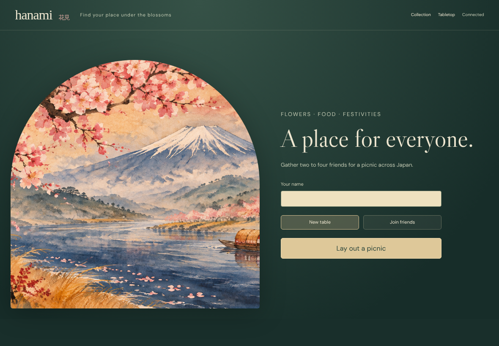
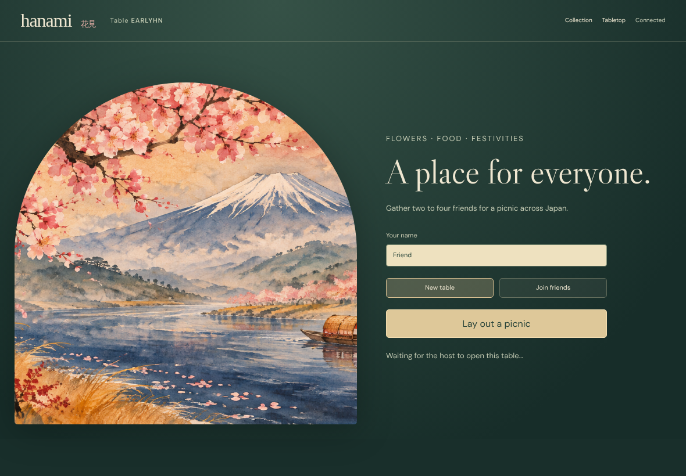
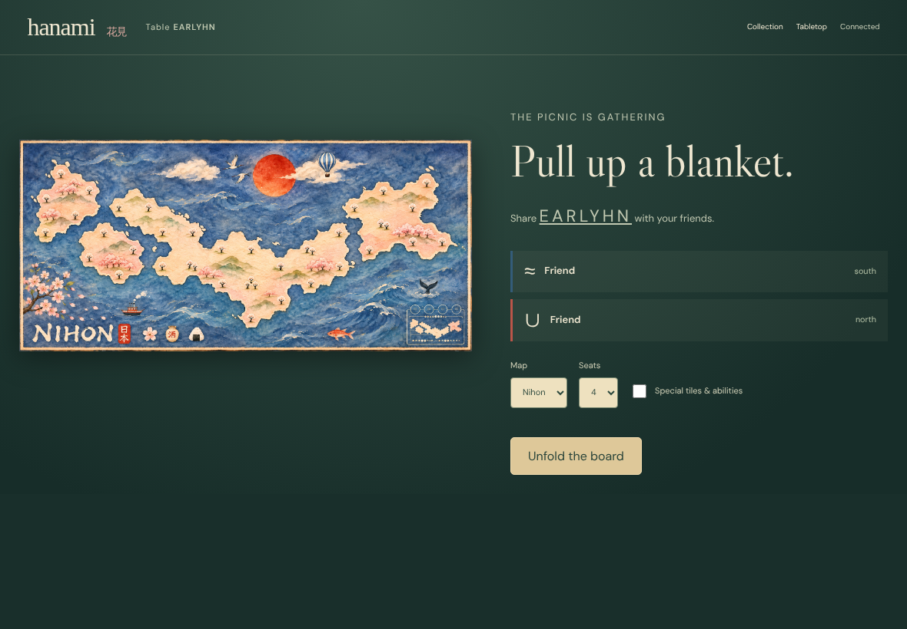
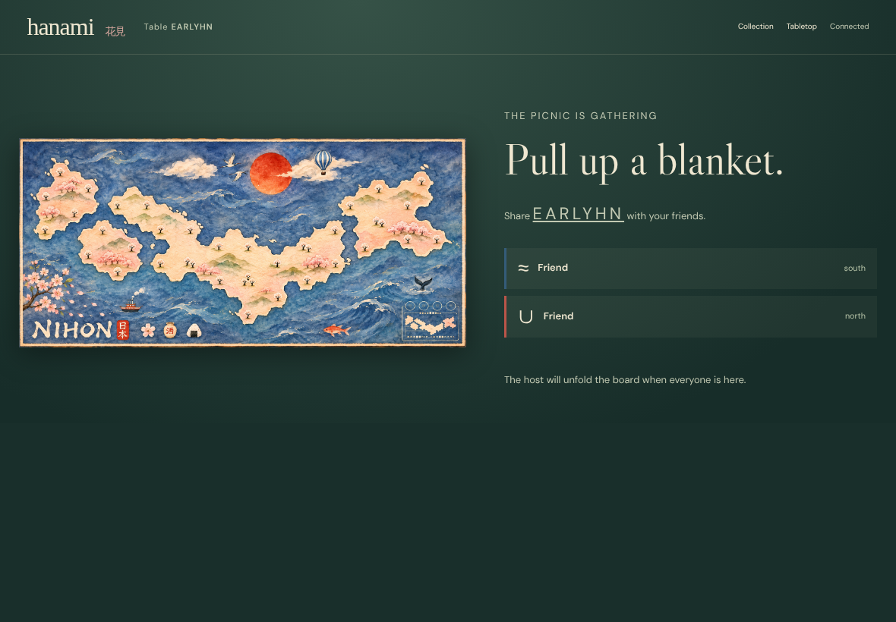

# A guest arriving before the host

Real UI → authenticated Firestore transaction → immutable event → deterministic replay → every observer. Zero pixel tolerance; every decoded RGBA byte and the accessible DOM are compared. No game-state injection or outcome fixtures.

## 000. Guest: Follow a join URL before the creator arrives

DOM assertions passed; actor and all observers captured.

[Host DOM evidence](../../../screenshots/tabletop-launch.spec.js/gameroom-guests-wait-for-their-creator-and-reload-never-seats-duplicates-000-host-linux.dom.txt)

[Guest DOM evidence](../../../screenshots/tabletop-launch.spec.js/gameroom-guests-wait-for-their-creator-and-reload-never-seats-duplicates-000-guest-linux.dom.txt)

## 001. Host: Open the intended host URL

DOM assertions passed; actor and all observers captured.

[Host DOM evidence](../../../screenshots/tabletop-launch.spec.js/gameroom-guests-wait-for-their-creator-and-reload-never-seats-duplicates-001-host-linux.dom.txt)

[Guest DOM evidence](../../../screenshots/tabletop-launch.spec.js/gameroom-guests-wait-for-their-creator-and-reload-never-seats-duplicates-001-guest-linux.dom.txt)

## 002. Guest: Reload the same invitation without another join

DOM assertions passed; actor and all observers captured.

[Host DOM evidence](../../../screenshots/tabletop-launch.spec.js/gameroom-guests-wait-for-their-creator-and-reload-never-seats-duplicates-002-host-linux.dom.txt)

[Guest DOM evidence](../../../screenshots/tabletop-launch.spec.js/gameroom-guests-wait-for-their-creator-and-reload-never-seats-duplicates-002-guest-linux.dom.txt)
