# The lab uses the production presenter

Real UI → authenticated Firestore transaction → immutable event → deterministic replay → every observer. Zero pixel tolerance; every decoded RGBA byte and the accessible DOM are compared. No game-state injection or outcome fixtures.

## 000. Web: Open the real game and the lab fixture beside it

DOM assertions passed; actor and all observers captured.

[Lab DOM evidence](../../../screenshots/presentation-parity.spec.js/the-animation-lab-runs-the-production-player-area-and-animation-presenter-000-lab-linux.dom.txt)

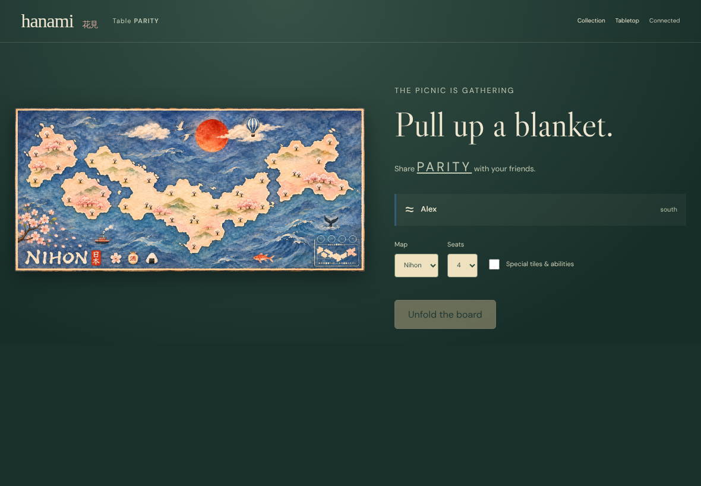

[Web DOM evidence](../../../screenshots/presentation-parity.spec.js/the-animation-lab-runs-the-production-player-area-and-animation-presenter-000-web-linux.dom.txt)

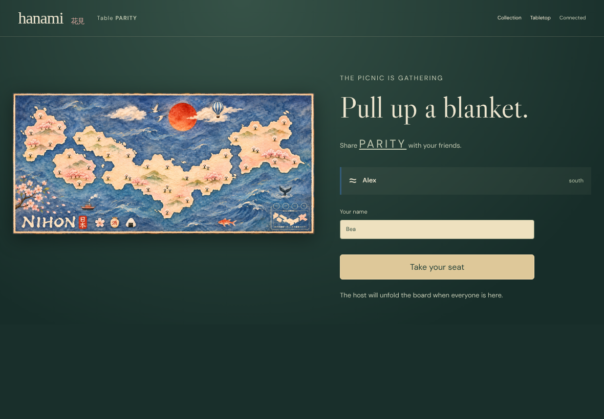

[Bea DOM evidence](../../../screenshots/presentation-parity.spec.js/the-animation-lab-runs-the-production-player-area-and-animation-presenter-000-bea-linux.dom.txt)

## 001. Bea: Join the game from a second client

DOM assertions passed; actor and all observers captured.

[Lab DOM evidence](../../../screenshots/presentation-parity.spec.js/the-animation-lab-runs-the-production-player-area-and-animation-presenter-001-lab-linux.dom.txt)

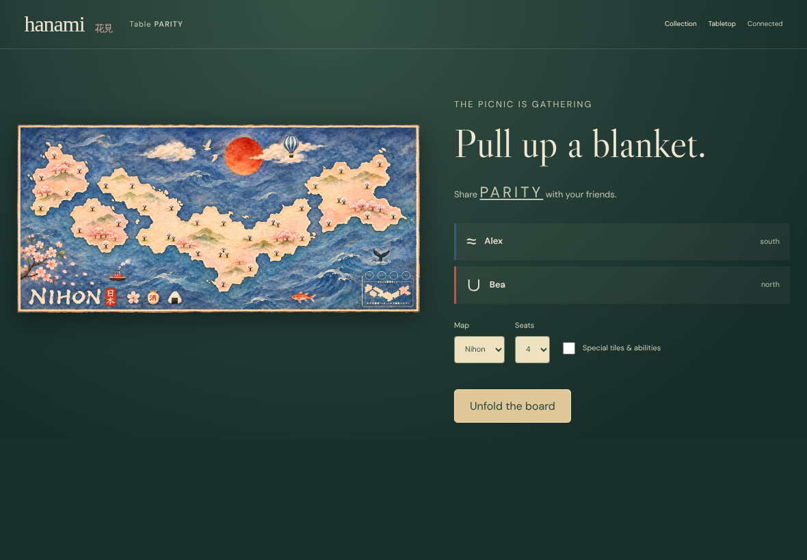

[Web DOM evidence](../../../screenshots/presentation-parity.spec.js/the-animation-lab-runs-the-production-player-area-and-animation-presenter-001-web-linux.dom.txt)

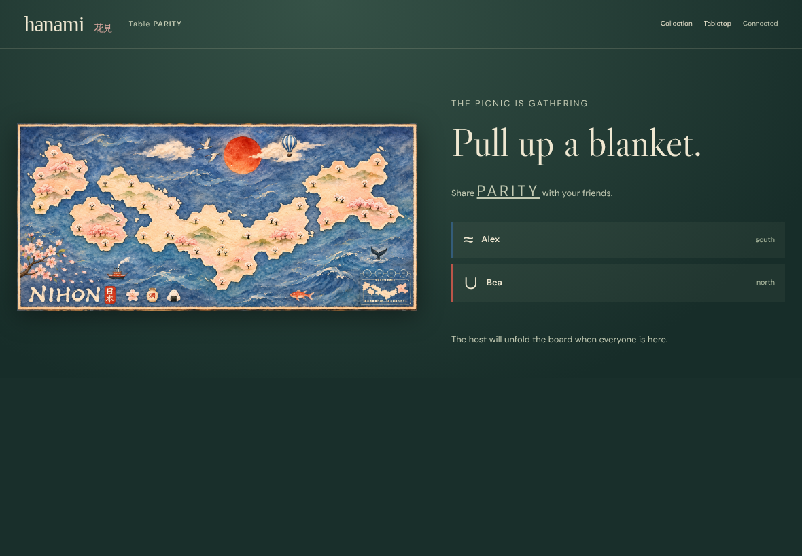

[Bea DOM evidence](../../../screenshots/presentation-parity.spec.js/the-animation-lab-runs-the-production-player-area-and-animation-presenter-001-bea-linux.dom.txt)

## 002. Web: Deal the real opening hands

DOM assertions passed; actor and all observers captured.

[Lab DOM evidence](../../../screenshots/presentation-parity.spec.js/the-animation-lab-runs-the-production-player-area-and-animation-presenter-002-lab-linux.dom.txt)

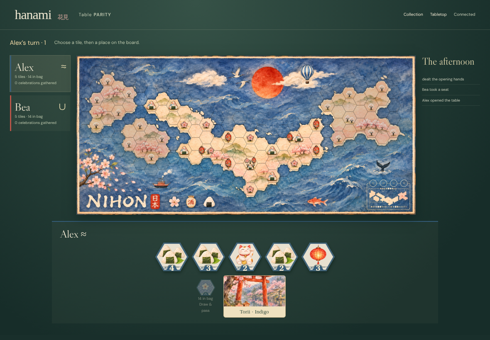

[Web DOM evidence](../../../screenshots/presentation-parity.spec.js/the-animation-lab-runs-the-production-player-area-and-animation-presenter-002-web-linux.dom.txt)

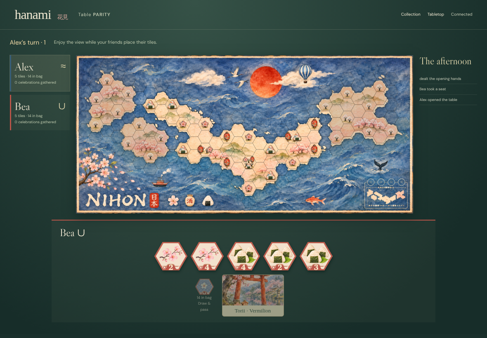

[Bea DOM evidence](../../../screenshots/presentation-parity.spec.js/the-animation-lab-runs-the-production-player-area-and-animation-presenter-002-bea-linux.dom.txt)

## 003. Web: Select a real held tile in the web game

DOM assertions passed; actor and all observers captured.

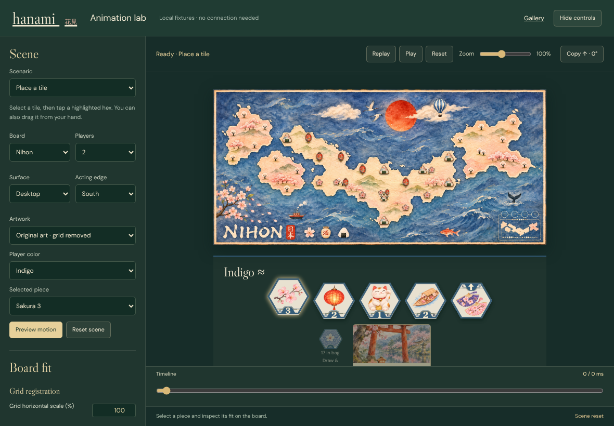

[Lab DOM evidence](../../../screenshots/presentation-parity.spec.js/the-animation-lab-runs-the-production-player-area-and-animation-presenter-003-lab-linux.dom.txt)

[Web DOM evidence](../../../screenshots/presentation-parity.spec.js/the-animation-lab-runs-the-production-player-area-and-animation-presenter-003-web-linux.dom.txt)

[Bea DOM evidence](../../../screenshots/presentation-parity.spec.js/the-animation-lab-runs-the-production-player-area-and-animation-presenter-003-bea-linux.dom.txt)

## 004. Lab: Choose that same component in the lab

DOM assertions passed; actor and all observers captured.

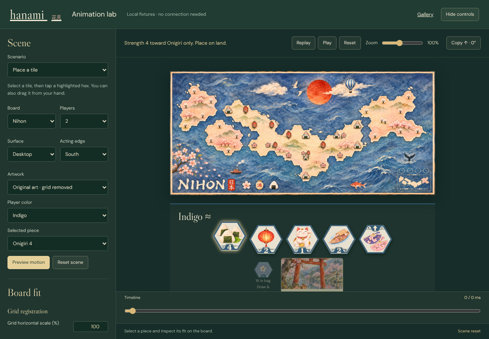

[Lab DOM evidence](../../../screenshots/presentation-parity.spec.js/the-animation-lab-runs-the-production-player-area-and-animation-presenter-004-lab-linux.dom.txt)

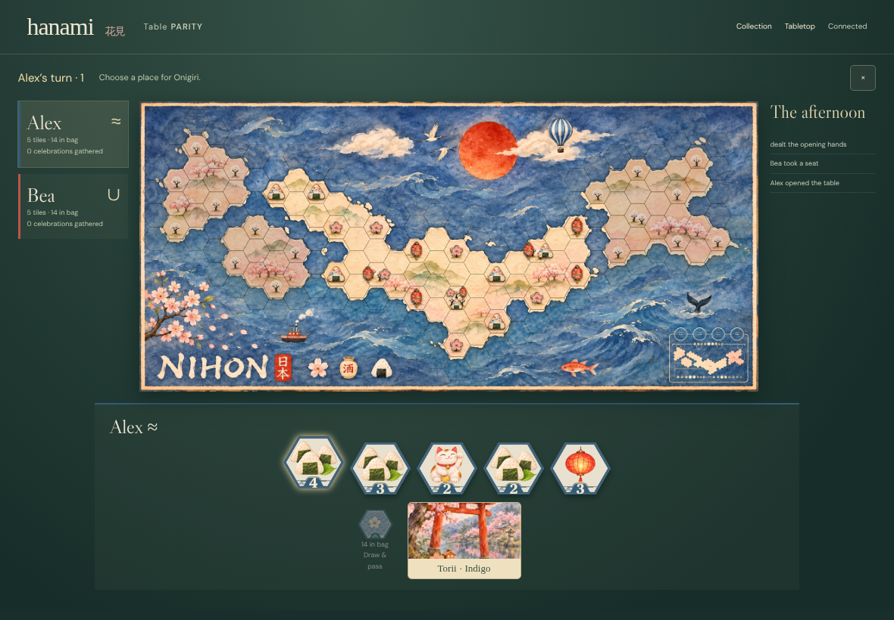

[Web DOM evidence](../../../screenshots/presentation-parity.spec.js/the-animation-lab-runs-the-production-player-area-and-animation-presenter-004-web-linux.dom.txt)

[Bea DOM evidence](../../../screenshots/presentation-parity.spec.js/the-animation-lab-runs-the-production-player-area-and-animation-presenter-004-bea-linux.dom.txt)

## 005. Lab: Place it through the production presenter in the lab

DOM assertions passed; actor and all observers captured.

[Lab DOM evidence](../../../screenshots/presentation-parity.spec.js/the-animation-lab-runs-the-production-player-area-and-animation-presenter-005-lab-linux.dom.txt)

[Web DOM evidence](../../../screenshots/presentation-parity.spec.js/the-animation-lab-runs-the-production-player-area-and-animation-presenter-005-web-linux.dom.txt)

[Bea DOM evidence](../../../screenshots/presentation-parity.spec.js/the-animation-lab-runs-the-production-player-area-and-animation-presenter-005-bea-linux.dom.txt)

## 006. Web: Place the real tile using exactly the same flight plan

DOM assertions passed; actor and all observers captured.

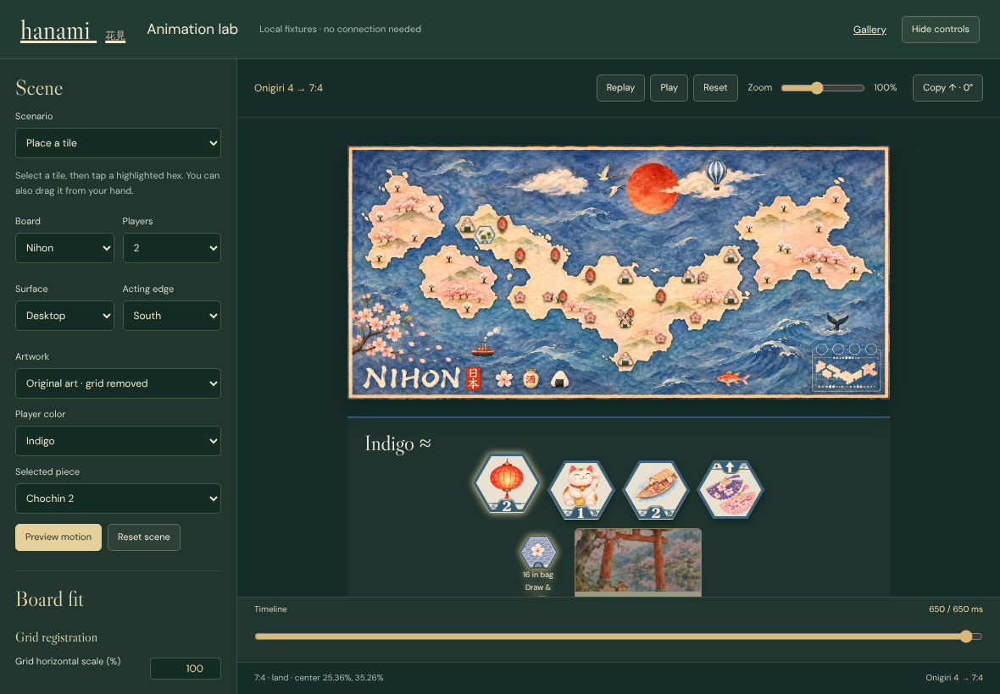

[Lab DOM evidence](../../../screenshots/presentation-parity.spec.js/the-animation-lab-runs-the-production-player-area-and-animation-presenter-006-lab-linux.dom.txt)

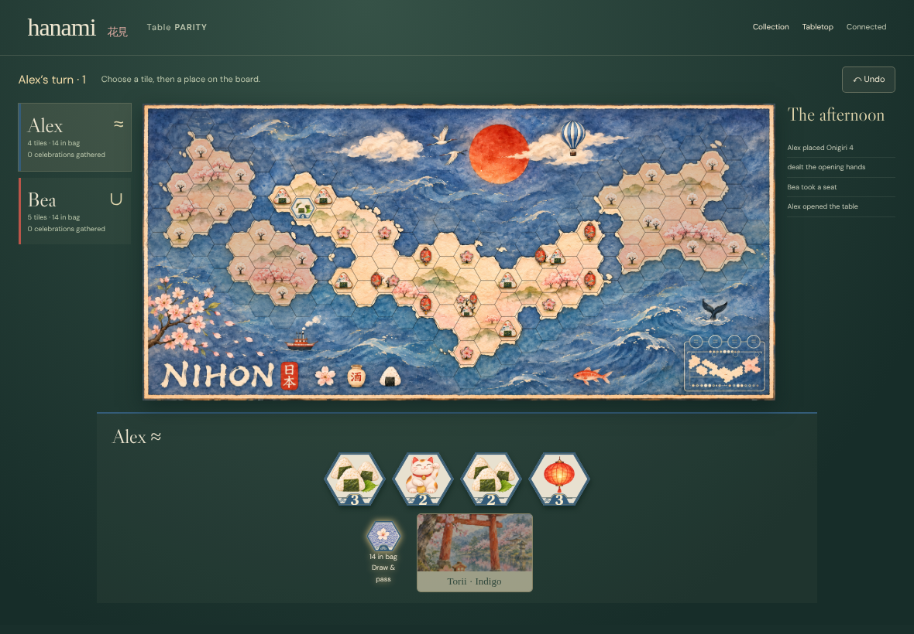

[Web DOM evidence](../../../screenshots/presentation-parity.spec.js/the-animation-lab-runs-the-production-player-area-and-animation-presenter-006-web-linux.dom.txt)

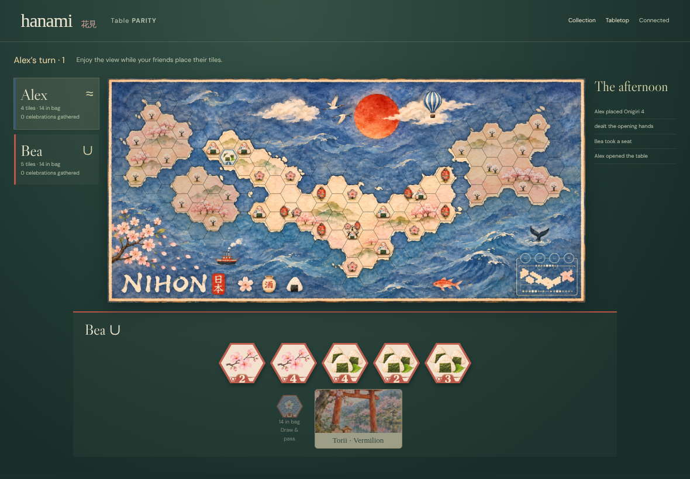

[Bea DOM evidence](../../../screenshots/presentation-parity.spec.js/the-animation-lab-runs-the-production-player-area-and-animation-presenter-006-bea-linux.dom.txt)

## 007. Lab: Preview the production refill in the lab

DOM assertions passed; actor and all observers captured.

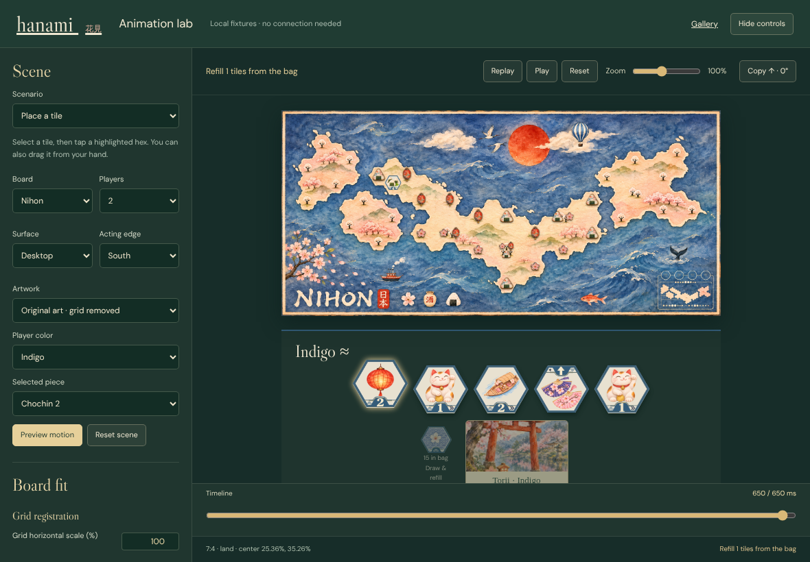

[Lab DOM evidence](../../../screenshots/presentation-parity.spec.js/the-animation-lab-runs-the-production-player-area-and-animation-presenter-007-lab-linux.dom.txt)

[Web DOM evidence](../../../screenshots/presentation-parity.spec.js/the-animation-lab-runs-the-production-player-area-and-animation-presenter-007-web-linux.dom.txt)

[Bea DOM evidence](../../../screenshots/presentation-parity.spec.js/the-animation-lab-runs-the-production-player-area-and-animation-presenter-007-bea-linux.dom.txt)

## 008. Web: Refill the real hand with the same perspective animation

DOM assertions passed; actor and all observers captured.

[Lab DOM evidence](../../../screenshots/presentation-parity.spec.js/the-animation-lab-runs-the-production-player-area-and-animation-presenter-008-lab-linux.dom.txt)

[Web DOM evidence](../../../screenshots/presentation-parity.spec.js/the-animation-lab-runs-the-production-player-area-and-animation-presenter-008-web-linux.dom.txt)

[Bea DOM evidence](../../../screenshots/presentation-parity.spec.js/the-animation-lab-runs-the-production-player-area-and-animation-presenter-008-bea-linux.dom.txt)

## 009. Lab: Change travel time once in the lab

DOM assertions passed; actor and all observers captured.

[Lab DOM evidence](../../../screenshots/presentation-parity.spec.js/the-animation-lab-runs-the-production-player-area-and-animation-presenter-009-lab-linux.dom.txt)

[Web DOM evidence](../../../screenshots/presentation-parity.spec.js/the-animation-lab-runs-the-production-player-area-and-animation-presenter-009-web-linux.dom.txt)

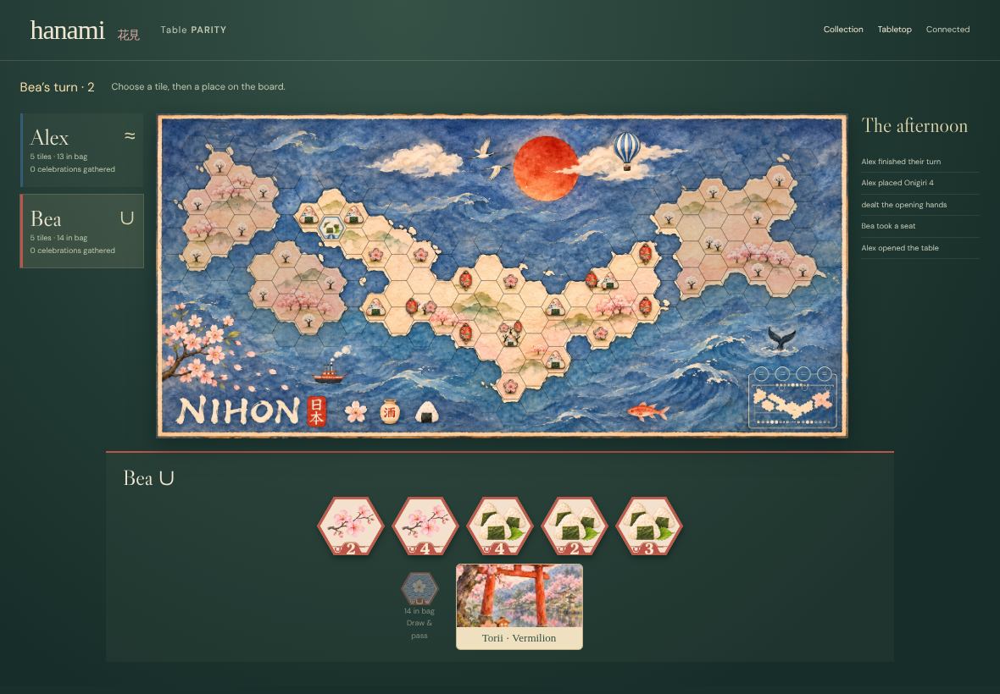

[Bea DOM evidence](../../../screenshots/presentation-parity.spec.js/the-animation-lab-runs-the-production-player-area-and-animation-presenter-009-bea-linux.dom.txt)

## 010. Bea: Bea selects a real held tile

DOM assertions passed; actor and all observers captured.

[Lab DOM evidence](../../../screenshots/presentation-parity.spec.js/the-animation-lab-runs-the-production-player-area-and-animation-presenter-010-lab-linux.dom.txt)

[Web DOM evidence](../../../screenshots/presentation-parity.spec.js/the-animation-lab-runs-the-production-player-area-and-animation-presenter-010-web-linux.dom.txt)

[Bea DOM evidence](../../../screenshots/presentation-parity.spec.js/the-animation-lab-runs-the-production-player-area-and-animation-presenter-010-bea-linux.dom.txt)

## 011. Bea: Bea places it on the playing field

DOM assertions passed; actor and all observers captured.

[Lab DOM evidence](../../../screenshots/presentation-parity.spec.js/the-animation-lab-runs-the-production-player-area-and-animation-presenter-011-lab-linux.dom.txt)

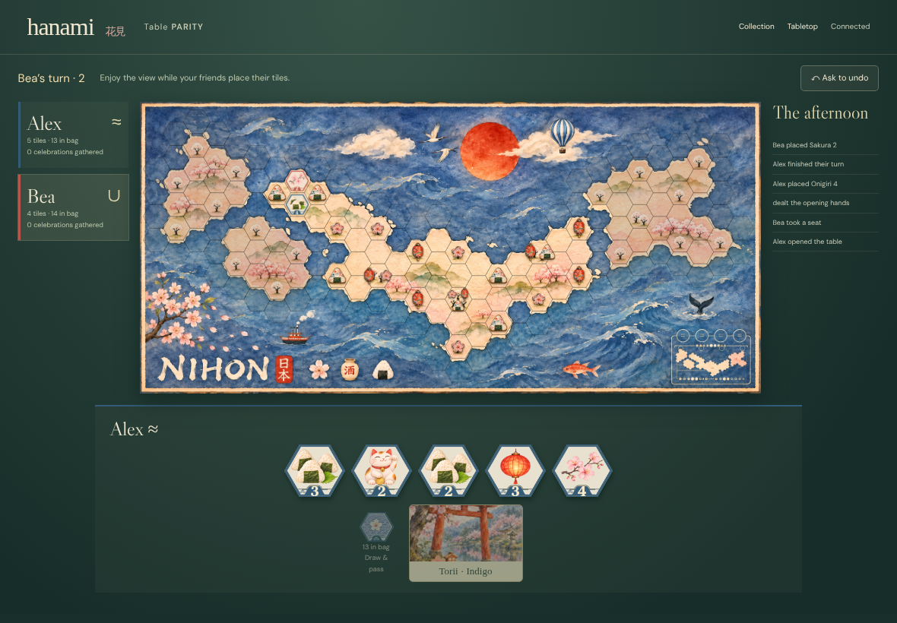

[Web DOM evidence](../../../screenshots/presentation-parity.spec.js/the-animation-lab-runs-the-production-player-area-and-animation-presenter-011-web-linux.dom.txt)

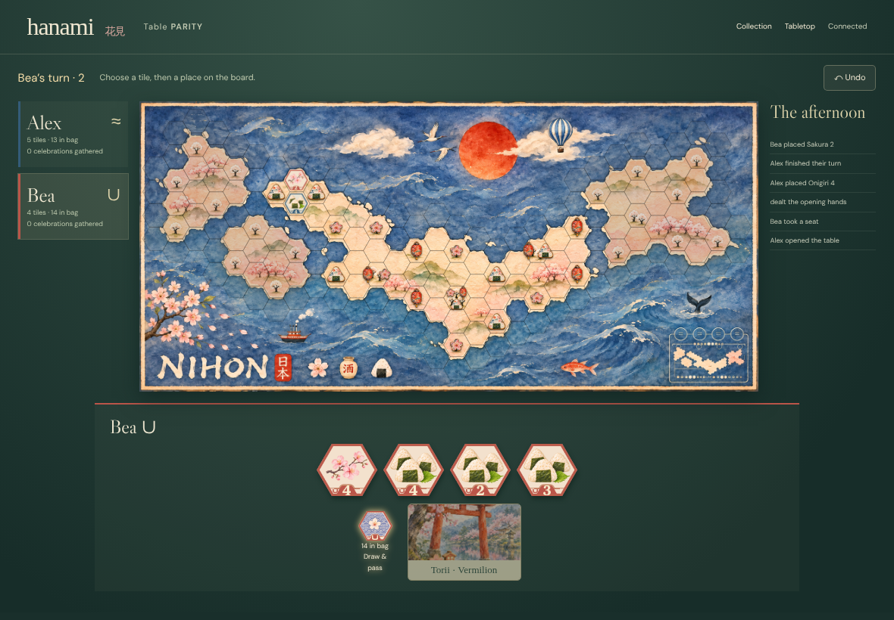

[Bea DOM evidence](../../../screenshots/presentation-parity.spec.js/the-animation-lab-runs-the-production-player-area-and-animation-presenter-011-bea-linux.dom.txt)

## 012. Bea: Bea draws and returns the turn

DOM assertions passed; actor and all observers captured.

[Lab DOM evidence](../../../screenshots/presentation-parity.spec.js/the-animation-lab-runs-the-production-player-area-and-animation-presenter-012-lab-linux.dom.txt)

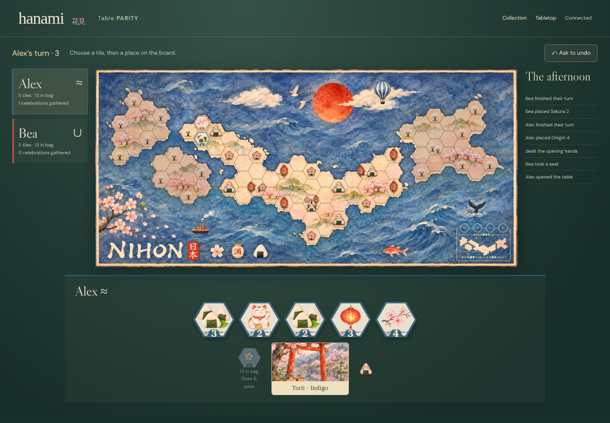

[Web DOM evidence](../../../screenshots/presentation-parity.spec.js/the-animation-lab-runs-the-production-player-area-and-animation-presenter-012-web-linux.dom.txt)

[Bea DOM evidence](../../../screenshots/presentation-parity.spec.js/the-animation-lab-runs-the-production-player-area-and-animation-presenter-012-bea-linux.dom.txt)

## 013. Web: Select the next real tile

DOM assertions passed; actor and all observers captured.

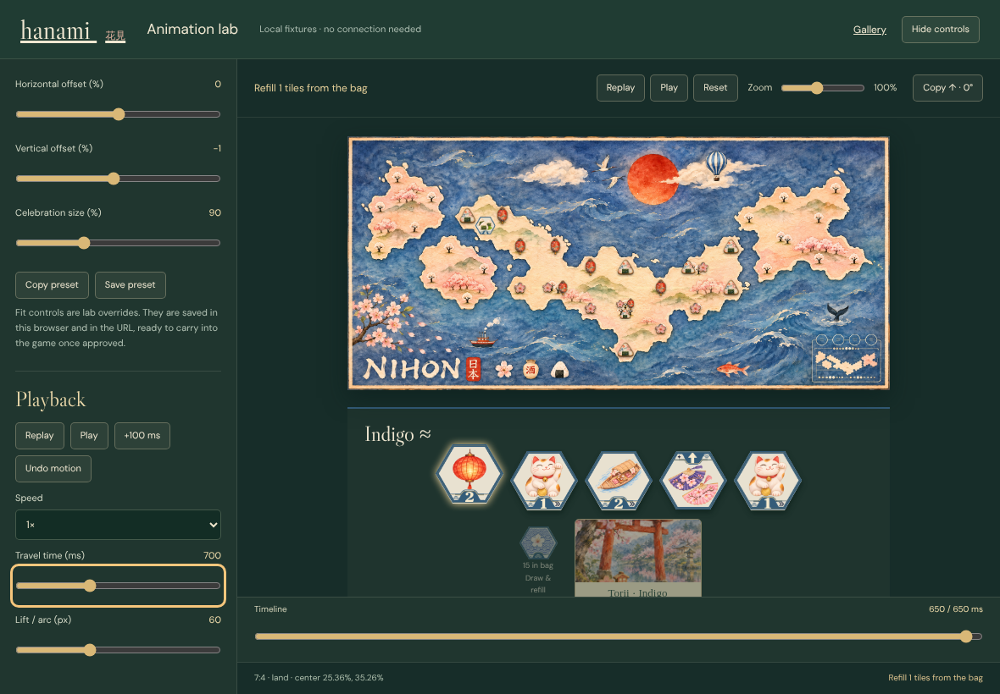

[Lab DOM evidence](../../../screenshots/presentation-parity.spec.js/the-animation-lab-runs-the-production-player-area-and-animation-presenter-013-lab-linux.dom.txt)

[Web DOM evidence](../../../screenshots/presentation-parity.spec.js/the-animation-lab-runs-the-production-player-area-and-animation-presenter-013-web-linux.dom.txt)

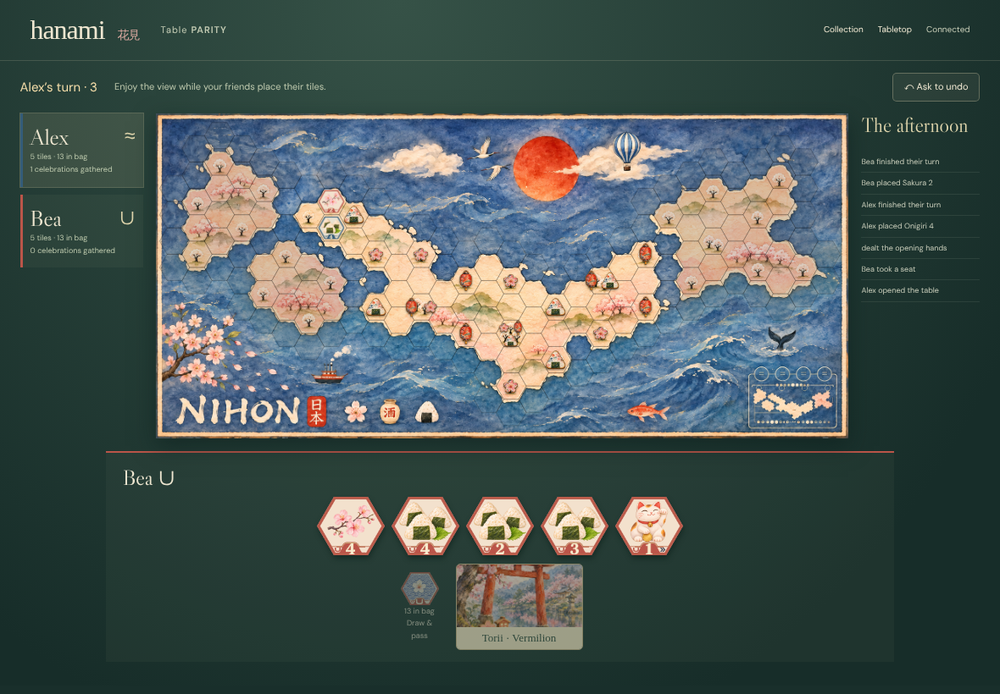

[Bea DOM evidence](../../../screenshots/presentation-parity.spec.js/the-animation-lab-runs-the-production-player-area-and-animation-presenter-013-bea-linux.dom.txt)

## 014. Lab: Select the matching lab component

DOM assertions passed; actor and all observers captured.

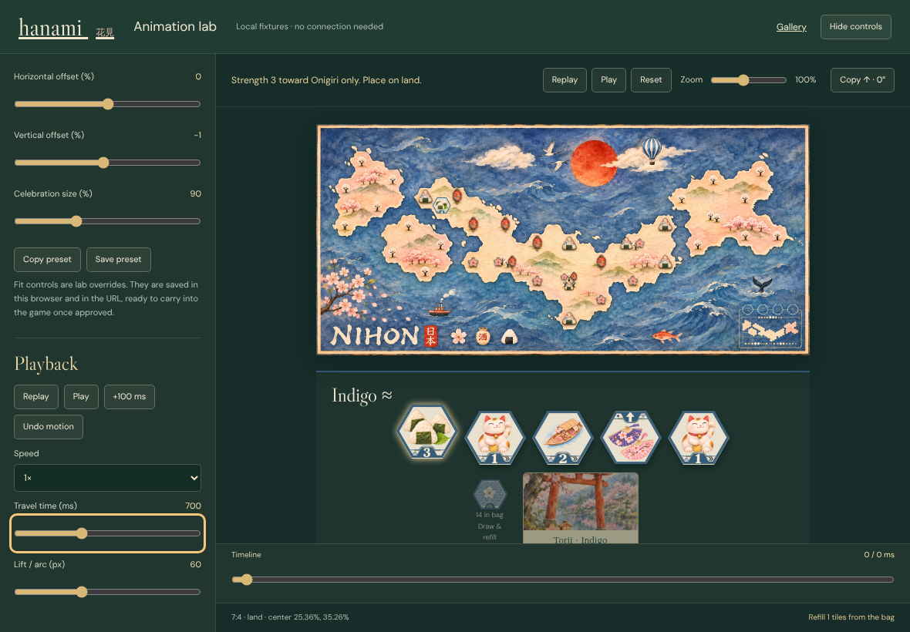

[Lab DOM evidence](../../../screenshots/presentation-parity.spec.js/the-animation-lab-runs-the-production-player-area-and-animation-presenter-014-lab-linux.dom.txt)

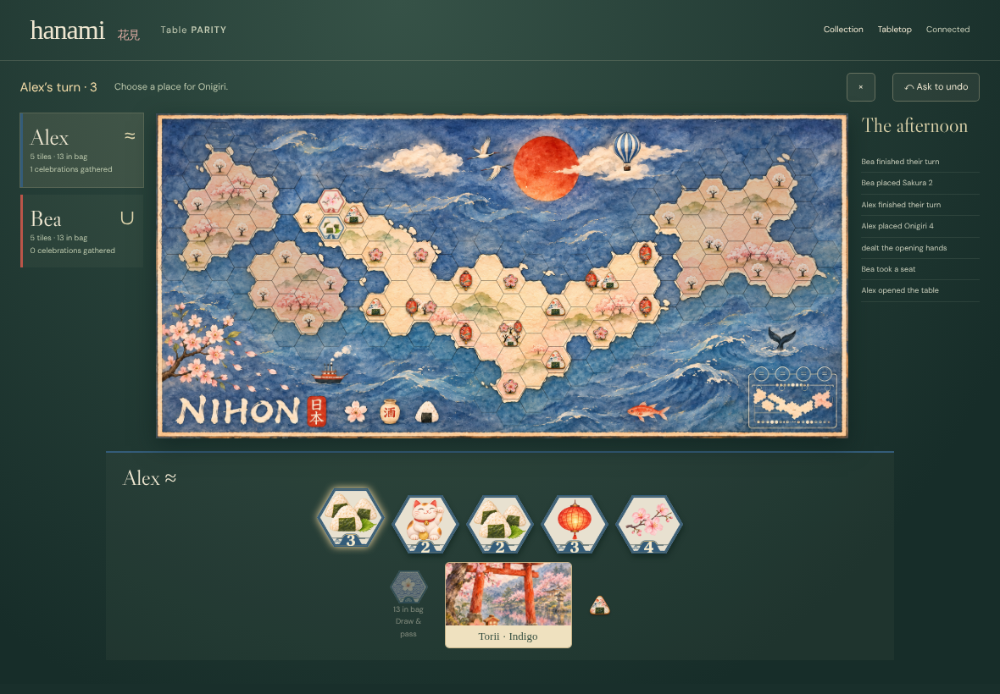

[Web DOM evidence](../../../screenshots/presentation-parity.spec.js/the-animation-lab-runs-the-production-player-area-and-animation-presenter-014-web-linux.dom.txt)

[Bea DOM evidence](../../../screenshots/presentation-parity.spec.js/the-animation-lab-runs-the-production-player-area-and-animation-presenter-014-bea-linux.dom.txt)

## 015. Lab: Run the updated lab flight

DOM assertions passed; actor and all observers captured.

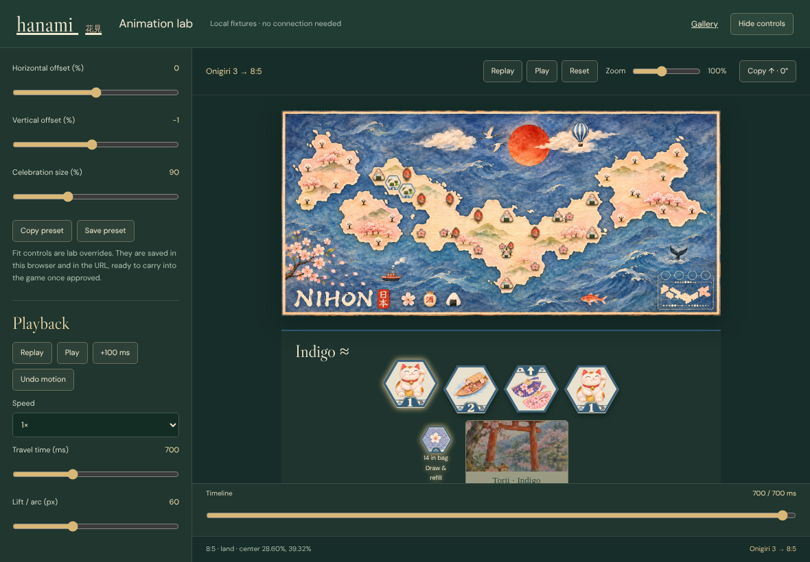

[Lab DOM evidence](../../../screenshots/presentation-parity.spec.js/the-animation-lab-runs-the-production-player-area-and-animation-presenter-015-lab-linux.dom.txt)

[Web DOM evidence](../../../screenshots/presentation-parity.spec.js/the-animation-lab-runs-the-production-player-area-and-animation-presenter-015-web-linux.dom.txt)

[Bea DOM evidence](../../../screenshots/presentation-parity.spec.js/the-animation-lab-runs-the-production-player-area-and-animation-presenter-015-bea-linux.dom.txt)

## 016. Web: The web game uses the updated production flight without a second implementation

DOM assertions passed; actor and all observers captured.

[Lab DOM evidence](../../../screenshots/presentation-parity.spec.js/the-animation-lab-runs-the-production-player-area-and-animation-presenter-016-lab-linux.dom.txt)

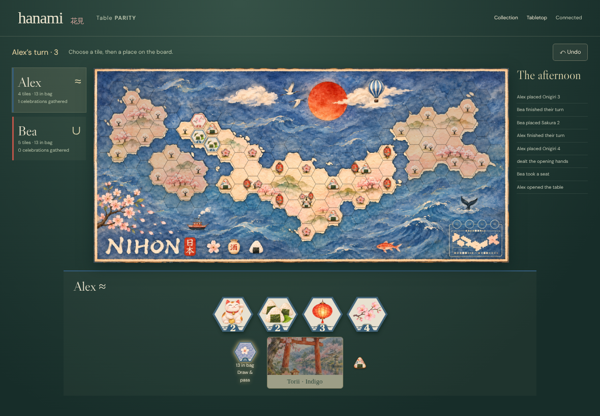

[Web DOM evidence](../../../screenshots/presentation-parity.spec.js/the-animation-lab-runs-the-production-player-area-and-animation-presenter-016-web-linux.dom.txt)

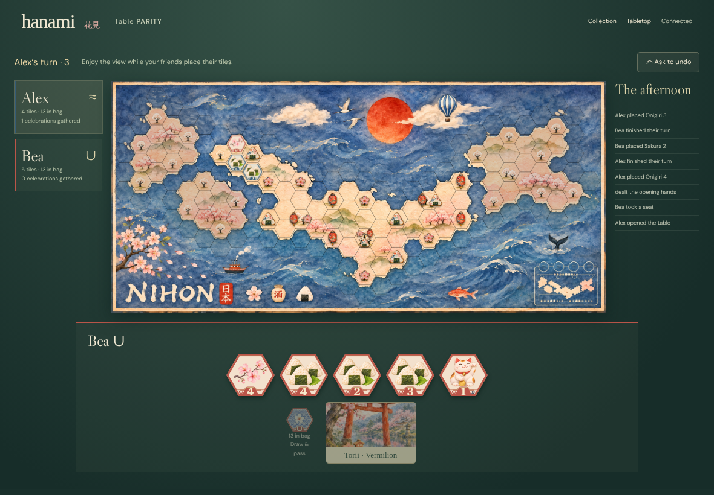

[Bea DOM evidence](../../../screenshots/presentation-parity.spec.js/the-animation-lab-runs-the-production-player-area-and-animation-presenter-016-bea-linux.dom.txt)
