# Special tile motions through real events

Real UI → authenticated Firestore transaction → immutable event → deterministic replay → every observer. Zero pixel tolerance; every decoded RGBA byte and the accessible DOM are compared. No game-state injection or outcome fixtures.

## 000. Table: Open an advanced picnic table and an independent observer

DOM assertions passed; actor and all observers captured.

[Table DOM evidence](../../../screenshots/special-motion.spec.js/real-special-tiles-share-placement-holding-cover-copy-and-flip-motion-000-table-linux.dom.txt)

[Observer DOM evidence](../../../screenshots/special-motion.spec.js/real-special-tiles-share-placement-holding-cover-copy-and-flip-motion-000-observer-linux.dom.txt)

## 001. Table: Tap the South-west seat

DOM assertions passed; actor and all observers captured.

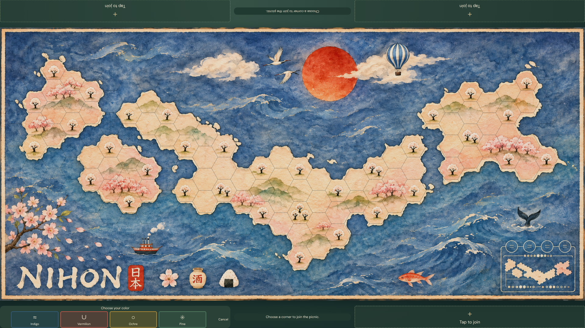

[Table DOM evidence](../../../screenshots/special-motion.spec.js/real-special-tiles-share-placement-holding-cover-copy-and-flip-motion-001-table-linux.dom.txt)

[Observer DOM evidence](../../../screenshots/special-motion.spec.js/real-special-tiles-share-placement-holding-cover-copy-and-flip-motion-001-observer-linux.dom.txt)

## 002. Table: Join as Indigo

DOM assertions passed; actor and all observers captured.

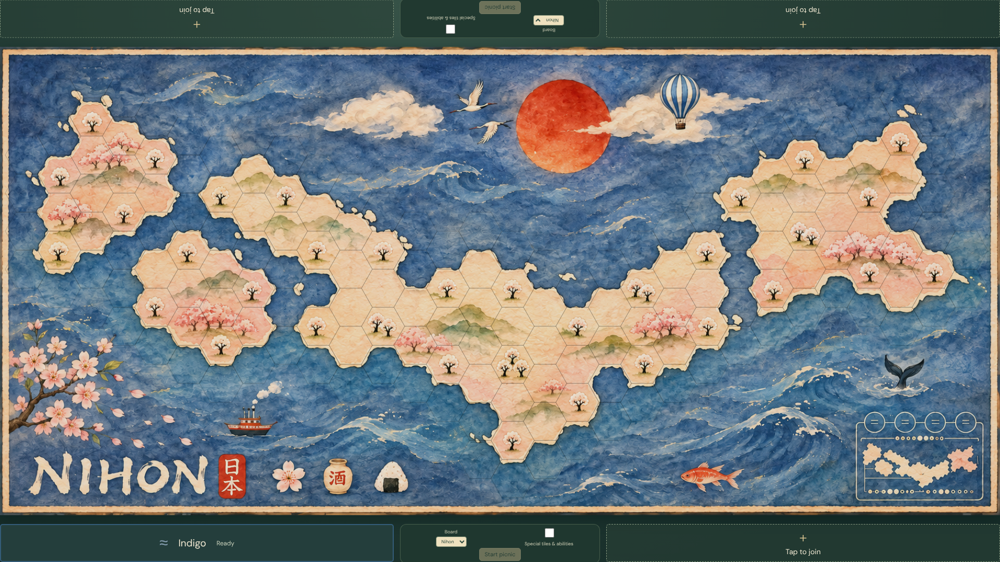

[Table DOM evidence](../../../screenshots/special-motion.spec.js/real-special-tiles-share-placement-holding-cover-copy-and-flip-motion-002-table-linux.dom.txt)

[Observer DOM evidence](../../../screenshots/special-motion.spec.js/real-special-tiles-share-placement-holding-cover-copy-and-flip-motion-002-observer-linux.dom.txt)

## 003. Table: Tap the North-east seat

DOM assertions passed; actor and all observers captured.

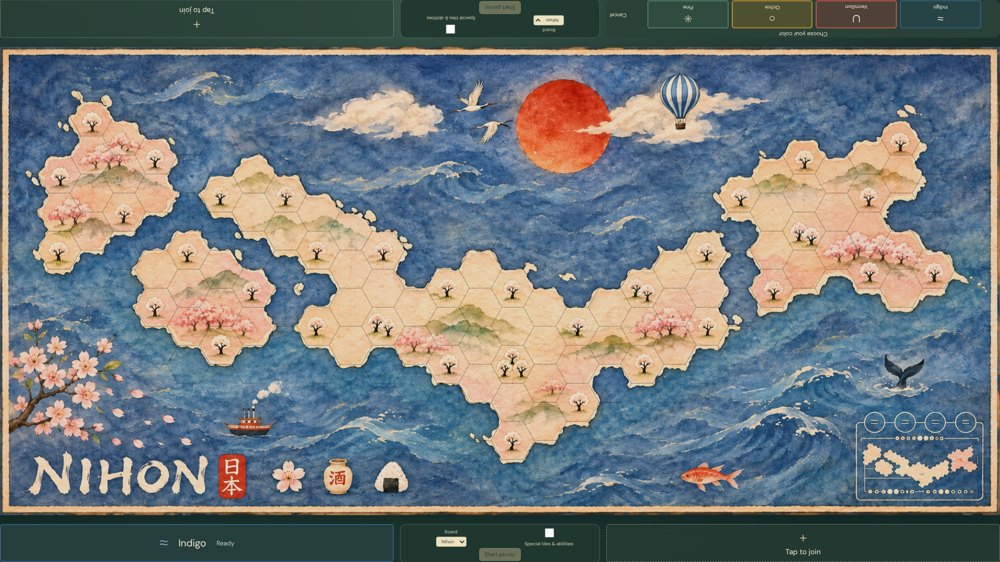

[Table DOM evidence](../../../screenshots/special-motion.spec.js/real-special-tiles-share-placement-holding-cover-copy-and-flip-motion-003-table-linux.dom.txt)

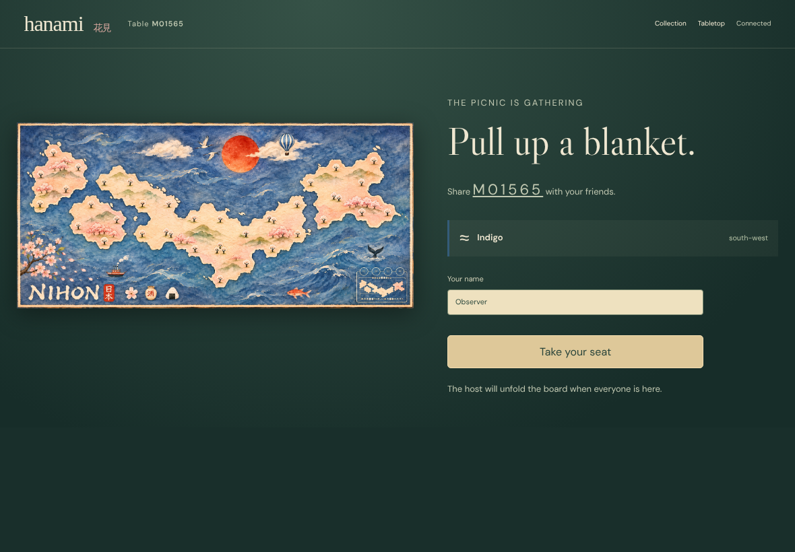

[Observer DOM evidence](../../../screenshots/special-motion.spec.js/real-special-tiles-share-placement-holding-cover-copy-and-flip-motion-003-observer-linux.dom.txt)

## 004. Table: Join as Pine

DOM assertions passed; actor and all observers captured.

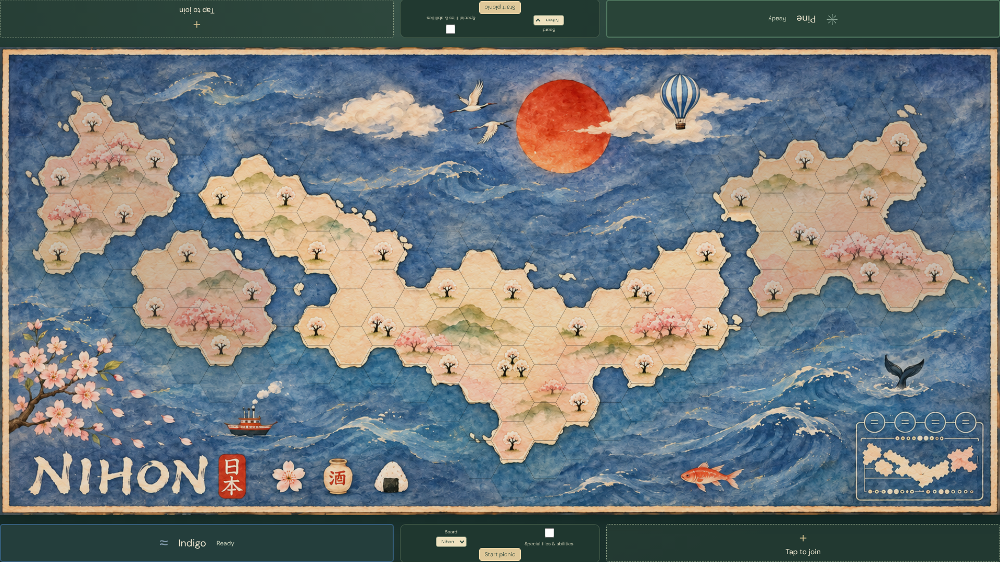

[Table DOM evidence](../../../screenshots/special-motion.spec.js/real-special-tiles-share-placement-holding-cover-copy-and-flip-motion-004-table-linux.dom.txt)

[Observer DOM evidence](../../../screenshots/special-motion.spec.js/real-special-tiles-share-placement-holding-cover-copy-and-flip-motion-004-observer-linux.dom.txt)

## 005. Table: Enable the real special tile set

DOM assertions passed; actor and all observers captured.

[Table DOM evidence](../../../screenshots/special-motion.spec.js/real-special-tiles-share-placement-holding-cover-copy-and-flip-motion-005-table-linux.dom.txt)

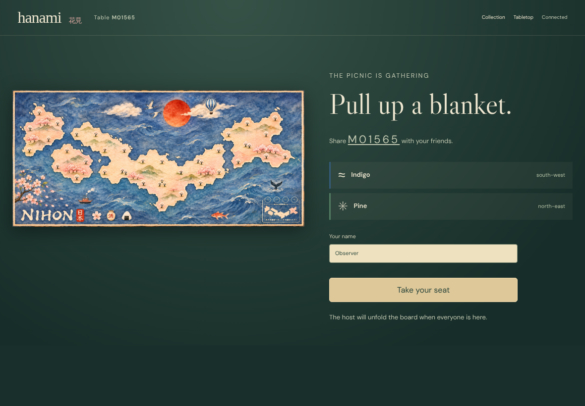

[Observer DOM evidence](../../../screenshots/special-motion.spec.js/real-special-tiles-share-placement-holding-cover-copy-and-flip-motion-005-observer-linux.dom.txt)

## 006. Table: Deal the production deck and ability choices

DOM assertions passed; actor and all observers captured.

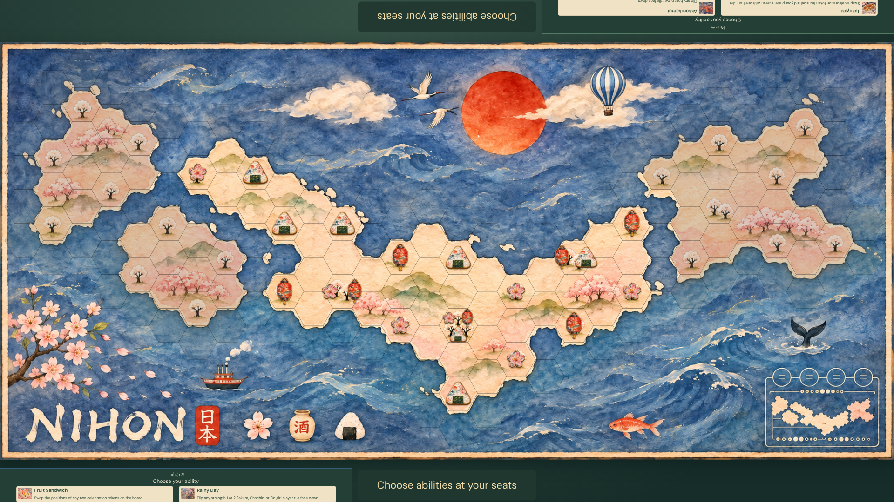

[Table DOM evidence](../../../screenshots/special-motion.spec.js/real-special-tiles-share-placement-holding-cover-copy-and-flip-motion-006-table-linux.dom.txt)

[Observer DOM evidence](../../../screenshots/special-motion.spec.js/real-special-tiles-share-placement-holding-cover-copy-and-flip-motion-006-observer-linux.dom.txt)

## 007. Table: Indigo chooses Rainy Day

DOM assertions passed; actor and all observers captured.

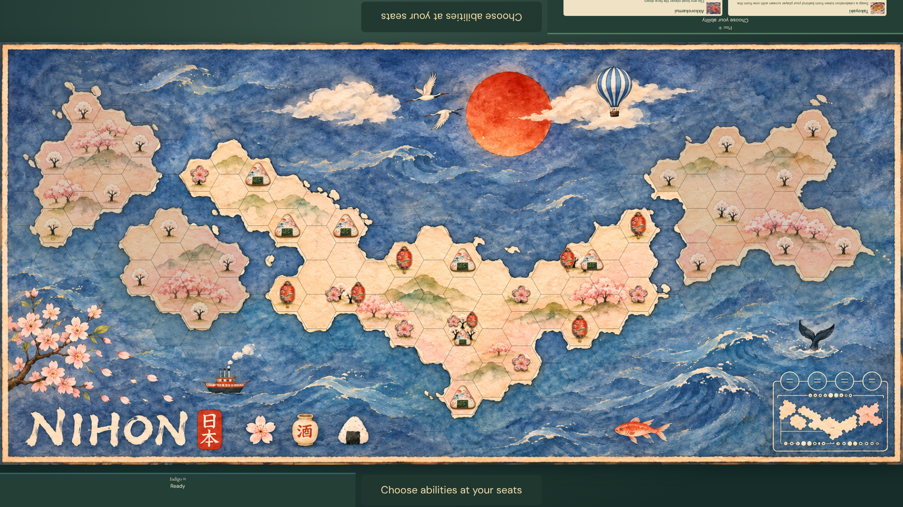

[Table DOM evidence](../../../screenshots/special-motion.spec.js/real-special-tiles-share-placement-holding-cover-copy-and-flip-motion-007-table-linux.dom.txt)

[Observer DOM evidence](../../../screenshots/special-motion.spec.js/real-special-tiles-share-placement-holding-cover-copy-and-flip-motion-007-observer-linux.dom.txt)

## 008. Table: Pine chooses Akkorokamui

DOM assertions passed; actor and all observers captured.

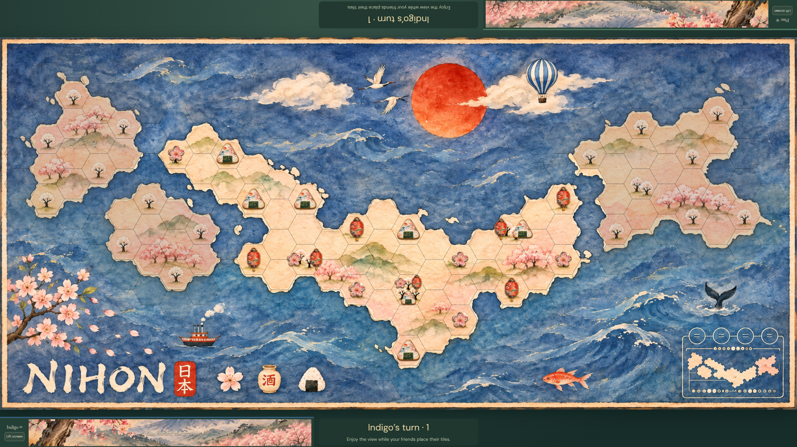

[Table DOM evidence](../../../screenshots/special-motion.spec.js/real-special-tiles-share-placement-holding-cover-copy-and-flip-motion-008-table-linux.dom.txt)

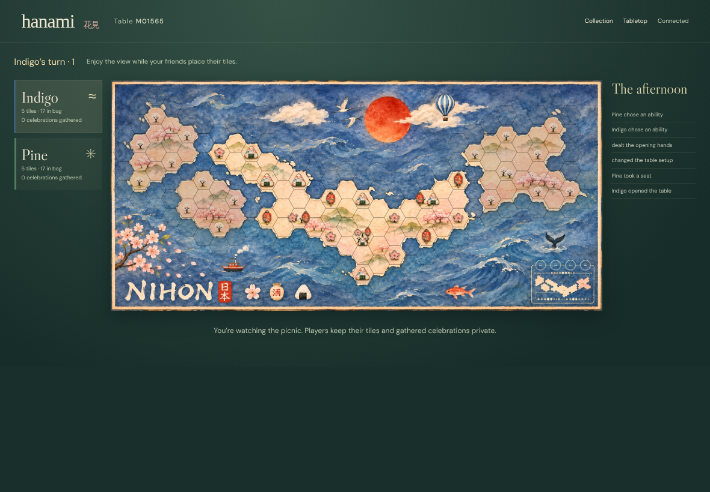

[Observer DOM evidence](../../../screenshots/special-motion.spec.js/real-special-tiles-share-placement-holding-cover-copy-and-flip-motion-008-observer-linux.dom.txt)

## 009. Table: Lift Indigo’s screen to inspect the actual dealt tiles

DOM assertions passed; actor and all observers captured.

[Table DOM evidence](../../../screenshots/special-motion.spec.js/real-special-tiles-share-placement-holding-cover-copy-and-flip-motion-009-table-linux.dom.txt)

[Observer DOM evidence](../../../screenshots/special-motion.spec.js/real-special-tiles-share-placement-holding-cover-copy-and-flip-motion-009-observer-linux.dom.txt)

## 010. Table: Indigo selects draw

DOM assertions passed; actor and all observers captured.

[Table DOM evidence](../../../screenshots/special-motion.spec.js/real-special-tiles-share-placement-holding-cover-copy-and-flip-motion-010-table-linux.dom.txt)

[Observer DOM evidence](../../../screenshots/special-motion.spec.js/real-special-tiles-share-placement-holding-cover-copy-and-flip-motion-010-observer-linux.dom.txt)

## 011. Table: Place draw at 14:6

DOM assertions passed; actor and all observers captured.

[Table DOM evidence](../../../screenshots/special-motion.spec.js/real-special-tiles-share-placement-holding-cover-copy-and-flip-motion-011-table-linux.dom.txt)

[Observer DOM evidence](../../../screenshots/special-motion.spec.js/real-special-tiles-share-placement-holding-cover-copy-and-flip-motion-011-observer-linux.dom.txt)

## 012. Table: Indigo selects onigiri-2

DOM assertions passed; actor and all observers captured.

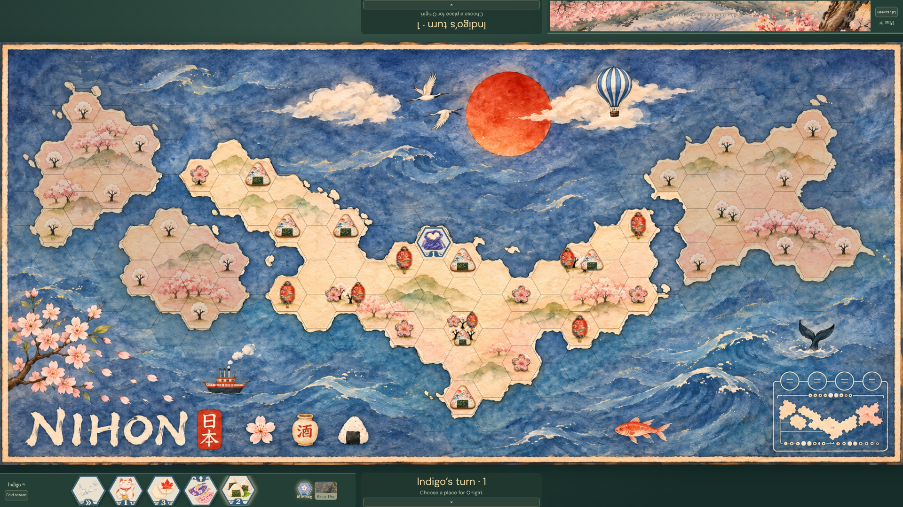

[Table DOM evidence](../../../screenshots/special-motion.spec.js/real-special-tiles-share-placement-holding-cover-copy-and-flip-motion-012-table-linux.dom.txt)

[Observer DOM evidence](../../../screenshots/special-motion.spec.js/real-special-tiles-share-placement-holding-cover-copy-and-flip-motion-012-observer-linux.dom.txt)

## 013. Table: Place onigiri-2 at 15:7

DOM assertions passed; actor and all observers captured.

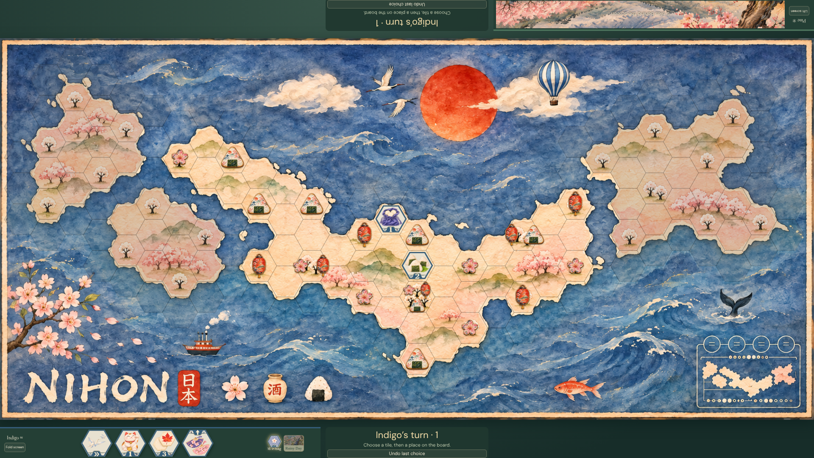

[Table DOM evidence](../../../screenshots/special-motion.spec.js/real-special-tiles-share-placement-holding-cover-copy-and-flip-motion-013-table-linux.dom.txt)

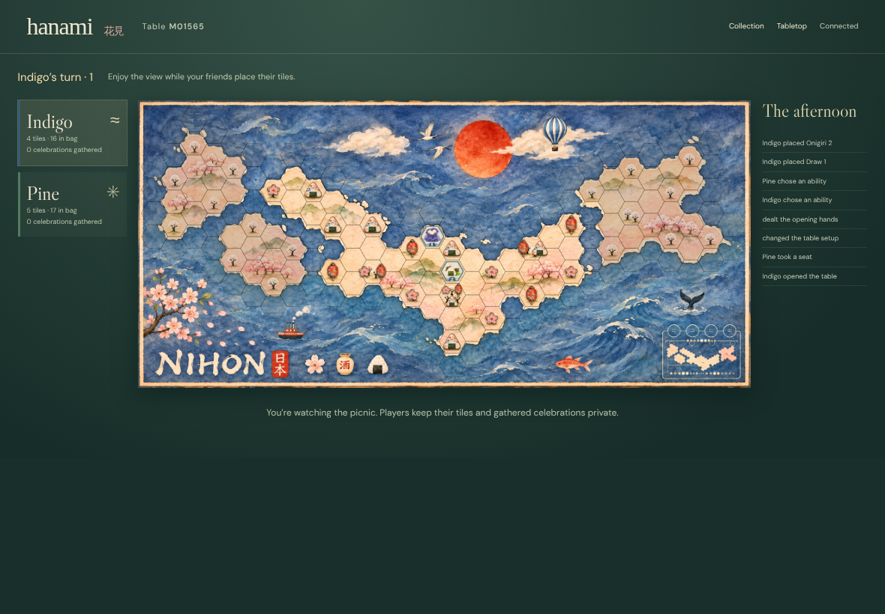

[Observer DOM evidence](../../../screenshots/special-motion.spec.js/real-special-tiles-share-placement-holding-cover-copy-and-flip-motion-013-observer-linux.dom.txt)

## 014. Table: Indigo selects move

DOM assertions passed; actor and all observers captured.

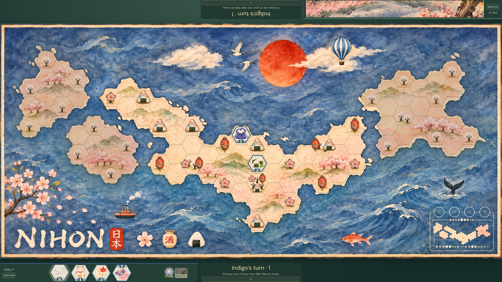

[Table DOM evidence](../../../screenshots/special-motion.spec.js/real-special-tiles-share-placement-holding-cover-copy-and-flip-motion-014-table-linux.dom.txt)

[Observer DOM evidence](../../../screenshots/special-motion.spec.js/real-special-tiles-share-placement-holding-cover-copy-and-flip-motion-014-observer-linux.dom.txt)

## 015. Table: Move replaces Onigiri and sends Onigiri to the holding spot

DOM assertions passed; actor and all observers captured.

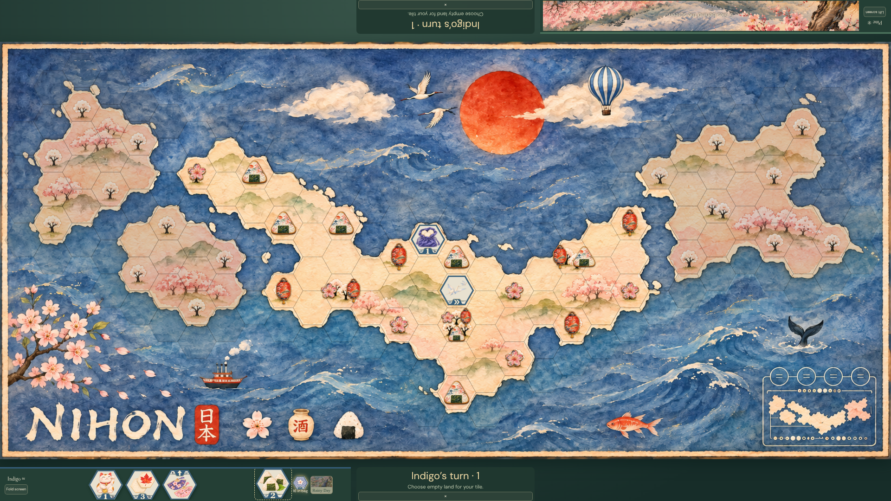

[Table DOM evidence](../../../screenshots/special-motion.spec.js/real-special-tiles-share-placement-holding-cover-copy-and-flip-motion-015-table-linux.dom.txt)

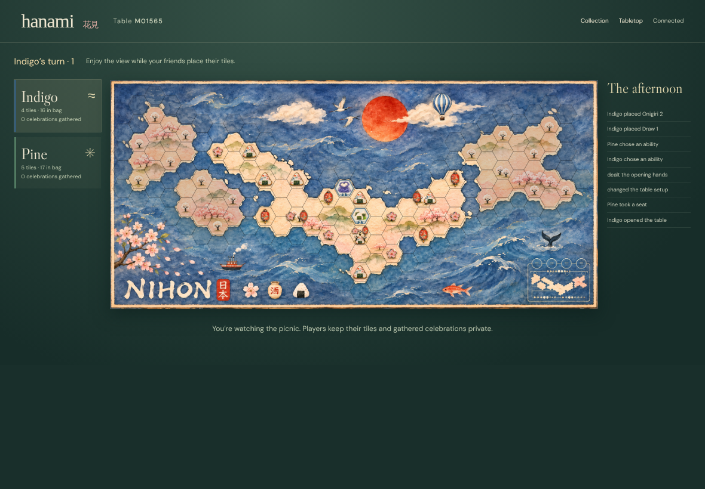

[Observer DOM evidence](../../../screenshots/special-motion.spec.js/real-special-tiles-share-placement-holding-cover-copy-and-flip-motion-015-observer-linux.dom.txt)

## 016. Table: Place the held Onigiri tile and commit the Move event

DOM assertions passed; actor and all observers captured.

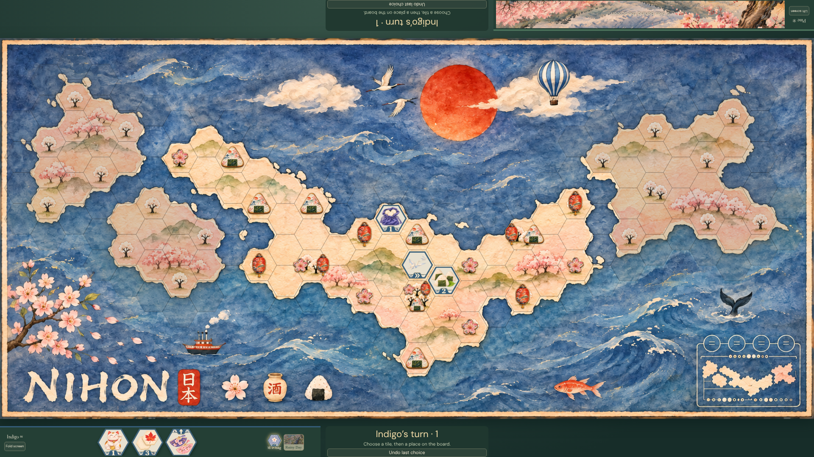

[Table DOM evidence](../../../screenshots/special-motion.spec.js/real-special-tiles-share-placement-holding-cover-copy-and-flip-motion-016-table-linux.dom.txt)

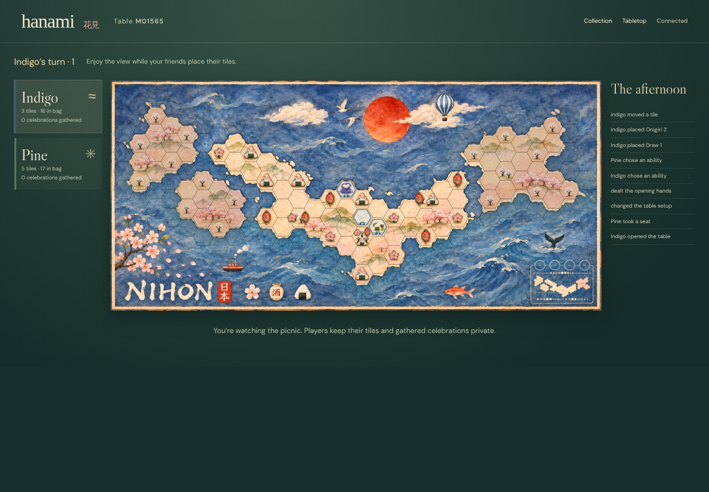

[Observer DOM evidence](../../../screenshots/special-motion.spec.js/real-special-tiles-share-placement-holding-cover-copy-and-flip-motion-016-observer-linux.dom.txt)

## 017. Table: Indigo refills and passes to Pine

DOM assertions passed; actor and all observers captured.

[Table DOM evidence](../../../screenshots/special-motion.spec.js/real-special-tiles-share-placement-holding-cover-copy-and-flip-motion-017-table-linux.dom.txt)

[Observer DOM evidence](../../../screenshots/special-motion.spec.js/real-special-tiles-share-placement-holding-cover-copy-and-flip-motion-017-observer-linux.dom.txt)

## 018. Table: Lift Pine’s north-facing hand

DOM assertions passed; actor and all observers captured.

[Table DOM evidence](../../../screenshots/special-motion.spec.js/real-special-tiles-share-placement-holding-cover-copy-and-flip-motion-018-table-linux.dom.txt)

[Observer DOM evidence](../../../screenshots/special-motion.spec.js/real-special-tiles-share-placement-holding-cover-copy-and-flip-motion-018-observer-linux.dom.txt)

## 019. Table: Pine selects boat-3

DOM assertions passed; actor and all observers captured.

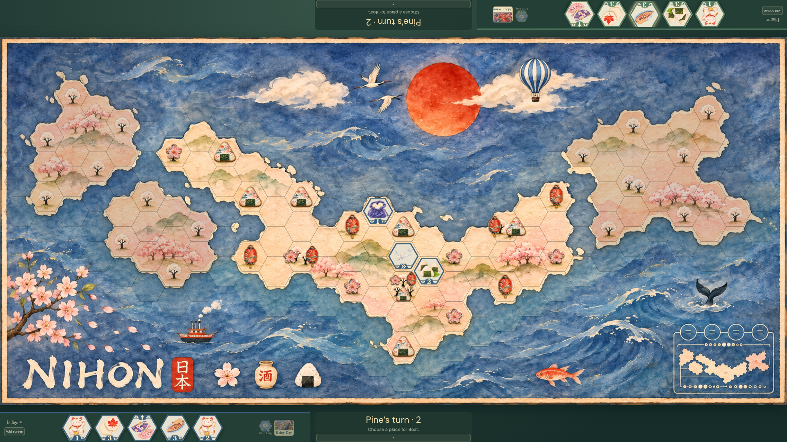

[Table DOM evidence](../../../screenshots/special-motion.spec.js/real-special-tiles-share-placement-holding-cover-copy-and-flip-motion-019-table-linux.dom.txt)

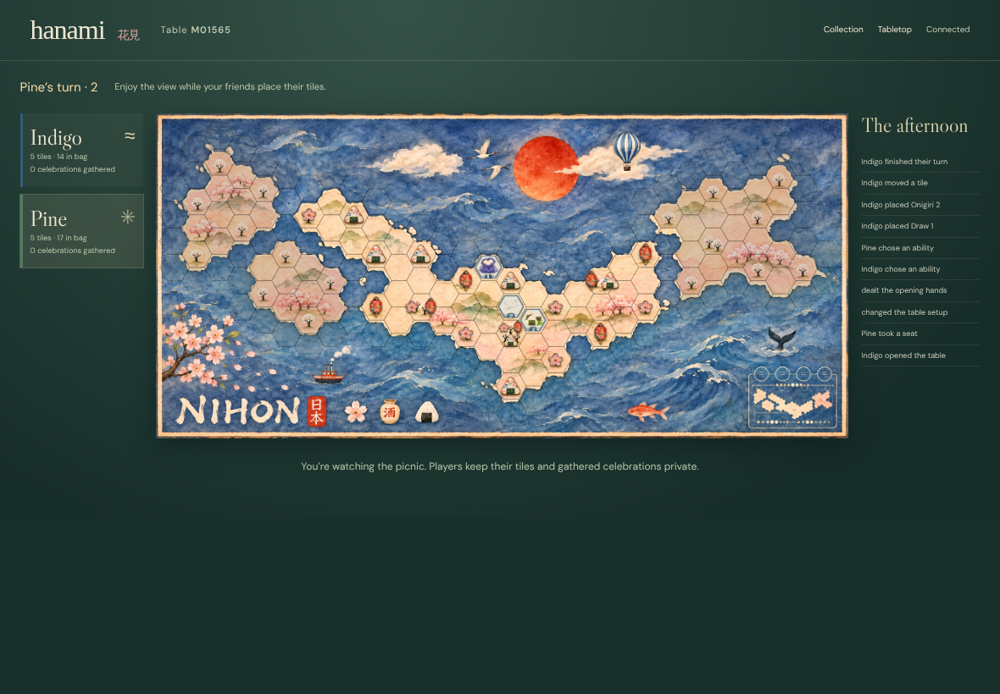

[Observer DOM evidence](../../../screenshots/special-motion.spec.js/real-special-tiles-share-placement-holding-cover-copy-and-flip-motion-019-observer-linux.dom.txt)

## 020. Table: Place boat-3 at 15:5

DOM assertions passed; actor and all observers captured.

[Table DOM evidence](../../../screenshots/special-motion.spec.js/real-special-tiles-share-placement-holding-cover-copy-and-flip-motion-020-table-linux.dom.txt)

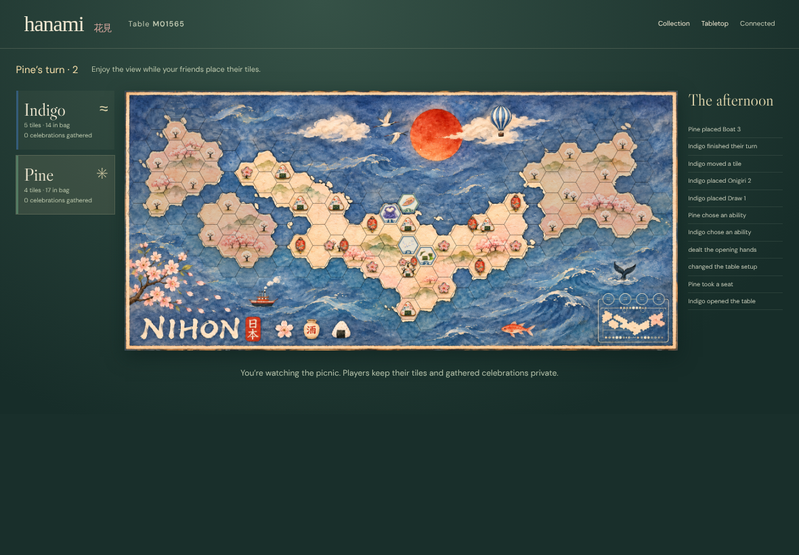

[Observer DOM evidence](../../../screenshots/special-motion.spec.js/real-special-tiles-share-placement-holding-cover-copy-and-flip-motion-020-observer-linux.dom.txt)

## 021. Table: Pine selects cat-0

DOM assertions passed; actor and all observers captured.

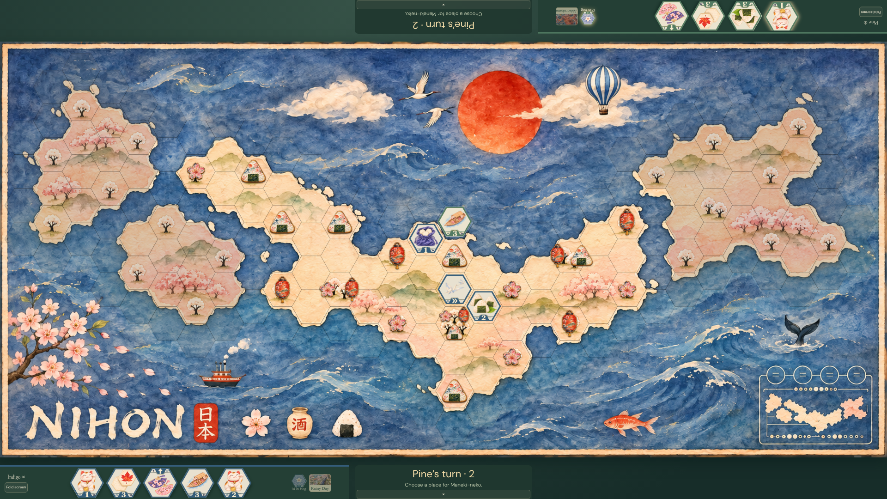

[Table DOM evidence](../../../screenshots/special-motion.spec.js/real-special-tiles-share-placement-holding-cover-copy-and-flip-motion-021-table-linux.dom.txt)

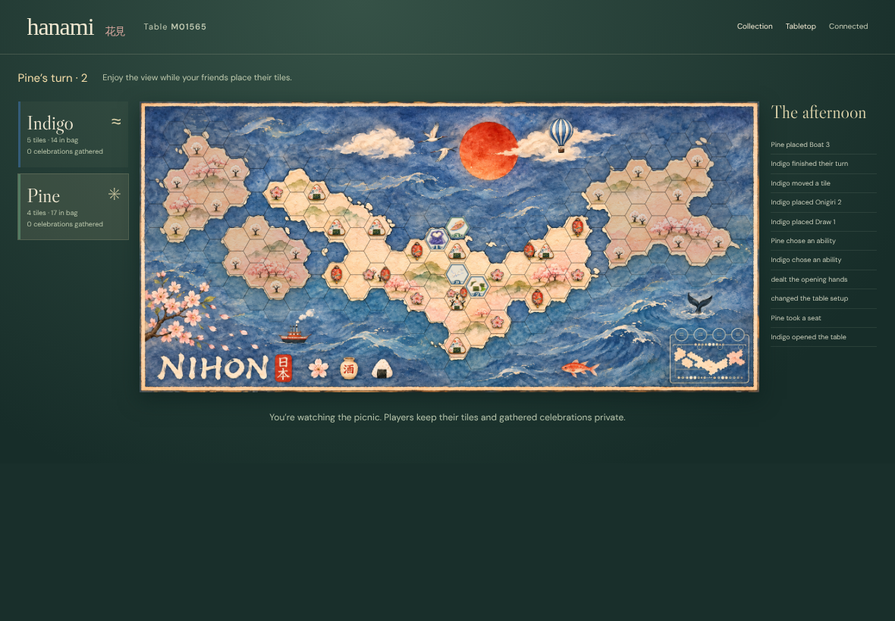

[Observer DOM evidence](../../../screenshots/special-motion.spec.js/real-special-tiles-share-placement-holding-cover-copy-and-flip-motion-021-observer-linux.dom.txt)

## 022. Table: Place cat-0 at 14:7

DOM assertions passed; actor and all observers captured.

[Table DOM evidence](../../../screenshots/special-motion.spec.js/real-special-tiles-share-placement-holding-cover-copy-and-flip-motion-022-table-linux.dom.txt)

[Observer DOM evidence](../../../screenshots/special-motion.spec.js/real-special-tiles-share-placement-holding-cover-copy-and-flip-motion-022-observer-linux.dom.txt)

## 023. Table: Pine refills and passes to Indigo

DOM assertions passed; actor and all observers captured.

[Table DOM evidence](../../../screenshots/special-motion.spec.js/real-special-tiles-share-placement-holding-cover-copy-and-flip-motion-023-table-linux.dom.txt)

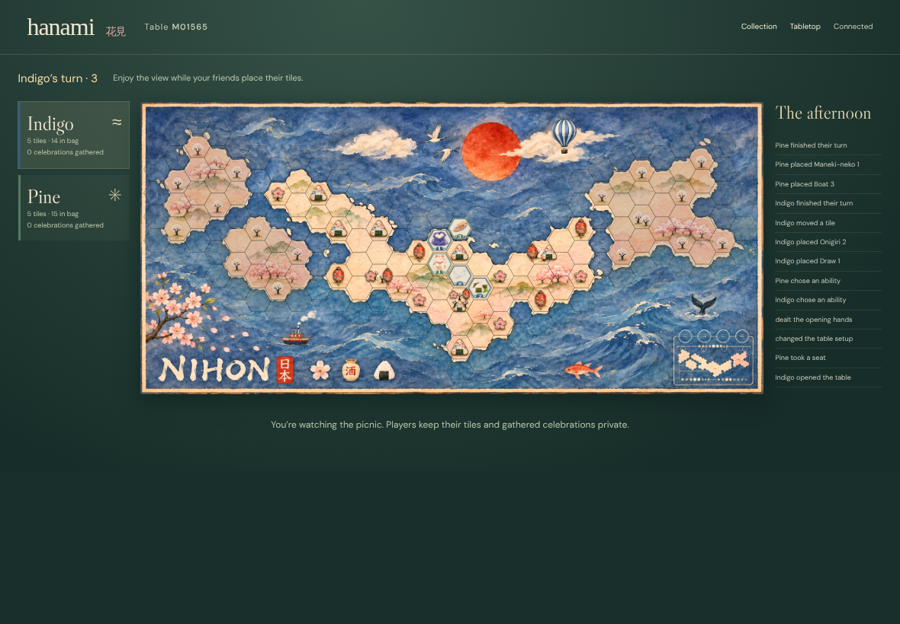

[Observer DOM evidence](../../../screenshots/special-motion.spec.js/real-special-tiles-share-placement-holding-cover-copy-and-flip-motion-023-observer-linux.dom.txt)

## 024. Table: Indigo selects copy

DOM assertions passed; actor and all observers captured.

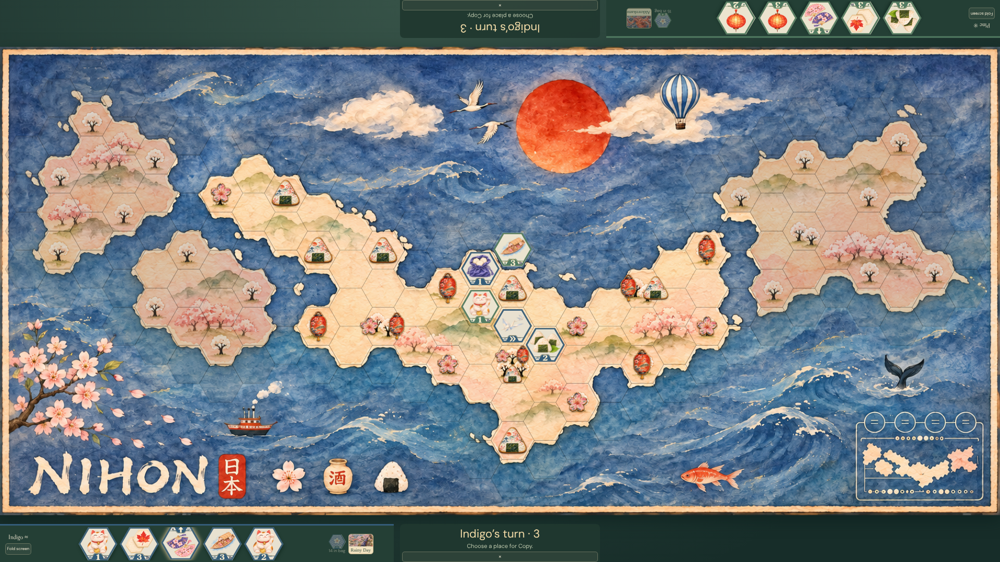

[Table DOM evidence](../../../screenshots/special-motion.spec.js/real-special-tiles-share-placement-holding-cover-copy-and-flip-motion-024-table-linux.dom.txt)

[Observer DOM evidence](../../../screenshots/special-motion.spec.js/real-special-tiles-share-placement-holding-cover-copy-and-flip-motion-024-observer-linux.dom.txt)

## 025. Table: Point Copy north-east

DOM assertions passed; actor and all observers captured.

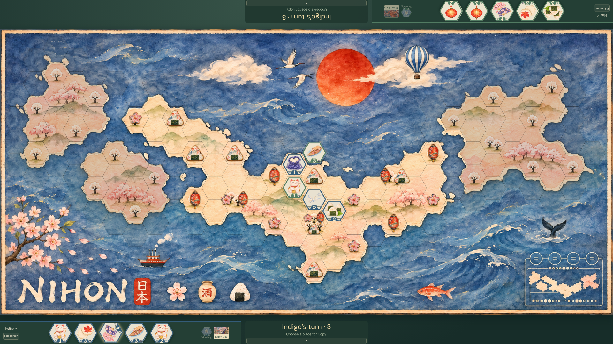

[Table DOM evidence](../../../screenshots/special-motion.spec.js/real-special-tiles-share-placement-holding-cover-copy-and-flip-motion-025-table-linux.dom.txt)

[Observer DOM evidence](../../../screenshots/special-motion.spec.js/real-special-tiles-share-placement-holding-cover-copy-and-flip-motion-025-observer-linux.dom.txt)

## 026. Table: Point Copy south-east

DOM assertions passed; actor and all observers captured.

[Table DOM evidence](../../../screenshots/special-motion.spec.js/real-special-tiles-share-placement-holding-cover-copy-and-flip-motion-026-table-linux.dom.txt)

[Observer DOM evidence](../../../screenshots/special-motion.spec.js/real-special-tiles-share-placement-holding-cover-copy-and-flip-motion-026-observer-linux.dom.txt)

## 027. Table: Point Copy south

DOM assertions passed; actor and all observers captured.

[Table DOM evidence](../../../screenshots/special-motion.spec.js/real-special-tiles-share-placement-holding-cover-copy-and-flip-motion-027-table-linux.dom.txt)

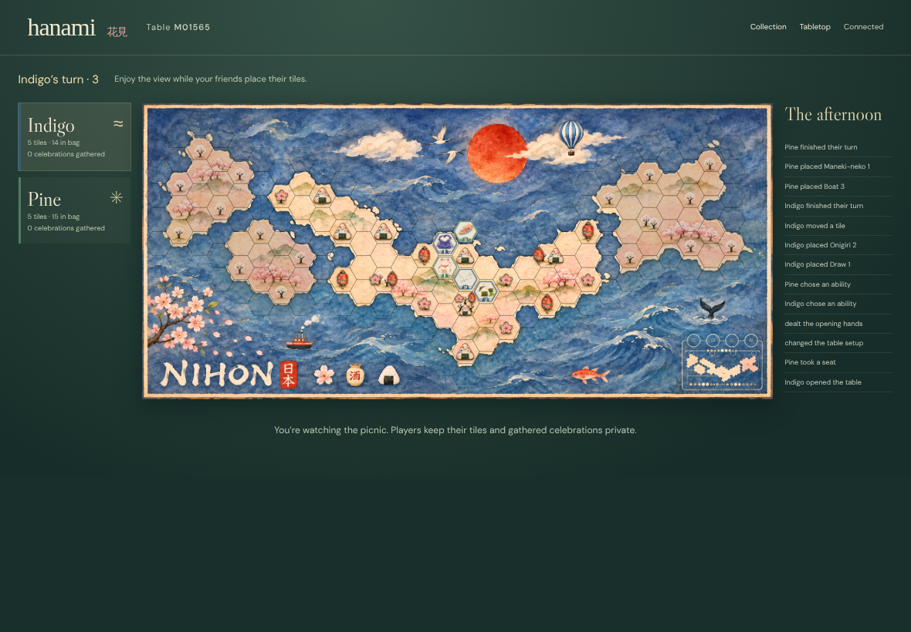

[Observer DOM evidence](../../../screenshots/special-motion.spec.js/real-special-tiles-share-placement-holding-cover-copy-and-flip-motion-027-observer-linux.dom.txt)

## 028. Table: Place copy at 16:7

DOM assertions passed; actor and all observers captured.

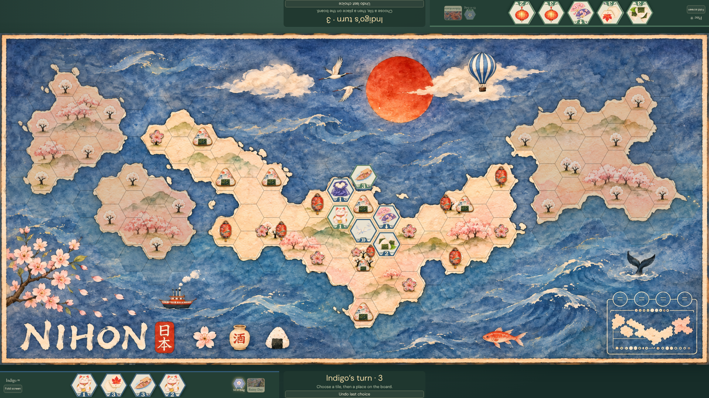

[Table DOM evidence](../../../screenshots/special-motion.spec.js/real-special-tiles-share-placement-holding-cover-copy-and-flip-motion-028-table-linux.dom.txt)

[Observer DOM evidence](../../../screenshots/special-motion.spec.js/real-special-tiles-share-placement-holding-cover-copy-and-flip-motion-028-observer-linux.dom.txt)

## 029. Table: Indigo selects cover

DOM assertions passed; actor and all observers captured.

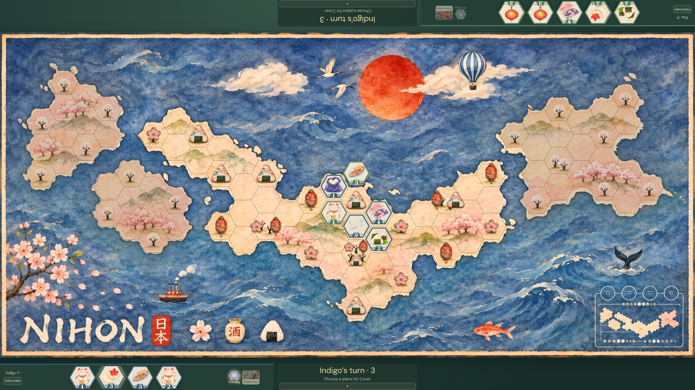

[Table DOM evidence](../../../screenshots/special-motion.spec.js/real-special-tiles-share-placement-holding-cover-copy-and-flip-motion-029-table-linux.dom.txt)

[Observer DOM evidence](../../../screenshots/special-motion.spec.js/real-special-tiles-share-placement-holding-cover-copy-and-flip-motion-029-observer-linux.dom.txt)

## 030. Table: Place cover at 16:8

DOM assertions passed; actor and all observers captured.

[Table DOM evidence](../../../screenshots/special-motion.spec.js/real-special-tiles-share-placement-holding-cover-copy-and-flip-motion-030-table-linux.dom.txt)

[Observer DOM evidence](../../../screenshots/special-motion.spec.js/real-special-tiles-share-placement-holding-cover-copy-and-flip-motion-030-observer-linux.dom.txt)

## 031. Table: Indigo refills and passes to Pine

DOM assertions passed; actor and all observers captured.

[Table DOM evidence](../../../screenshots/special-motion.spec.js/real-special-tiles-share-placement-holding-cover-copy-and-flip-motion-031-table-linux.dom.txt)

[Observer DOM evidence](../../../screenshots/special-motion.spec.js/real-special-tiles-share-placement-holding-cover-copy-and-flip-motion-031-observer-linux.dom.txt)

## 032. Table: Activate Akkorokamui before placing a tile

DOM assertions passed; actor and all observers captured.

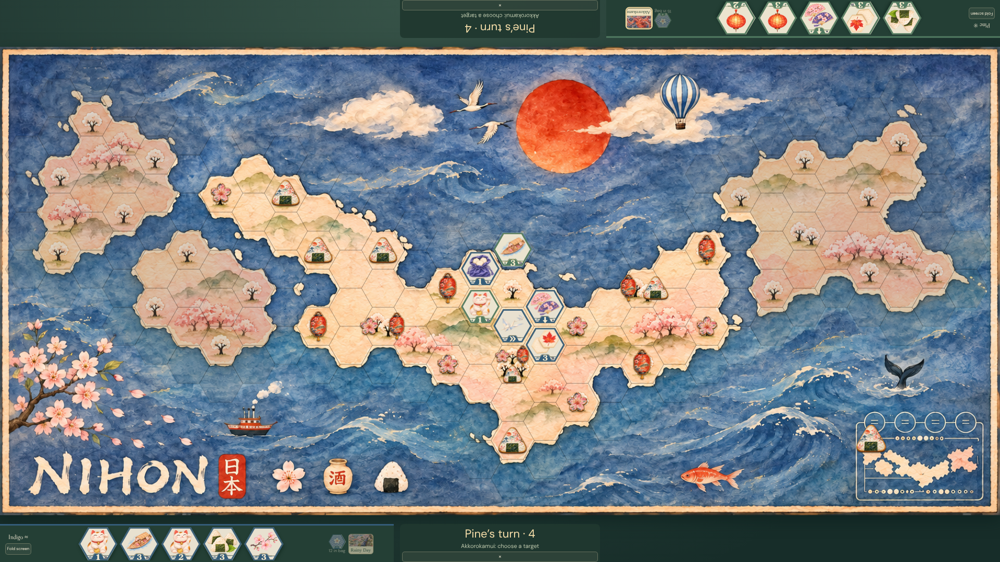

[Table DOM evidence](../../../screenshots/special-motion.spec.js/real-special-tiles-share-placement-holding-cover-copy-and-flip-motion-032-table-linux.dom.txt)

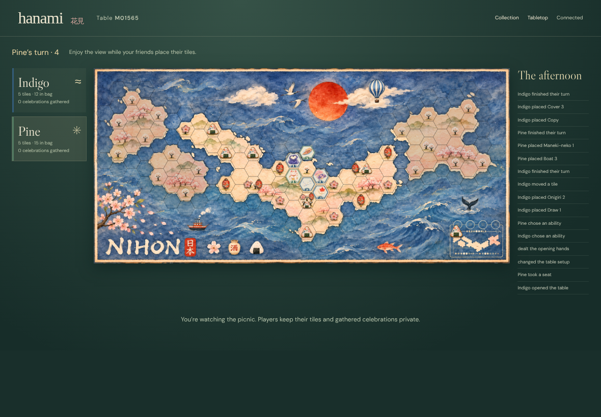

[Observer DOM evidence](../../../screenshots/special-motion.spec.js/real-special-tiles-share-placement-holding-cover-copy-and-flip-motion-032-observer-linux.dom.txt)

## 033. Table: Flip the real boat in place

DOM assertions passed; actor and all observers captured.

[Table DOM evidence](../../../screenshots/special-motion.spec.js/real-special-tiles-share-placement-holding-cover-copy-and-flip-motion-033-table-linux.dom.txt)

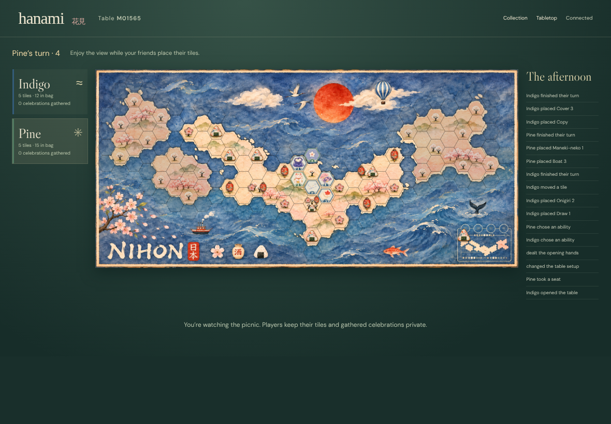

[Observer DOM evidence](../../../screenshots/special-motion.spec.js/real-special-tiles-share-placement-holding-cover-copy-and-flip-motion-033-observer-linux.dom.txt)

## 034. Table: Pine selects onigiri-3

DOM assertions passed; actor and all observers captured.

[Table DOM evidence](../../../screenshots/special-motion.spec.js/real-special-tiles-share-placement-holding-cover-copy-and-flip-motion-034-table-linux.dom.txt)

[Observer DOM evidence](../../../screenshots/special-motion.spec.js/real-special-tiles-share-placement-holding-cover-copy-and-flip-motion-034-observer-linux.dom.txt)

## 035. Table: Place onigiri-3 at 14:8

DOM assertions passed; actor and all observers captured.

[Table DOM evidence](../../../screenshots/special-motion.spec.js/real-special-tiles-share-placement-holding-cover-copy-and-flip-motion-035-table-linux.dom.txt)

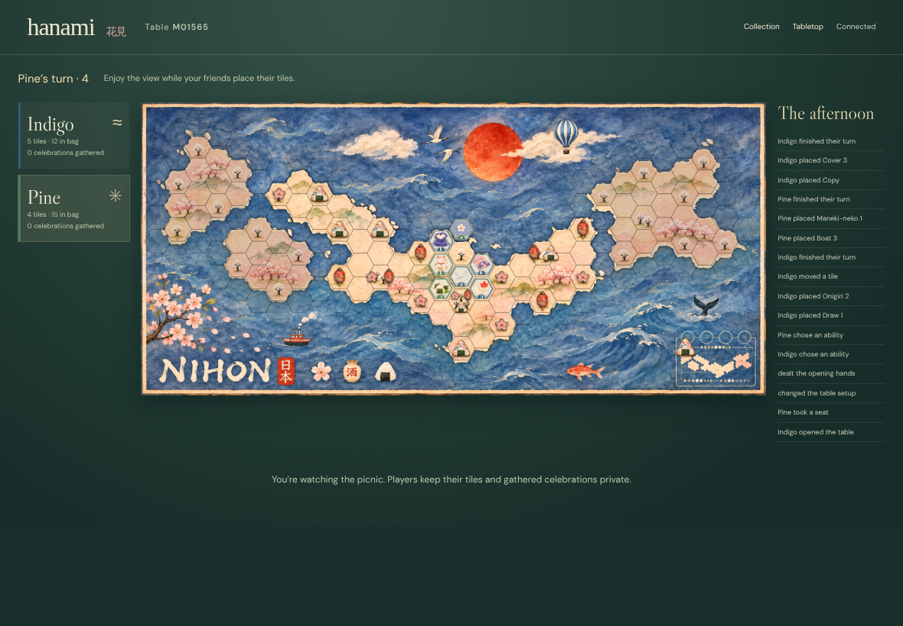

[Observer DOM evidence](../../../screenshots/special-motion.spec.js/real-special-tiles-share-placement-holding-cover-copy-and-flip-motion-035-observer-linux.dom.txt)

## 036. Table: Pine refills and passes to Indigo

DOM assertions passed; actor and all observers captured.

[Table DOM evidence](../../../screenshots/special-motion.spec.js/real-special-tiles-share-placement-holding-cover-copy-and-flip-motion-036-table-linux.dom.txt)

[Observer DOM evidence](../../../screenshots/special-motion.spec.js/real-special-tiles-share-placement-holding-cover-copy-and-flip-motion-036-observer-linux.dom.txt)

## 037. Observer: Reload the observer and replay the same special-tile board

DOM assertions passed; actor and all observers captured.

[Table DOM evidence](../../../screenshots/special-motion.spec.js/real-special-tiles-share-placement-holding-cover-copy-and-flip-motion-037-table-linux.dom.txt)

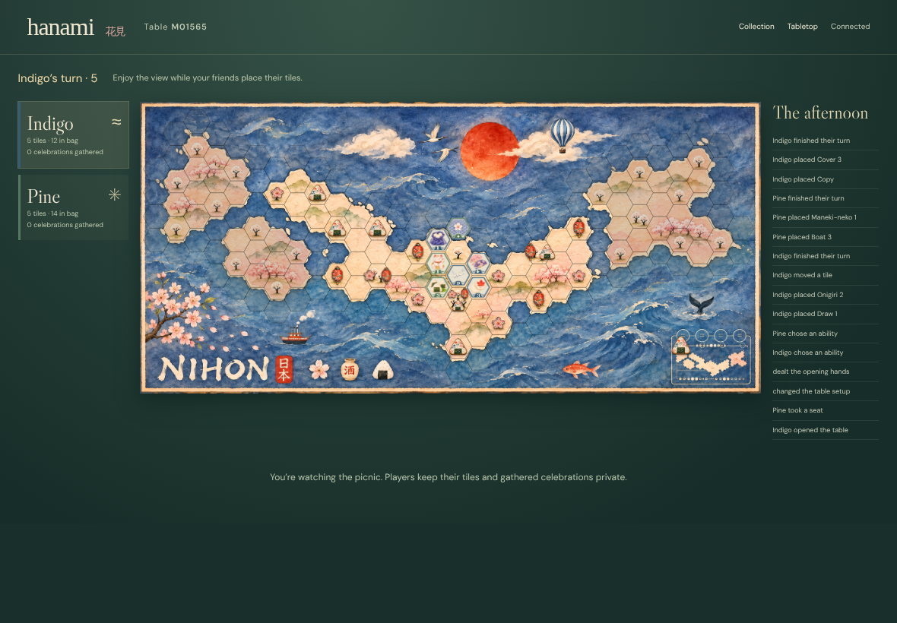

[Observer DOM evidence](../../../screenshots/special-motion.spec.js/real-special-tiles-share-placement-holding-cover-copy-and-flip-motion-037-observer-linux.dom.txt)
