# Easy practice against the computer — complete game

Real UI → authenticated Firestore transaction → immutable event → deterministic replay → every observer. Zero pixel tolerance; every decoded RGBA byte and the accessible DOM are compared. No game-state injection or outcome fixtures.

## 000. Alex: Choose practice from the entrance

DOM assertions passed; actor and all observers captured.

[Alex DOM evidence](../../../screenshots/practice.spec.js/practice-from-the-front-door-through-computer-turns-reload-undo-and-victory-000-alex-linux.dom.txt)

[Observer DOM evidence](../../../screenshots/practice.spec.js/practice-from-the-front-door-through-computer-turns-reload-undo-and-victory-000-observer-linux.dom.txt)

## 001. Alex: Invite the computer through the real create choice

DOM assertions passed; actor and all observers captured.

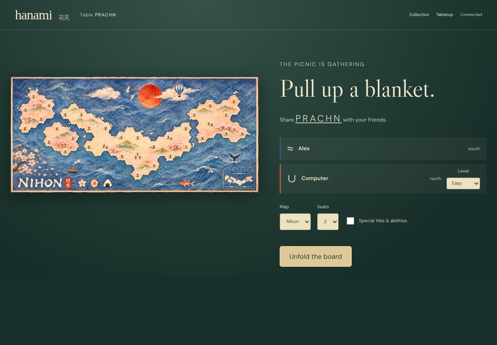

[Alex DOM evidence](../../../screenshots/practice.spec.js/practice-from-the-front-door-through-computer-turns-reload-undo-and-victory-001-alex-linux.dom.txt)

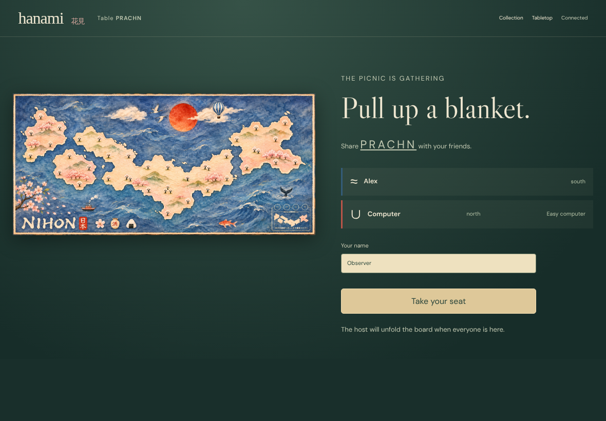

[Observer DOM evidence](../../../screenshots/practice.spec.js/practice-from-the-front-door-through-computer-turns-reload-undo-and-victory-001-observer-linux.dom.txt)

## 002. Alex: Deal both hands from the ordinary event log

DOM assertions passed; actor and all observers captured.

[Alex DOM evidence](../../../screenshots/practice.spec.js/practice-from-the-front-door-through-computer-turns-reload-undo-and-victory-002-alex-linux.dom.txt)

[Observer DOM evidence](../../../screenshots/practice.spec.js/practice-from-the-front-door-through-computer-turns-reload-undo-and-victory-002-observer-linux.dom.txt)

## 003. Alex: Select onigiri-3 from the private hand

DOM assertions passed; actor and all observers captured.

[Alex DOM evidence](../../../screenshots/practice.spec.js/practice-from-the-front-door-through-computer-turns-reload-undo-and-victory-003-alex-linux.dom.txt)

[Observer DOM evidence](../../../screenshots/practice.spec.js/practice-from-the-front-door-through-computer-turns-reload-undo-and-victory-003-observer-linux.dom.txt)

## 004. Alex: Place onigiri-3 on 7:4

DOM assertions passed; actor and all observers captured.

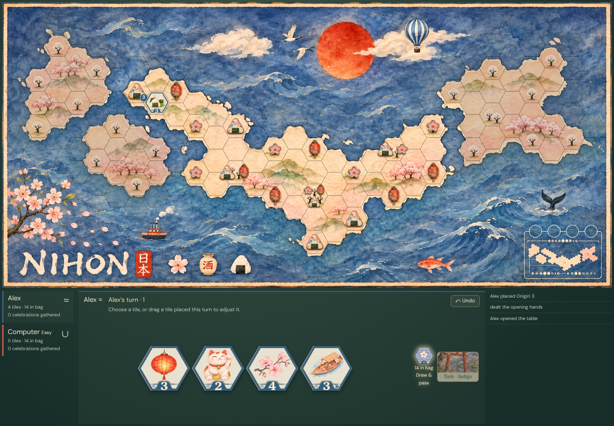

[Alex DOM evidence](../../../screenshots/practice.spec.js/practice-from-the-front-door-through-computer-turns-reload-undo-and-victory-004-alex-linux.dom.txt)

[Observer DOM evidence](../../../screenshots/practice.spec.js/practice-from-the-front-door-through-computer-turns-reload-undo-and-victory-004-observer-linux.dom.txt)

## 005. Alex: Undo a placement before any new information

DOM assertions passed; actor and all observers captured.

[Alex DOM evidence](../../../screenshots/practice.spec.js/practice-from-the-front-door-through-computer-turns-reload-undo-and-victory-005-alex-linux.dom.txt)

[Observer DOM evidence](../../../screenshots/practice.spec.js/practice-from-the-front-door-through-computer-turns-reload-undo-and-victory-005-observer-linux.dom.txt)

## 006. Alex: Select onigiri-3 from the private hand

DOM assertions passed; actor and all observers captured.

[Alex DOM evidence](../../../screenshots/practice.spec.js/practice-from-the-front-door-through-computer-turns-reload-undo-and-victory-006-alex-linux.dom.txt)

[Observer DOM evidence](../../../screenshots/practice.spec.js/practice-from-the-front-door-through-computer-turns-reload-undo-and-victory-006-observer-linux.dom.txt)

## 007. Alex: Place onigiri-3 on 7:4

DOM assertions passed; actor and all observers captured.

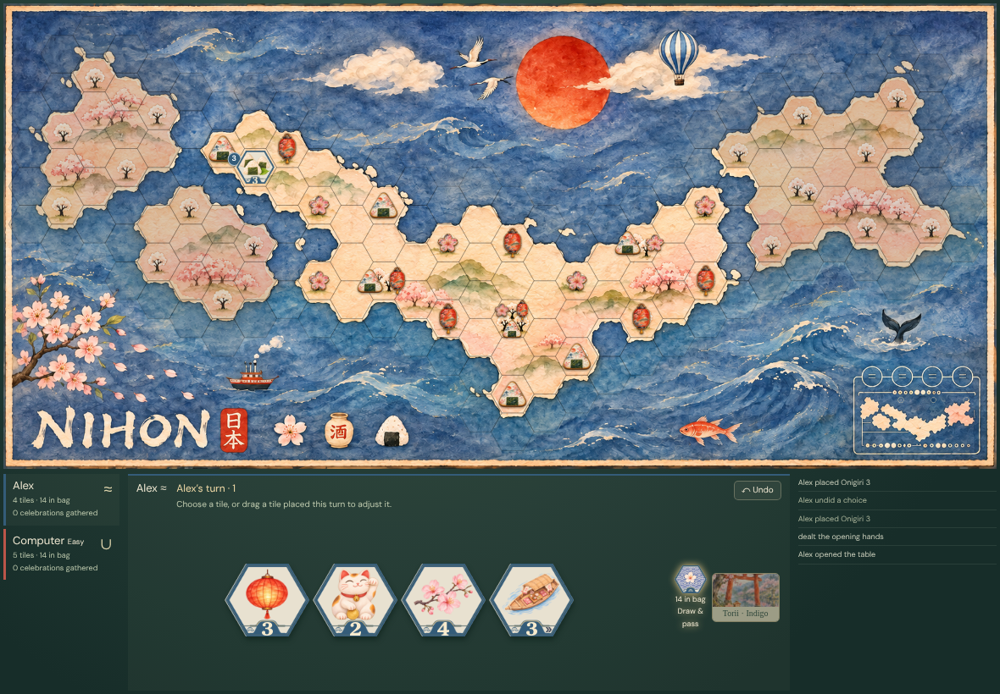

[Alex DOM evidence](../../../screenshots/practice.spec.js/practice-from-the-front-door-through-computer-turns-reload-undo-and-victory-007-alex-linux.dom.txt)

[Observer DOM evidence](../../../screenshots/practice.spec.js/practice-from-the-front-door-through-computer-turns-reload-undo-and-victory-007-observer-linux.dom.txt)

## 008. Alex: Draw then reload while the computer takes its turn

DOM assertions passed; actor and all observers captured.

[Alex DOM evidence](../../../screenshots/practice.spec.js/practice-from-the-front-door-through-computer-turns-reload-undo-and-victory-008-alex-linux.dom.txt)

[Observer DOM evidence](../../../screenshots/practice.spec.js/practice-from-the-front-door-through-computer-turns-reload-undo-and-victory-008-observer-linux.dom.txt)

## 009. Alex: Ask to undo after the draw and the computer response

DOM assertions passed; actor and all observers captured.

[Alex DOM evidence](../../../screenshots/practice.spec.js/practice-from-the-front-door-through-computer-turns-reload-undo-and-victory-009-alex-linux.dom.txt)

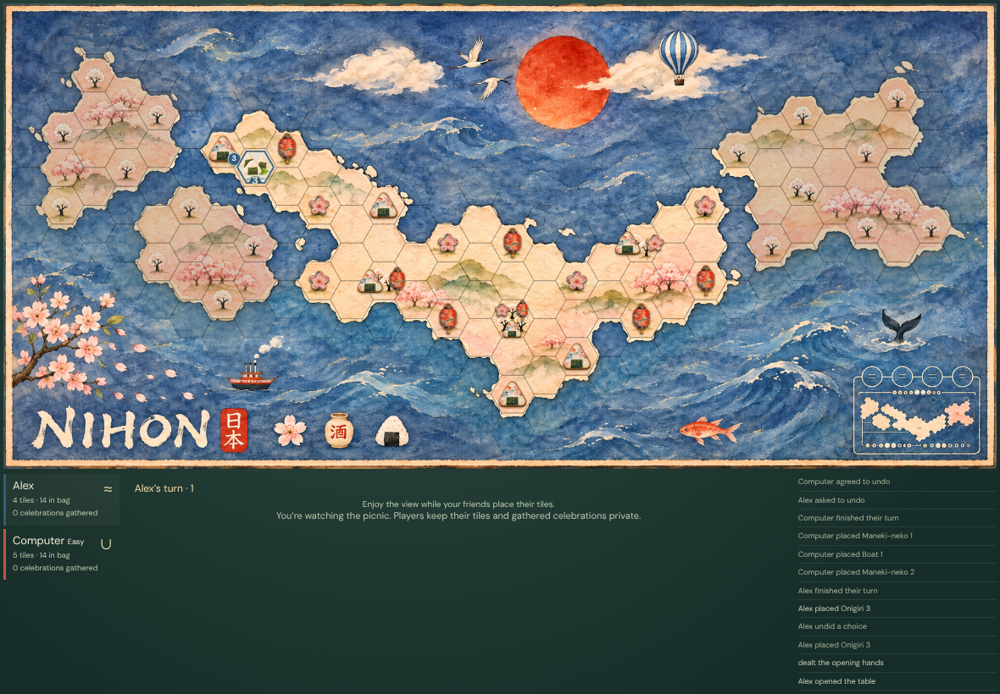

[Observer DOM evidence](../../../screenshots/practice.spec.js/practice-from-the-front-door-through-computer-turns-reload-undo-and-victory-009-observer-linux.dom.txt)

## 010. Alex: Repeat the draw and let the computer resume from replay

DOM assertions passed; actor and all observers captured.

[Alex DOM evidence](../../../screenshots/practice.spec.js/practice-from-the-front-door-through-computer-turns-reload-undo-and-victory-010-alex-linux.dom.txt)

[Observer DOM evidence](../../../screenshots/practice.spec.js/practice-from-the-front-door-through-computer-turns-reload-undo-and-victory-010-observer-linux.dom.txt)

## 011. Alex: Select chochin-3 from the private hand

DOM assertions passed; actor and all observers captured.

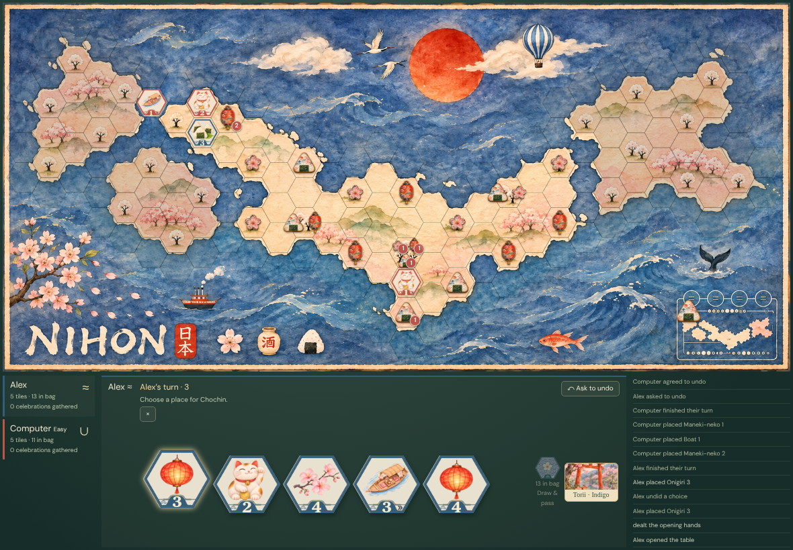

[Alex DOM evidence](../../../screenshots/practice.spec.js/practice-from-the-front-door-through-computer-turns-reload-undo-and-victory-011-alex-linux.dom.txt)

[Observer DOM evidence](../../../screenshots/practice.spec.js/practice-from-the-front-door-through-computer-turns-reload-undo-and-victory-011-observer-linux.dom.txt)

## 012. Alex: Place chochin-3 on 8:5

DOM assertions passed; actor and all observers captured.

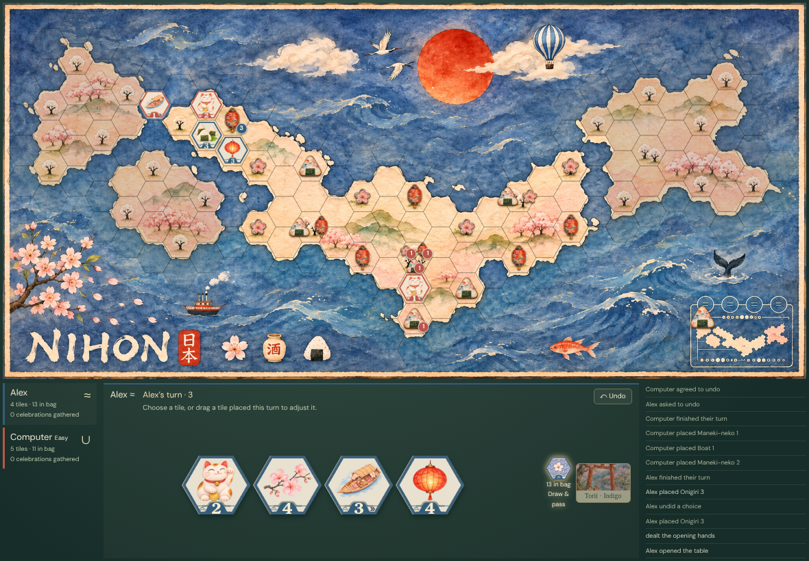

[Alex DOM evidence](../../../screenshots/practice.spec.js/practice-from-the-front-door-through-computer-turns-reload-undo-and-victory-012-alex-linux.dom.txt)

[Observer DOM evidence](../../../screenshots/practice.spec.js/practice-from-the-front-door-through-computer-turns-reload-undo-and-victory-012-observer-linux.dom.txt)

## 013. Alex: Draw and let the computer play its real turn

DOM assertions passed; actor and all observers captured.

[Alex DOM evidence](../../../screenshots/practice.spec.js/practice-from-the-front-door-through-computer-turns-reload-undo-and-victory-013-alex-linux.dom.txt)

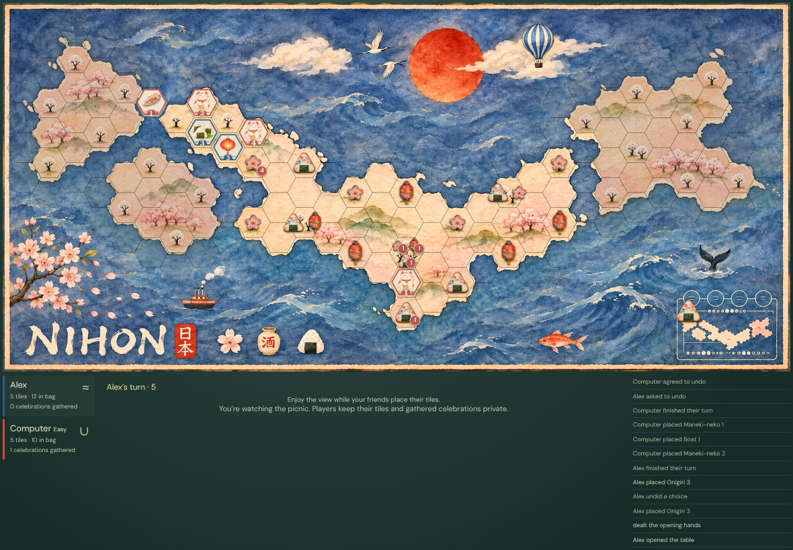

[Observer DOM evidence](../../../screenshots/practice.spec.js/practice-from-the-front-door-through-computer-turns-reload-undo-and-victory-013-observer-linux.dom.txt)

## 014. Alex: Select cat-2 from the private hand

DOM assertions passed; actor and all observers captured.

[Alex DOM evidence](../../../screenshots/practice.spec.js/practice-from-the-front-door-through-computer-turns-reload-undo-and-victory-014-alex-linux.dom.txt)

[Observer DOM evidence](../../../screenshots/practice.spec.js/practice-from-the-front-door-through-computer-turns-reload-undo-and-victory-014-observer-linux.dom.txt)

## 015. Alex: Place cat-2 on 10:6

DOM assertions passed; actor and all observers captured.

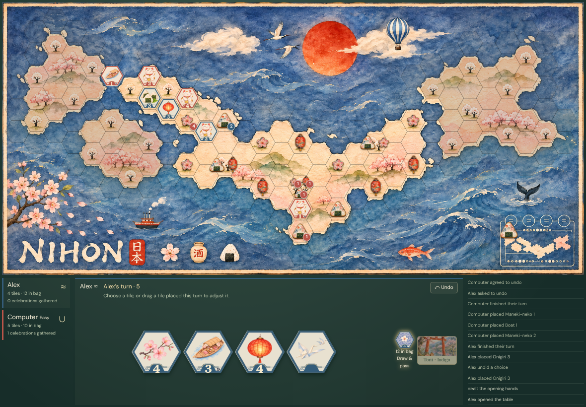

[Alex DOM evidence](../../../screenshots/practice.spec.js/practice-from-the-front-door-through-computer-turns-reload-undo-and-victory-015-alex-linux.dom.txt)

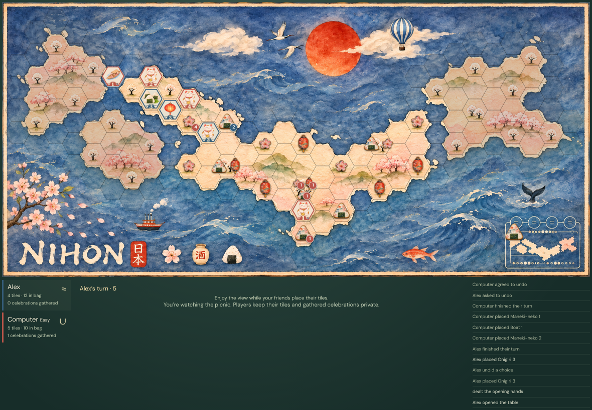

[Observer DOM evidence](../../../screenshots/practice.spec.js/practice-from-the-front-door-through-computer-turns-reload-undo-and-victory-015-observer-linux.dom.txt)

## 016. Alex: Draw and let the computer play its real turn

DOM assertions passed; actor and all observers captured.

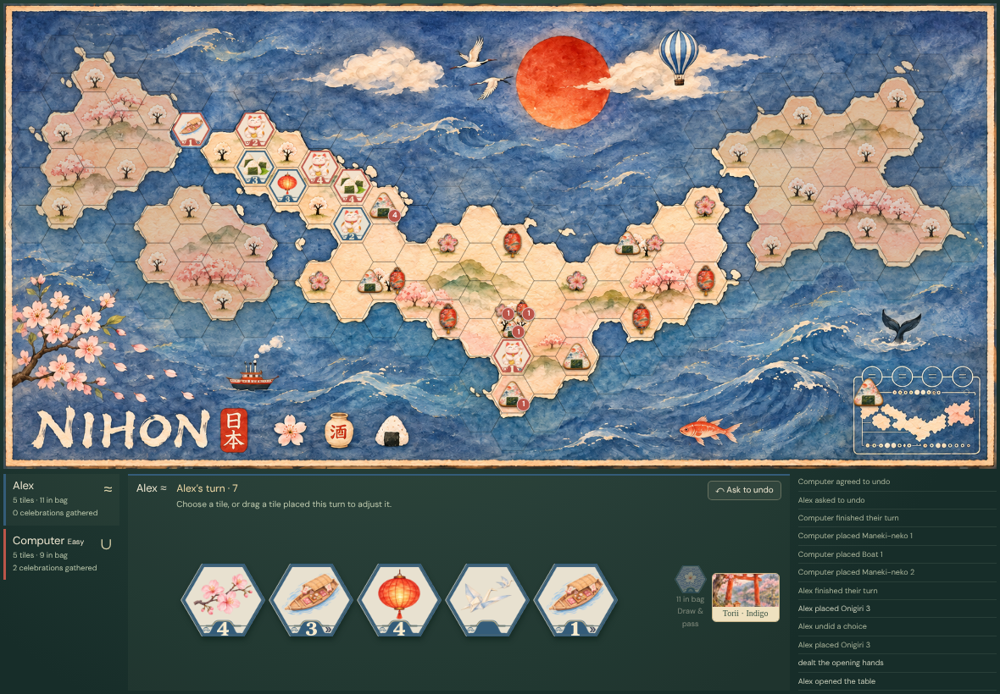

[Alex DOM evidence](../../../screenshots/practice.spec.js/practice-from-the-front-door-through-computer-turns-reload-undo-and-victory-016-alex-linux.dom.txt)

[Observer DOM evidence](../../../screenshots/practice.spec.js/practice-from-the-front-door-through-computer-turns-reload-undo-and-victory-016-observer-linux.dom.txt)

## 017. Alex: Select sakura-4 from the private hand

DOM assertions passed; actor and all observers captured.

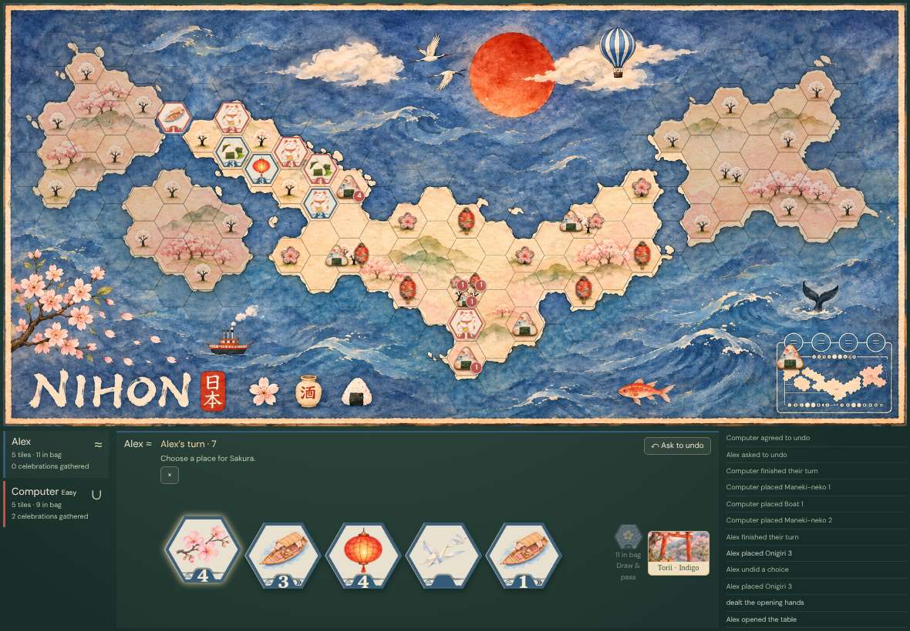

[Alex DOM evidence](../../../screenshots/practice.spec.js/practice-from-the-front-door-through-computer-turns-reload-undo-and-victory-017-alex-linux.dom.txt)

[Observer DOM evidence](../../../screenshots/practice.spec.js/practice-from-the-front-door-through-computer-turns-reload-undo-and-victory-017-observer-linux.dom.txt)

## 018. Alex: Place sakura-4 on 11:6

DOM assertions passed; actor and all observers captured.

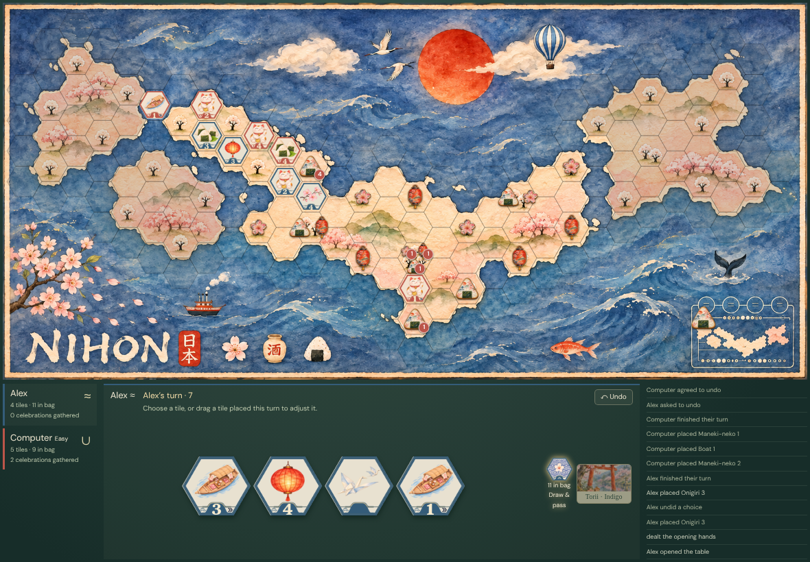

[Alex DOM evidence](../../../screenshots/practice.spec.js/practice-from-the-front-door-through-computer-turns-reload-undo-and-victory-018-alex-linux.dom.txt)

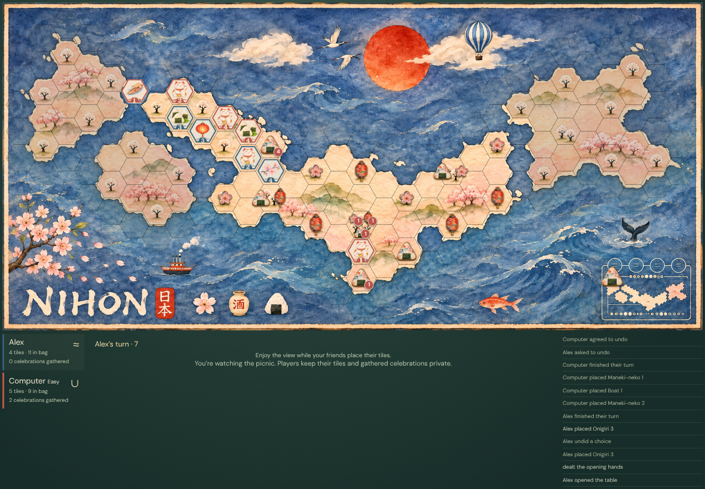

[Observer DOM evidence](../../../screenshots/practice.spec.js/practice-from-the-front-door-through-computer-turns-reload-undo-and-victory-018-observer-linux.dom.txt)

## 019. Alex: Draw and let the computer play its real turn

DOM assertions passed; actor and all observers captured.

[Alex DOM evidence](../../../screenshots/practice.spec.js/practice-from-the-front-door-through-computer-turns-reload-undo-and-victory-019-alex-linux.dom.txt)

[Observer DOM evidence](../../../screenshots/practice.spec.js/practice-from-the-front-door-through-computer-turns-reload-undo-and-victory-019-observer-linux.dom.txt)

## 020. Alex: Select boat-3 from the private hand

DOM assertions passed; actor and all observers captured.

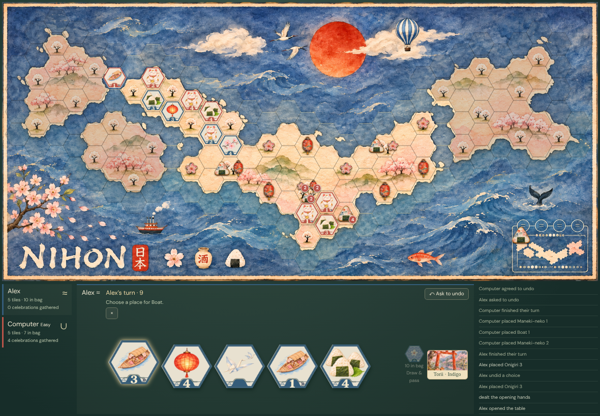

[Alex DOM evidence](../../../screenshots/practice.spec.js/practice-from-the-front-door-through-computer-turns-reload-undo-and-victory-020-alex-linux.dom.txt)

[Observer DOM evidence](../../../screenshots/practice.spec.js/practice-from-the-front-door-through-computer-turns-reload-undo-and-victory-020-observer-linux.dom.txt)

## 021. Alex: Place boat-3 on 5:4

DOM assertions passed; actor and all observers captured.

[Alex DOM evidence](../../../screenshots/practice.spec.js/practice-from-the-front-door-through-computer-turns-reload-undo-and-victory-021-alex-linux.dom.txt)

[Observer DOM evidence](../../../screenshots/practice.spec.js/practice-from-the-front-door-through-computer-turns-reload-undo-and-victory-021-observer-linux.dom.txt)

## 022. Alex: Draw and let the computer play its real turn

DOM assertions passed; actor and all observers captured.

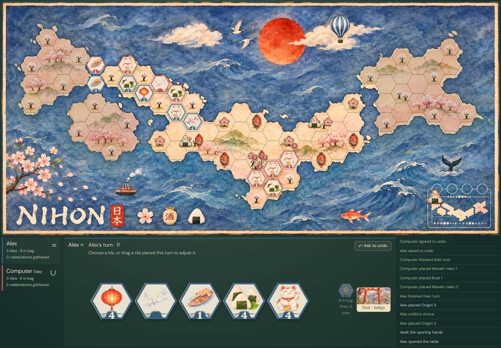

[Alex DOM evidence](../../../screenshots/practice.spec.js/practice-from-the-front-door-through-computer-turns-reload-undo-and-victory-022-alex-linux.dom.txt)

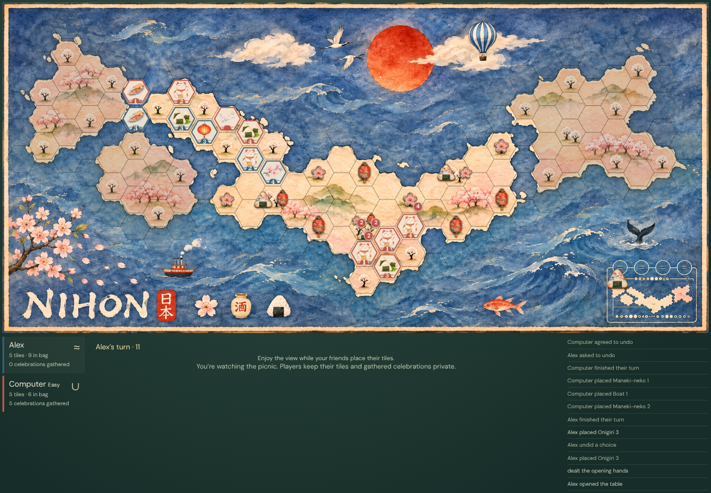

[Observer DOM evidence](../../../screenshots/practice.spec.js/practice-from-the-front-door-through-computer-turns-reload-undo-and-victory-022-observer-linux.dom.txt)

## 023. Alex: Select chochin-4 from the private hand

DOM assertions passed; actor and all observers captured.

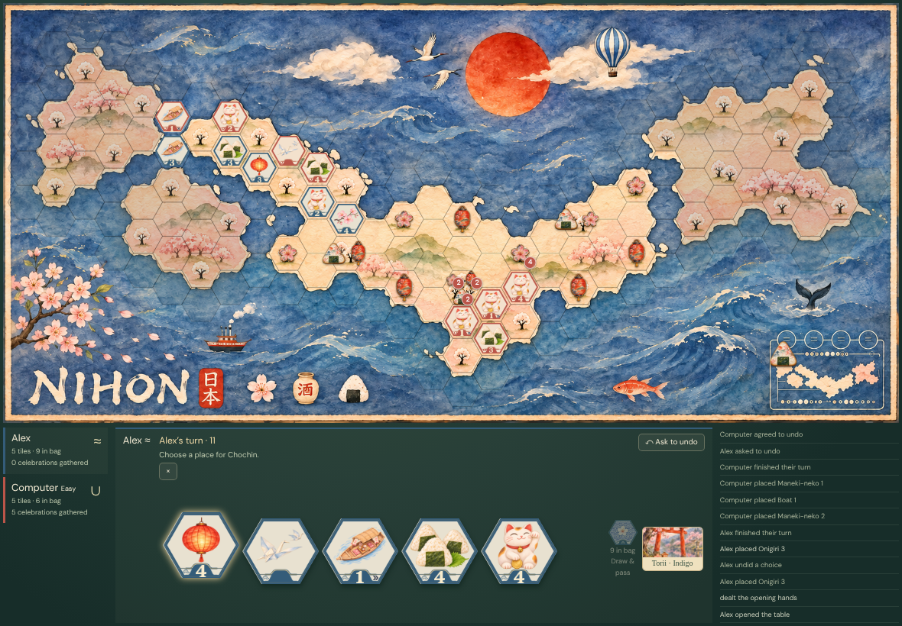

[Alex DOM evidence](../../../screenshots/practice.spec.js/practice-from-the-front-door-through-computer-turns-reload-undo-and-victory-023-alex-linux.dom.txt)

[Observer DOM evidence](../../../screenshots/practice.spec.js/practice-from-the-front-door-through-computer-turns-reload-undo-and-victory-023-observer-linux.dom.txt)

## 024. Alex: Place chochin-4 on 10:7

DOM assertions passed; actor and all observers captured.

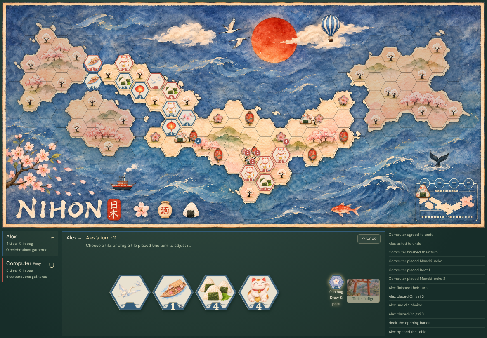

[Alex DOM evidence](../../../screenshots/practice.spec.js/practice-from-the-front-door-through-computer-turns-reload-undo-and-victory-024-alex-linux.dom.txt)

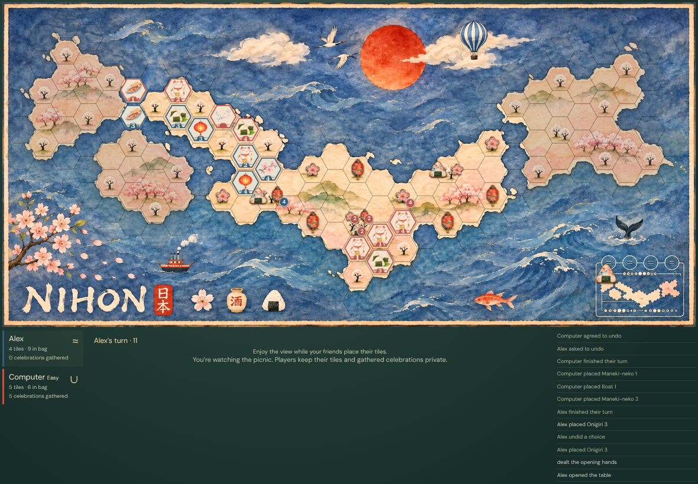

[Observer DOM evidence](../../../screenshots/practice.spec.js/practice-from-the-front-door-through-computer-turns-reload-undo-and-victory-024-observer-linux.dom.txt)

## 025. Alex: Draw and let the computer play its real turn

DOM assertions passed; actor and all observers captured.

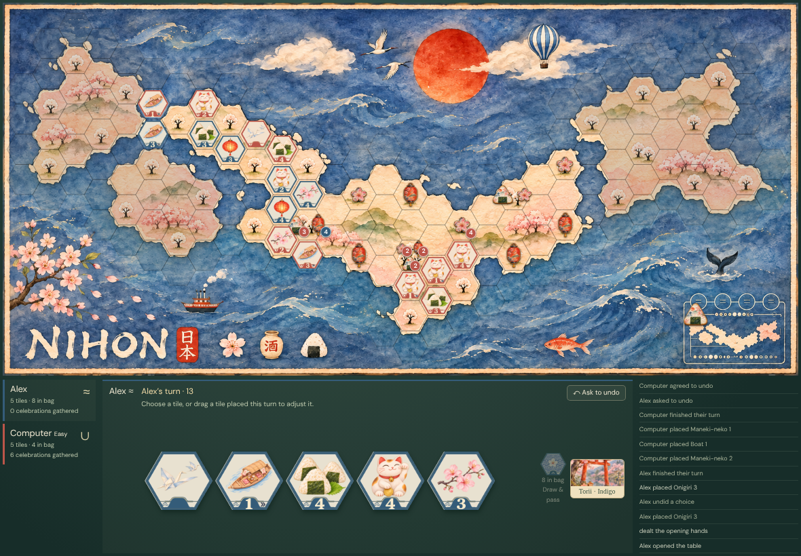

[Alex DOM evidence](../../../screenshots/practice.spec.js/practice-from-the-front-door-through-computer-turns-reload-undo-and-victory-025-alex-linux.dom.txt)

[Observer DOM evidence](../../../screenshots/practice.spec.js/practice-from-the-front-door-through-computer-turns-reload-undo-and-victory-025-observer-linux.dom.txt)

## 026. Alex: Select boat-1 from the private hand

DOM assertions passed; actor and all observers captured.

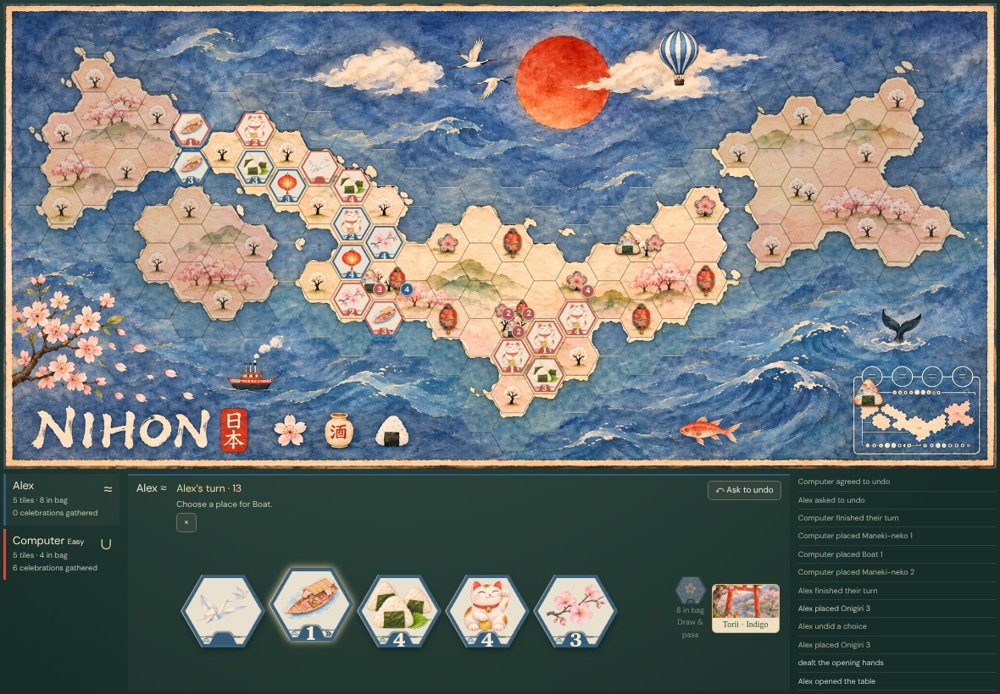

[Alex DOM evidence](../../../screenshots/practice.spec.js/practice-from-the-front-door-through-computer-turns-reload-undo-and-victory-026-alex-linux.dom.txt)

[Observer DOM evidence](../../../screenshots/practice.spec.js/practice-from-the-front-door-through-computer-turns-reload-undo-and-victory-026-observer-linux.dom.txt)

## 027. Alex: Place boat-1 on 6:5

DOM assertions passed; actor and all observers captured.

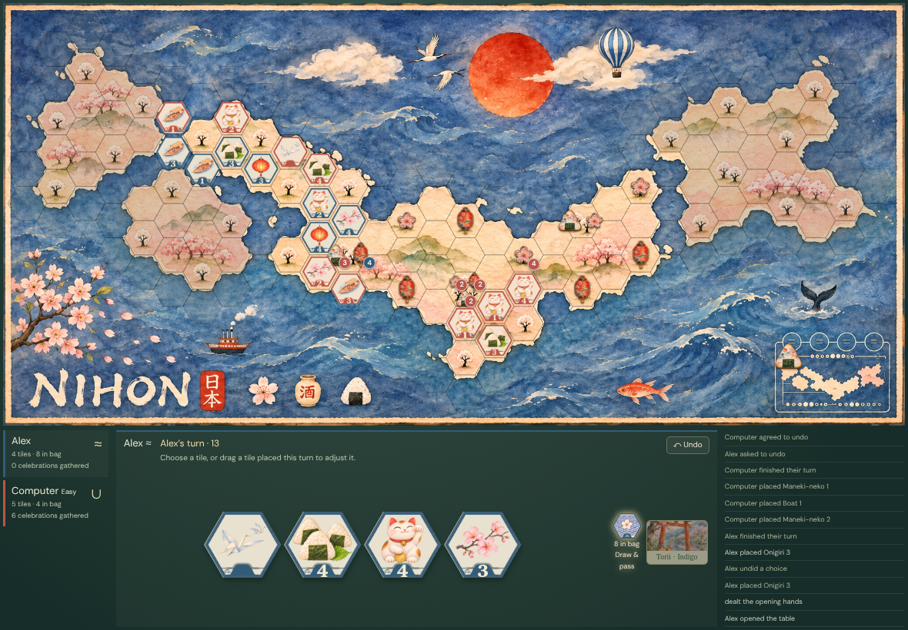

[Alex DOM evidence](../../../screenshots/practice.spec.js/practice-from-the-front-door-through-computer-turns-reload-undo-and-victory-027-alex-linux.dom.txt)

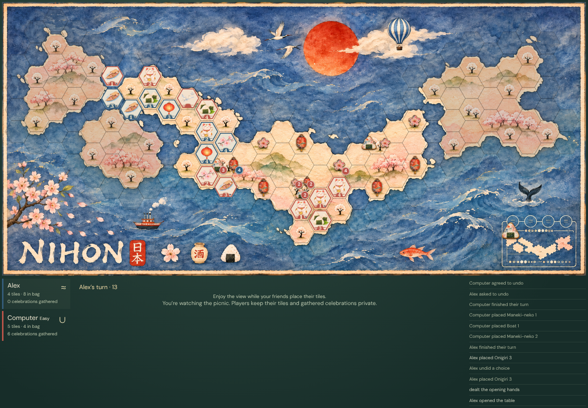

[Observer DOM evidence](../../../screenshots/practice.spec.js/practice-from-the-front-door-through-computer-turns-reload-undo-and-victory-027-observer-linux.dom.txt)

## 028. Alex: Draw and let the computer play its real turn

DOM assertions passed; actor and all observers captured.

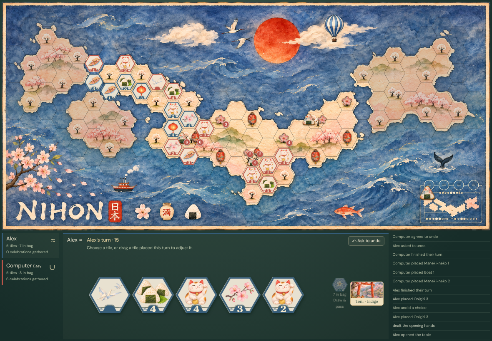

[Alex DOM evidence](../../../screenshots/practice.spec.js/practice-from-the-front-door-through-computer-turns-reload-undo-and-victory-028-alex-linux.dom.txt)

[Observer DOM evidence](../../../screenshots/practice.spec.js/practice-from-the-front-door-through-computer-turns-reload-undo-and-victory-028-observer-linux.dom.txt)

## 029. Alex: Select onigiri-4 from the private hand

DOM assertions passed; actor and all observers captured.

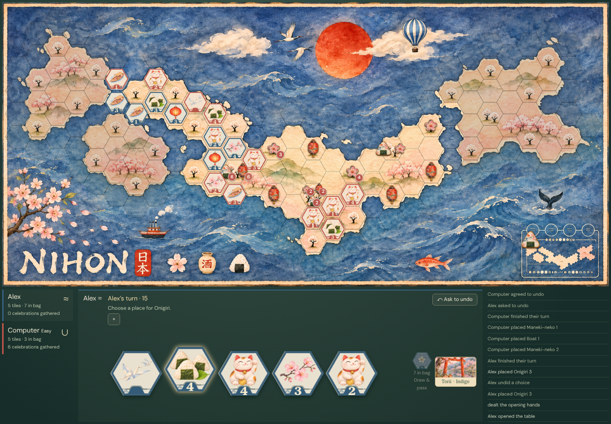

[Alex DOM evidence](../../../screenshots/practice.spec.js/practice-from-the-front-door-through-computer-turns-reload-undo-and-victory-029-alex-linux.dom.txt)

[Observer DOM evidence](../../../screenshots/practice.spec.js/practice-from-the-front-door-through-computer-turns-reload-undo-and-victory-029-observer-linux.dom.txt)

## 030. Alex: Place onigiri-4 on 13:7

DOM assertions passed; actor and all observers captured.

[Alex DOM evidence](../../../screenshots/practice.spec.js/practice-from-the-front-door-through-computer-turns-reload-undo-and-victory-030-alex-linux.dom.txt)

[Observer DOM evidence](../../../screenshots/practice.spec.js/practice-from-the-front-door-through-computer-turns-reload-undo-and-victory-030-observer-linux.dom.txt)

## 031. Alex: Draw and let the computer play its real turn

DOM assertions passed; actor and all observers captured.

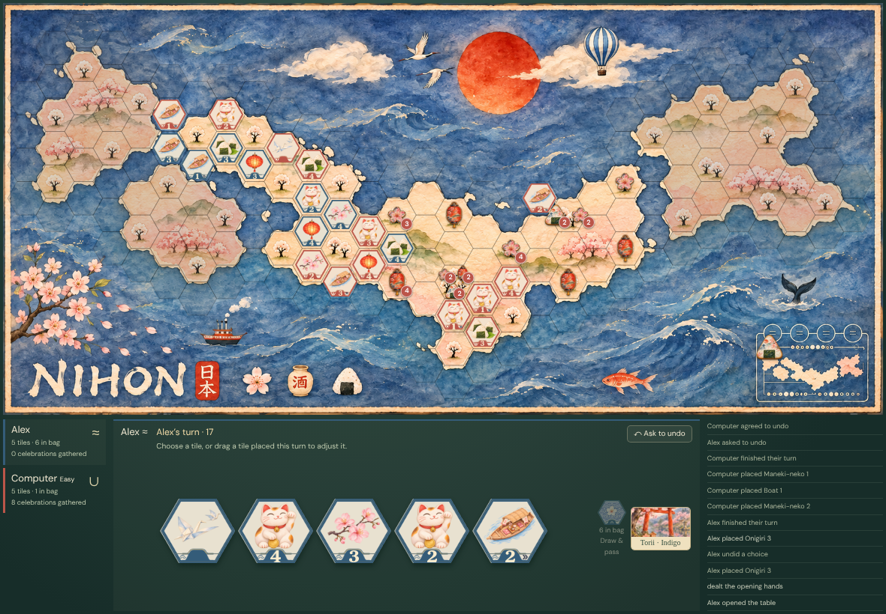

[Alex DOM evidence](../../../screenshots/practice.spec.js/practice-from-the-front-door-through-computer-turns-reload-undo-and-victory-031-alex-linux.dom.txt)

[Observer DOM evidence](../../../screenshots/practice.spec.js/practice-from-the-front-door-through-computer-turns-reload-undo-and-victory-031-observer-linux.dom.txt)

## 032. Alex: Select cat-5 from the private hand

DOM assertions passed; actor and all observers captured.

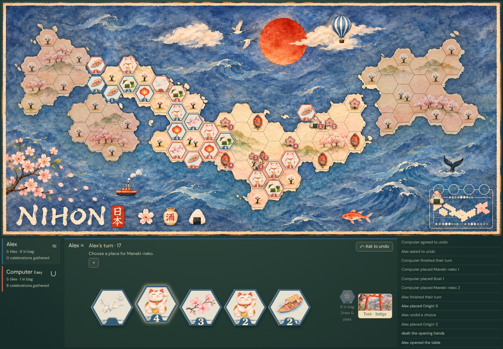

[Alex DOM evidence](../../../screenshots/practice.spec.js/practice-from-the-front-door-through-computer-turns-reload-undo-and-victory-032-alex-linux.dom.txt)

[Observer DOM evidence](../../../screenshots/practice.spec.js/practice-from-the-front-door-through-computer-turns-reload-undo-and-victory-032-observer-linux.dom.txt)

## 033. Alex: Place cat-5 on 14:8

DOM assertions passed; actor and all observers captured.

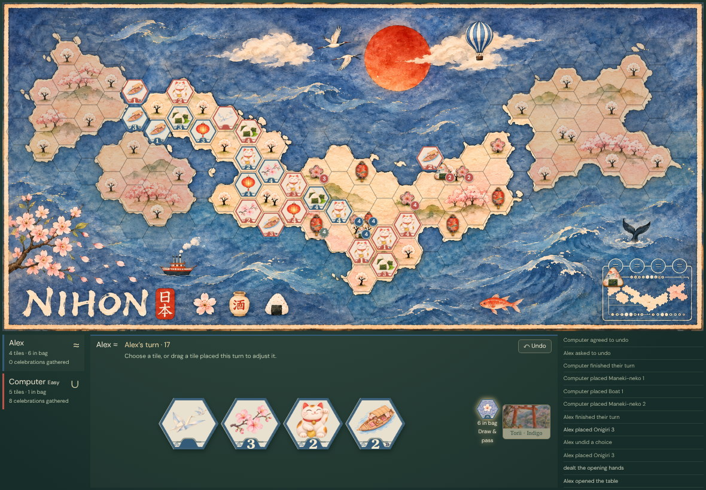

[Alex DOM evidence](../../../screenshots/practice.spec.js/practice-from-the-front-door-through-computer-turns-reload-undo-and-victory-033-alex-linux.dom.txt)

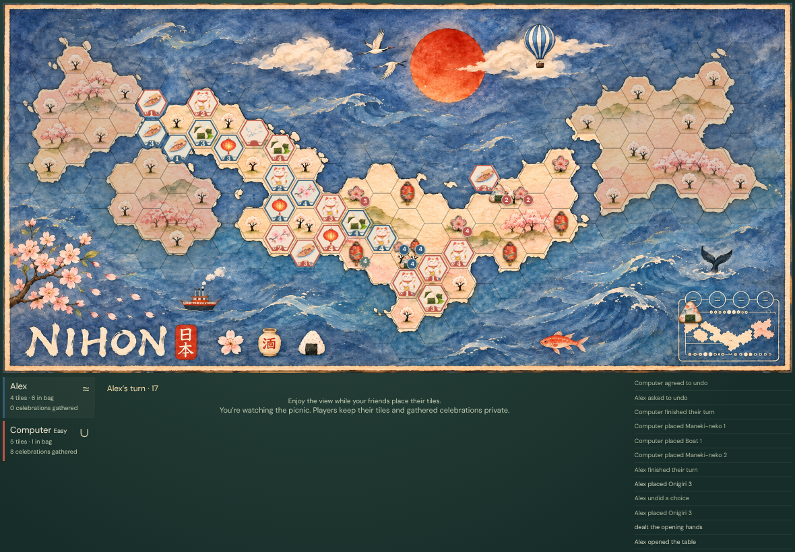

[Observer DOM evidence](../../../screenshots/practice.spec.js/practice-from-the-front-door-through-computer-turns-reload-undo-and-victory-033-observer-linux.dom.txt)

## 034. Alex: Draw and let the computer play its real turn

DOM assertions passed; actor and all observers captured.

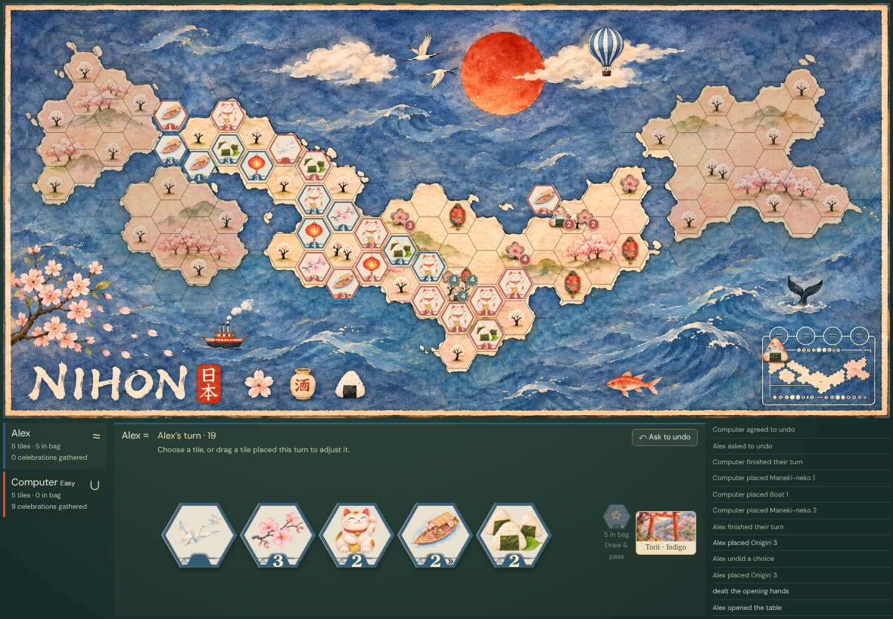

[Alex DOM evidence](../../../screenshots/practice.spec.js/practice-from-the-front-door-through-computer-turns-reload-undo-and-victory-034-alex-linux.dom.txt)

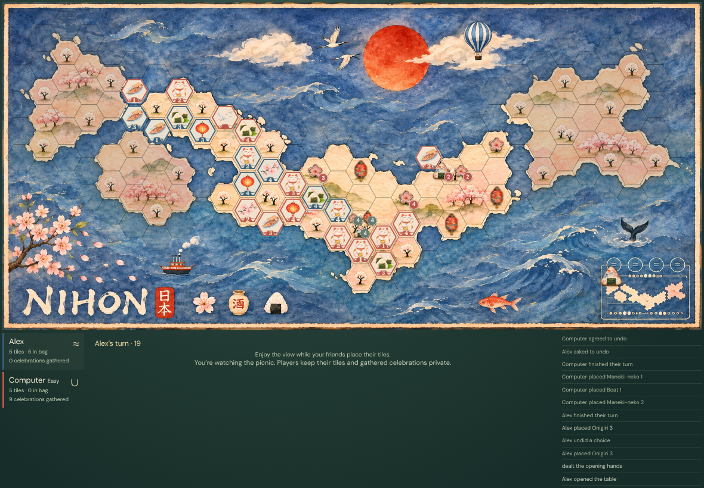

[Observer DOM evidence](../../../screenshots/practice.spec.js/practice-from-the-front-door-through-computer-turns-reload-undo-and-victory-034-observer-linux.dom.txt)

## 035. Alex: Select sakura-3 from the private hand

DOM assertions passed; actor and all observers captured.

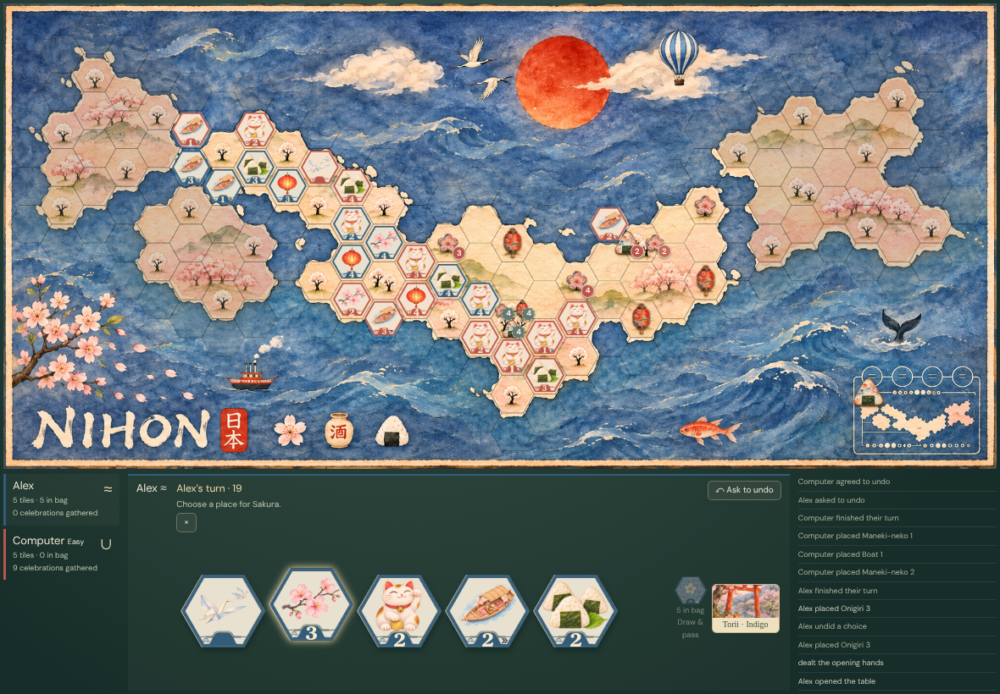

[Alex DOM evidence](../../../screenshots/practice.spec.js/practice-from-the-front-door-through-computer-turns-reload-undo-and-victory-035-alex-linux.dom.txt)

[Observer DOM evidence](../../../screenshots/practice.spec.js/practice-from-the-front-door-through-computer-turns-reload-undo-and-victory-035-observer-linux.dom.txt)

## 036. Alex: Place sakura-3 on 14:7

DOM assertions passed; actor and all observers captured.

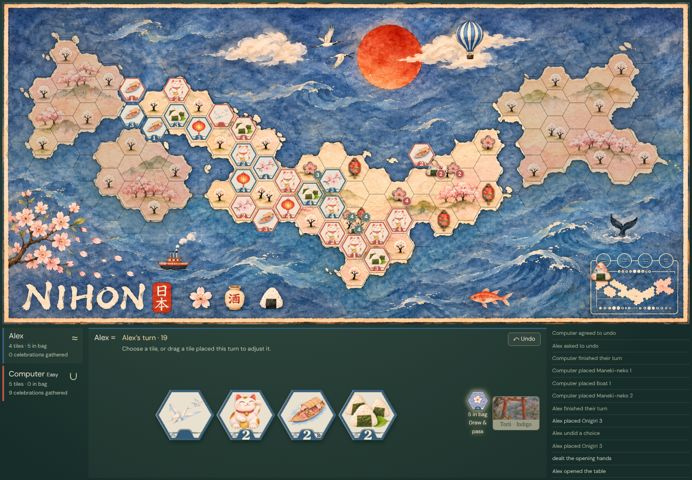

[Alex DOM evidence](../../../screenshots/practice.spec.js/practice-from-the-front-door-through-computer-turns-reload-undo-and-victory-036-alex-linux.dom.txt)

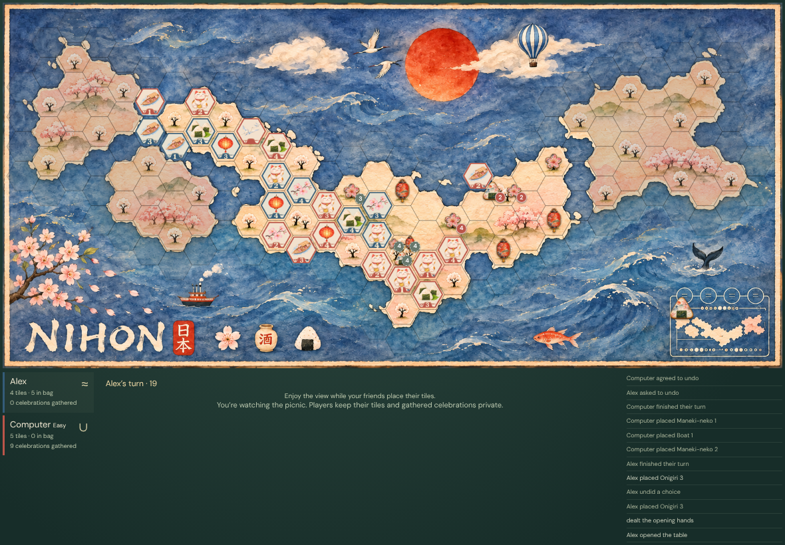

[Observer DOM evidence](../../../screenshots/practice.spec.js/practice-from-the-front-door-through-computer-turns-reload-undo-and-victory-036-observer-linux.dom.txt)

## 037. Alex: Draw and let the computer play its real turn

DOM assertions passed; actor and all observers captured.

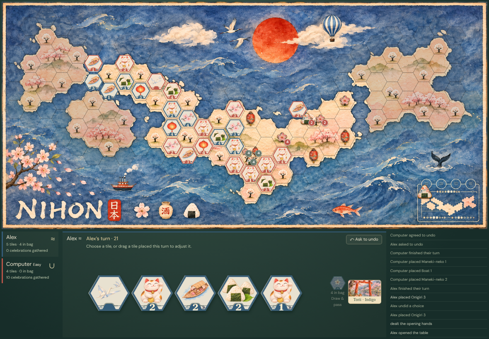

[Alex DOM evidence](../../../screenshots/practice.spec.js/practice-from-the-front-door-through-computer-turns-reload-undo-and-victory-037-alex-linux.dom.txt)

[Observer DOM evidence](../../../screenshots/practice.spec.js/practice-from-the-front-door-through-computer-turns-reload-undo-and-victory-037-observer-linux.dom.txt)

## 038. Alex: Select cat-3 from the private hand

DOM assertions passed; actor and all observers captured.

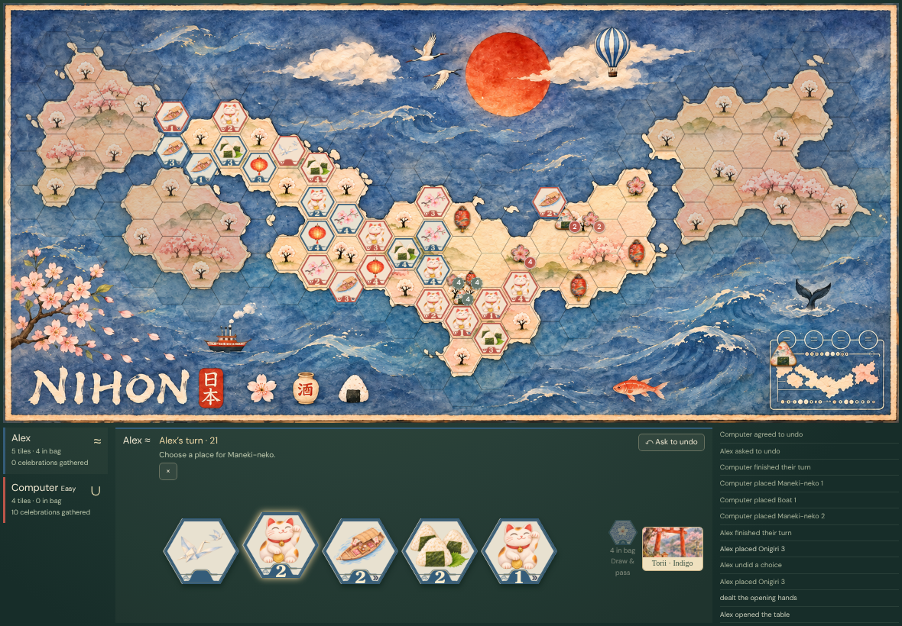

[Alex DOM evidence](../../../screenshots/practice.spec.js/practice-from-the-front-door-through-computer-turns-reload-undo-and-victory-038-alex-linux.dom.txt)

[Observer DOM evidence](../../../screenshots/practice.spec.js/practice-from-the-front-door-through-computer-turns-reload-undo-and-victory-038-observer-linux.dom.txt)

## 039. Alex: Place cat-3 on 15:7

DOM assertions passed; actor and all observers captured.

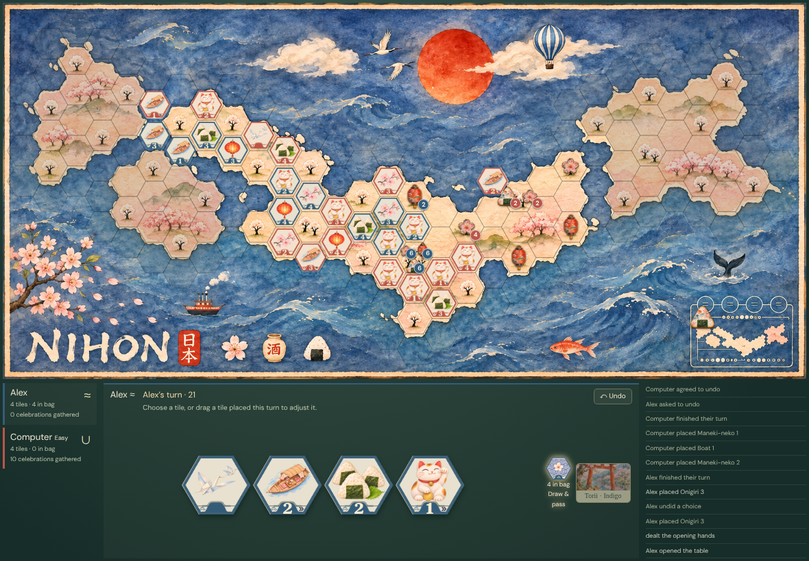

[Alex DOM evidence](../../../screenshots/practice.spec.js/practice-from-the-front-door-through-computer-turns-reload-undo-and-victory-039-alex-linux.dom.txt)

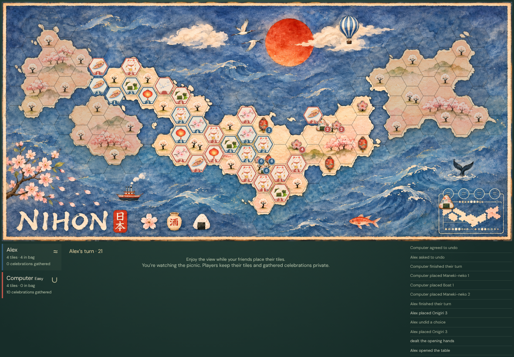

[Observer DOM evidence](../../../screenshots/practice.spec.js/practice-from-the-front-door-through-computer-turns-reload-undo-and-victory-039-observer-linux.dom.txt)

## 040. Alex: Draw and let the computer play its real turn

DOM assertions passed; actor and all observers captured.

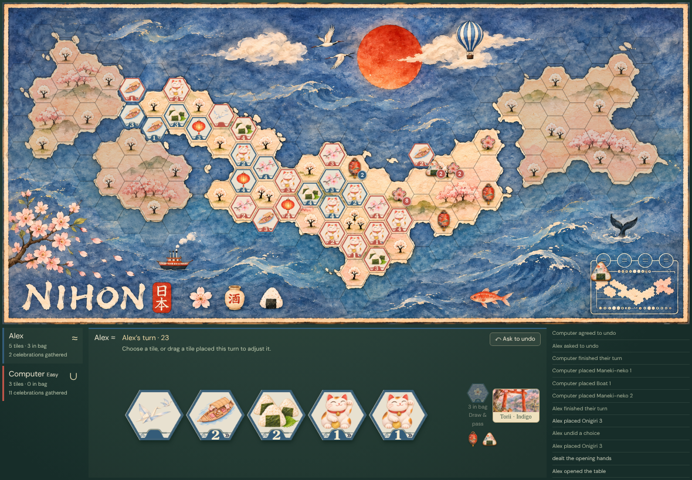

[Alex DOM evidence](../../../screenshots/practice.spec.js/practice-from-the-front-door-through-computer-turns-reload-undo-and-victory-040-alex-linux.dom.txt)

[Observer DOM evidence](../../../screenshots/practice.spec.js/practice-from-the-front-door-through-computer-turns-reload-undo-and-victory-040-observer-linux.dom.txt)

## 041. Alex: Select boat-2 from the private hand

DOM assertions passed; actor and all observers captured.

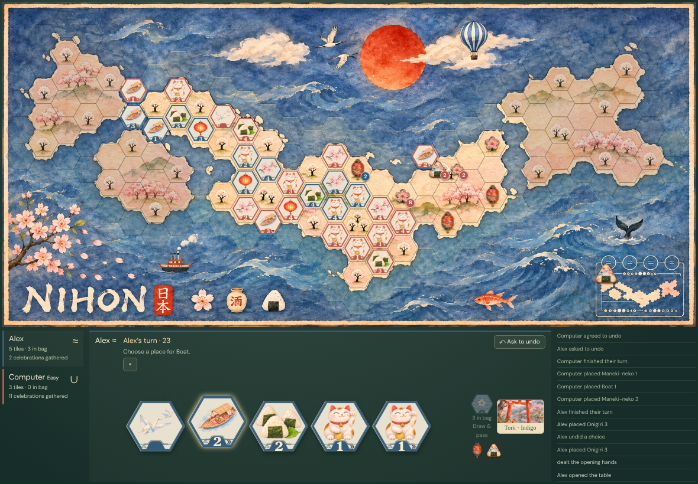

[Alex DOM evidence](../../../screenshots/practice.spec.js/practice-from-the-front-door-through-computer-turns-reload-undo-and-victory-041-alex-linux.dom.txt)

[Observer DOM evidence](../../../screenshots/practice.spec.js/practice-from-the-front-door-through-computer-turns-reload-undo-and-victory-041-observer-linux.dom.txt)

## 042. Alex: Place boat-2 on 7:5

DOM assertions passed; actor and all observers captured.

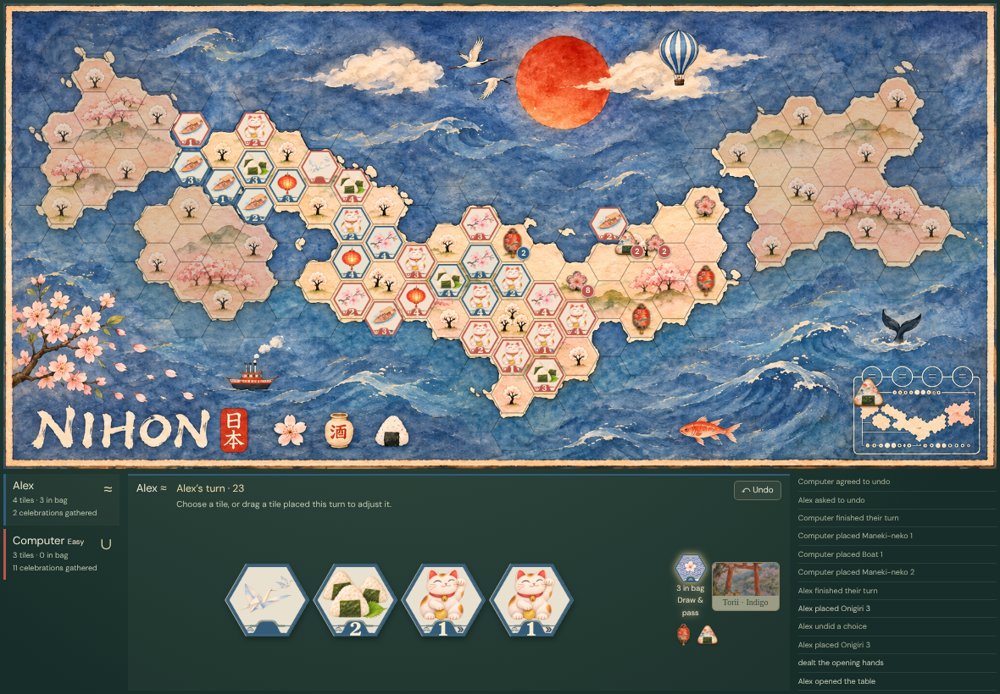

[Alex DOM evidence](../../../screenshots/practice.spec.js/practice-from-the-front-door-through-computer-turns-reload-undo-and-victory-042-alex-linux.dom.txt)

[Observer DOM evidence](../../../screenshots/practice.spec.js/practice-from-the-front-door-through-computer-turns-reload-undo-and-victory-042-observer-linux.dom.txt)

## 043. Alex: Draw and let the computer play its real turn

DOM assertions passed; actor and all observers captured.

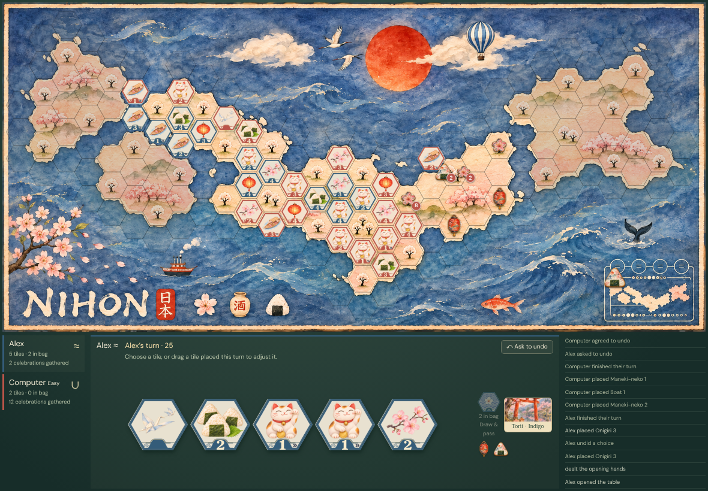

[Alex DOM evidence](../../../screenshots/practice.spec.js/practice-from-the-front-door-through-computer-turns-reload-undo-and-victory-043-alex-linux.dom.txt)

[Observer DOM evidence](../../../screenshots/practice.spec.js/practice-from-the-front-door-through-computer-turns-reload-undo-and-victory-043-observer-linux.dom.txt)

## 044. Alex: Select onigiri-2 from the private hand

DOM assertions passed; actor and all observers captured.

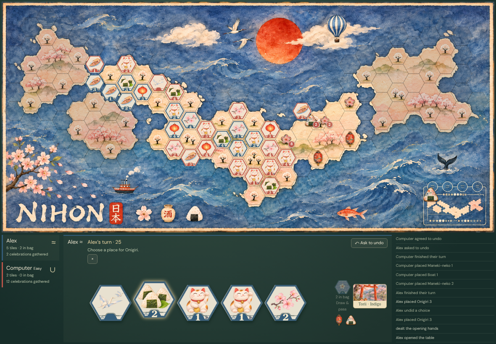

[Alex DOM evidence](../../../screenshots/practice.spec.js/practice-from-the-front-door-through-computer-turns-reload-undo-and-victory-044-alex-linux.dom.txt)

[Observer DOM evidence](../../../screenshots/practice.spec.js/practice-from-the-front-door-through-computer-turns-reload-undo-and-victory-044-observer-linux.dom.txt)

## 045. Alex: Place onigiri-2 on 18:8

DOM assertions passed; actor and all observers captured.

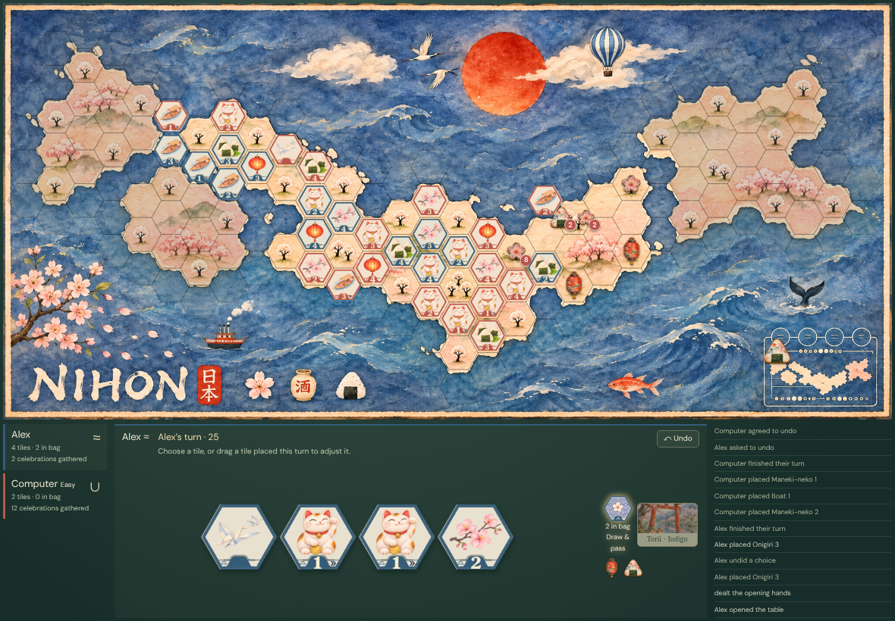

[Alex DOM evidence](../../../screenshots/practice.spec.js/practice-from-the-front-door-through-computer-turns-reload-undo-and-victory-045-alex-linux.dom.txt)

[Observer DOM evidence](../../../screenshots/practice.spec.js/practice-from-the-front-door-through-computer-turns-reload-undo-and-victory-045-observer-linux.dom.txt)

## 046. Alex: Draw and let the computer play its real turn

DOM assertions passed; actor and all observers captured.

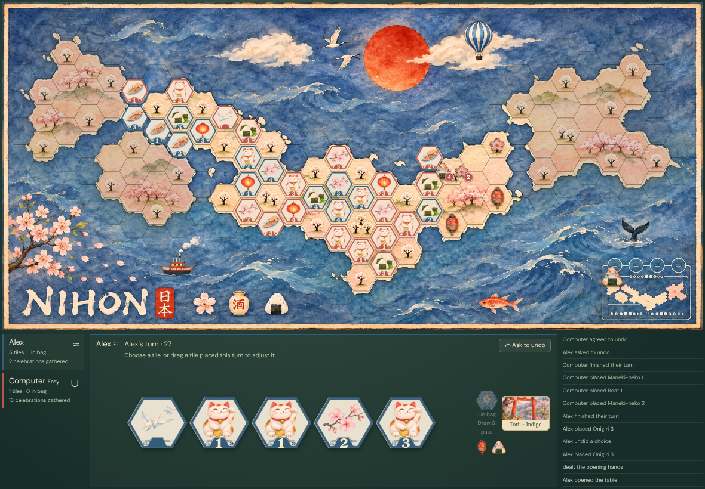

[Alex DOM evidence](../../../screenshots/practice.spec.js/practice-from-the-front-door-through-computer-turns-reload-undo-and-victory-046-alex-linux.dom.txt)

[Observer DOM evidence](../../../screenshots/practice.spec.js/practice-from-the-front-door-through-computer-turns-reload-undo-and-victory-046-observer-linux.dom.txt)

## 047. Alex: Select cat-0 from the private hand

DOM assertions passed; actor and all observers captured.

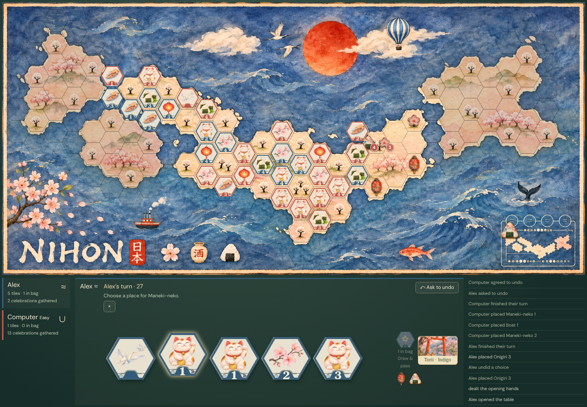

[Alex DOM evidence](../../../screenshots/practice.spec.js/practice-from-the-front-door-through-computer-turns-reload-undo-and-victory-047-alex-linux.dom.txt)

[Observer DOM evidence](../../../screenshots/practice.spec.js/practice-from-the-front-door-through-computer-turns-reload-undo-and-victory-047-observer-linux.dom.txt)

## 048. Alex: Place cat-0 on 19:7

DOM assertions passed; actor and all observers captured.

[Alex DOM evidence](../../../screenshots/practice.spec.js/practice-from-the-front-door-through-computer-turns-reload-undo-and-victory-048-alex-linux.dom.txt)

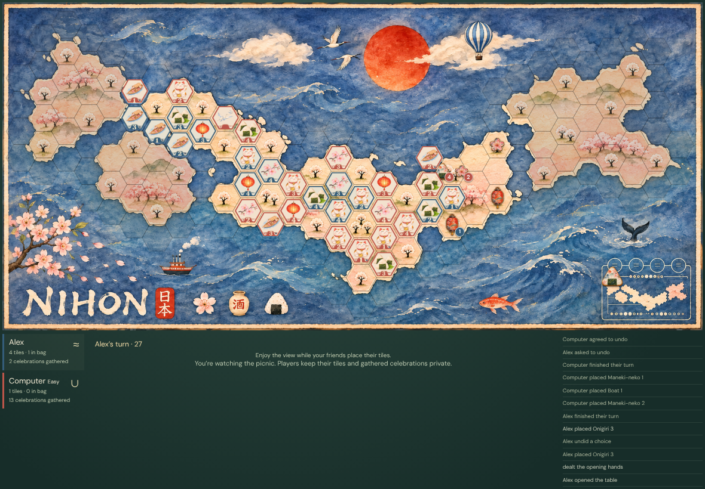

[Observer DOM evidence](../../../screenshots/practice.spec.js/practice-from-the-front-door-through-computer-turns-reload-undo-and-victory-048-observer-linux.dom.txt)

## 049. Alex: Draw and let the computer play its real turn

DOM assertions passed; actor and all observers captured.

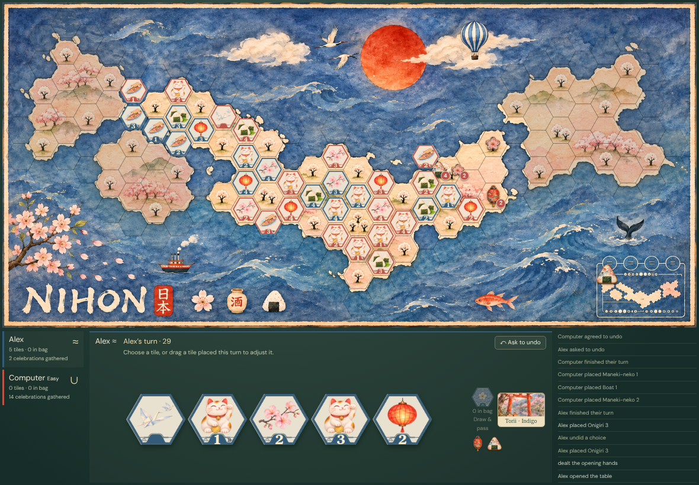

[Alex DOM evidence](../../../screenshots/practice.spec.js/practice-from-the-front-door-through-computer-turns-reload-undo-and-victory-049-alex-linux.dom.txt)

[Observer DOM evidence](../../../screenshots/practice.spec.js/practice-from-the-front-door-through-computer-turns-reload-undo-and-victory-049-observer-linux.dom.txt)

## 050. Alex: Select cat-1 from the private hand

DOM assertions passed; actor and all observers captured.

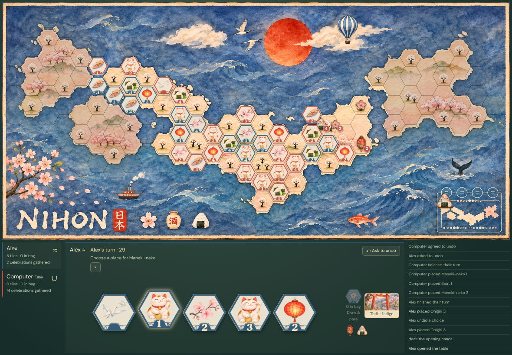

[Alex DOM evidence](../../../screenshots/practice.spec.js/practice-from-the-front-door-through-computer-turns-reload-undo-and-victory-050-alex-linux.dom.txt)

[Observer DOM evidence](../../../screenshots/practice.spec.js/practice-from-the-front-door-through-computer-turns-reload-undo-and-victory-050-observer-linux.dom.txt)

## 051. Alex: Place cat-1 on 20:7

DOM assertions passed; actor and all observers captured.

[Alex DOM evidence](../../../screenshots/practice.spec.js/practice-from-the-front-door-through-computer-turns-reload-undo-and-victory-051-alex-linux.dom.txt)

[Observer DOM evidence](../../../screenshots/practice.spec.js/practice-from-the-front-door-through-computer-turns-reload-undo-and-victory-051-observer-linux.dom.txt)

## 052. Alex: Draw and let the computer play its real turn

DOM assertions passed; actor and all observers captured.

[Alex DOM evidence](../../../screenshots/practice.spec.js/practice-from-the-front-door-through-computer-turns-reload-undo-and-victory-052-alex-linux.dom.txt)

[Observer DOM evidence](../../../screenshots/practice.spec.js/practice-from-the-front-door-through-computer-turns-reload-undo-and-victory-052-observer-linux.dom.txt)

## 053. Alex: Select sakura-2 from the private hand

DOM assertions passed; actor and all observers captured.

[Alex DOM evidence](../../../screenshots/practice.spec.js/practice-from-the-front-door-through-computer-turns-reload-undo-and-victory-053-alex-linux.dom.txt)

[Observer DOM evidence](../../../screenshots/practice.spec.js/practice-from-the-front-door-through-computer-turns-reload-undo-and-victory-053-observer-linux.dom.txt)

## 054. Alex: Place sakura-2 on 20:6

DOM assertions passed; actor and all observers captured.

[Alex DOM evidence](../../../screenshots/practice.spec.js/practice-from-the-front-door-through-computer-turns-reload-undo-and-victory-054-alex-linux.dom.txt)

[Observer DOM evidence](../../../screenshots/practice.spec.js/practice-from-the-front-door-through-computer-turns-reload-undo-and-victory-054-observer-linux.dom.txt)

## 055. Alex: Draw and let the computer play its real turn

DOM assertions passed; actor and all observers captured.

[Alex DOM evidence](../../../screenshots/practice.spec.js/practice-from-the-front-door-through-computer-turns-reload-undo-and-victory-055-alex-linux.dom.txt)

[Observer DOM evidence](../../../screenshots/practice.spec.js/practice-from-the-front-door-through-computer-turns-reload-undo-and-victory-055-observer-linux.dom.txt)

## 056. Alex: Reveal the true event-driven result to both clients

DOM assertions passed; actor and all observers captured.

[Alex DOM evidence](../../../screenshots/practice.spec.js/practice-from-the-front-door-through-computer-turns-reload-undo-and-victory-056-alex-linux.dom.txt)

[Observer DOM evidence](../../../screenshots/practice.spec.js/practice-from-the-front-door-through-computer-turns-reload-undo-and-victory-056-observer-linux.dom.txt)

## 057. Alex: Reload the complete practice game without adding choices

DOM assertions passed; actor and all observers captured.

[Alex DOM evidence](../../../screenshots/practice.spec.js/practice-from-the-front-door-through-computer-turns-reload-undo-and-victory-057-alex-linux.dom.txt)

[Observer DOM evidence](../../../screenshots/practice.spec.js/practice-from-the-front-door-through-computer-turns-reload-undo-and-victory-057-observer-linux.dom.txt)
