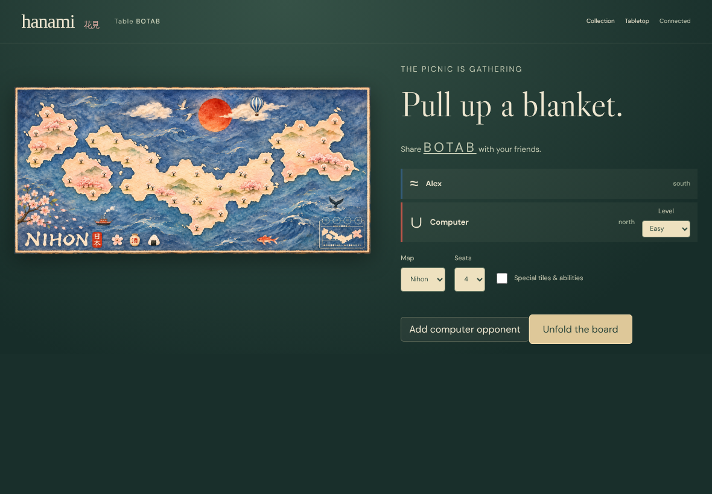
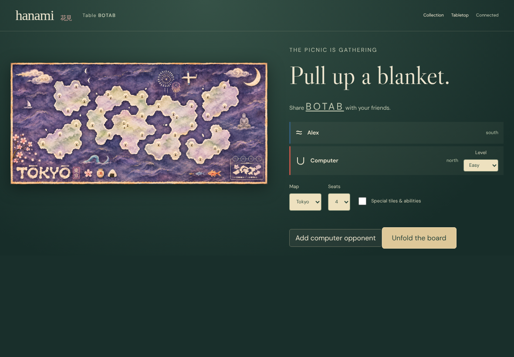
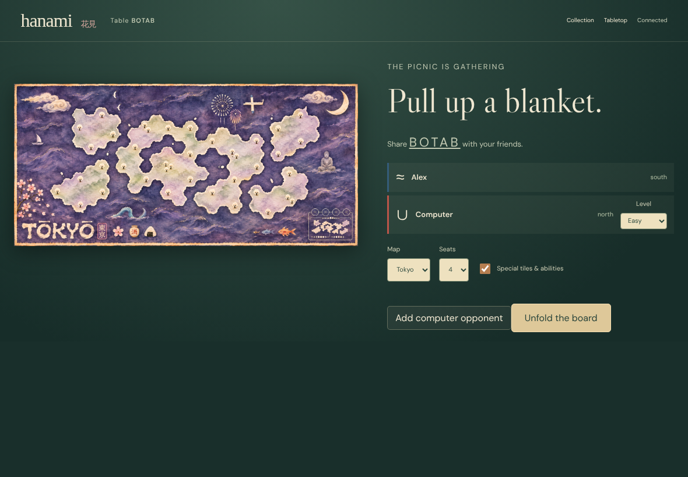
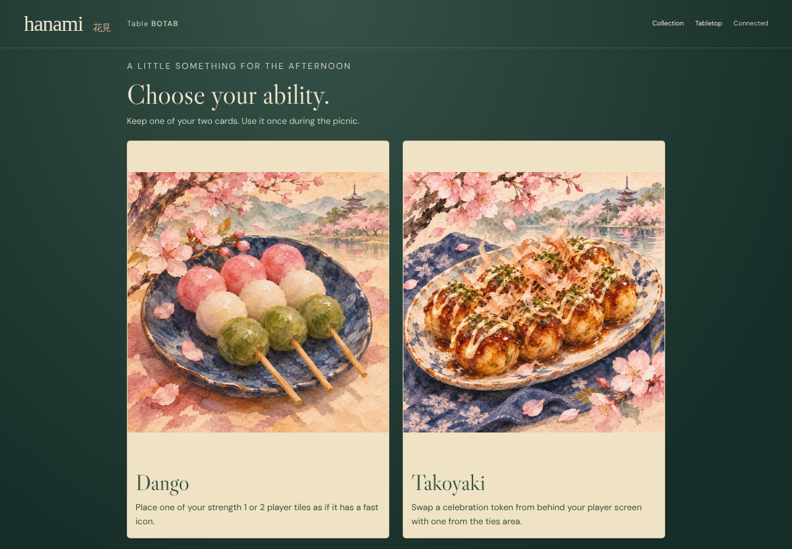
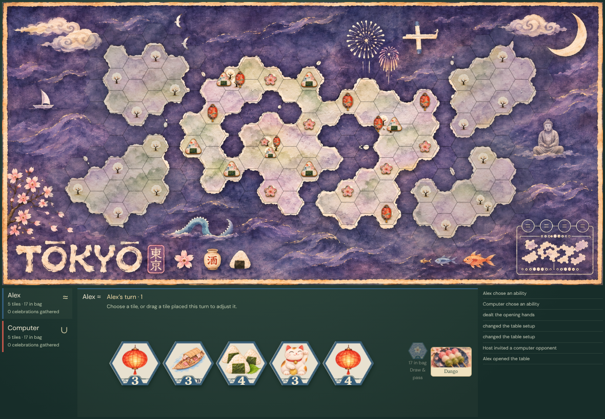

# Invite a computer and choose special abilities

Real UI → authenticated Firestore transaction → immutable event → deterministic replay → every observer. Zero pixel tolerance; every decoded RGBA byte and the accessible DOM are compared. No game-state injection or outcome fixtures.

## 000. Alex: Add a computer to an ordinary gathering

Viewport, scrolling, clipping and DOM assertions passed; actor and all observers captured.

[Alex DOM evidence](../../../screenshots/practice.spec.js/add-a-computer-to-a-normal-gathering-and-let-it-choose-a-special-ability-000-alex-linux.dom.txt)

## 001. Alex: Choose Tokyo

Viewport, scrolling, clipping and DOM assertions passed; actor and all observers captured.

[Alex DOM evidence](../../../screenshots/practice.spec.js/add-a-computer-to-a-normal-gathering-and-let-it-choose-a-special-ability-001-alex-linux.dom.txt)

## 002. Alex: Include the special components

Viewport, scrolling, clipping and DOM assertions passed; actor and all observers captured.

[Alex DOM evidence](../../../screenshots/practice.spec.js/add-a-computer-to-a-normal-gathering-and-let-it-choose-a-special-ability-002-alex-linux.dom.txt)

## 003. Alex: Deal ability choices for both players

Viewport, scrolling, clipping and DOM assertions passed; actor and all observers captured.

[Alex DOM evidence](../../../screenshots/practice.spec.js/add-a-computer-to-a-normal-gathering-and-let-it-choose-a-special-ability-003-alex-linux.dom.txt)

## 004. Alex: Choose an ability and reload after losing its acknowledgement; recover the saved choice

Viewport, scrolling, clipping and DOM assertions passed; actor and all observers captured.

[Alex DOM evidence](../../../screenshots/practice.spec.js/add-a-computer-to-a-normal-gathering-and-let-it-choose-a-special-ability-004-alex-linux.dom.txt)
