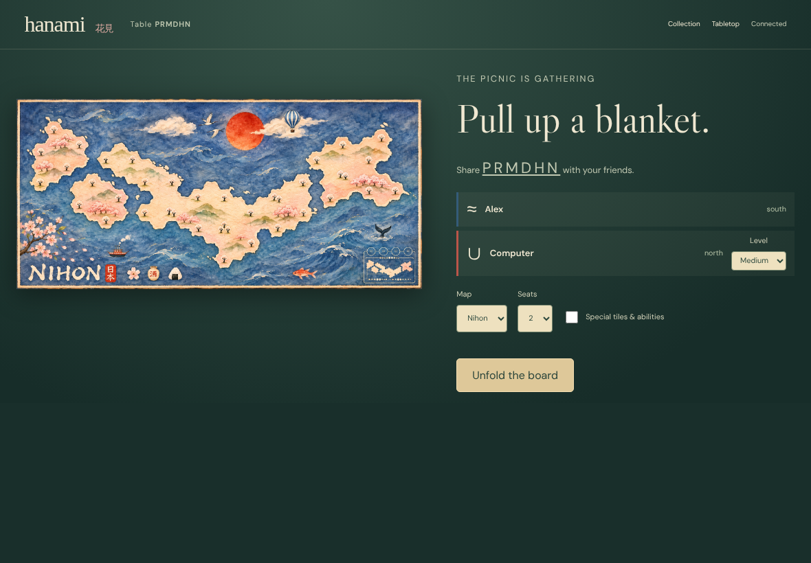
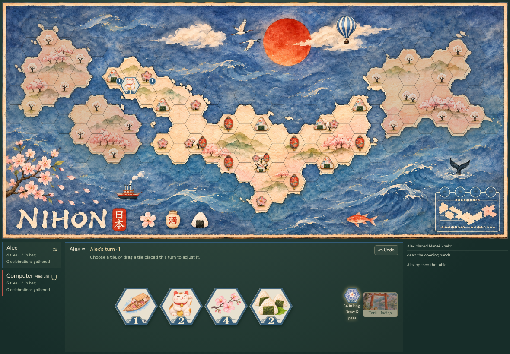
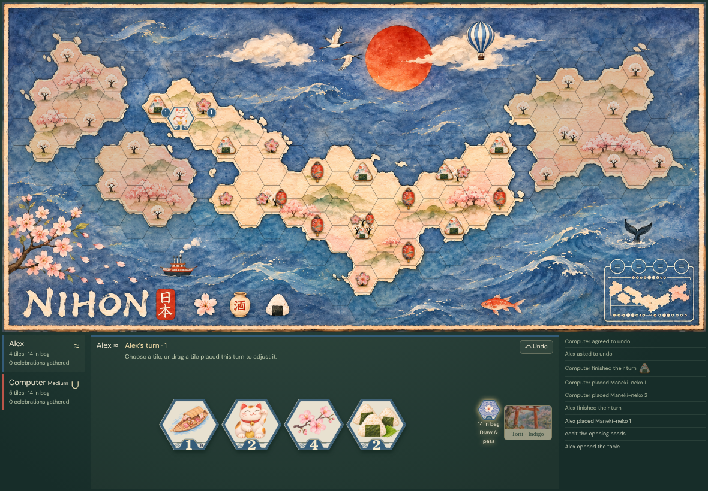
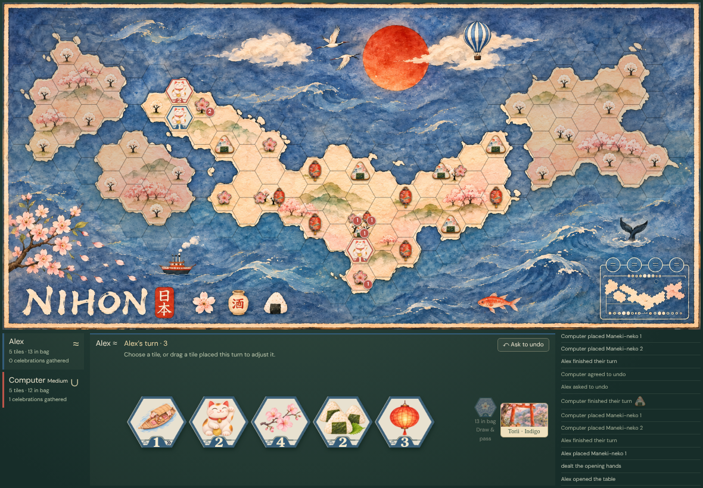

# Medium computer: level, turn, reload and undo

Real UI → authenticated Firestore transaction → immutable event → deterministic replay → every observer. Zero pixel tolerance; every decoded RGBA byte and the accessible DOM are compared. No game-state injection or outcome fixtures.

## 000. Player: Select Medium practice

Viewport, scrolling, clipping and DOM assertions passed; actor and all observers captured.

[Player DOM evidence](../../../screenshots/levels.spec.js/medium-practice-persists-its-level-through-real-turns-reload-and-undo-000-player-linux.dom.txt)

## 001. Player: Create a table with the selected computer level

Viewport, scrolling, clipping and DOM assertions passed; actor and all observers captured.

[Player DOM evidence](../../../screenshots/levels.spec.js/medium-practice-persists-its-level-through-real-turns-reload-and-undo-001-player-linux.dom.txt)

## 002. Player: Reload the chosen level before dealing

Viewport, scrolling, clipping and DOM assertions passed; actor and all observers captured.

[Player DOM evidence](../../../screenshots/levels.spec.js/medium-practice-persists-its-level-through-real-turns-reload-and-undo-002-player-linux.dom.txt)

## 003. Player: Start a real game

Viewport, scrolling, clipping and DOM assertions passed; actor and all observers captured.

[Player DOM evidence](../../../screenshots/levels.spec.js/medium-practice-persists-its-level-through-real-turns-reload-and-undo-003-player-linux.dom.txt)

## 004. Player: Select a tile from the real private hand

Viewport, scrolling, clipping and DOM assertions passed; actor and all observers captured.

[Player DOM evidence](../../../screenshots/levels.spec.js/medium-practice-persists-its-level-through-real-turns-reload-and-undo-004-player-linux.dom.txt)

## 005. Player: Place it on the board

Viewport, scrolling, clipping and DOM assertions passed; actor and all observers captured.

[Player DOM evidence](../../../screenshots/levels.spec.js/medium-practice-persists-its-level-through-real-turns-reload-and-undo-005-player-linux.dom.txt)

## 006. Player: Draw and reload while the selected computer takes its turn

Viewport, scrolling, clipping and DOM assertions passed; actor and all observers captured.

[Player DOM evidence](../../../screenshots/levels.spec.js/medium-practice-persists-its-level-through-real-turns-reload-and-undo-006-player-linux.dom.txt)

## 007. Player: Request undo and receive consent from this level

Viewport, scrolling, clipping and DOM assertions passed; actor and all observers captured.

[Player DOM evidence](../../../screenshots/levels.spec.js/medium-practice-persists-its-level-through-real-turns-reload-and-undo-007-player-linux.dom.txt)

## 008. Player: Draw again and let the same computer resume

Viewport, scrolling, clipping and DOM assertions passed; actor and all observers captured.

[Player DOM evidence](../../../screenshots/levels.spec.js/medium-practice-persists-its-level-through-real-turns-reload-and-undo-008-player-linux.dom.txt)
