# Readable powers and undo consent without scrolling · Tokyo

Real UI → authenticated Firestore transaction → immutable event → deterministic replay → every observer. Zero pixel tolerance; every decoded RGBA byte and the accessible DOM are compared. No game-state injection or outcome fixtures.

## 000. Bea: Join the picnic through the real invitation

Viewport, scrolling, clipping and DOM assertions passed; actor and all observers captured.

[Alex DOM evidence](../../../screenshots/viewport.spec.js/power-cards-and-undo-consent-fit-the-real-game-at-every-viewport-on-tokyo-000-alex-linux.dom.txt)

[Bea DOM evidence](../../../screenshots/viewport.spec.js/power-cards-and-undo-consent-fit-the-real-game-at-every-viewport-on-tokyo-000-bea-linux.dom.txt)

## 001. Alex: Deal two single-use powers to each player

Viewport, scrolling, clipping and DOM assertions passed; actor and all observers captured.

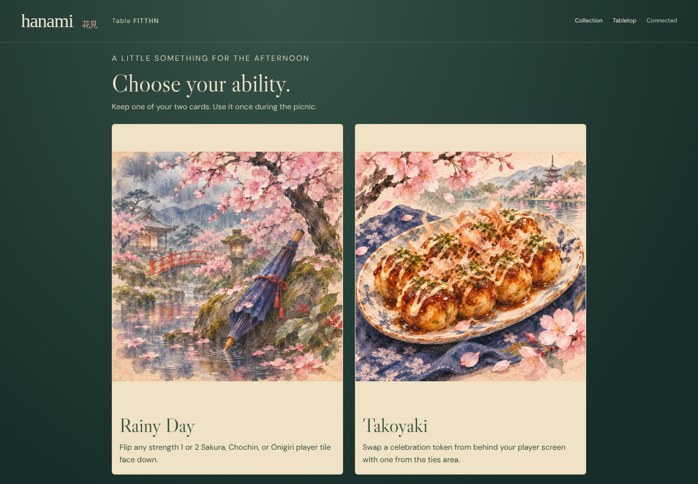

[Alex DOM evidence](../../../screenshots/viewport.spec.js/power-cards-and-undo-consent-fit-the-real-game-at-every-viewport-on-tokyo-001-alex-linux.dom.txt)

[Bea DOM evidence](../../../screenshots/viewport.spec.js/power-cards-and-undo-consent-fit-the-real-game-at-every-viewport-on-tokyo-001-bea-linux.dom.txt)

## 002. Alex: Read both power cards on iPad Air

Viewport, scrolling, clipping and DOM assertions passed; actor and all observers captured.

[Alex DOM evidence](../../../screenshots/viewport.spec.js/power-cards-and-undo-consent-fit-the-real-game-at-every-viewport-on-tokyo-002-alex-linux.dom.txt)

[Bea DOM evidence](../../../screenshots/viewport.spec.js/power-cards-and-undo-consent-fit-the-real-game-at-every-viewport-on-tokyo-002-bea-linux.dom.txt)

## 003. Alex: Read both power cards on iPad

Viewport, scrolling, clipping and DOM assertions passed; actor and all observers captured.

[Alex DOM evidence](../../../screenshots/viewport.spec.js/power-cards-and-undo-consent-fit-the-real-game-at-every-viewport-on-tokyo-003-alex-linux.dom.txt)

[Bea DOM evidence](../../../screenshots/viewport.spec.js/power-cards-and-undo-consent-fit-the-real-game-at-every-viewport-on-tokyo-003-bea-linux.dom.txt)

## 004. Alex: Read both power cards on desktop

Viewport, scrolling, clipping and DOM assertions passed; actor and all observers captured.

[Alex DOM evidence](../../../screenshots/viewport.spec.js/power-cards-and-undo-consent-fit-the-real-game-at-every-viewport-on-tokyo-004-alex-linux.dom.txt)

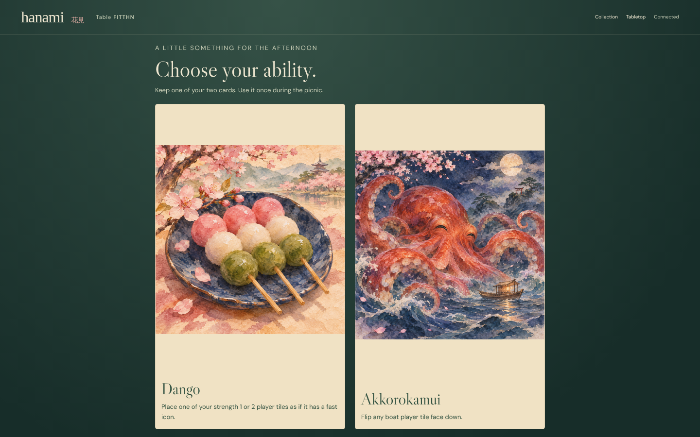

[Bea DOM evidence](../../../screenshots/viewport.spec.js/power-cards-and-undo-consent-fit-the-real-game-at-every-viewport-on-tokyo-004-bea-linux.dom.txt)

## 005. Alex: Read both power cards on short landscape

Viewport, scrolling, clipping and DOM assertions passed; actor and all observers captured.

[Alex DOM evidence](../../../screenshots/viewport.spec.js/power-cards-and-undo-consent-fit-the-real-game-at-every-viewport-on-tokyo-005-alex-linux.dom.txt)

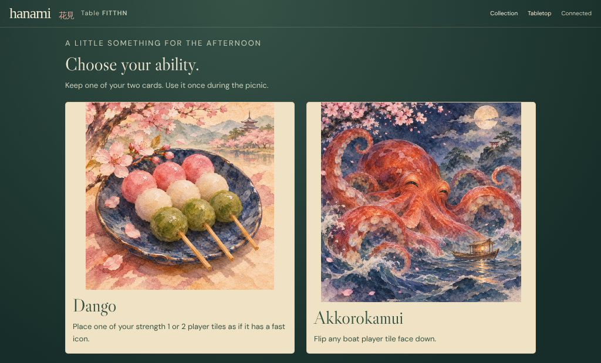

[Bea DOM evidence](../../../screenshots/viewport.spec.js/power-cards-and-undo-consent-fit-the-real-game-at-every-viewport-on-tokyo-005-bea-linux.dom.txt)

## 006. Alex: Read both power cards on phone landscape

Viewport, scrolling, clipping and DOM assertions passed; actor and all observers captured.

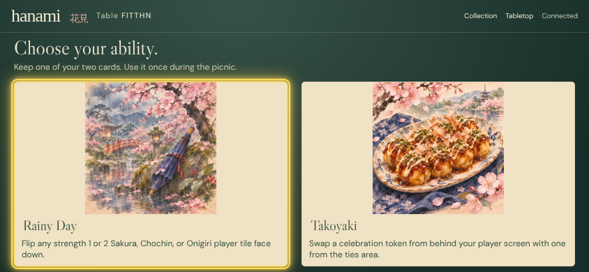

[Alex DOM evidence](../../../screenshots/viewport.spec.js/power-cards-and-undo-consent-fit-the-real-game-at-every-viewport-on-tokyo-006-alex-linux.dom.txt)

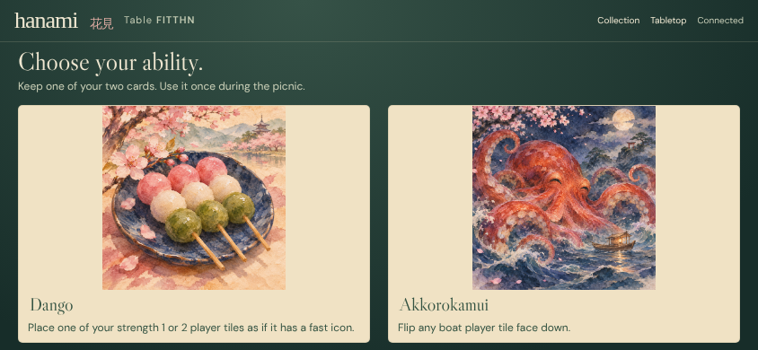

[Bea DOM evidence](../../../screenshots/viewport.spec.js/power-cards-and-undo-consent-fit-the-real-game-at-every-viewport-on-tokyo-006-bea-linux.dom.txt)

## 007. Alex: Read both power cards on compact phone landscape

Viewport, scrolling, clipping and DOM assertions passed; actor and all observers captured.

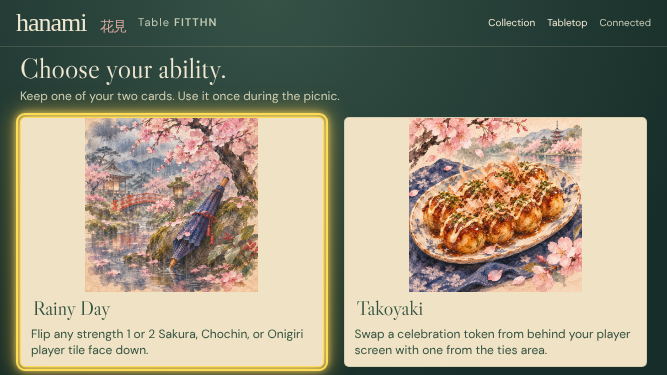

[Alex DOM evidence](../../../screenshots/viewport.spec.js/power-cards-and-undo-consent-fit-the-real-game-at-every-viewport-on-tokyo-007-alex-linux.dom.txt)

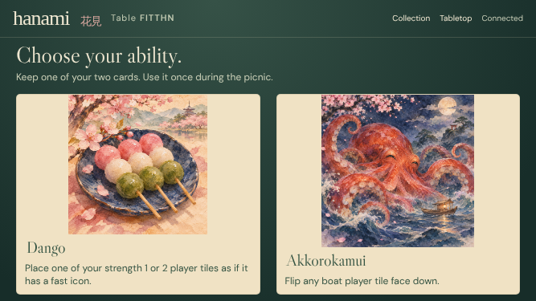

[Bea DOM evidence](../../../screenshots/viewport.spec.js/power-cards-and-undo-consent-fit-the-real-game-at-every-viewport-on-tokyo-007-bea-linux.dom.txt)

## 008. Alex: Read both power cards on small phone landscape

Viewport, scrolling, clipping and DOM assertions passed; actor and all observers captured.

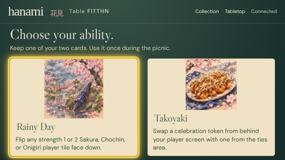

[Alex DOM evidence](../../../screenshots/viewport.spec.js/power-cards-and-undo-consent-fit-the-real-game-at-every-viewport-on-tokyo-008-alex-linux.dom.txt)

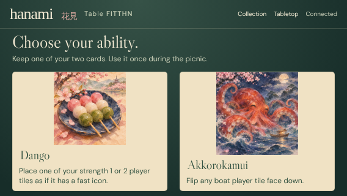

[Bea DOM evidence](../../../screenshots/viewport.spec.js/power-cards-and-undo-consent-fit-the-real-game-at-every-viewport-on-tokyo-008-bea-linux.dom.txt)

## 009. Alex: Read both power cards on phone portrait

Viewport, scrolling, clipping and DOM assertions passed; actor and all observers captured.

[Alex DOM evidence](../../../screenshots/viewport.spec.js/power-cards-and-undo-consent-fit-the-real-game-at-every-viewport-on-tokyo-009-alex-linux.dom.txt)

[Bea DOM evidence](../../../screenshots/viewport.spec.js/power-cards-and-undo-consent-fit-the-real-game-at-every-viewport-on-tokyo-009-bea-linux.dom.txt)

## 010. Alex: Keyboard focus gives the same gold glow without darkening

Viewport, scrolling, clipping and DOM assertions passed; actor and all observers captured.

[Alex DOM evidence](../../../screenshots/viewport.spec.js/power-cards-and-undo-consent-fit-the-real-game-at-every-viewport-on-tokyo-010-alex-linux.dom.txt)

[Bea DOM evidence](../../../screenshots/viewport.spec.js/power-cards-and-undo-consent-fit-the-real-game-at-every-viewport-on-tokyo-010-bea-linux.dom.txt)

## 011. Alex: Alex keeps one of the actual dealt powers

Viewport, scrolling, clipping and DOM assertions passed; actor and all observers captured.

[Alex DOM evidence](../../../screenshots/viewport.spec.js/power-cards-and-undo-consent-fit-the-real-game-at-every-viewport-on-tokyo-011-alex-linux.dom.txt)

[Bea DOM evidence](../../../screenshots/viewport.spec.js/power-cards-and-undo-consent-fit-the-real-game-at-every-viewport-on-tokyo-011-bea-linux.dom.txt)

## 012. Bea: Bea keeps a power and begins real play

Viewport, scrolling, clipping and DOM assertions passed; actor and all observers captured.

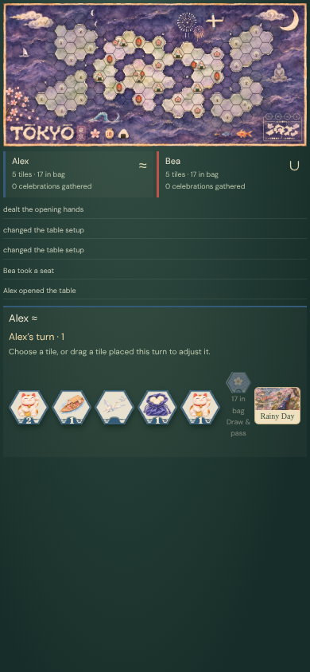

[Alex DOM evidence](../../../screenshots/viewport.spec.js/power-cards-and-undo-consent-fit-the-real-game-at-every-viewport-on-tokyo-012-alex-linux.dom.txt)

[Bea DOM evidence](../../../screenshots/viewport.spec.js/power-cards-and-undo-consent-fit-the-real-game-at-every-viewport-on-tokyo-012-bea-linux.dom.txt)

## 013. Alex: Select a real tile from the private hand

Viewport, scrolling, clipping and DOM assertions passed; actor and all observers captured.

[Alex DOM evidence](../../../screenshots/viewport.spec.js/power-cards-and-undo-consent-fit-the-real-game-at-every-viewport-on-tokyo-013-alex-linux.dom.txt)

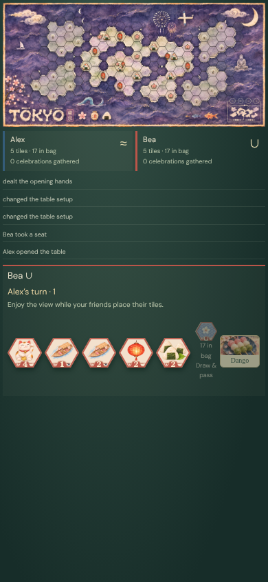

[Bea DOM evidence](../../../screenshots/viewport.spec.js/power-cards-and-undo-consent-fit-the-real-game-at-every-viewport-on-tokyo-013-bea-linux.dom.txt)

## 014. Alex: Place that tile on a legal hex

Viewport, scrolling, clipping and DOM assertions passed; actor and all observers captured.

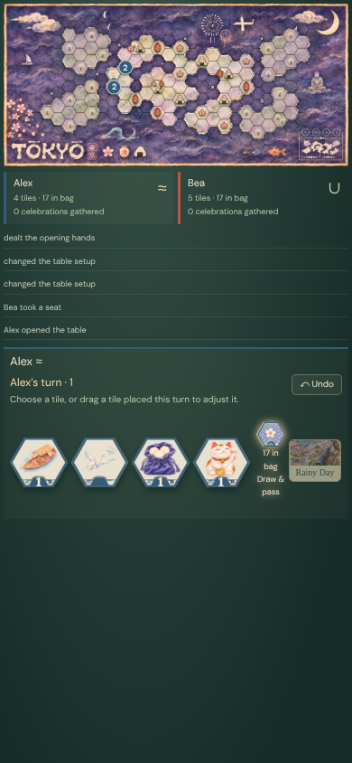

[Alex DOM evidence](../../../screenshots/viewport.spec.js/power-cards-and-undo-consent-fit-the-real-game-at-every-viewport-on-tokyo-014-alex-linux.dom.txt)

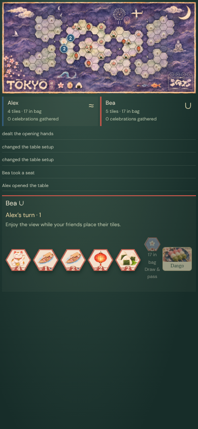

[Bea DOM evidence](../../../screenshots/viewport.spec.js/power-cards-and-undo-consent-fit-the-real-game-at-every-viewport-on-tokyo-014-bea-linux.dom.txt)

## 015. Alex: Draw new information and finish the turn

Viewport, scrolling, clipping and DOM assertions passed; actor and all observers captured.

[Alex DOM evidence](../../../screenshots/viewport.spec.js/power-cards-and-undo-consent-fit-the-real-game-at-every-viewport-on-tokyo-015-alex-linux.dom.txt)

[Bea DOM evidence](../../../screenshots/viewport.spec.js/power-cards-and-undo-consent-fit-the-real-game-at-every-viewport-on-tokyo-015-bea-linux.dom.txt)

## 016. Alex: Ask permission to undo the draw

Viewport, scrolling, clipping and DOM assertions passed; actor and all observers captured.

[Alex DOM evidence](../../../screenshots/viewport.spec.js/power-cards-and-undo-consent-fit-the-real-game-at-every-viewport-on-tokyo-016-alex-linux.dom.txt)

[Bea DOM evidence](../../../screenshots/viewport.spec.js/power-cards-and-undo-consent-fit-the-real-game-at-every-viewport-on-tokyo-016-bea-linux.dom.txt)

## 017. Bea: Keep every consent control over the map on iPad Air

Viewport, scrolling, clipping and DOM assertions passed; actor and all observers captured.

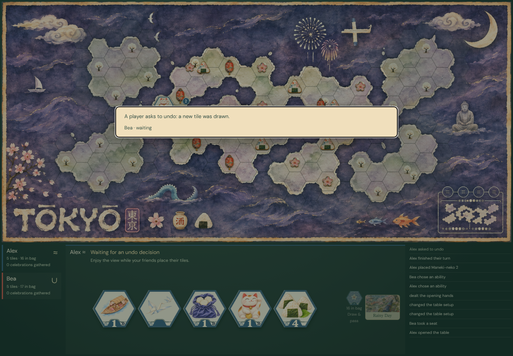

[Alex DOM evidence](../../../screenshots/viewport.spec.js/power-cards-and-undo-consent-fit-the-real-game-at-every-viewport-on-tokyo-017-alex-linux.dom.txt)

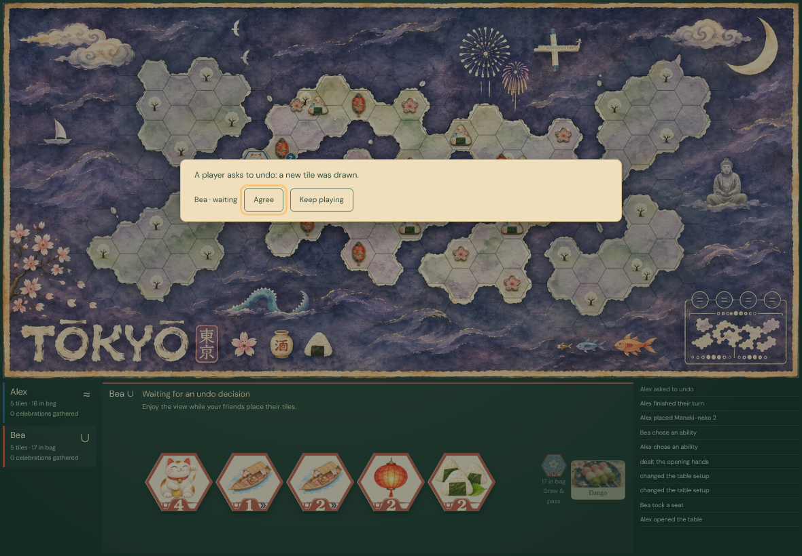

[Bea DOM evidence](../../../screenshots/viewport.spec.js/power-cards-and-undo-consent-fit-the-real-game-at-every-viewport-on-tokyo-017-bea-linux.dom.txt)

## 018. Bea: Keep every consent control over the map on iPad

Viewport, scrolling, clipping and DOM assertions passed; actor and all observers captured.

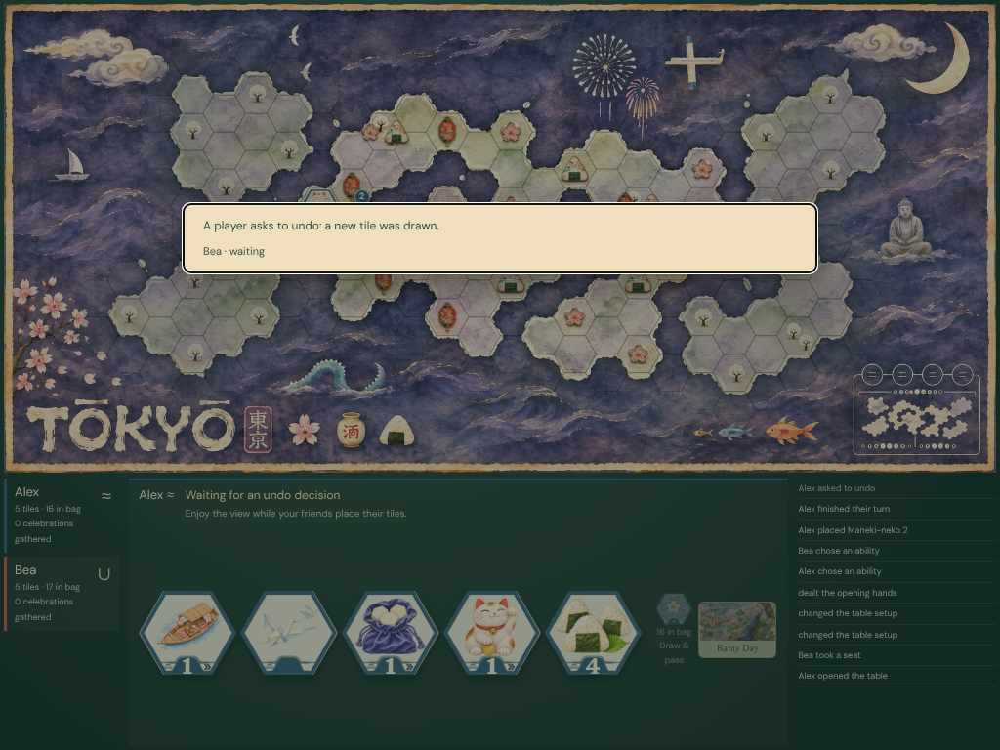

[Alex DOM evidence](../../../screenshots/viewport.spec.js/power-cards-and-undo-consent-fit-the-real-game-at-every-viewport-on-tokyo-018-alex-linux.dom.txt)

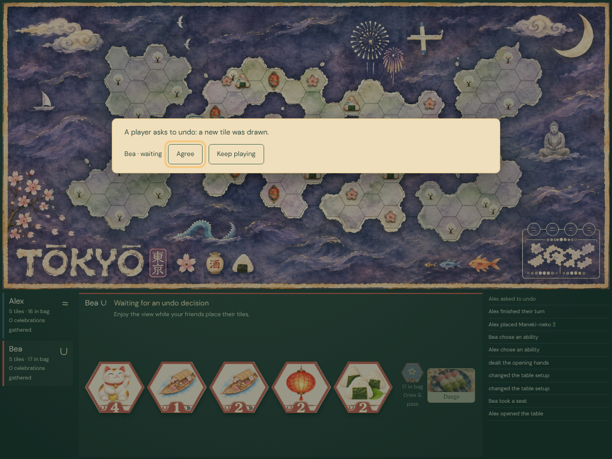

[Bea DOM evidence](../../../screenshots/viewport.spec.js/power-cards-and-undo-consent-fit-the-real-game-at-every-viewport-on-tokyo-018-bea-linux.dom.txt)

## 019. Bea: Keep every consent control over the map on desktop

Viewport, scrolling, clipping and DOM assertions passed; actor and all observers captured.

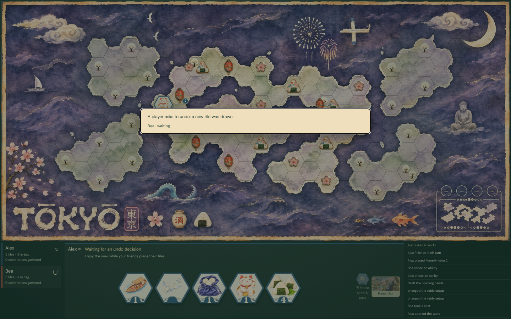

[Alex DOM evidence](../../../screenshots/viewport.spec.js/power-cards-and-undo-consent-fit-the-real-game-at-every-viewport-on-tokyo-019-alex-linux.dom.txt)

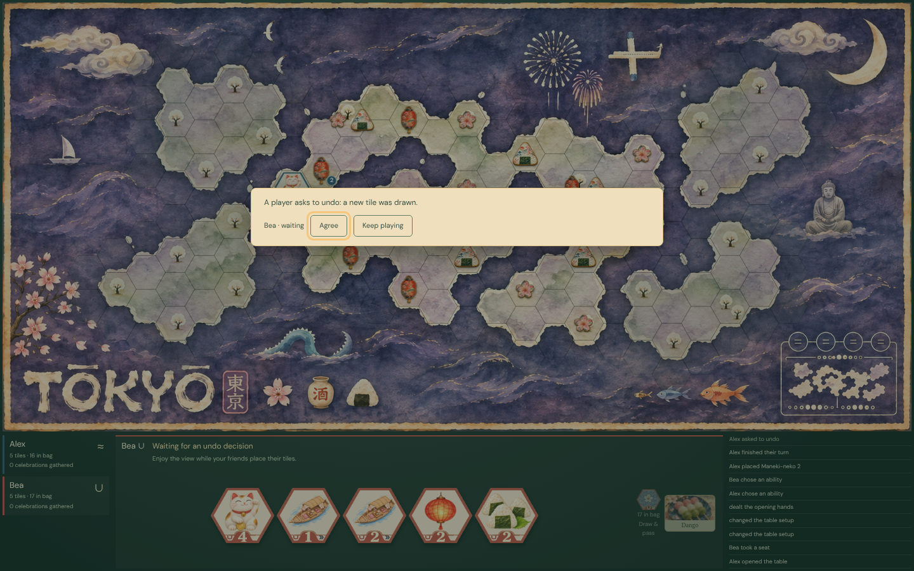

[Bea DOM evidence](../../../screenshots/viewport.spec.js/power-cards-and-undo-consent-fit-the-real-game-at-every-viewport-on-tokyo-019-bea-linux.dom.txt)

## 020. Bea: Keep every consent control over the map on short landscape

Viewport, scrolling, clipping and DOM assertions passed; actor and all observers captured.

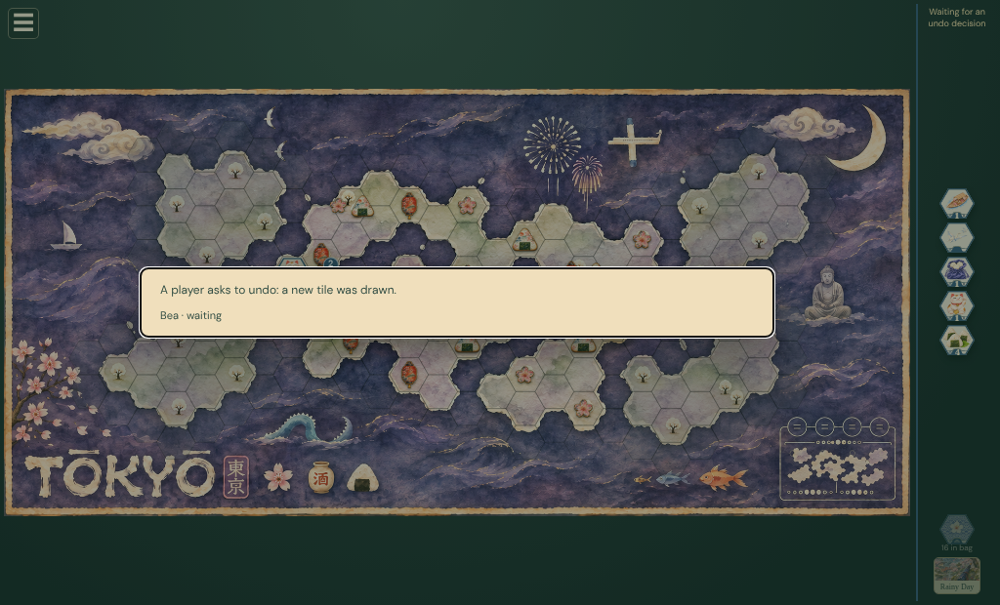

[Alex DOM evidence](../../../screenshots/viewport.spec.js/power-cards-and-undo-consent-fit-the-real-game-at-every-viewport-on-tokyo-020-alex-linux.dom.txt)

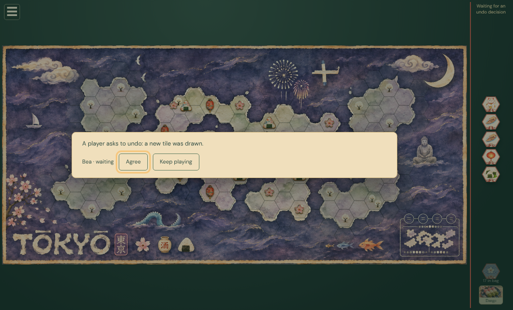

[Bea DOM evidence](../../../screenshots/viewport.spec.js/power-cards-and-undo-consent-fit-the-real-game-at-every-viewport-on-tokyo-020-bea-linux.dom.txt)

## 021. Bea: Keep every consent control over the map on phone landscape

Viewport, scrolling, clipping and DOM assertions passed; actor and all observers captured.

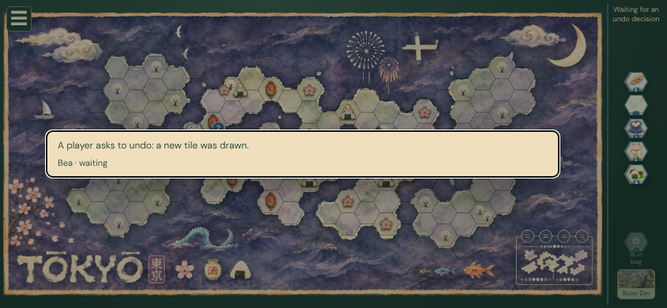

[Alex DOM evidence](../../../screenshots/viewport.spec.js/power-cards-and-undo-consent-fit-the-real-game-at-every-viewport-on-tokyo-021-alex-linux.dom.txt)

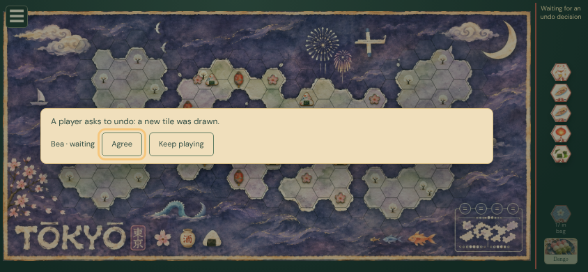

[Bea DOM evidence](../../../screenshots/viewport.spec.js/power-cards-and-undo-consent-fit-the-real-game-at-every-viewport-on-tokyo-021-bea-linux.dom.txt)

## 022. Bea: Keep every consent control over the map on compact phone landscape

Viewport, scrolling, clipping and DOM assertions passed; actor and all observers captured.

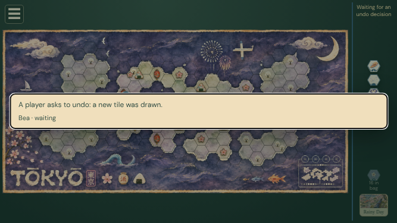

[Alex DOM evidence](../../../screenshots/viewport.spec.js/power-cards-and-undo-consent-fit-the-real-game-at-every-viewport-on-tokyo-022-alex-linux.dom.txt)

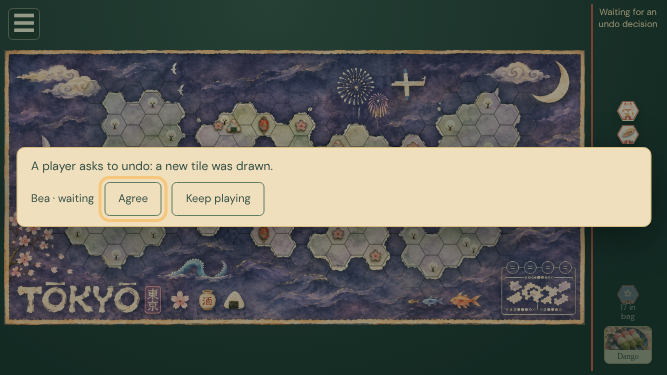

[Bea DOM evidence](../../../screenshots/viewport.spec.js/power-cards-and-undo-consent-fit-the-real-game-at-every-viewport-on-tokyo-022-bea-linux.dom.txt)

## 023. Bea: Keep every consent control over the map on small phone landscape

Viewport, scrolling, clipping and DOM assertions passed; actor and all observers captured.

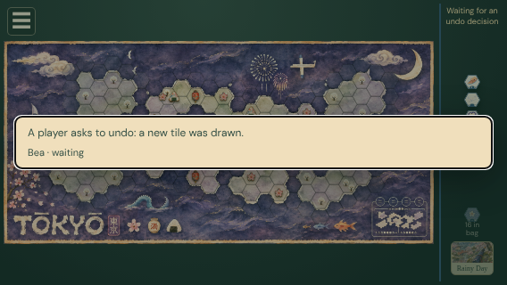

[Alex DOM evidence](../../../screenshots/viewport.spec.js/power-cards-and-undo-consent-fit-the-real-game-at-every-viewport-on-tokyo-023-alex-linux.dom.txt)

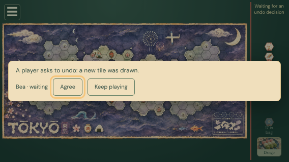

[Bea DOM evidence](../../../screenshots/viewport.spec.js/power-cards-and-undo-consent-fit-the-real-game-at-every-viewport-on-tokyo-023-bea-linux.dom.txt)

## 024. Bea: Keep every consent control over the map on phone portrait

Viewport, scrolling, clipping and DOM assertions passed; actor and all observers captured.

[Alex DOM evidence](../../../screenshots/viewport.spec.js/power-cards-and-undo-consent-fit-the-real-game-at-every-viewport-on-tokyo-024-alex-linux.dom.txt)

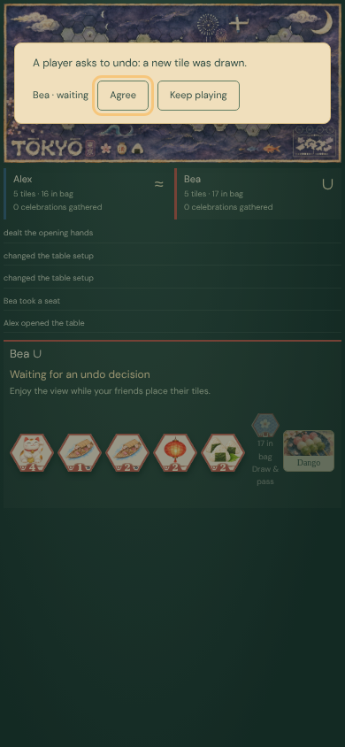

[Bea DOM evidence](../../../screenshots/viewport.spec.js/power-cards-and-undo-consent-fit-the-real-game-at-every-viewport-on-tokyo-024-bea-linux.dom.txt)

## 025. Bea: Decline from the visible dialog without scrolling

Viewport, scrolling, clipping and DOM assertions passed; actor and all observers captured.

[Alex DOM evidence](../../../screenshots/viewport.spec.js/power-cards-and-undo-consent-fit-the-real-game-at-every-viewport-on-tokyo-025-alex-linux.dom.txt)

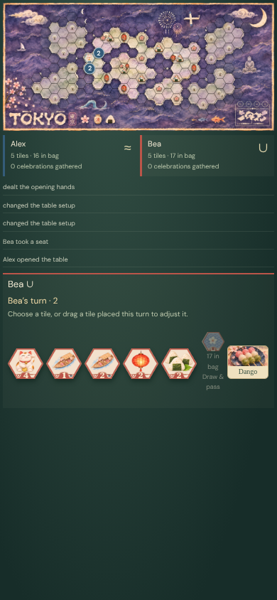

[Bea DOM evidence](../../../screenshots/viewport.spec.js/power-cards-and-undo-consent-fit-the-real-game-at-every-viewport-on-tokyo-025-bea-linux.dom.txt)

## 026. Alex: Request consent again through the player mat

Viewport, scrolling, clipping and DOM assertions passed; actor and all observers captured.

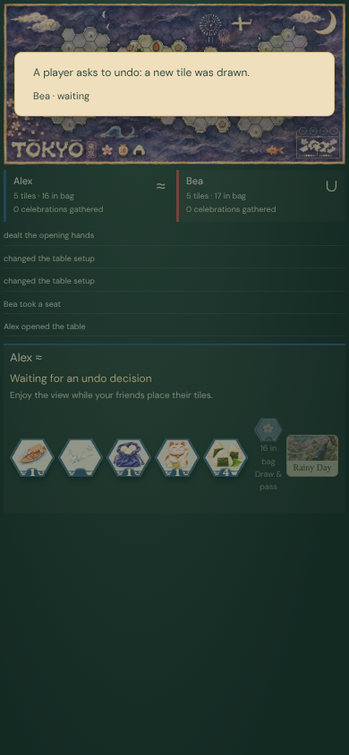

[Alex DOM evidence](../../../screenshots/viewport.spec.js/power-cards-and-undo-consent-fit-the-real-game-at-every-viewport-on-tokyo-026-alex-linux.dom.txt)

[Bea DOM evidence](../../../screenshots/viewport.spec.js/power-cards-and-undo-consent-fit-the-real-game-at-every-viewport-on-tokyo-026-bea-linux.dom.txt)

## 027. Bea: Agree and replay the actual undo event

Viewport, scrolling, clipping and DOM assertions passed; actor and all observers captured.

[Alex DOM evidence](../../../screenshots/viewport.spec.js/power-cards-and-undo-consent-fit-the-real-game-at-every-viewport-on-tokyo-027-alex-linux.dom.txt)

[Bea DOM evidence](../../../screenshots/viewport.spec.js/power-cards-and-undo-consent-fit-the-real-game-at-every-viewport-on-tokyo-027-bea-linux.dom.txt)
