# Special tile motions through real events

Real UI → authenticated Firestore transaction → immutable event → deterministic replay → every observer. Zero pixel tolerance; every decoded RGBA byte and the accessible DOM are compared. No game-state injection or outcome fixtures.

## 000. Table: Open an advanced picnic table and an independent observer

Viewport, scrolling, clipping and DOM assertions passed; actor and all observers captured.

[Table DOM evidence](../../../screenshots/special-motion.spec.js/real-special-tiles-share-placement-holding-cover-copy-and-flip-motion-000-table-linux.dom.txt)

[Observer DOM evidence](../../../screenshots/special-motion.spec.js/real-special-tiles-share-placement-holding-cover-copy-and-flip-motion-000-observer-linux.dom.txt)

## 001. Table: Tap the South-west seat

Viewport, scrolling, clipping and DOM assertions passed; actor and all observers captured.

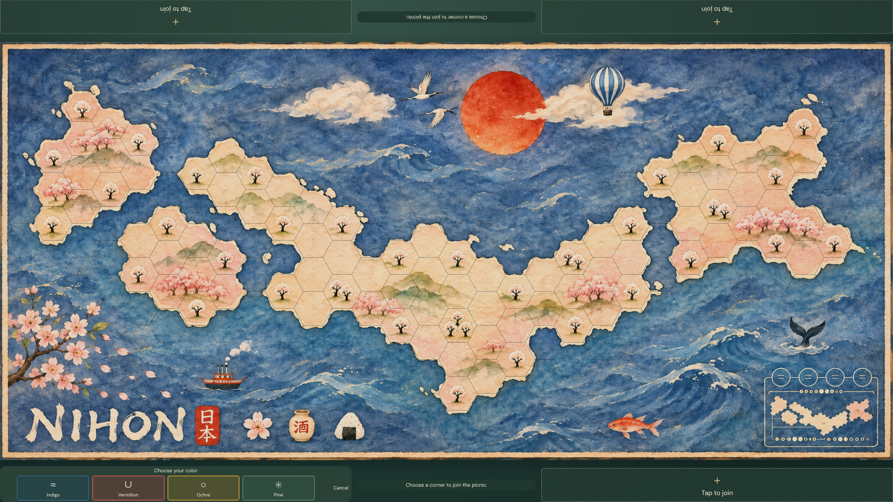

[Table DOM evidence](../../../screenshots/special-motion.spec.js/real-special-tiles-share-placement-holding-cover-copy-and-flip-motion-001-table-linux.dom.txt)

[Observer DOM evidence](../../../screenshots/special-motion.spec.js/real-special-tiles-share-placement-holding-cover-copy-and-flip-motion-001-observer-linux.dom.txt)

## 002. Table: Join as Indigo

Viewport, scrolling, clipping and DOM assertions passed; actor and all observers captured.

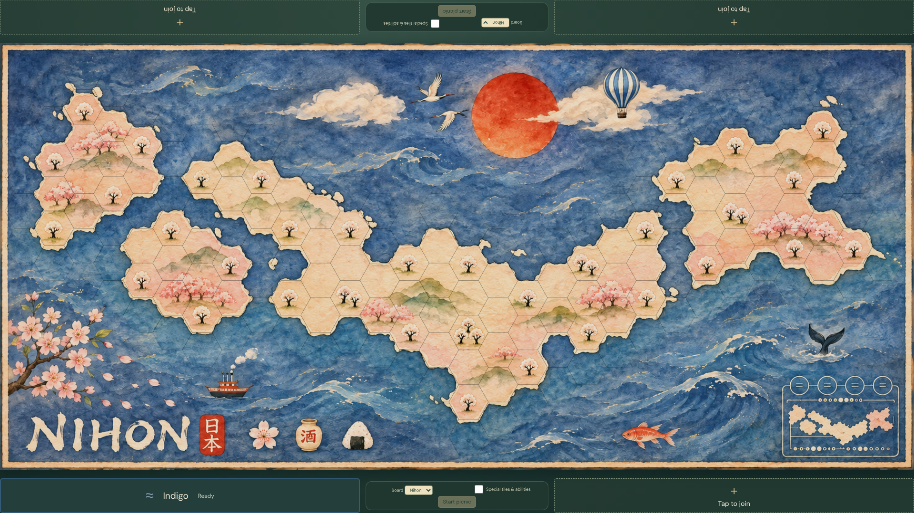

[Table DOM evidence](../../../screenshots/special-motion.spec.js/real-special-tiles-share-placement-holding-cover-copy-and-flip-motion-002-table-linux.dom.txt)

[Observer DOM evidence](../../../screenshots/special-motion.spec.js/real-special-tiles-share-placement-holding-cover-copy-and-flip-motion-002-observer-linux.dom.txt)

## 003. Table: Tap the North-east seat

Viewport, scrolling, clipping and DOM assertions passed; actor and all observers captured.

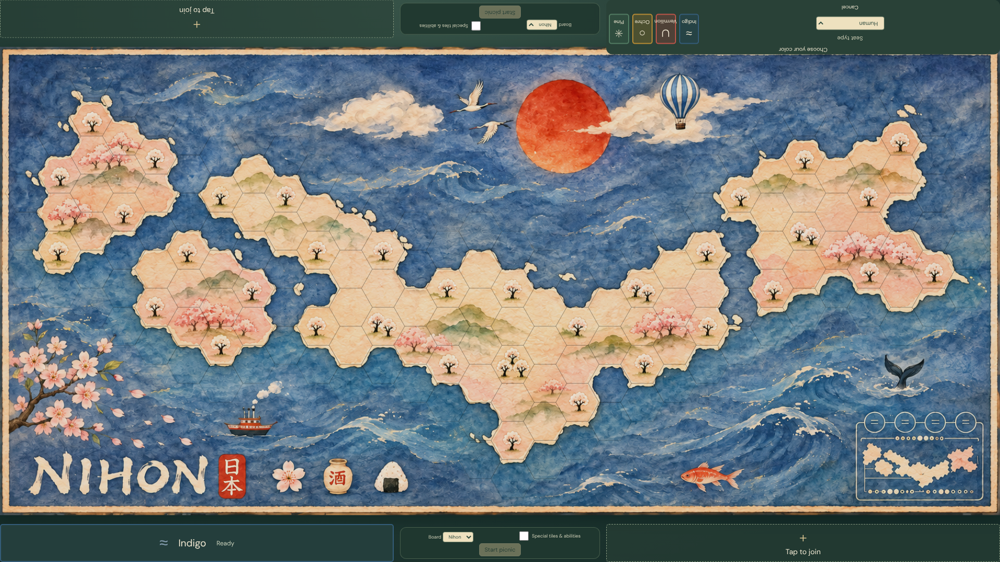

[Table DOM evidence](../../../screenshots/special-motion.spec.js/real-special-tiles-share-placement-holding-cover-copy-and-flip-motion-003-table-linux.dom.txt)

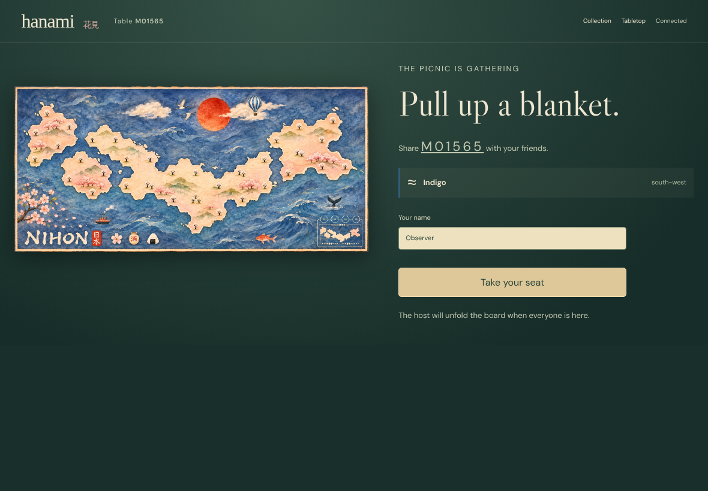

[Observer DOM evidence](../../../screenshots/special-motion.spec.js/real-special-tiles-share-placement-holding-cover-copy-and-flip-motion-003-observer-linux.dom.txt)

## 004. Table: Join as Pine

Viewport, scrolling, clipping and DOM assertions passed; actor and all observers captured.

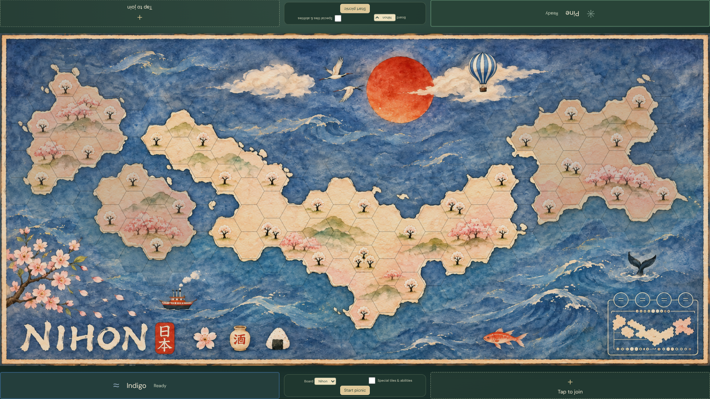

[Table DOM evidence](../../../screenshots/special-motion.spec.js/real-special-tiles-share-placement-holding-cover-copy-and-flip-motion-004-table-linux.dom.txt)

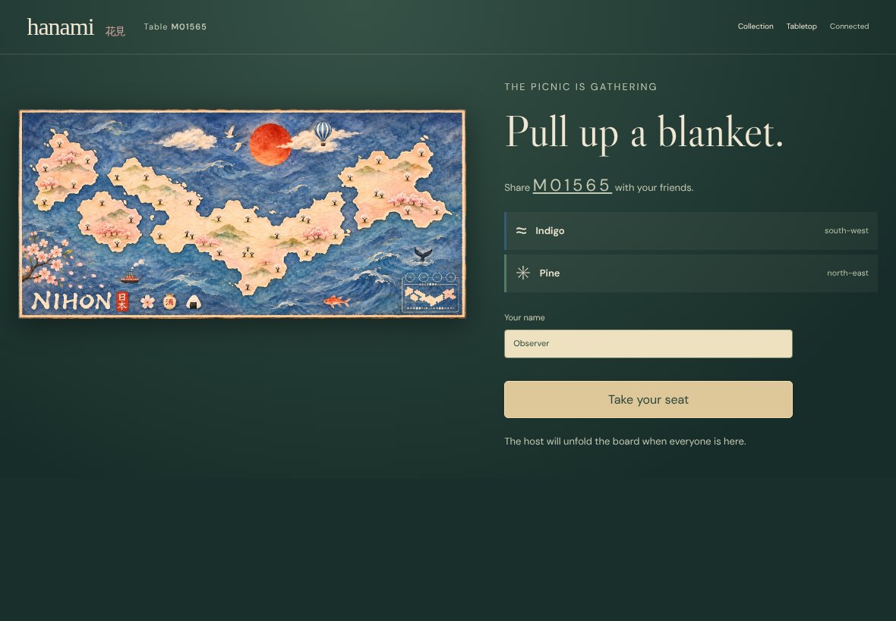

[Observer DOM evidence](../../../screenshots/special-motion.spec.js/real-special-tiles-share-placement-holding-cover-copy-and-flip-motion-004-observer-linux.dom.txt)

## 005. Table: Enable the real special tile set

Viewport, scrolling, clipping and DOM assertions passed; actor and all observers captured.

[Table DOM evidence](../../../screenshots/special-motion.spec.js/real-special-tiles-share-placement-holding-cover-copy-and-flip-motion-005-table-linux.dom.txt)

[Observer DOM evidence](../../../screenshots/special-motion.spec.js/real-special-tiles-share-placement-holding-cover-copy-and-flip-motion-005-observer-linux.dom.txt)

## 006. Table: Deal the production deck and ability choices

Viewport, scrolling, clipping and DOM assertions passed; actor and all observers captured.

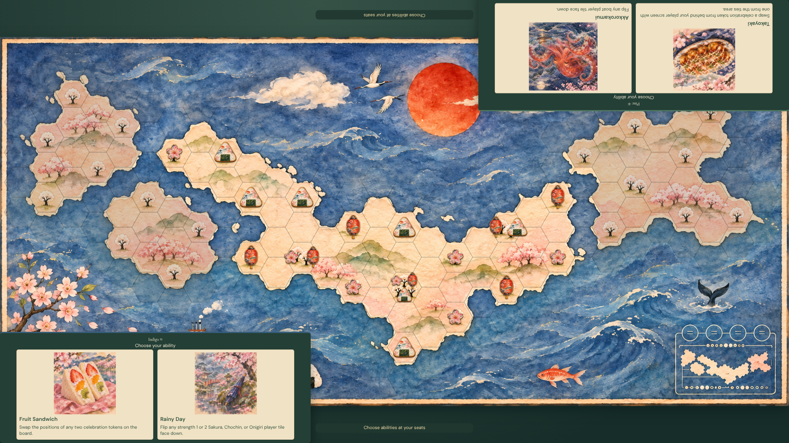

[Table DOM evidence](../../../screenshots/special-motion.spec.js/real-special-tiles-share-placement-holding-cover-copy-and-flip-motion-006-table-linux.dom.txt)

[Observer DOM evidence](../../../screenshots/special-motion.spec.js/real-special-tiles-share-placement-holding-cover-copy-and-flip-motion-006-observer-linux.dom.txt)

## 007. Table: Indigo chooses Rainy Day

Viewport, scrolling, clipping and DOM assertions passed; actor and all observers captured.

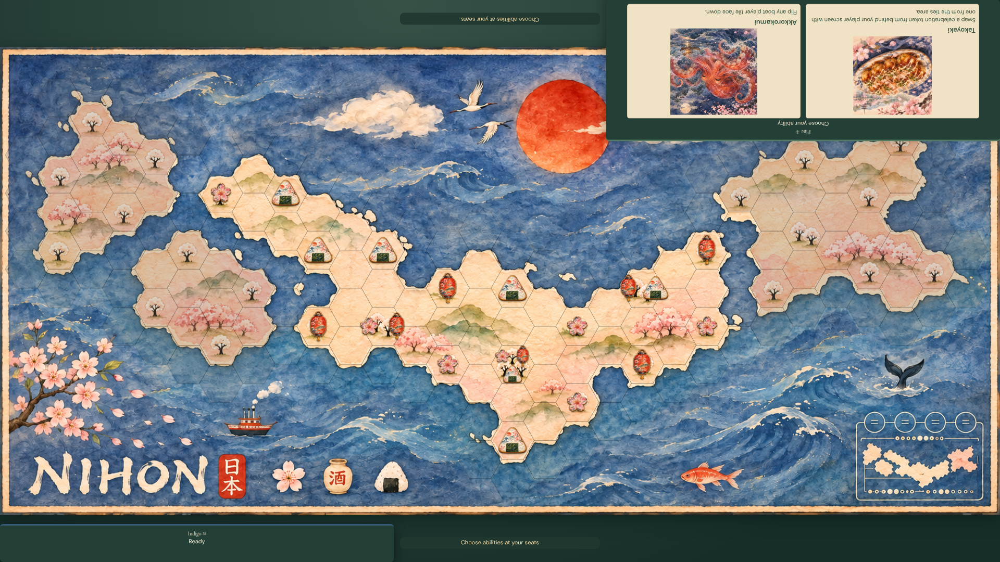

[Table DOM evidence](../../../screenshots/special-motion.spec.js/real-special-tiles-share-placement-holding-cover-copy-and-flip-motion-007-table-linux.dom.txt)

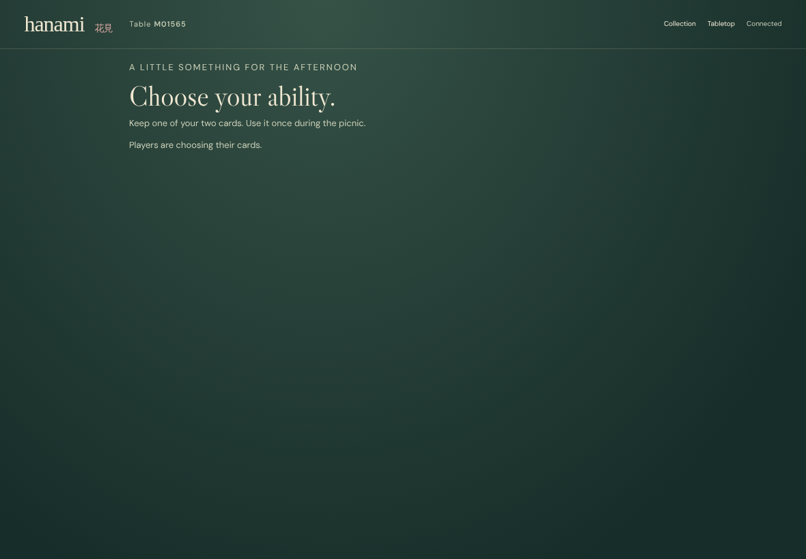

[Observer DOM evidence](../../../screenshots/special-motion.spec.js/real-special-tiles-share-placement-holding-cover-copy-and-flip-motion-007-observer-linux.dom.txt)

## 008. Table: Pine chooses Akkorokamui

Viewport, scrolling, clipping and DOM assertions passed; actor and all observers captured.

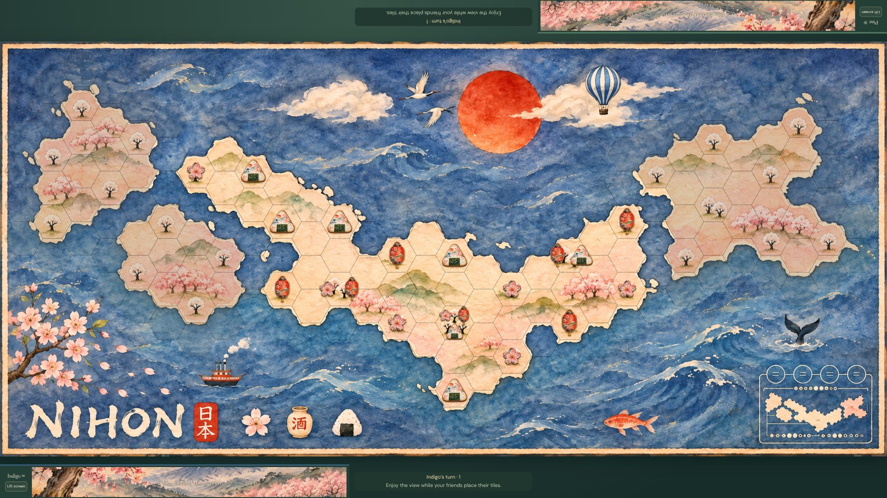

[Table DOM evidence](../../../screenshots/special-motion.spec.js/real-special-tiles-share-placement-holding-cover-copy-and-flip-motion-008-table-linux.dom.txt)

[Observer DOM evidence](../../../screenshots/special-motion.spec.js/real-special-tiles-share-placement-holding-cover-copy-and-flip-motion-008-observer-linux.dom.txt)

## 009. Table: Lift Indigo’s screen to inspect the actual dealt tiles

Viewport, scrolling, clipping and DOM assertions passed; actor and all observers captured.

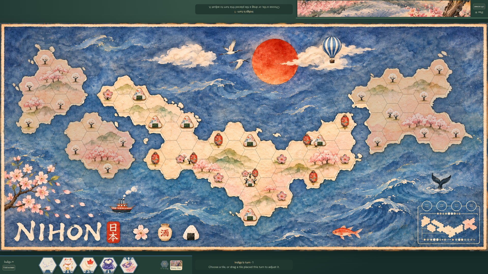

[Table DOM evidence](../../../screenshots/special-motion.spec.js/real-special-tiles-share-placement-holding-cover-copy-and-flip-motion-009-table-linux.dom.txt)

[Observer DOM evidence](../../../screenshots/special-motion.spec.js/real-special-tiles-share-placement-holding-cover-copy-and-flip-motion-009-observer-linux.dom.txt)

## 010. Table: Indigo selects draw

Viewport, scrolling, clipping and DOM assertions passed; actor and all observers captured.

[Table DOM evidence](../../../screenshots/special-motion.spec.js/real-special-tiles-share-placement-holding-cover-copy-and-flip-motion-010-table-linux.dom.txt)

[Observer DOM evidence](../../../screenshots/special-motion.spec.js/real-special-tiles-share-placement-holding-cover-copy-and-flip-motion-010-observer-linux.dom.txt)

## 011. Table: Hover Draw over land to preview public influence without an event

Viewport, scrolling, clipping and DOM assertions passed; actor and all observers captured.

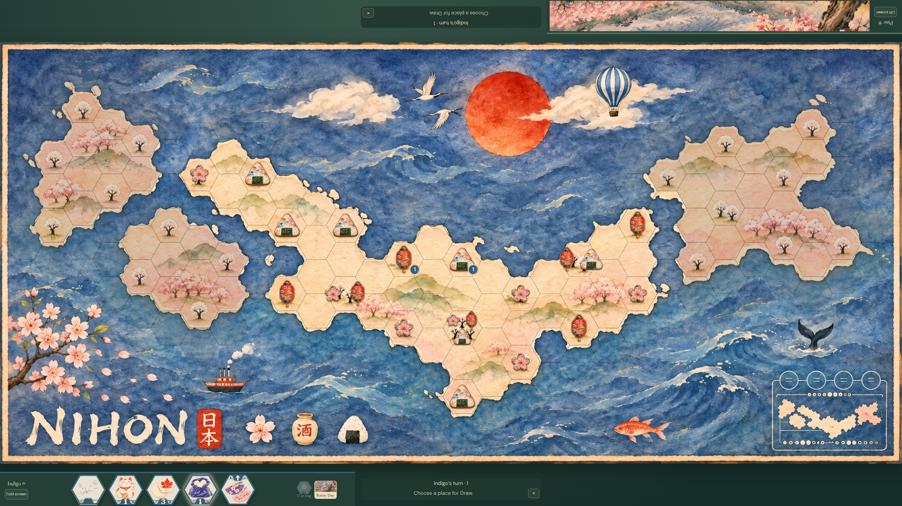

[Table DOM evidence](../../../screenshots/special-motion.spec.js/real-special-tiles-share-placement-holding-cover-copy-and-flip-motion-011-table-linux.dom.txt)

[Observer DOM evidence](../../../screenshots/special-motion.spec.js/real-special-tiles-share-placement-holding-cover-copy-and-flip-motion-011-observer-linux.dom.txt)

## 012. Table: Move away to cancel the influence preview

Viewport, scrolling, clipping and DOM assertions passed; actor and all observers captured.

[Table DOM evidence](../../../screenshots/special-motion.spec.js/real-special-tiles-share-placement-holding-cover-copy-and-flip-motion-012-table-linux.dom.txt)

[Observer DOM evidence](../../../screenshots/special-motion.spec.js/real-special-tiles-share-placement-holding-cover-copy-and-flip-motion-012-observer-linux.dom.txt)

## 013. Table: Place draw at 14:6

Viewport, scrolling, clipping and DOM assertions passed; actor and all observers captured.

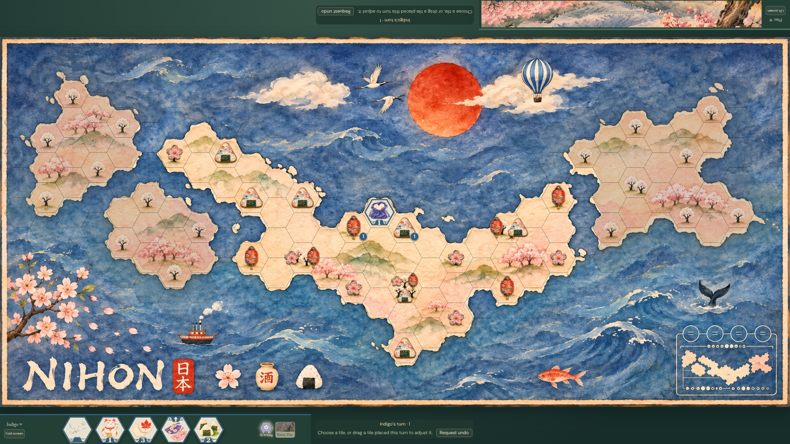

[Table DOM evidence](../../../screenshots/special-motion.spec.js/real-special-tiles-share-placement-holding-cover-copy-and-flip-motion-013-table-linux.dom.txt)

[Observer DOM evidence](../../../screenshots/special-motion.spec.js/real-special-tiles-share-placement-holding-cover-copy-and-flip-motion-013-observer-linux.dom.txt)

## 014. Table: Indigo selects onigiri-2

Viewport, scrolling, clipping and DOM assertions passed; actor and all observers captured.

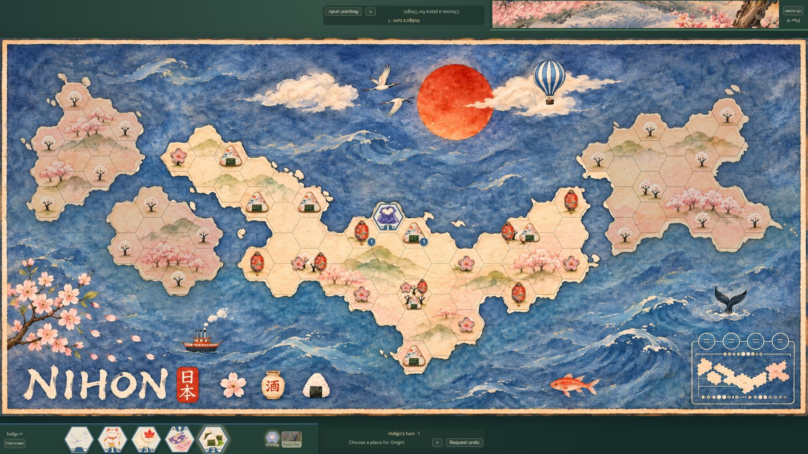

[Table DOM evidence](../../../screenshots/special-motion.spec.js/real-special-tiles-share-placement-holding-cover-copy-and-flip-motion-014-table-linux.dom.txt)

[Observer DOM evidence](../../../screenshots/special-motion.spec.js/real-special-tiles-share-placement-holding-cover-copy-and-flip-motion-014-observer-linux.dom.txt)

## 015. Table: Place onigiri-2 at 15:7

Viewport, scrolling, clipping and DOM assertions passed; actor and all observers captured.

[Table DOM evidence](../../../screenshots/special-motion.spec.js/real-special-tiles-share-placement-holding-cover-copy-and-flip-motion-015-table-linux.dom.txt)

[Observer DOM evidence](../../../screenshots/special-motion.spec.js/real-special-tiles-share-placement-holding-cover-copy-and-flip-motion-015-observer-linux.dom.txt)

## 016. Table: Indigo refills and passes to Pine

Viewport, scrolling, clipping and DOM assertions passed; actor and all observers captured.

[Table DOM evidence](../../../screenshots/special-motion.spec.js/real-special-tiles-share-placement-holding-cover-copy-and-flip-motion-016-table-linux.dom.txt)

[Observer DOM evidence](../../../screenshots/special-motion.spec.js/real-special-tiles-share-placement-holding-cover-copy-and-flip-motion-016-observer-linux.dom.txt)

## 017. Table: Lift Pine’s north-facing hand

Viewport, scrolling, clipping and DOM assertions passed; actor and all observers captured.

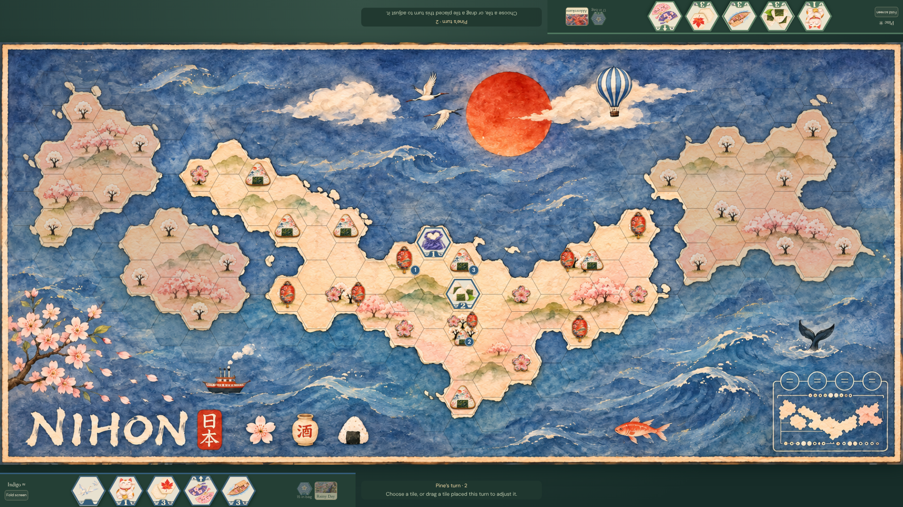

[Table DOM evidence](../../../screenshots/special-motion.spec.js/real-special-tiles-share-placement-holding-cover-copy-and-flip-motion-017-table-linux.dom.txt)

[Observer DOM evidence](../../../screenshots/special-motion.spec.js/real-special-tiles-share-placement-holding-cover-copy-and-flip-motion-017-observer-linux.dom.txt)

## 018. Table: Pine selects boat-3

Viewport, scrolling, clipping and DOM assertions passed; actor and all observers captured.

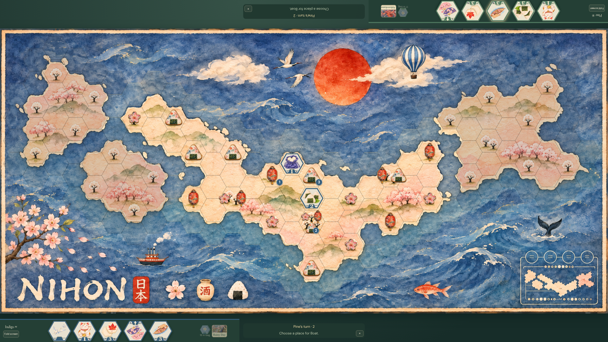

[Table DOM evidence](../../../screenshots/special-motion.spec.js/real-special-tiles-share-placement-holding-cover-copy-and-flip-motion-018-table-linux.dom.txt)

[Observer DOM evidence](../../../screenshots/special-motion.spec.js/real-special-tiles-share-placement-holding-cover-copy-and-flip-motion-018-observer-linux.dom.txt)

## 019. Table: Place boat-3 at 15:5

Viewport, scrolling, clipping and DOM assertions passed; actor and all observers captured.

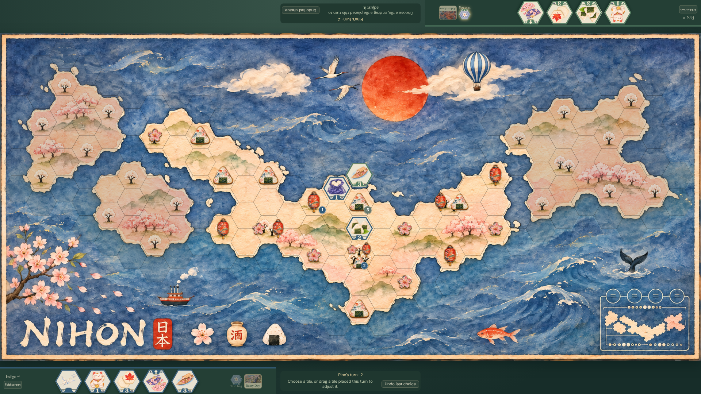

[Table DOM evidence](../../../screenshots/special-motion.spec.js/real-special-tiles-share-placement-holding-cover-copy-and-flip-motion-019-table-linux.dom.txt)

[Observer DOM evidence](../../../screenshots/special-motion.spec.js/real-special-tiles-share-placement-holding-cover-copy-and-flip-motion-019-observer-linux.dom.txt)

## 020. Table: Pine selects cat-0

Viewport, scrolling, clipping and DOM assertions passed; actor and all observers captured.

[Table DOM evidence](../../../screenshots/special-motion.spec.js/real-special-tiles-share-placement-holding-cover-copy-and-flip-motion-020-table-linux.dom.txt)

[Observer DOM evidence](../../../screenshots/special-motion.spec.js/real-special-tiles-share-placement-holding-cover-copy-and-flip-motion-020-observer-linux.dom.txt)

## 021. Table: Place cat-0 at 14:7

Viewport, scrolling, clipping and DOM assertions passed; actor and all observers captured.

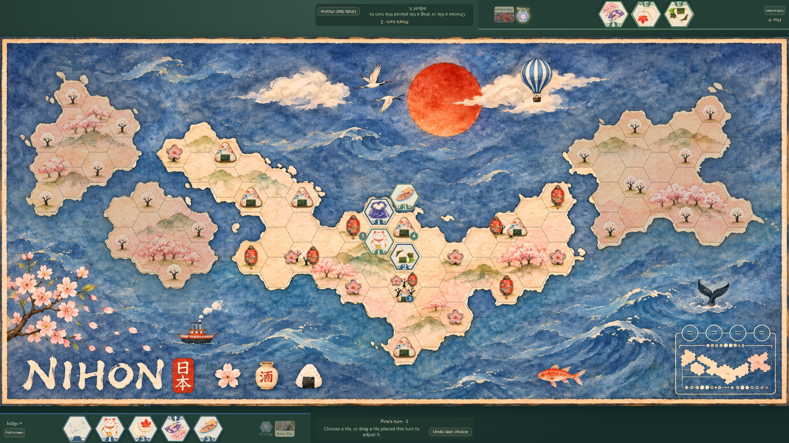

[Table DOM evidence](../../../screenshots/special-motion.spec.js/real-special-tiles-share-placement-holding-cover-copy-and-flip-motion-021-table-linux.dom.txt)

[Observer DOM evidence](../../../screenshots/special-motion.spec.js/real-special-tiles-share-placement-holding-cover-copy-and-flip-motion-021-observer-linux.dom.txt)

## 022. Table: Pine refills and passes to Indigo

Viewport, scrolling, clipping and DOM assertions passed; actor and all observers captured.

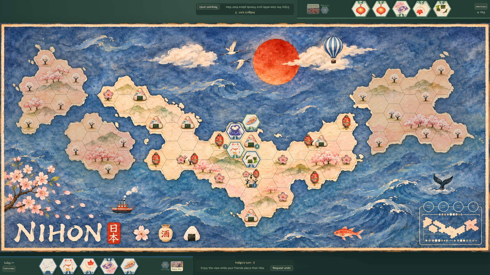

[Table DOM evidence](../../../screenshots/special-motion.spec.js/real-special-tiles-share-placement-holding-cover-copy-and-flip-motion-022-table-linux.dom.txt)

[Observer DOM evidence](../../../screenshots/special-motion.spec.js/real-special-tiles-share-placement-holding-cover-copy-and-flip-motion-022-observer-linux.dom.txt)

## 023. Table: Indigo selects copy

Viewport, scrolling, clipping and DOM assertions passed; actor and all observers captured.

[Table DOM evidence](../../../screenshots/special-motion.spec.js/real-special-tiles-share-placement-holding-cover-copy-and-flip-motion-023-table-linux.dom.txt)

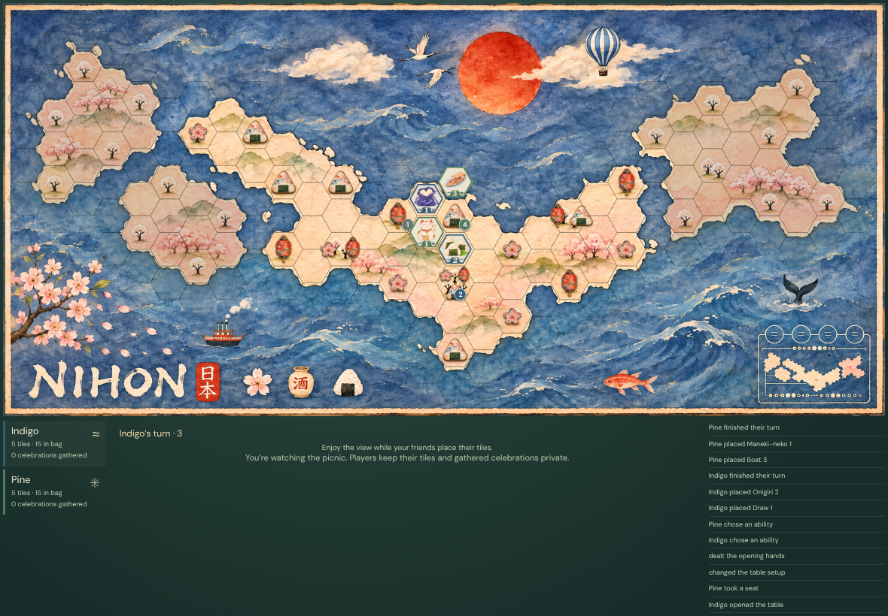

[Observer DOM evidence](../../../screenshots/special-motion.spec.js/real-special-tiles-share-placement-holding-cover-copy-and-flip-motion-023-observer-linux.dom.txt)

## 024. Table: Point Copy north-east

Viewport, scrolling, clipping and DOM assertions passed; actor and all observers captured.

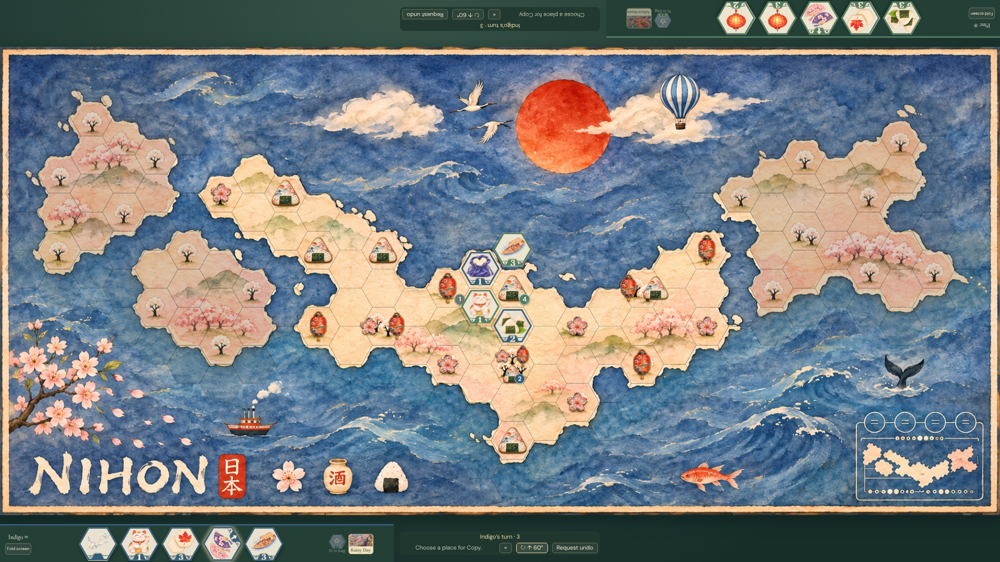

[Table DOM evidence](../../../screenshots/special-motion.spec.js/real-special-tiles-share-placement-holding-cover-copy-and-flip-motion-024-table-linux.dom.txt)

[Observer DOM evidence](../../../screenshots/special-motion.spec.js/real-special-tiles-share-placement-holding-cover-copy-and-flip-motion-024-observer-linux.dom.txt)

## 025. Table: Point Copy south-east

Viewport, scrolling, clipping and DOM assertions passed; actor and all observers captured.

[Table DOM evidence](../../../screenshots/special-motion.spec.js/real-special-tiles-share-placement-holding-cover-copy-and-flip-motion-025-table-linux.dom.txt)

[Observer DOM evidence](../../../screenshots/special-motion.spec.js/real-special-tiles-share-placement-holding-cover-copy-and-flip-motion-025-observer-linux.dom.txt)

## 026. Table: Point Copy south

Viewport, scrolling, clipping and DOM assertions passed; actor and all observers captured.

[Table DOM evidence](../../../screenshots/special-motion.spec.js/real-special-tiles-share-placement-holding-cover-copy-and-flip-motion-026-table-linux.dom.txt)

[Observer DOM evidence](../../../screenshots/special-motion.spec.js/real-special-tiles-share-placement-holding-cover-copy-and-flip-motion-026-observer-linux.dom.txt)

## 027. Table: Drag the selected Copy and turn it with R before landing

Viewport, scrolling, clipping and DOM assertions passed; actor and all observers captured.

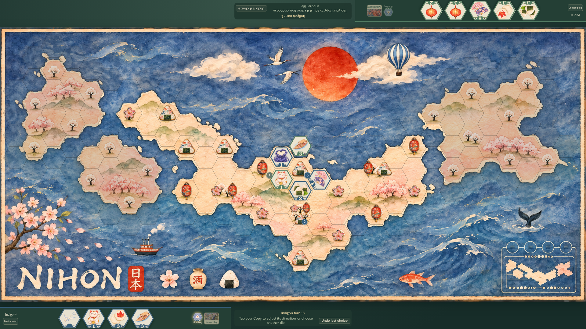

[Table DOM evidence](../../../screenshots/special-motion.spec.js/real-special-tiles-share-placement-holding-cover-copy-and-flip-motion-027-table-linux.dom.txt)

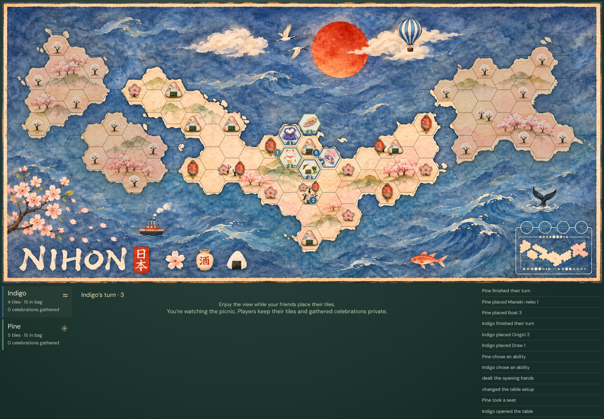

[Observer DOM evidence](../../../screenshots/special-motion.spec.js/real-special-tiles-share-placement-holding-cover-copy-and-flip-motion-027-observer-linux.dom.txt)

## 028. Table: Adjust the landed Copy before finishing the turn

Viewport, scrolling, clipping and DOM assertions passed; actor and all observers captured.

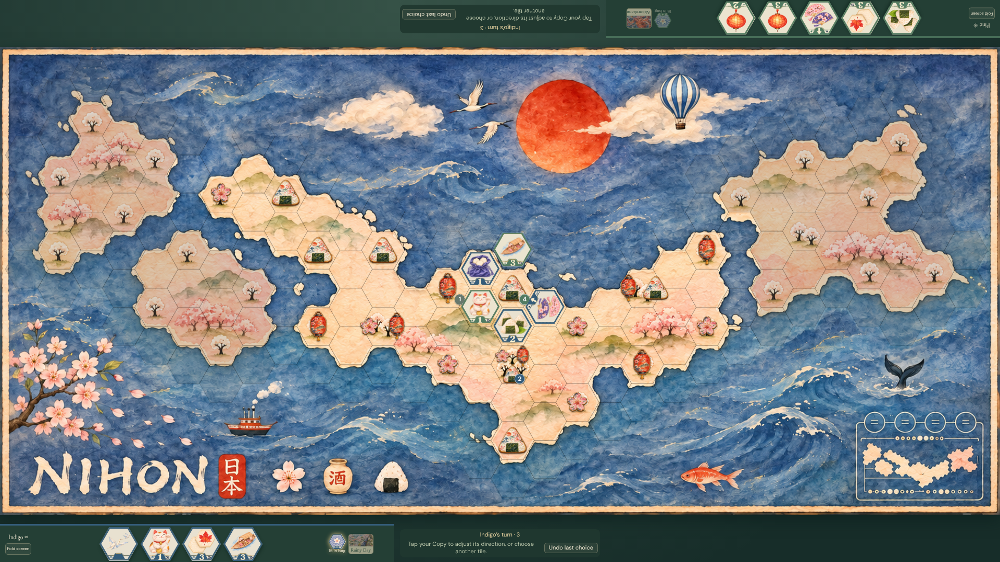

[Table DOM evidence](../../../screenshots/special-motion.spec.js/real-special-tiles-share-placement-holding-cover-copy-and-flip-motion-028-table-linux.dom.txt)

[Observer DOM evidence](../../../screenshots/special-motion.spec.js/real-special-tiles-share-placement-holding-cover-copy-and-flip-motion-028-observer-linux.dom.txt)

## 029. Table: Copy used the normal placement, so Move must wait for another turn

Viewport, scrolling, clipping and DOM assertions passed; actor and all observers captured.

[Table DOM evidence](../../../screenshots/special-motion.spec.js/real-special-tiles-share-placement-holding-cover-copy-and-flip-motion-029-table-linux.dom.txt)

[Observer DOM evidence](../../../screenshots/special-motion.spec.js/real-special-tiles-share-placement-holding-cover-copy-and-flip-motion-029-observer-linux.dom.txt)

## 030. Table: Indigo refills and passes to Pine

Viewport, scrolling, clipping and DOM assertions passed; actor and all observers captured.

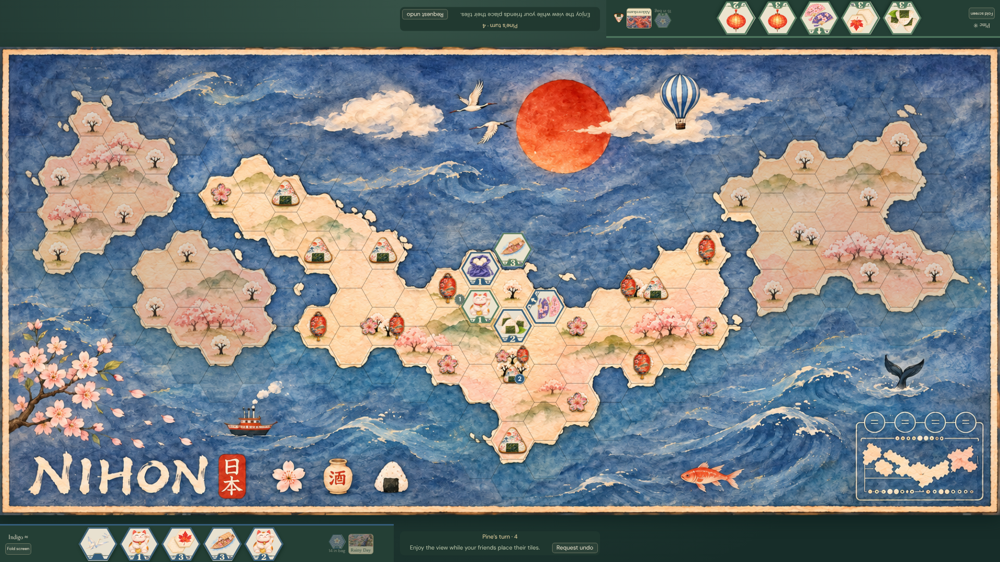

[Table DOM evidence](../../../screenshots/special-motion.spec.js/real-special-tiles-share-placement-holding-cover-copy-and-flip-motion-030-table-linux.dom.txt)

[Observer DOM evidence](../../../screenshots/special-motion.spec.js/real-special-tiles-share-placement-holding-cover-copy-and-flip-motion-030-observer-linux.dom.txt)

## 031. Table: Pine selects chochin-3

Viewport, scrolling, clipping and DOM assertions passed; actor and all observers captured.

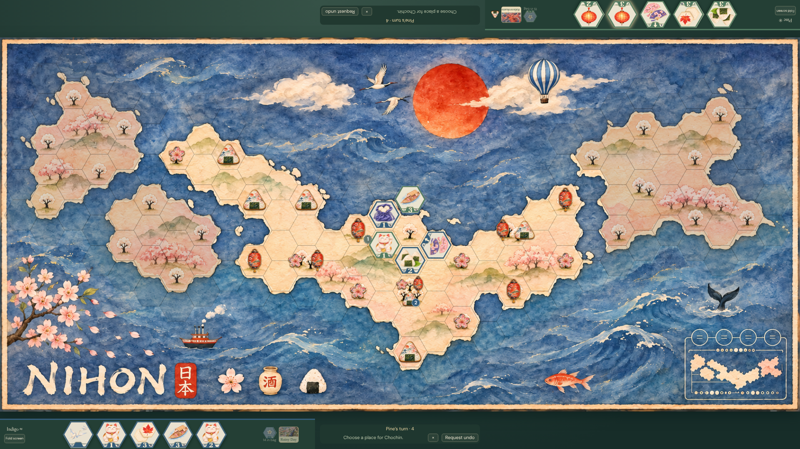

[Table DOM evidence](../../../screenshots/special-motion.spec.js/real-special-tiles-share-placement-holding-cover-copy-and-flip-motion-031-table-linux.dom.txt)

[Observer DOM evidence](../../../screenshots/special-motion.spec.js/real-special-tiles-share-placement-holding-cover-copy-and-flip-motion-031-observer-linux.dom.txt)

## 032. Table: Place chochin-3 at 7:4

Viewport, scrolling, clipping and DOM assertions passed; actor and all observers captured.

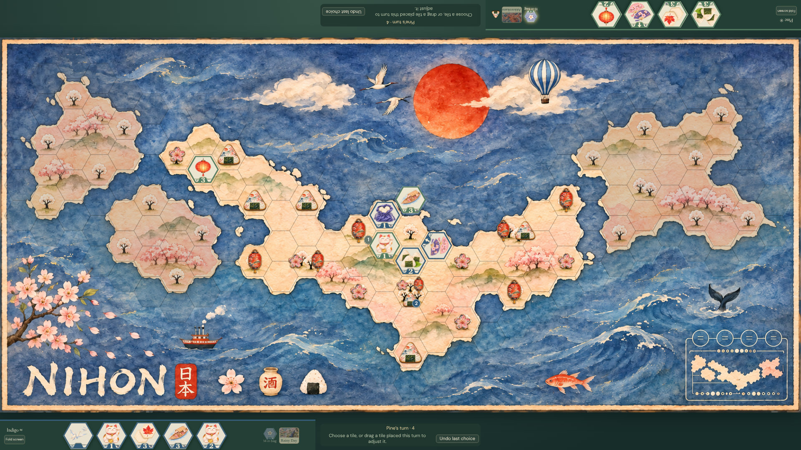

[Table DOM evidence](../../../screenshots/special-motion.spec.js/real-special-tiles-share-placement-holding-cover-copy-and-flip-motion-032-table-linux.dom.txt)

[Observer DOM evidence](../../../screenshots/special-motion.spec.js/real-special-tiles-share-placement-holding-cover-copy-and-flip-motion-032-observer-linux.dom.txt)

## 033. Table: Pine refills and passes to Indigo

Viewport, scrolling, clipping and DOM assertions passed; actor and all observers captured.

[Table DOM evidence](../../../screenshots/special-motion.spec.js/real-special-tiles-share-placement-holding-cover-copy-and-flip-motion-033-table-linux.dom.txt)

[Observer DOM evidence](../../../screenshots/special-motion.spec.js/real-special-tiles-share-placement-holding-cover-copy-and-flip-motion-033-observer-linux.dom.txt)

## 034. Table: Indigo selects move

Viewport, scrolling, clipping and DOM assertions passed; actor and all observers captured.

[Table DOM evidence](../../../screenshots/special-motion.spec.js/real-special-tiles-share-placement-holding-cover-copy-and-flip-motion-034-table-linux.dom.txt)

[Observer DOM evidence](../../../screenshots/special-motion.spec.js/real-special-tiles-share-placement-holding-cover-copy-and-flip-motion-034-observer-linux.dom.txt)

## 035. Table: Move replaces Copy and lifts it into the holding spot

Viewport, scrolling, clipping and DOM assertions passed; actor and all observers captured.

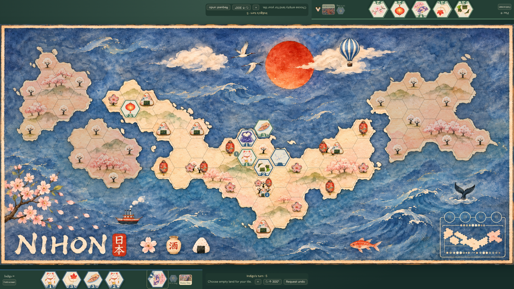

[Table DOM evidence](../../../screenshots/special-motion.spec.js/real-special-tiles-share-placement-holding-cover-copy-and-flip-motion-035-table-linux.dom.txt)

[Observer DOM evidence](../../../screenshots/special-motion.spec.js/real-special-tiles-share-placement-holding-cover-copy-and-flip-motion-035-observer-linux.dom.txt)

## 036. Table: Rotate the held Copy across north using the direction control

Viewport, scrolling, clipping and DOM assertions passed; actor and all observers captured.

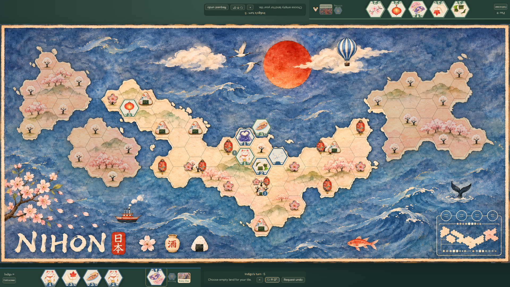

[Table DOM evidence](../../../screenshots/special-motion.spec.js/real-special-tiles-share-placement-holding-cover-copy-and-flip-motion-036-table-linux.dom.txt)

[Observer DOM evidence](../../../screenshots/special-motion.spec.js/real-special-tiles-share-placement-holding-cover-copy-and-flip-motion-036-observer-linux.dom.txt)

## 037. Table: Tap the held Copy to turn it again

Viewport, scrolling, clipping and DOM assertions passed; actor and all observers captured.

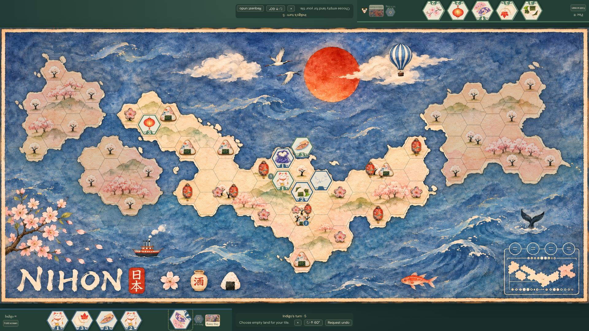

[Table DOM evidence](../../../screenshots/special-motion.spec.js/real-special-tiles-share-placement-holding-cover-copy-and-flip-motion-037-table-linux.dom.txt)

[Observer DOM evidence](../../../screenshots/special-motion.spec.js/real-special-tiles-share-placement-holding-cover-copy-and-flip-motion-037-observer-linux.dom.txt)

## 038. Table: Fly Copy to its new destination with the chosen direction

Viewport, scrolling, clipping and DOM assertions passed; actor and all observers captured.

[Table DOM evidence](../../../screenshots/special-motion.spec.js/real-special-tiles-share-placement-holding-cover-copy-and-flip-motion-038-table-linux.dom.txt)

[Observer DOM evidence](../../../screenshots/special-motion.spec.js/real-special-tiles-share-placement-holding-cover-copy-and-flip-motion-038-observer-linux.dom.txt)

## 039. Table: Turn the relocated Copy on the board

Viewport, scrolling, clipping and DOM assertions passed; actor and all observers captured.

[Table DOM evidence](../../../screenshots/special-motion.spec.js/real-special-tiles-share-placement-holding-cover-copy-and-flip-motion-039-table-linux.dom.txt)

[Observer DOM evidence](../../../screenshots/special-motion.spec.js/real-special-tiles-share-placement-holding-cover-copy-and-flip-motion-039-observer-linux.dom.txt)

## 040. Table: Move consumed the normal placement while Cover remains fast

Viewport, scrolling, clipping and DOM assertions passed; actor and all observers captured.

[Table DOM evidence](../../../screenshots/special-motion.spec.js/real-special-tiles-share-placement-holding-cover-copy-and-flip-motion-040-table-linux.dom.txt)

[Observer DOM evidence](../../../screenshots/special-motion.spec.js/real-special-tiles-share-placement-holding-cover-copy-and-flip-motion-040-observer-linux.dom.txt)

## 041. Table: Indigo selects cover

Viewport, scrolling, clipping and DOM assertions passed; actor and all observers captured.

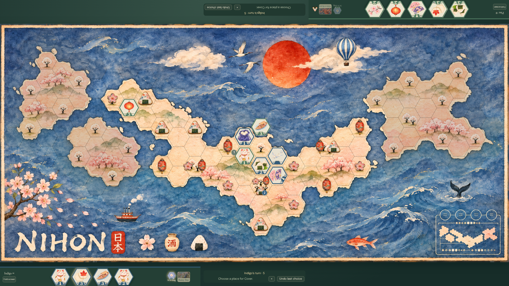

[Table DOM evidence](../../../screenshots/special-motion.spec.js/real-special-tiles-share-placement-holding-cover-copy-and-flip-motion-041-table-linux.dom.txt)

[Observer DOM evidence](../../../screenshots/special-motion.spec.js/real-special-tiles-share-placement-holding-cover-copy-and-flip-motion-041-observer-linux.dom.txt)

## 042. Table: Place cover at 15:7

Viewport, scrolling, clipping and DOM assertions passed; actor and all observers captured.

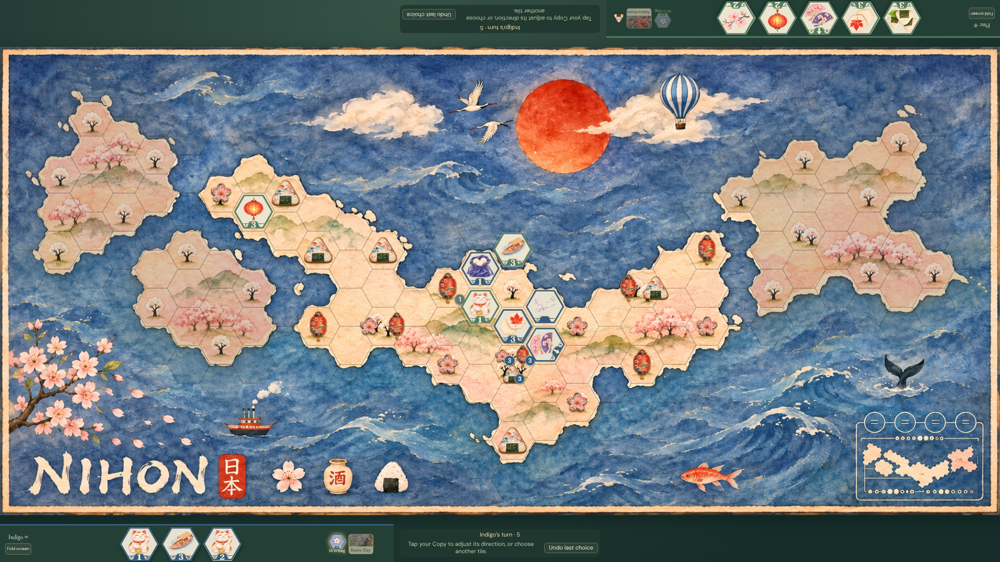

[Table DOM evidence](../../../screenshots/special-motion.spec.js/real-special-tiles-share-placement-holding-cover-copy-and-flip-motion-042-table-linux.dom.txt)

[Observer DOM evidence](../../../screenshots/special-motion.spec.js/real-special-tiles-share-placement-holding-cover-copy-and-flip-motion-042-observer-linux.dom.txt)

## 043. Table: Inspect the two real tiles stacked in the covered hex

Viewport, scrolling, clipping and DOM assertions passed; actor and all observers captured.

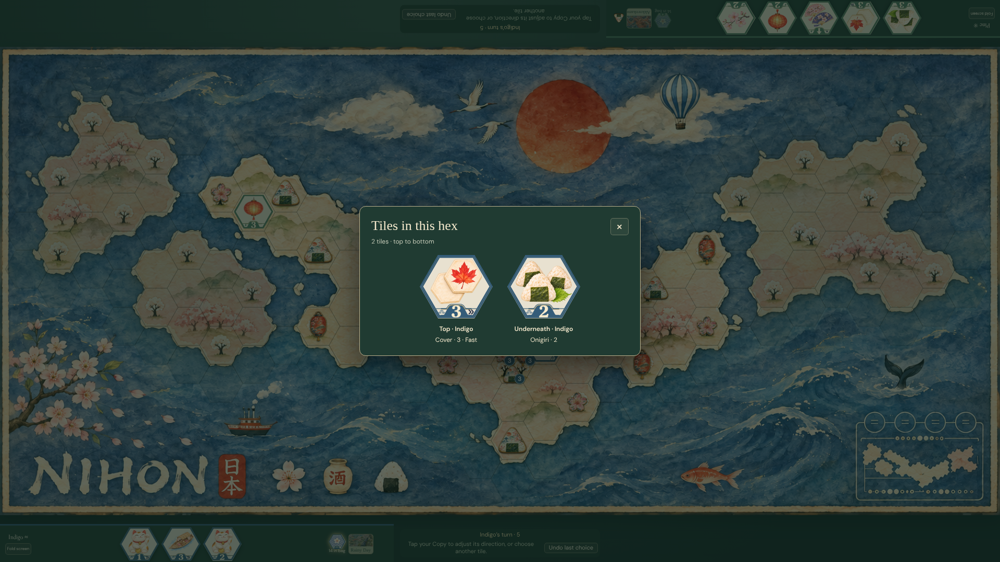

[Table DOM evidence](../../../screenshots/special-motion.spec.js/real-special-tiles-share-placement-holding-cover-copy-and-flip-motion-043-table-linux.dom.txt)

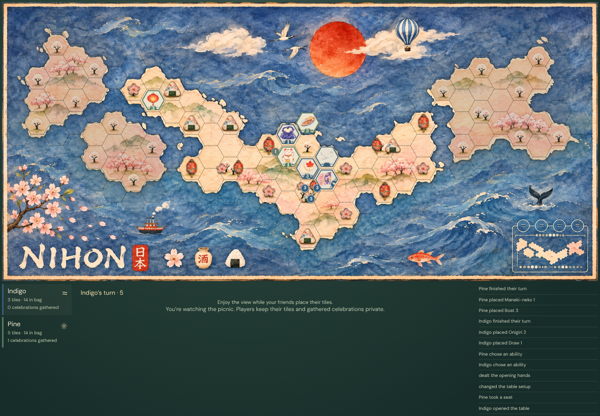

[Observer DOM evidence](../../../screenshots/special-motion.spec.js/real-special-tiles-share-placement-holding-cover-copy-and-flip-motion-043-observer-linux.dom.txt)

## 044. Table: Close tile inspection without making a game choice

Viewport, scrolling, clipping and DOM assertions passed; actor and all observers captured.

[Table DOM evidence](../../../screenshots/special-motion.spec.js/real-special-tiles-share-placement-holding-cover-copy-and-flip-motion-044-table-linux.dom.txt)

[Observer DOM evidence](../../../screenshots/special-motion.spec.js/real-special-tiles-share-placement-holding-cover-copy-and-flip-motion-044-observer-linux.dom.txt)

## 045. Table: Indigo refills and passes to Pine

Viewport, scrolling, clipping and DOM assertions passed; actor and all observers captured.

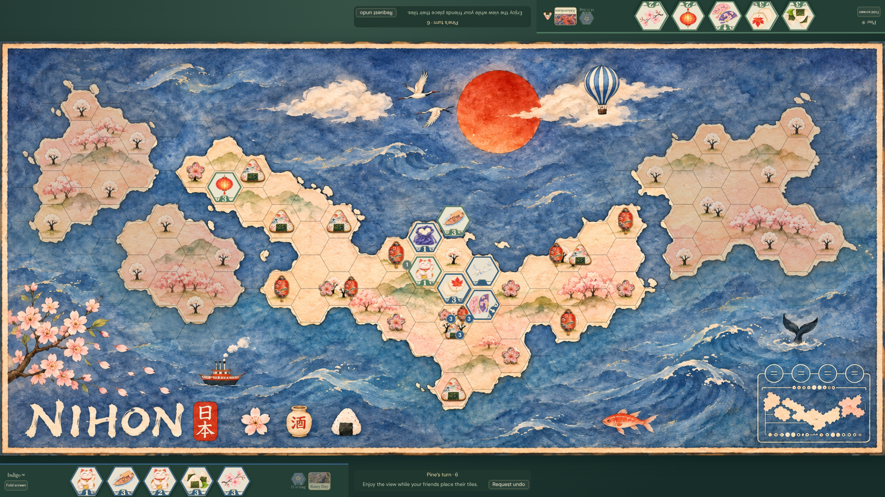

[Table DOM evidence](../../../screenshots/special-motion.spec.js/real-special-tiles-share-placement-holding-cover-copy-and-flip-motion-045-table-linux.dom.txt)

[Observer DOM evidence](../../../screenshots/special-motion.spec.js/real-special-tiles-share-placement-holding-cover-copy-and-flip-motion-045-observer-linux.dom.txt)

## 046. Table: Activate Akkorokamui before placing a tile

Viewport, scrolling, clipping and DOM assertions passed; actor and all observers captured.

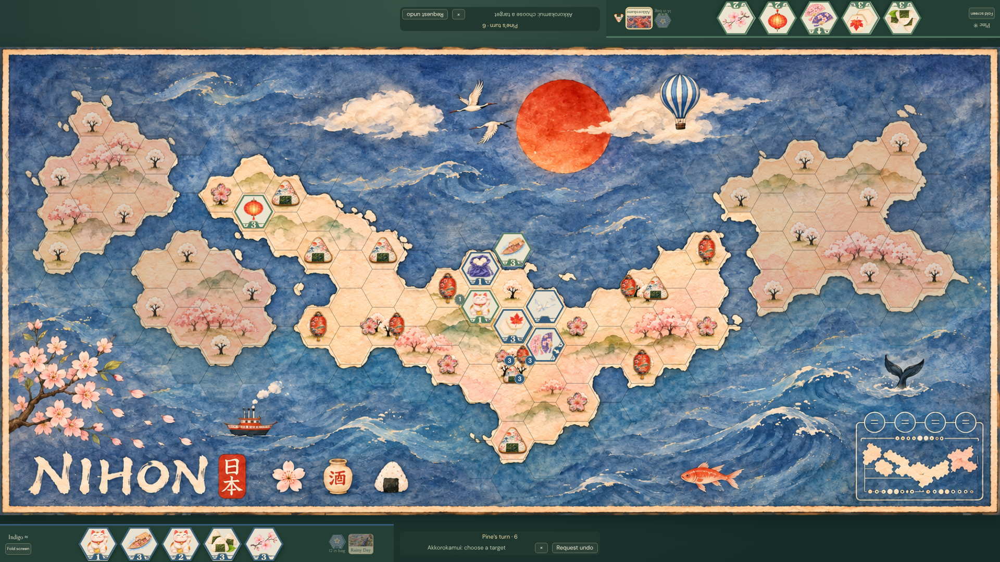

[Table DOM evidence](../../../screenshots/special-motion.spec.js/real-special-tiles-share-placement-holding-cover-copy-and-flip-motion-046-table-linux.dom.txt)

[Observer DOM evidence](../../../screenshots/special-motion.spec.js/real-special-tiles-share-placement-holding-cover-copy-and-flip-motion-046-observer-linux.dom.txt)

## 047. Table: Flip the real boat in place

Viewport, scrolling, clipping and DOM assertions passed; actor and all observers captured.

[Table DOM evidence](../../../screenshots/special-motion.spec.js/real-special-tiles-share-placement-holding-cover-copy-and-flip-motion-047-table-linux.dom.txt)

[Observer DOM evidence](../../../screenshots/special-motion.spec.js/real-special-tiles-share-placement-holding-cover-copy-and-flip-motion-047-observer-linux.dom.txt)

## 048. Table: Pine selects onigiri-3

Viewport, scrolling, clipping and DOM assertions passed; actor and all observers captured.

[Table DOM evidence](../../../screenshots/special-motion.spec.js/real-special-tiles-share-placement-holding-cover-copy-and-flip-motion-048-table-linux.dom.txt)

[Observer DOM evidence](../../../screenshots/special-motion.spec.js/real-special-tiles-share-placement-holding-cover-copy-and-flip-motion-048-observer-linux.dom.txt)

## 049. Table: Place onigiri-3 at 14:8

Viewport, scrolling, clipping and DOM assertions passed; actor and all observers captured.

[Table DOM evidence](../../../screenshots/special-motion.spec.js/real-special-tiles-share-placement-holding-cover-copy-and-flip-motion-049-table-linux.dom.txt)

[Observer DOM evidence](../../../screenshots/special-motion.spec.js/real-special-tiles-share-placement-holding-cover-copy-and-flip-motion-049-observer-linux.dom.txt)

## 050. Table: Pine refills and passes to Indigo

Viewport, scrolling, clipping and DOM assertions passed; actor and all observers captured.

[Table DOM evidence](../../../screenshots/special-motion.spec.js/real-special-tiles-share-placement-holding-cover-copy-and-flip-motion-050-table-linux.dom.txt)

[Observer DOM evidence](../../../screenshots/special-motion.spec.js/real-special-tiles-share-placement-holding-cover-copy-and-flip-motion-050-observer-linux.dom.txt)

## 051. Observer: Reload the observer and replay the same special-tile board

Viewport, scrolling, clipping and DOM assertions passed; actor and all observers captured.

[Table DOM evidence](../../../screenshots/special-motion.spec.js/real-special-tiles-share-placement-holding-cover-copy-and-flip-motion-051-table-linux.dom.txt)

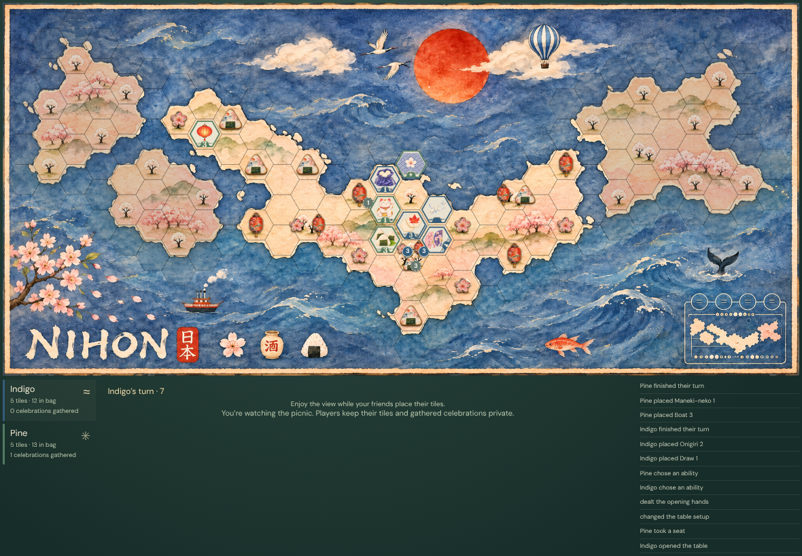

[Observer DOM evidence](../../../screenshots/special-motion.spec.js/real-special-tiles-share-placement-holding-cover-copy-and-flip-motion-051-observer-linux.dom.txt)
