# Choose tabletop computer corners and levels

Real UI → authenticated Firestore transaction → immutable event → deterministic replay → every observer. Zero pixel tolerance; every decoded RGBA byte and the accessible DOM are compared. No game-state injection or outcome fixtures.

## 000. Table: Open the south-west corner

Viewport, scrolling, clipping and DOM assertions passed; actor and all observers captured.

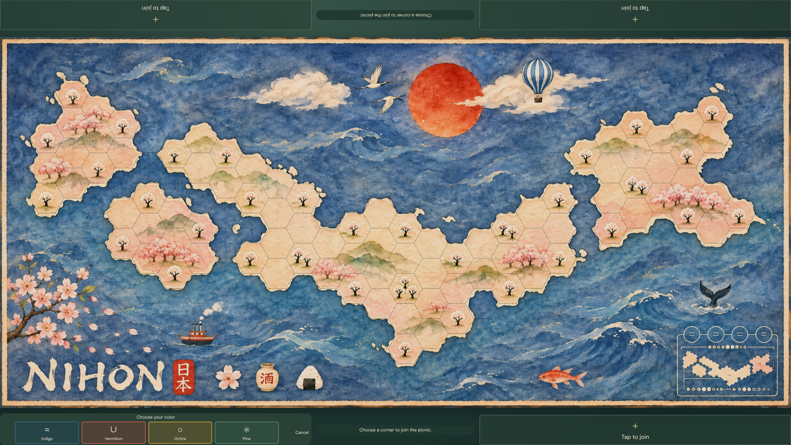

[Table DOM evidence](../../../screenshots/multiplayer-levels.spec.js/tabletop-computers-occupy-chosen-corners-with-independently-editable-levels-000-table-linux.dom.txt)

[Observer DOM evidence](../../../screenshots/multiplayer-levels.spec.js/tabletop-computers-occupy-chosen-corners-with-independently-editable-levels-000-observer-linux.dom.txt)

## 001. Table: Take Indigo’s human seat

Viewport, scrolling, clipping and DOM assertions passed; actor and all observers captured.

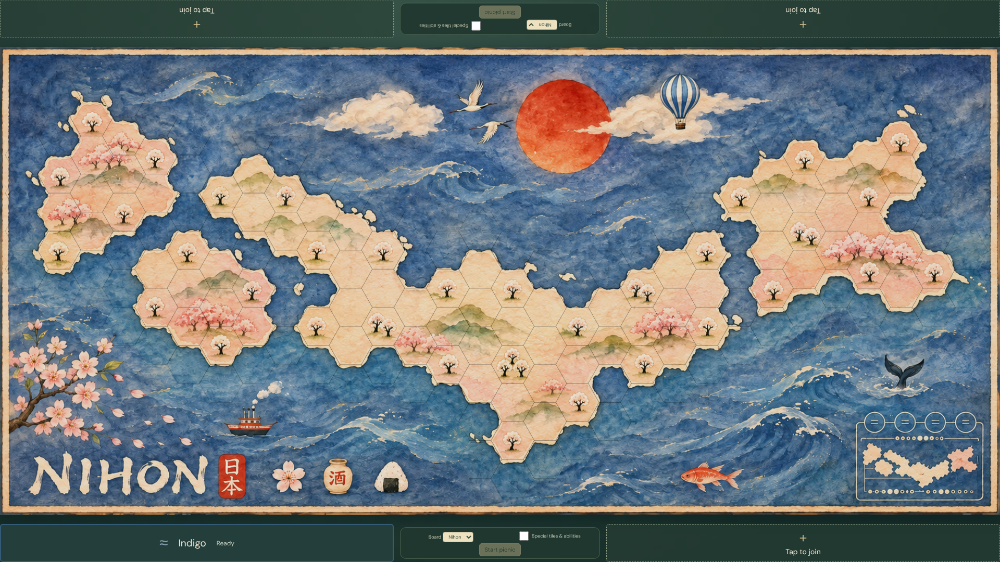

[Table DOM evidence](../../../screenshots/multiplayer-levels.spec.js/tabletop-computers-occupy-chosen-corners-with-independently-editable-levels-001-table-linux.dom.txt)

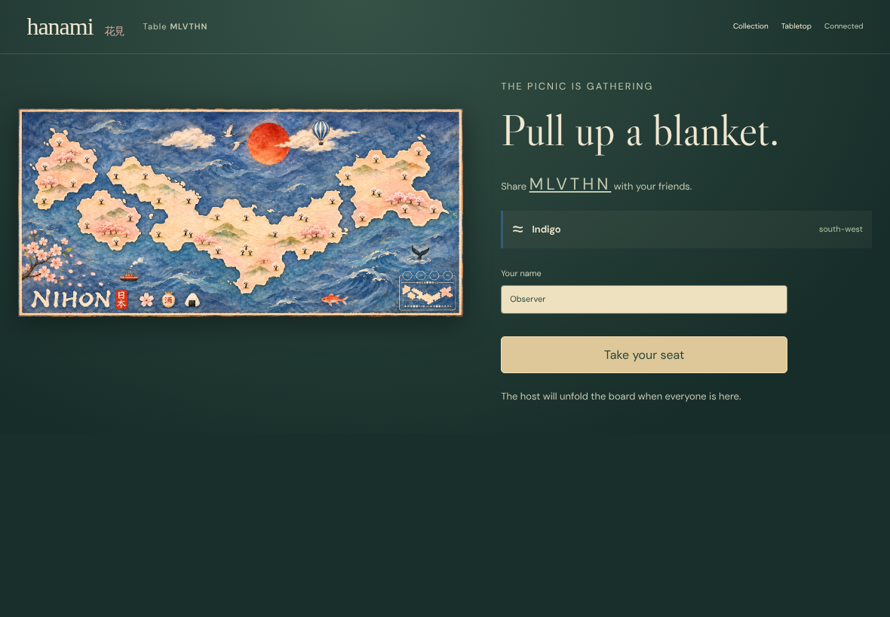

[Observer DOM evidence](../../../screenshots/multiplayer-levels.spec.js/tabletop-computers-occupy-chosen-corners-with-independently-editable-levels-001-observer-linux.dom.txt)

## 002. Table: Open North-east for a computer

Viewport, scrolling, clipping and DOM assertions passed; actor and all observers captured.

[Table DOM evidence](../../../screenshots/multiplayer-levels.spec.js/tabletop-computers-occupy-chosen-corners-with-independently-editable-levels-002-table-linux.dom.txt)

[Observer DOM evidence](../../../screenshots/multiplayer-levels.spec.js/tabletop-computers-occupy-chosen-corners-with-independently-editable-levels-002-observer-linux.dom.txt)

## 003. Table: Choose a hard computer

Viewport, scrolling, clipping and DOM assertions passed; actor and all observers captured.

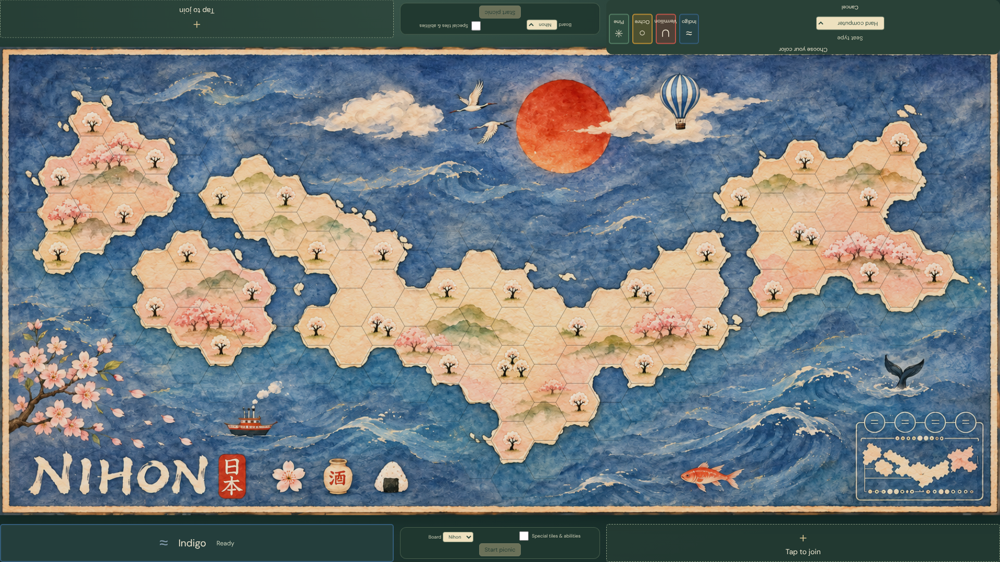

[Table DOM evidence](../../../screenshots/multiplayer-levels.spec.js/tabletop-computers-occupy-chosen-corners-with-independently-editable-levels-003-table-linux.dom.txt)

[Observer DOM evidence](../../../screenshots/multiplayer-levels.spec.js/tabletop-computers-occupy-chosen-corners-with-independently-editable-levels-003-observer-linux.dom.txt)

## 004. Table: Seat Pine at North-east

Viewport, scrolling, clipping and DOM assertions passed; actor and all observers captured.

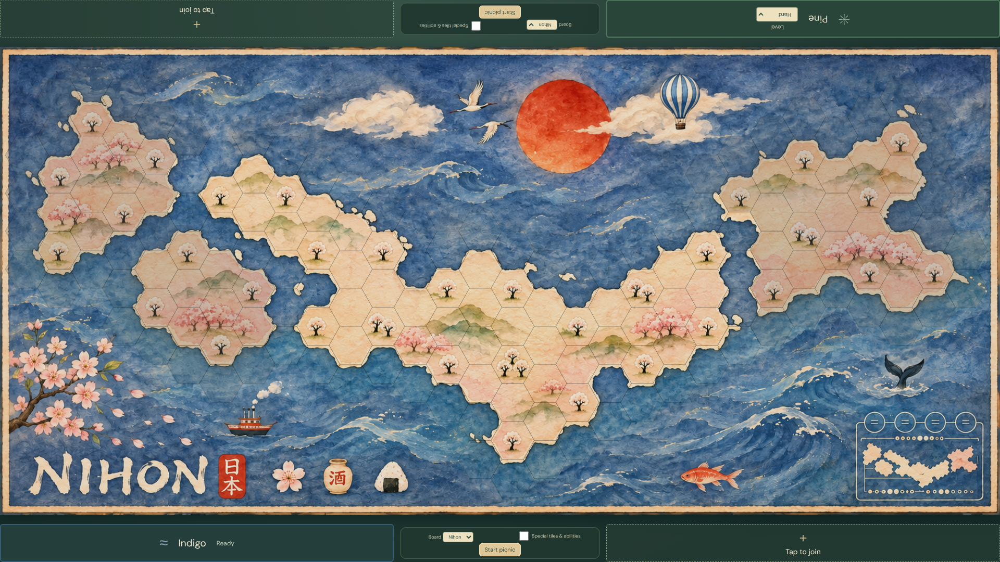

[Table DOM evidence](../../../screenshots/multiplayer-levels.spec.js/tabletop-computers-occupy-chosen-corners-with-independently-editable-levels-004-table-linux.dom.txt)

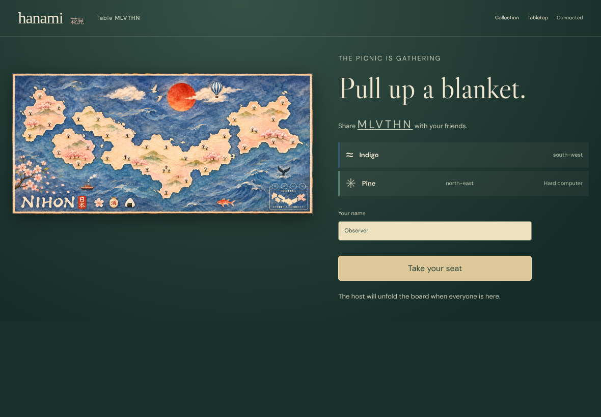

[Observer DOM evidence](../../../screenshots/multiplayer-levels.spec.js/tabletop-computers-occupy-chosen-corners-with-independently-editable-levels-004-observer-linux.dom.txt)

## 005. Table: Open South-east for a computer

Viewport, scrolling, clipping and DOM assertions passed; actor and all observers captured.

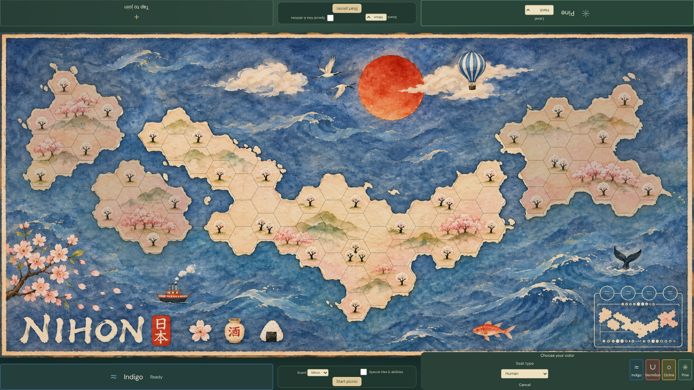

[Table DOM evidence](../../../screenshots/multiplayer-levels.spec.js/tabletop-computers-occupy-chosen-corners-with-independently-editable-levels-005-table-linux.dom.txt)

[Observer DOM evidence](../../../screenshots/multiplayer-levels.spec.js/tabletop-computers-occupy-chosen-corners-with-independently-editable-levels-005-observer-linux.dom.txt)

## 006. Table: Choose a medium computer

Viewport, scrolling, clipping and DOM assertions passed; actor and all observers captured.

[Table DOM evidence](../../../screenshots/multiplayer-levels.spec.js/tabletop-computers-occupy-chosen-corners-with-independently-editable-levels-006-table-linux.dom.txt)

[Observer DOM evidence](../../../screenshots/multiplayer-levels.spec.js/tabletop-computers-occupy-chosen-corners-with-independently-editable-levels-006-observer-linux.dom.txt)

## 007. Table: Seat Vermilion at South-east

Viewport, scrolling, clipping and DOM assertions passed; actor and all observers captured.

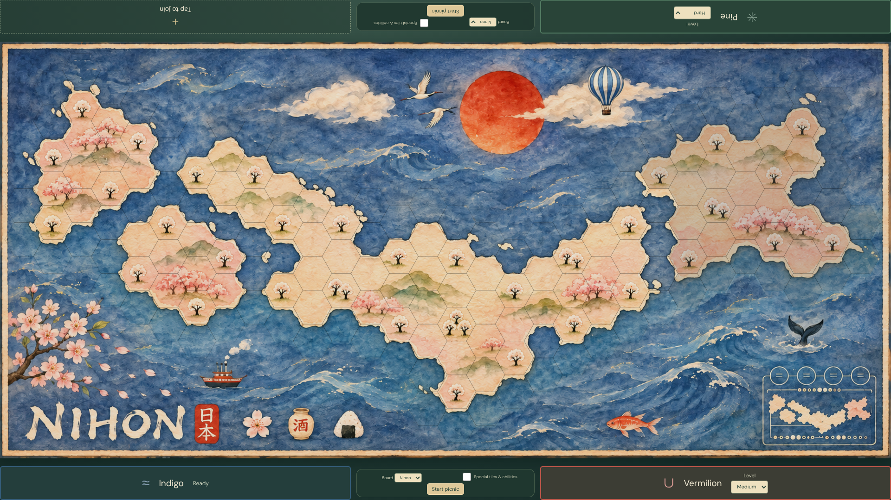

[Table DOM evidence](../../../screenshots/multiplayer-levels.spec.js/tabletop-computers-occupy-chosen-corners-with-independently-editable-levels-007-table-linux.dom.txt)

[Observer DOM evidence](../../../screenshots/multiplayer-levels.spec.js/tabletop-computers-occupy-chosen-corners-with-independently-editable-levels-007-observer-linux.dom.txt)

## 008. Table: Change Pine to easy before dealing

Viewport, scrolling, clipping and DOM assertions passed; actor and all observers captured.

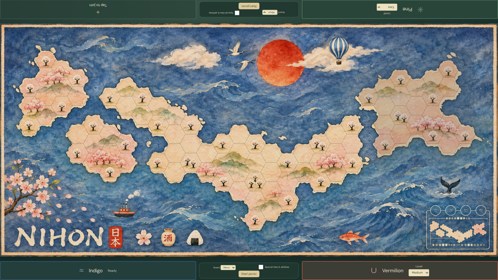

[Table DOM evidence](../../../screenshots/multiplayer-levels.spec.js/tabletop-computers-occupy-chosen-corners-with-independently-editable-levels-008-table-linux.dom.txt)

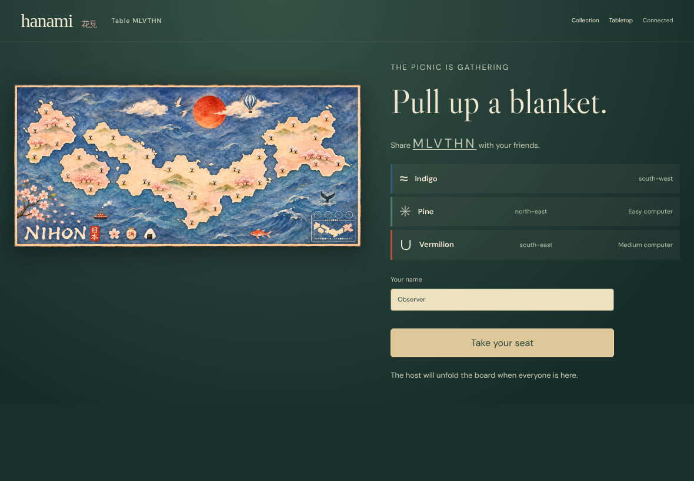

[Observer DOM evidence](../../../screenshots/multiplayer-levels.spec.js/tabletop-computers-occupy-chosen-corners-with-independently-editable-levels-008-observer-linux.dom.txt)

## 009. Table: Restore Pine to hard and persist it

Viewport, scrolling, clipping and DOM assertions passed; actor and all observers captured.

[Table DOM evidence](../../../screenshots/multiplayer-levels.spec.js/tabletop-computers-occupy-chosen-corners-with-independently-editable-levels-009-table-linux.dom.txt)

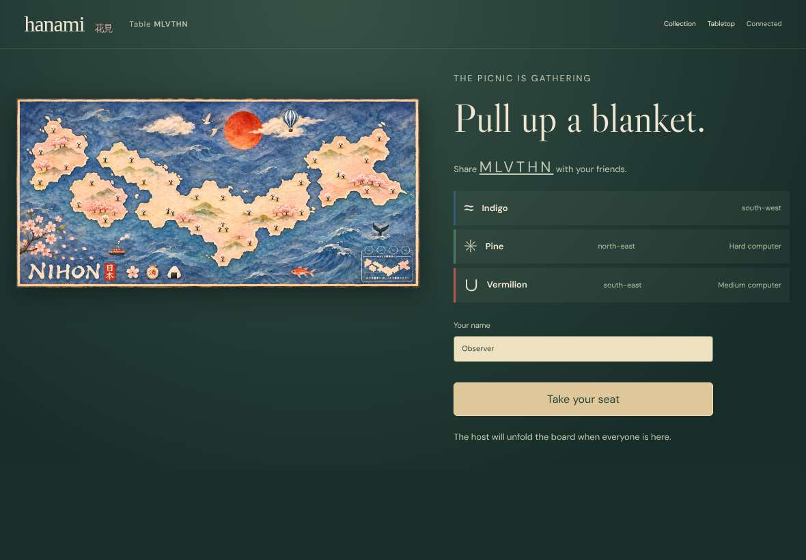

[Observer DOM evidence](../../../screenshots/multiplayer-levels.spec.js/tabletop-computers-occupy-chosen-corners-with-independently-editable-levels-009-observer-linux.dom.txt)

## 010. Table: Reload the physical seats and levels

Viewport, scrolling, clipping and DOM assertions passed; actor and all observers captured.

[Table DOM evidence](../../../screenshots/multiplayer-levels.spec.js/tabletop-computers-occupy-chosen-corners-with-independently-editable-levels-010-table-linux.dom.txt)

[Observer DOM evidence](../../../screenshots/multiplayer-levels.spec.js/tabletop-computers-occupy-chosen-corners-with-independently-editable-levels-010-observer-linux.dom.txt)

## 011. Table: Start the real three-player picnic

Viewport, scrolling, clipping and DOM assertions passed; actor and all observers captured.

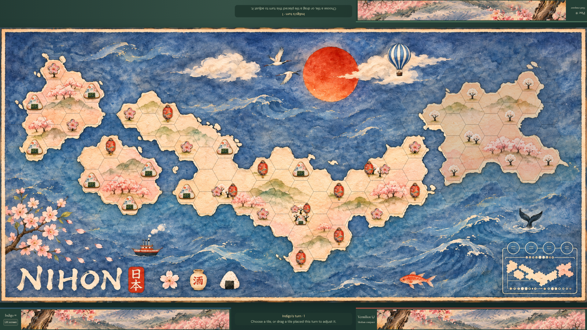

[Table DOM evidence](../../../screenshots/multiplayer-levels.spec.js/tabletop-computers-occupy-chosen-corners-with-independently-editable-levels-011-table-linux.dom.txt)

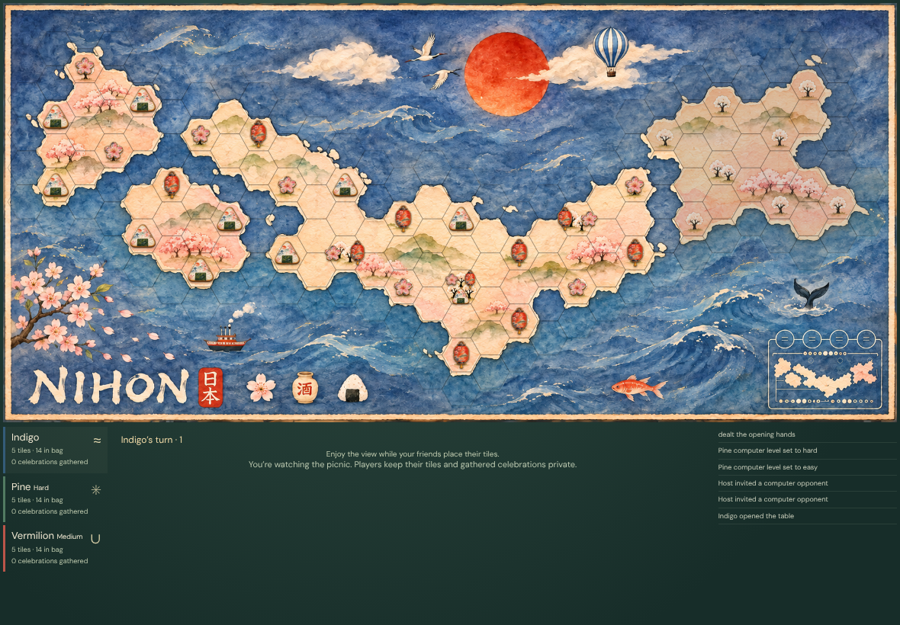

[Observer DOM evidence](../../../screenshots/multiplayer-levels.spec.js/tabletop-computers-occupy-chosen-corners-with-independently-editable-levels-011-observer-linux.dom.txt)

## 012. Table: Lift only the human screen

Viewport, scrolling, clipping and DOM assertions passed; actor and all observers captured.

[Table DOM evidence](../../../screenshots/multiplayer-levels.spec.js/tabletop-computers-occupy-chosen-corners-with-independently-editable-levels-012-table-linux.dom.txt)

[Observer DOM evidence](../../../screenshots/multiplayer-levels.spec.js/tabletop-computers-occupy-chosen-corners-with-independently-editable-levels-012-observer-linux.dom.txt)

## 013. Indigo: Select onigiri-3 from Indigo’s real hand

Viewport, scrolling, clipping and DOM assertions passed; actor and all observers captured.

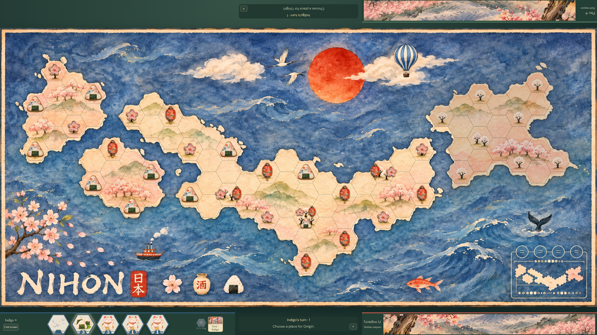

[Table DOM evidence](../../../screenshots/multiplayer-levels.spec.js/tabletop-computers-occupy-chosen-corners-with-independently-editable-levels-013-table-linux.dom.txt)

[Observer DOM evidence](../../../screenshots/multiplayer-levels.spec.js/tabletop-computers-occupy-chosen-corners-with-independently-editable-levels-013-observer-linux.dom.txt)

## 014. Indigo: Place onigiri-3 at 2:4

Viewport, scrolling, clipping and DOM assertions passed; actor and all observers captured.

[Table DOM evidence](../../../screenshots/multiplayer-levels.spec.js/tabletop-computers-occupy-chosen-corners-with-independently-editable-levels-014-table-linux.dom.txt)

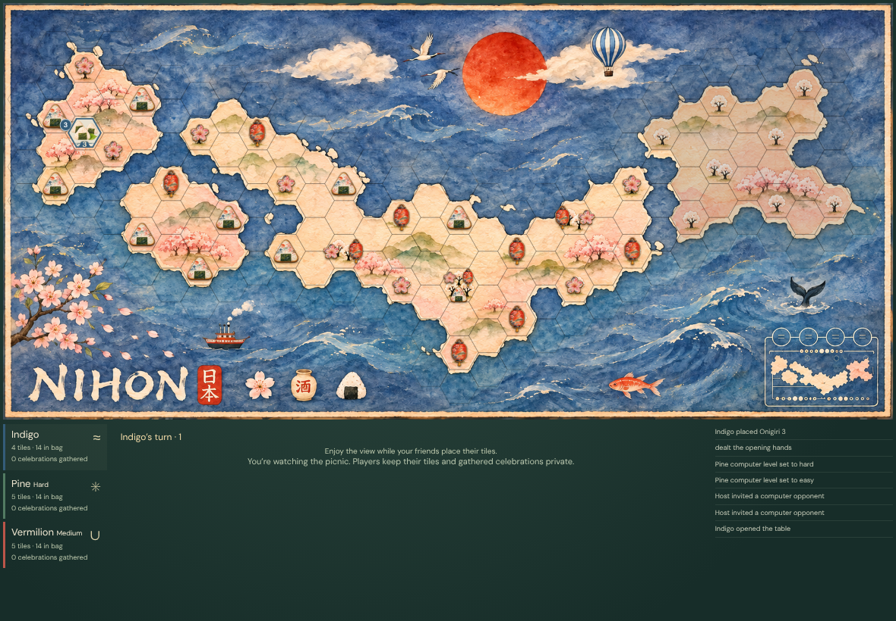

[Observer DOM evidence](../../../screenshots/multiplayer-levels.spec.js/tabletop-computers-occupy-chosen-corners-with-independently-editable-levels-014-observer-linux.dom.txt)

## 015. Table: Both computer corners play and return the turn

Viewport, scrolling, clipping and DOM assertions passed; actor and all observers captured.

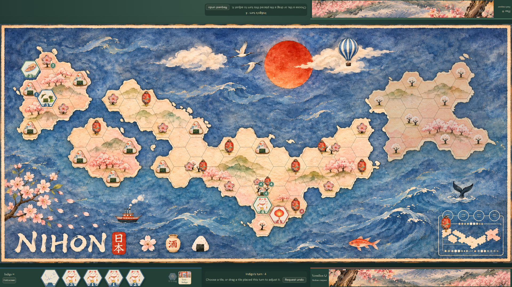

[Table DOM evidence](../../../screenshots/multiplayer-levels.spec.js/tabletop-computers-occupy-chosen-corners-with-independently-editable-levels-015-table-linux.dom.txt)

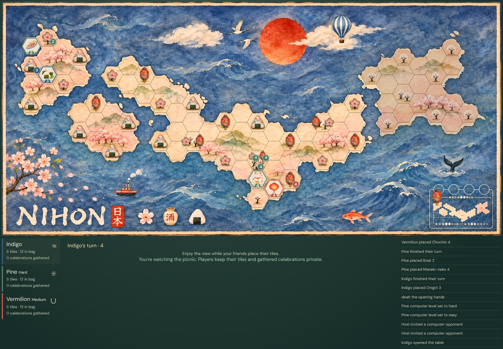

[Observer DOM evidence](../../../screenshots/multiplayer-levels.spec.js/tabletop-computers-occupy-chosen-corners-with-independently-editable-levels-015-observer-linux.dom.txt)
