# Four corner seats and a private phone

Real UI → authenticated Firestore transaction → immutable event → deterministic replay → every observer. Zero pixel tolerance; every decoded RGBA byte and the accessible DOM are compared. No game-state injection or outcome fixtures.

## 000. Table: Open a header-free table with four corner seats

Viewport, scrolling, clipping and DOM assertions passed; actor and all observers captured.

[Table DOM evidence](../../../screenshots/tabletop-launch.spec.js/tabletop-corner-colors-private-phone-and-unanimous-undo-000-table-linux.dom.txt)

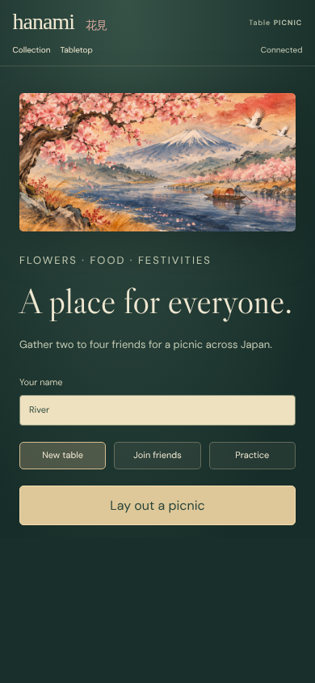

[Phone DOM evidence](../../../screenshots/tabletop-launch.spec.js/tabletop-corner-colors-private-phone-and-unanimous-undo-000-phone-linux.dom.txt)

## 001. Table: Tap the south-west corner

Viewport, scrolling, clipping and DOM assertions passed; actor and all observers captured.

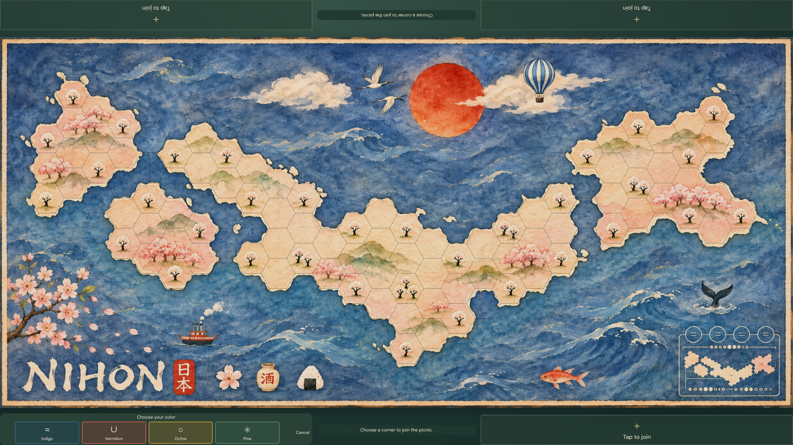

[Table DOM evidence](../../../screenshots/tabletop-launch.spec.js/tabletop-corner-colors-private-phone-and-unanimous-undo-001-table-linux.dom.txt)

[Phone DOM evidence](../../../screenshots/tabletop-launch.spec.js/tabletop-corner-colors-private-phone-and-unanimous-undo-001-phone-linux.dom.txt)

## 002. Table: Join south-west as Indigo without entering a name

Viewport, scrolling, clipping and DOM assertions passed; actor and all observers captured.

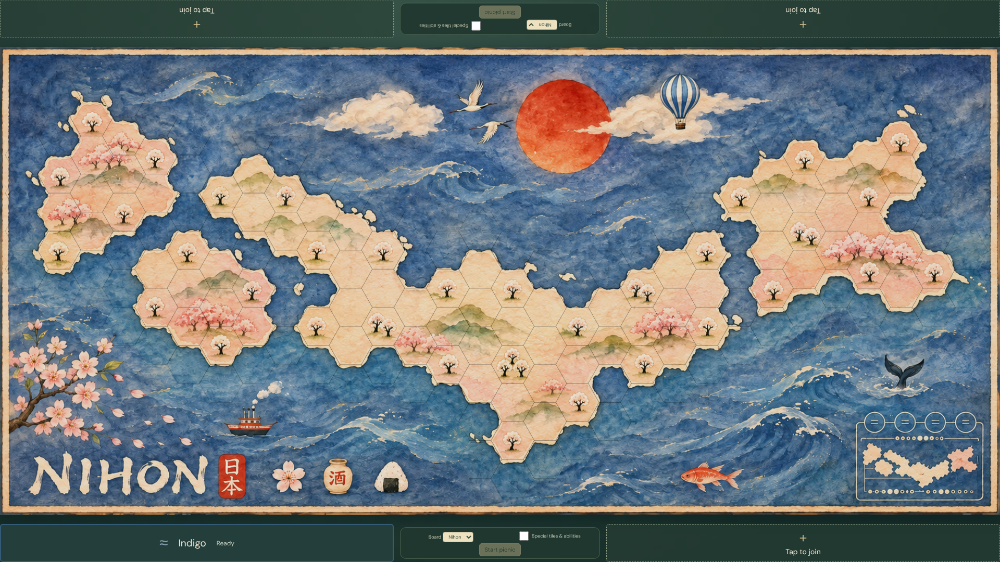

[Table DOM evidence](../../../screenshots/tabletop-launch.spec.js/tabletop-corner-colors-private-phone-and-unanimous-undo-002-table-linux.dom.txt)

[Phone DOM evidence](../../../screenshots/tabletop-launch.spec.js/tabletop-corner-colors-private-phone-and-unanimous-undo-002-phone-linux.dom.txt)

## 003. Table: Tap the north-east corner

Viewport, scrolling, clipping and DOM assertions passed; actor and all observers captured.

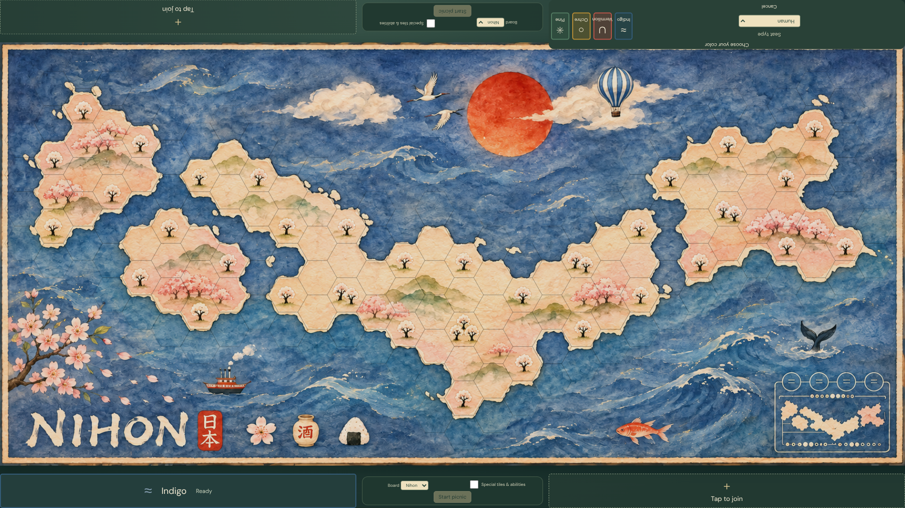

[Table DOM evidence](../../../screenshots/tabletop-launch.spec.js/tabletop-corner-colors-private-phone-and-unanimous-undo-003-table-linux.dom.txt)

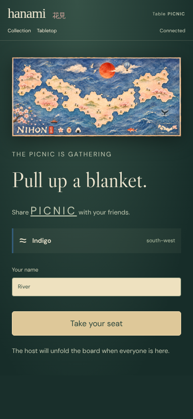

[Phone DOM evidence](../../../screenshots/tabletop-launch.spec.js/tabletop-corner-colors-private-phone-and-unanimous-undo-003-phone-linux.dom.txt)

## 004. Table: Join north-east as Pine

Viewport, scrolling, clipping and DOM assertions passed; actor and all observers captured.

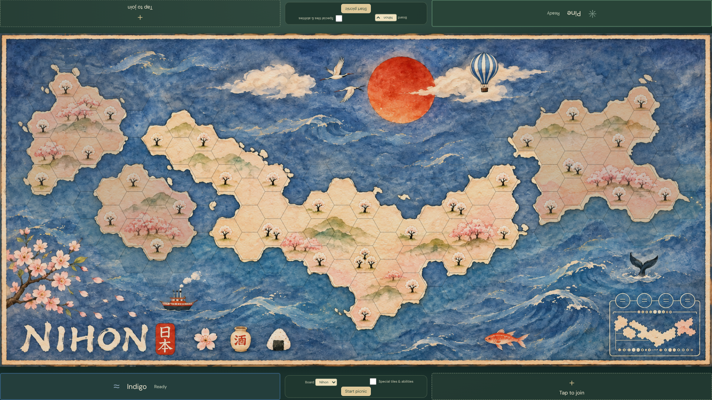

[Table DOM evidence](../../../screenshots/tabletop-launch.spec.js/tabletop-corner-colors-private-phone-and-unanimous-undo-004-table-linux.dom.txt)

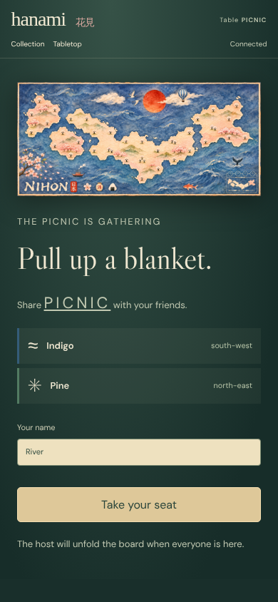

[Phone DOM evidence](../../../screenshots/tabletop-launch.spec.js/tabletop-corner-colors-private-phone-and-unanimous-undo-004-phone-linux.dom.txt)

## 005. Phone: Join the same table from a private phone

Viewport, scrolling, clipping and DOM assertions passed; actor and all observers captured.

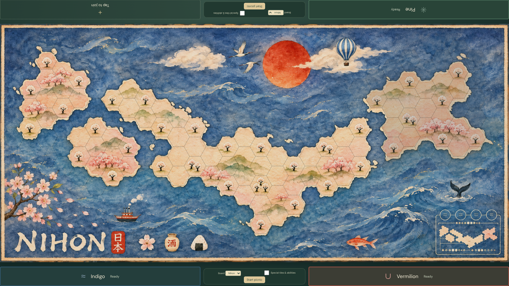

[Table DOM evidence](../../../screenshots/tabletop-launch.spec.js/tabletop-corner-colors-private-phone-and-unanimous-undo-005-table-linux.dom.txt)

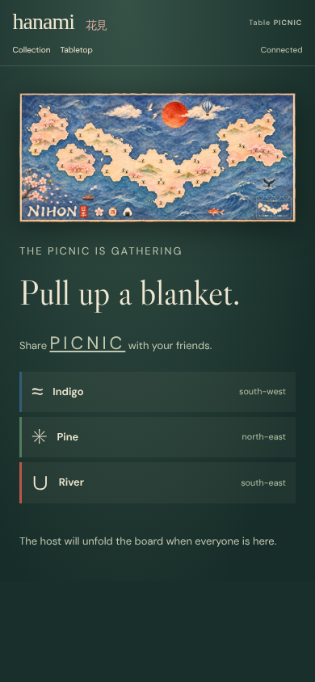

[Phone DOM evidence](../../../screenshots/tabletop-launch.spec.js/tabletop-corner-colors-private-phone-and-unanimous-undo-005-phone-linux.dom.txt)

## 006. Table: Start the picnic from the north edge

Viewport, scrolling, clipping and DOM assertions passed; actor and all observers captured.

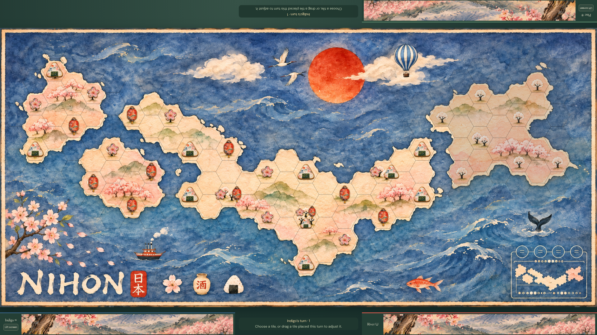

[Table DOM evidence](../../../screenshots/tabletop-launch.spec.js/tabletop-corner-colors-private-phone-and-unanimous-undo-006-table-linux.dom.txt)

[Phone DOM evidence](../../../screenshots/tabletop-launch.spec.js/tabletop-corner-colors-private-phone-and-unanimous-undo-006-phone-linux.dom.txt)

## 007. Table: Lift the south-west screen without resizing the board

Viewport, scrolling, clipping and DOM assertions passed; actor and all observers captured.

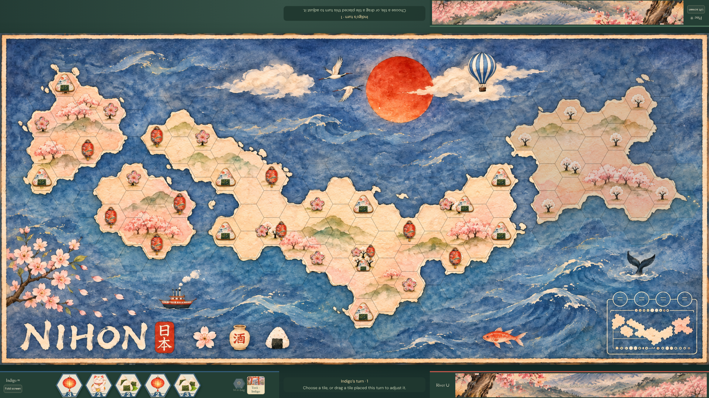

[Table DOM evidence](../../../screenshots/tabletop-launch.spec.js/tabletop-corner-colors-private-phone-and-unanimous-undo-007-table-linux.dom.txt)

[Phone DOM evidence](../../../screenshots/tabletop-launch.spec.js/tabletop-corner-colors-private-phone-and-unanimous-undo-007-phone-linux.dom.txt)

## 008. Table: Touch a held watercolor tile

Viewport, scrolling, clipping and DOM assertions passed; actor and all observers captured.

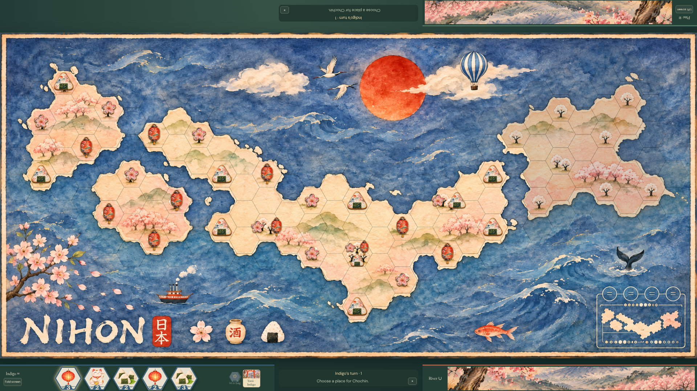

[Table DOM evidence](../../../screenshots/tabletop-launch.spec.js/tabletop-corner-colors-private-phone-and-unanimous-undo-008-table-linux.dom.txt)

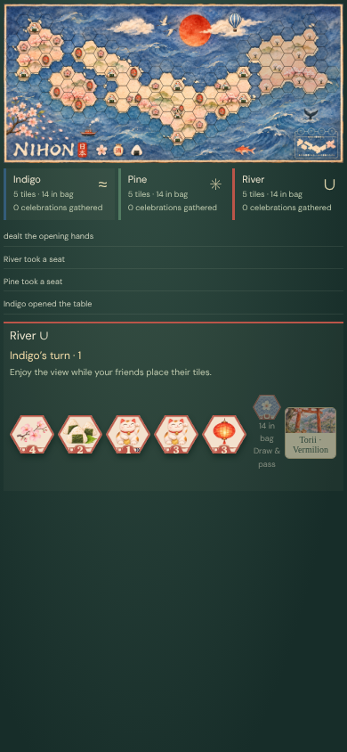

[Phone DOM evidence](../../../screenshots/tabletop-launch.spec.js/tabletop-corner-colors-private-phone-and-unanimous-undo-008-phone-linux.dom.txt)

## 009. Table: Place it on the shared grid through a real event

Viewport, scrolling, clipping and DOM assertions passed; actor and all observers captured.

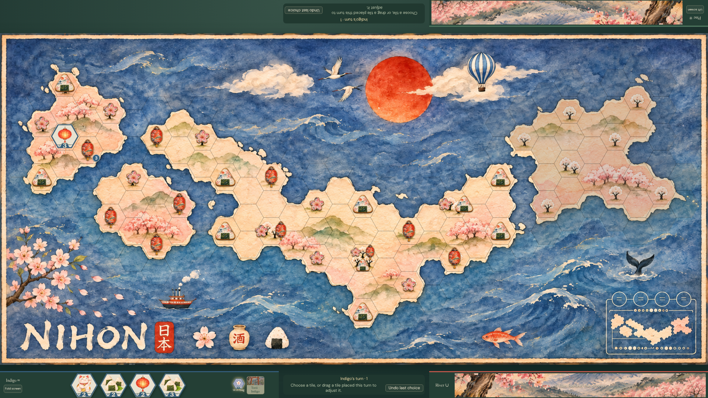

[Table DOM evidence](../../../screenshots/tabletop-launch.spec.js/tabletop-corner-colors-private-phone-and-unanimous-undo-009-table-linux.dom.txt)

[Phone DOM evidence](../../../screenshots/tabletop-launch.spec.js/tabletop-corner-colors-private-phone-and-unanimous-undo-009-phone-linux.dom.txt)

## 010. Table: Draw and pass to the north-east player

Viewport, scrolling, clipping and DOM assertions passed; actor and all observers captured.

[Table DOM evidence](../../../screenshots/tabletop-launch.spec.js/tabletop-corner-colors-private-phone-and-unanimous-undo-010-table-linux.dom.txt)

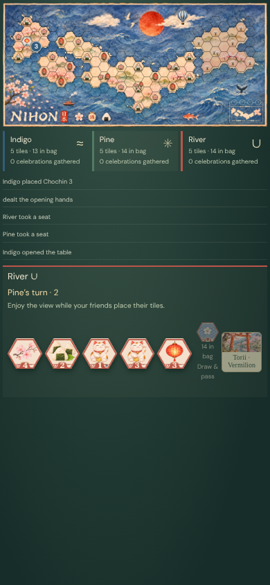

[Phone DOM evidence](../../../screenshots/tabletop-launch.spec.js/tabletop-corner-colors-private-phone-and-unanimous-undo-010-phone-linux.dom.txt)

## 011. Table: Request undo after drawing new information

Viewport, scrolling, clipping and DOM assertions passed; actor and all observers captured.

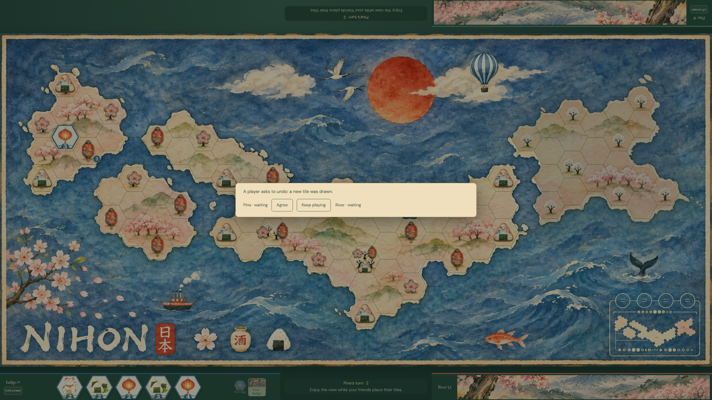

[Table DOM evidence](../../../screenshots/tabletop-launch.spec.js/tabletop-corner-colors-private-phone-and-unanimous-undo-011-table-linux.dom.txt)

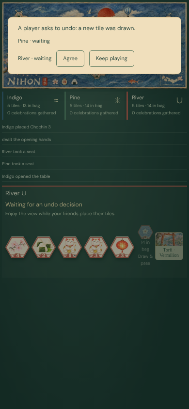

[Phone DOM evidence](../../../screenshots/tabletop-launch.spec.js/tabletop-corner-colors-private-phone-and-unanimous-undo-011-phone-linux.dom.txt)

## 012. Table: Pine independently agrees at the table

Viewport, scrolling, clipping and DOM assertions passed; actor and all observers captured.

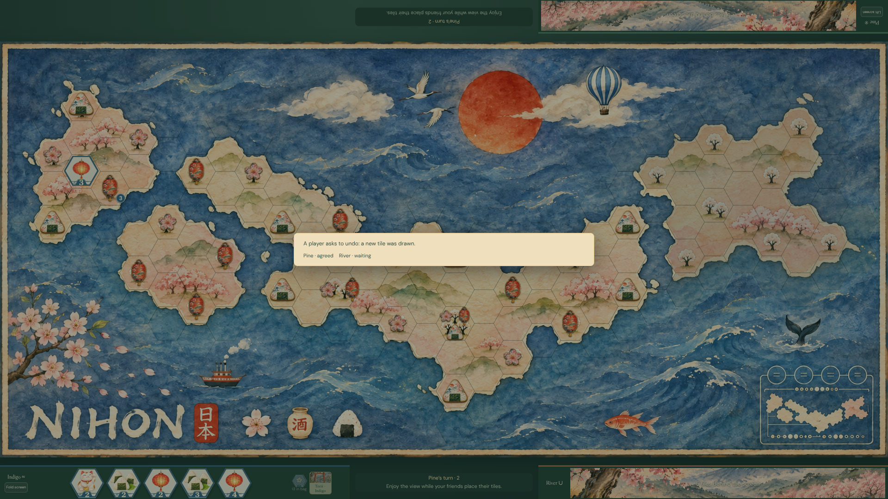

[Table DOM evidence](../../../screenshots/tabletop-launch.spec.js/tabletop-corner-colors-private-phone-and-unanimous-undo-012-table-linux.dom.txt)

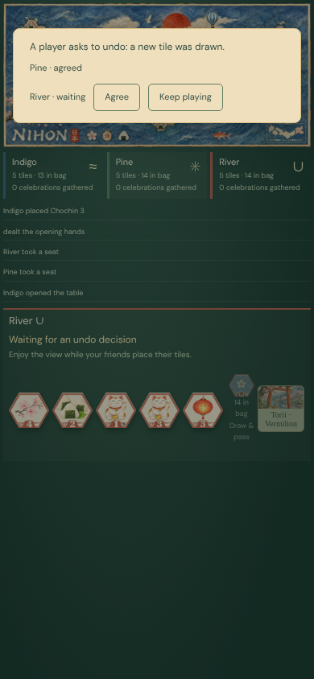

[Phone DOM evidence](../../../screenshots/tabletop-launch.spec.js/tabletop-corner-colors-private-phone-and-unanimous-undo-012-phone-linux.dom.txt)

## 013. Phone: The phone player supplies final consent

Viewport, scrolling, clipping and DOM assertions passed; actor and all observers captured.

[Table DOM evidence](../../../screenshots/tabletop-launch.spec.js/tabletop-corner-colors-private-phone-and-unanimous-undo-013-table-linux.dom.txt)

[Phone DOM evidence](../../../screenshots/tabletop-launch.spec.js/tabletop-corner-colors-private-phone-and-unanimous-undo-013-phone-linux.dom.txt)

## 014. Table: Fit the board and hands to a shorter display

Viewport, scrolling, clipping and DOM assertions passed; actor and all observers captured.

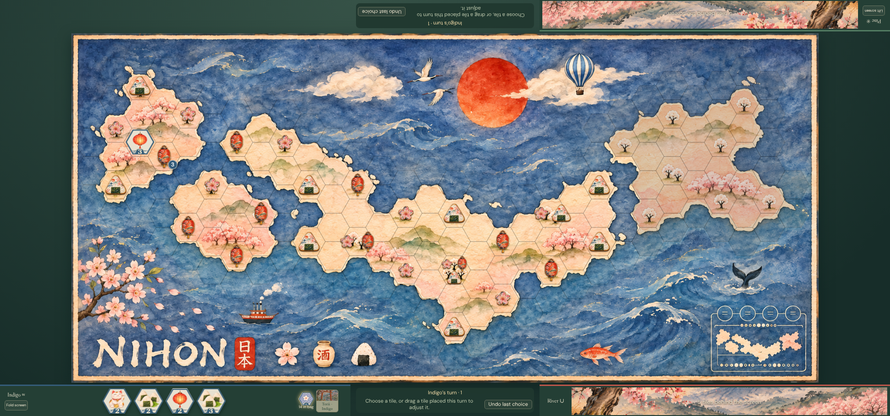

[Table DOM evidence](../../../screenshots/tabletop-launch.spec.js/tabletop-corner-colors-private-phone-and-unanimous-undo-014-table-linux.dom.txt)

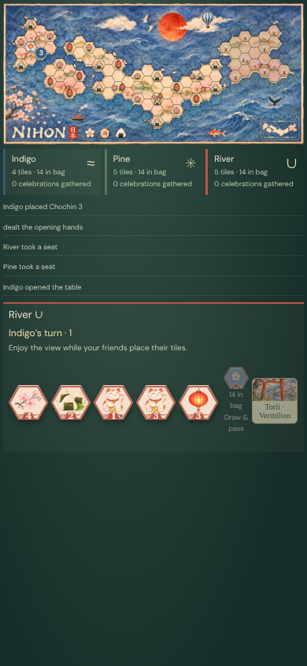

[Phone DOM evidence](../../../screenshots/tabletop-launch.spec.js/tabletop-corner-colors-private-phone-and-unanimous-undo-014-phone-linux.dom.txt)

## 015. Table: Use surplus vertical space for larger hands up to board tile size

Viewport, scrolling, clipping and DOM assertions passed; actor and all observers captured.

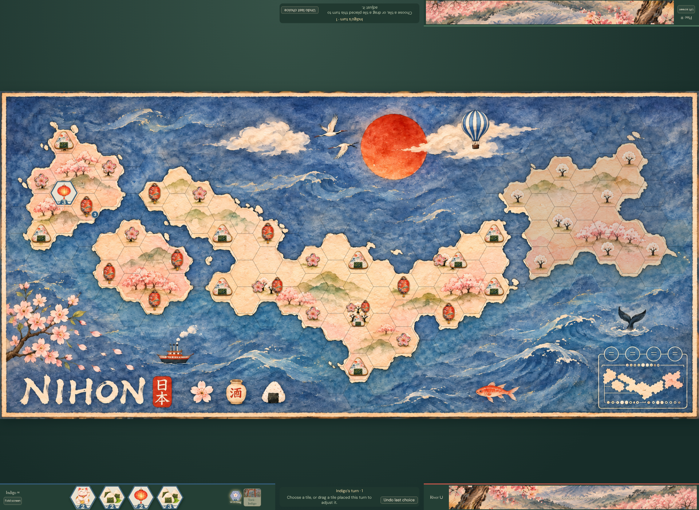

[Table DOM evidence](../../../screenshots/tabletop-launch.spec.js/tabletop-corner-colors-private-phone-and-unanimous-undo-015-table-linux.dom.txt)

[Phone DOM evidence](../../../screenshots/tabletop-launch.spec.js/tabletop-corner-colors-private-phone-and-unanimous-undo-015-phone-linux.dom.txt)

## 016. Table: Return to the original tabletop display

Viewport, scrolling, clipping and DOM assertions passed; actor and all observers captured.

[Table DOM evidence](../../../screenshots/tabletop-launch.spec.js/tabletop-corner-colors-private-phone-and-unanimous-undo-016-table-linux.dom.txt)

[Phone DOM evidence](../../../screenshots/tabletop-launch.spec.js/tabletop-corner-colors-private-phone-and-unanimous-undo-016-phone-linux.dom.txt)

## 017. Table: Fold the screen without changing board geometry

Viewport, scrolling, clipping and DOM assertions passed; actor and all observers captured.

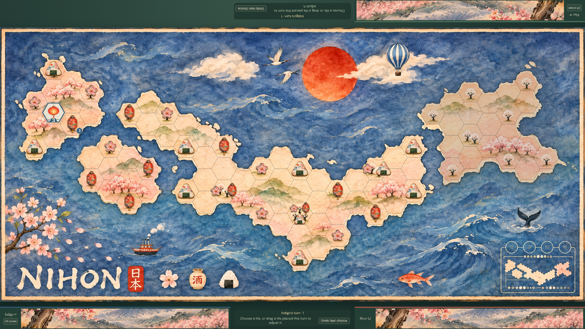

[Table DOM evidence](../../../screenshots/tabletop-launch.spec.js/tabletop-corner-colors-private-phone-and-unanimous-undo-017-table-linux.dom.txt)

[Phone DOM evidence](../../../screenshots/tabletop-launch.spec.js/tabletop-corner-colors-private-phone-and-unanimous-undo-017-phone-linux.dom.txt)
