# Chromium mobile layout · nihon

Real UI → authenticated Firestore transaction → immutable event → deterministic replay → every observer. Zero pixel tolerance; every decoded RGBA byte and the accessible DOM are compared. No game-state injection or outcome fixtures.

## 000. Bea: Join the real invitation from a portrait phone

Viewport, scrolling, clipping and DOM assertions passed; actor and all observers captured.

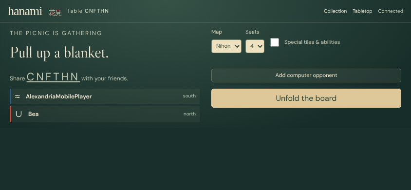

[Alex DOM evidence](https://raw.githubusercontent.com/anicolao/hanami/90ce25c5ff2930d1df294426dd921e9d068ef5d1/tests/e2e/screenshots/mobile-layout.spec.js/chromium-mobile-layout-survives-cold-loads-and-orientation-changes-on-nihon-000-alex-linux.dom.txt)

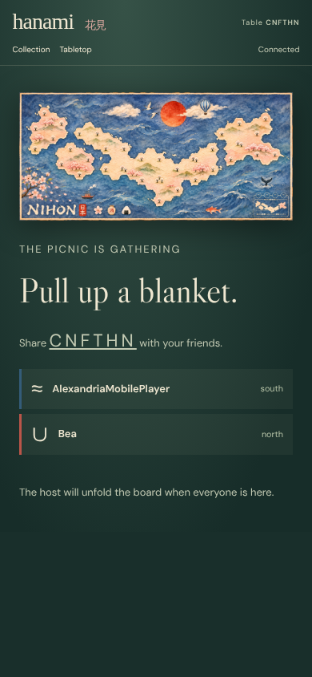

[Bea DOM evidence](https://raw.githubusercontent.com/anicolao/hanami/90ce25c5ff2930d1df294426dd921e9d068ef5d1/tests/e2e/screenshots/mobile-layout.spec.js/chromium-mobile-layout-survives-cold-loads-and-orientation-changes-on-nihon-000-bea-linux.dom.txt)

## 001. Alex: Deal directly into 844 by 390 landscape without an initial resize

Viewport, scrolling, clipping and DOM assertions passed; actor and all observers captured.

[Alex DOM evidence](https://raw.githubusercontent.com/anicolao/hanami/90ce25c5ff2930d1df294426dd921e9d068ef5d1/tests/e2e/screenshots/mobile-layout.spec.js/chromium-mobile-layout-survives-cold-loads-and-orientation-changes-on-nihon-001-alex-linux.dom.txt)

[Bea DOM evidence](https://raw.githubusercontent.com/anicolao/hanami/90ce25c5ff2930d1df294426dd921e9d068ef5d1/tests/e2e/screenshots/mobile-layout.spec.js/chromium-mobile-layout-survives-cold-loads-and-orientation-changes-on-nihon-001-bea-linux.dom.txt)

## 002. Alex: Cold reload in landscape without a corrective window resize

Viewport, scrolling, clipping and DOM assertions passed; actor and all observers captured.

[Alex DOM evidence](https://raw.githubusercontent.com/anicolao/hanami/90ce25c5ff2930d1df294426dd921e9d068ef5d1/tests/e2e/screenshots/mobile-layout.spec.js/chromium-mobile-layout-survives-cold-loads-and-orientation-changes-on-nihon-002-alex-linux.dom.txt)

[Bea DOM evidence](https://raw.githubusercontent.com/anicolao/hanami/90ce25c5ff2930d1df294426dd921e9d068ef5d1/tests/e2e/screenshots/mobile-layout.spec.js/chromium-mobile-layout-survives-cold-loads-and-orientation-changes-on-nihon-002-bea-linux.dom.txt)

## 003. Alex: Fit after text metrics change without resizing the viewport

Viewport, scrolling, clipping and DOM assertions passed; actor and all observers captured.

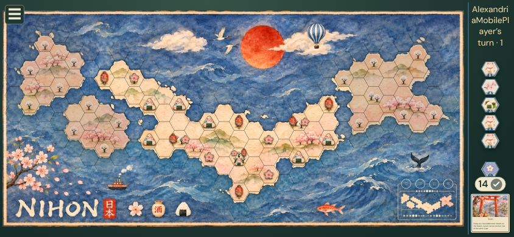

[Alex DOM evidence](https://raw.githubusercontent.com/anicolao/hanami/90ce25c5ff2930d1df294426dd921e9d068ef5d1/tests/e2e/screenshots/mobile-layout.spec.js/chromium-mobile-layout-survives-cold-loads-and-orientation-changes-on-nihon-003-alex-linux.dom.txt)

[Bea DOM evidence](https://raw.githubusercontent.com/anicolao/hanami/90ce25c5ff2930d1df294426dd921e9d068ef5d1/tests/e2e/screenshots/mobile-layout.spec.js/chromium-mobile-layout-survives-cold-loads-and-orientation-changes-on-nihon-003-bea-linux.dom.txt)

## 004. Alex: Fit every component after rotating or resizing to portrait phone

Viewport, scrolling, clipping and DOM assertions passed; actor and all observers captured.

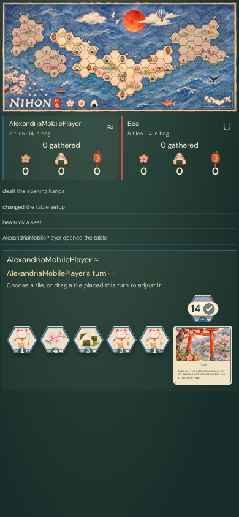

[Alex DOM evidence](https://raw.githubusercontent.com/anicolao/hanami/90ce25c5ff2930d1df294426dd921e9d068ef5d1/tests/e2e/screenshots/mobile-layout.spec.js/chromium-mobile-layout-survives-cold-loads-and-orientation-changes-on-nihon-004-alex-linux.dom.txt)

[Bea DOM evidence](https://raw.githubusercontent.com/anicolao/hanami/90ce25c5ff2930d1df294426dd921e9d068ef5d1/tests/e2e/screenshots/mobile-layout.spec.js/chromium-mobile-layout-survives-cold-loads-and-orientation-changes-on-nihon-004-bea-linux.dom.txt)

## 005. Alex: Fit every component after rotating or resizing to short landscape phone

Viewport, scrolling, clipping and DOM assertions passed; actor and all observers captured.

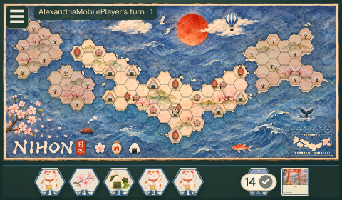

[Alex DOM evidence](https://raw.githubusercontent.com/anicolao/hanami/90ce25c5ff2930d1df294426dd921e9d068ef5d1/tests/e2e/screenshots/mobile-layout.spec.js/chromium-mobile-layout-survives-cold-loads-and-orientation-changes-on-nihon-005-alex-linux.dom.txt)

[Bea DOM evidence](https://raw.githubusercontent.com/anicolao/hanami/90ce25c5ff2930d1df294426dd921e9d068ef5d1/tests/e2e/screenshots/mobile-layout.spec.js/chromium-mobile-layout-survives-cold-loads-and-orientation-changes-on-nihon-005-bea-linux.dom.txt)

## 006. Alex: Fit every component after rotating or resizing to small landscape phone

Viewport, scrolling, clipping and DOM assertions passed; actor and all observers captured.

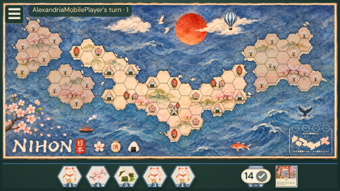

[Alex DOM evidence](https://raw.githubusercontent.com/anicolao/hanami/90ce25c5ff2930d1df294426dd921e9d068ef5d1/tests/e2e/screenshots/mobile-layout.spec.js/chromium-mobile-layout-survives-cold-loads-and-orientation-changes-on-nihon-006-alex-linux.dom.txt)

[Bea DOM evidence](https://raw.githubusercontent.com/anicolao/hanami/90ce25c5ff2930d1df294426dd921e9d068ef5d1/tests/e2e/screenshots/mobile-layout.spec.js/chromium-mobile-layout-survives-cold-loads-and-orientation-changes-on-nihon-006-bea-linux.dom.txt)

## 007. Alex: Fit every component after rotating or resizing to compact landscape phone

Viewport, scrolling, clipping and DOM assertions passed; actor and all observers captured.

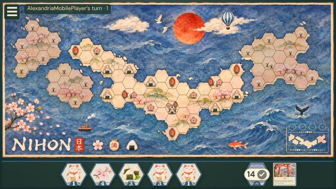

[Alex DOM evidence](https://raw.githubusercontent.com/anicolao/hanami/90ce25c5ff2930d1df294426dd921e9d068ef5d1/tests/e2e/screenshots/mobile-layout.spec.js/chromium-mobile-layout-survives-cold-loads-and-orientation-changes-on-nihon-007-alex-linux.dom.txt)

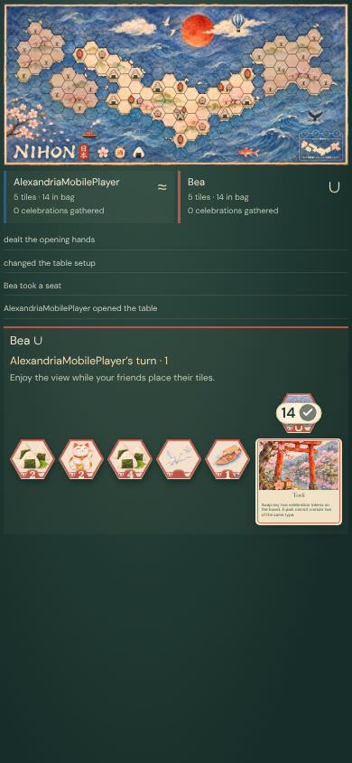

[Bea DOM evidence](https://raw.githubusercontent.com/anicolao/hanami/90ce25c5ff2930d1df294426dd921e9d068ef5d1/tests/e2e/screenshots/mobile-layout.spec.js/chromium-mobile-layout-survives-cold-loads-and-orientation-changes-on-nihon-007-bea-linux.dom.txt)

## 008. Alex: Fit every component after rotating or resizing to landscape phone

Viewport, scrolling, clipping and DOM assertions passed; actor and all observers captured.

[Alex DOM evidence](https://raw.githubusercontent.com/anicolao/hanami/90ce25c5ff2930d1df294426dd921e9d068ef5d1/tests/e2e/screenshots/mobile-layout.spec.js/chromium-mobile-layout-survives-cold-loads-and-orientation-changes-on-nihon-008-alex-linux.dom.txt)

[Bea DOM evidence](https://raw.githubusercontent.com/anicolao/hanami/90ce25c5ff2930d1df294426dd921e9d068ef5d1/tests/e2e/screenshots/mobile-layout.spec.js/chromium-mobile-layout-survives-cold-loads-and-orientation-changes-on-nihon-008-bea-linux.dom.txt)

## 009. Alex: Fit every component after rotating or resizing to landscape phone with browser chrome

Viewport, scrolling, clipping and DOM assertions passed; actor and all observers captured.

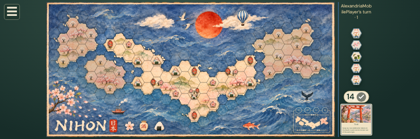

[Alex DOM evidence](https://raw.githubusercontent.com/anicolao/hanami/90ce25c5ff2930d1df294426dd921e9d068ef5d1/tests/e2e/screenshots/mobile-layout.spec.js/chromium-mobile-layout-survives-cold-loads-and-orientation-changes-on-nihon-009-alex-linux.dom.txt)

[Bea DOM evidence](https://raw.githubusercontent.com/anicolao/hanami/90ce25c5ff2930d1df294426dd921e9d068ef5d1/tests/e2e/screenshots/mobile-layout.spec.js/chromium-mobile-layout-survives-cold-loads-and-orientation-changes-on-nihon-009-bea-linux.dom.txt)

## 010. Alex: Fit every component after rotating or resizing to wide landscape phone

Viewport, scrolling, clipping and DOM assertions passed; actor and all observers captured.

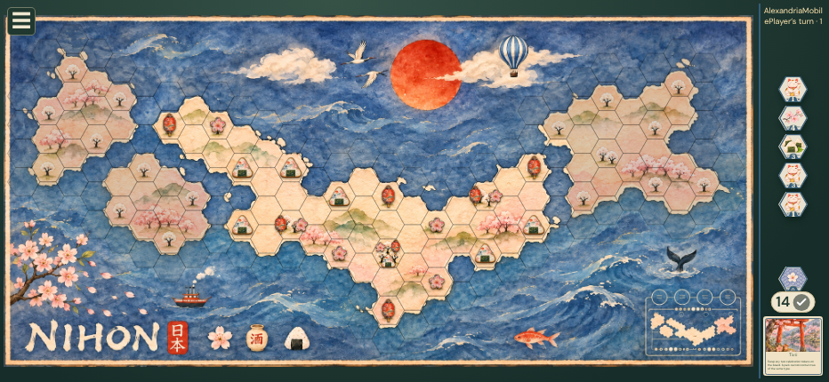

[Alex DOM evidence](https://raw.githubusercontent.com/anicolao/hanami/90ce25c5ff2930d1df294426dd921e9d068ef5d1/tests/e2e/screenshots/mobile-layout.spec.js/chromium-mobile-layout-survives-cold-loads-and-orientation-changes-on-nihon-010-alex-linux.dom.txt)

[Bea DOM evidence](https://raw.githubusercontent.com/anicolao/hanami/90ce25c5ff2930d1df294426dd921e9d068ef5d1/tests/e2e/screenshots/mobile-layout.spec.js/chromium-mobile-layout-survives-cold-loads-and-orientation-changes-on-nihon-010-bea-linux.dom.txt)

## 011. Alex: Fit every component after rotating or resizing to near-square landscape

Viewport, scrolling, clipping and DOM assertions passed; actor and all observers captured.

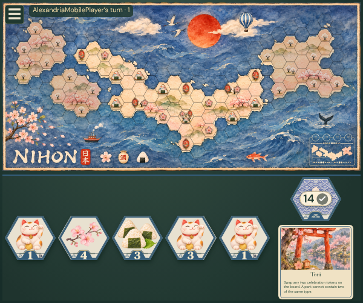

[Alex DOM evidence](https://raw.githubusercontent.com/anicolao/hanami/90ce25c5ff2930d1df294426dd921e9d068ef5d1/tests/e2e/screenshots/mobile-layout.spec.js/chromium-mobile-layout-survives-cold-loads-and-orientation-changes-on-nihon-011-alex-linux.dom.txt)

[Bea DOM evidence](https://raw.githubusercontent.com/anicolao/hanami/90ce25c5ff2930d1df294426dd921e9d068ef5d1/tests/e2e/screenshots/mobile-layout.spec.js/chromium-mobile-layout-survives-cold-loads-and-orientation-changes-on-nihon-011-bea-linux.dom.txt)

## 012. Alex: Fit every component after rotating or resizing to tablet portrait

Viewport, scrolling, clipping and DOM assertions passed; actor and all observers captured.

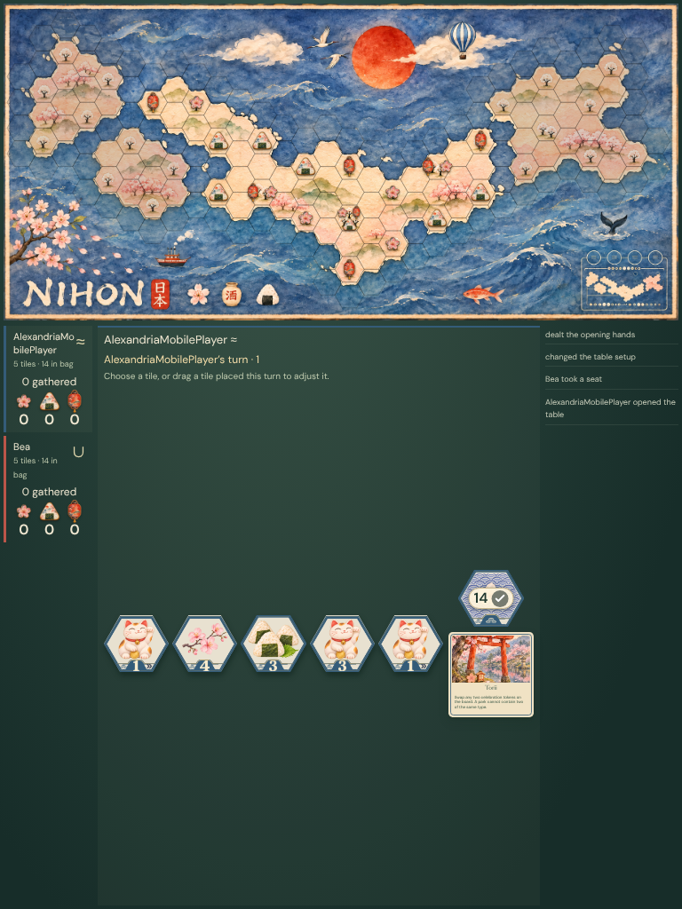

[Alex DOM evidence](https://raw.githubusercontent.com/anicolao/hanami/90ce25c5ff2930d1df294426dd921e9d068ef5d1/tests/e2e/screenshots/mobile-layout.spec.js/chromium-mobile-layout-survives-cold-loads-and-orientation-changes-on-nihon-012-alex-linux.dom.txt)

[Bea DOM evidence](https://raw.githubusercontent.com/anicolao/hanami/90ce25c5ff2930d1df294426dd921e9d068ef5d1/tests/e2e/screenshots/mobile-layout.spec.js/chromium-mobile-layout-survives-cold-loads-and-orientation-changes-on-nihon-012-bea-linux.dom.txt)

## 013. Alex: Fit every component after rotating or resizing to tablet landscape

Viewport, scrolling, clipping and DOM assertions passed; actor and all observers captured.

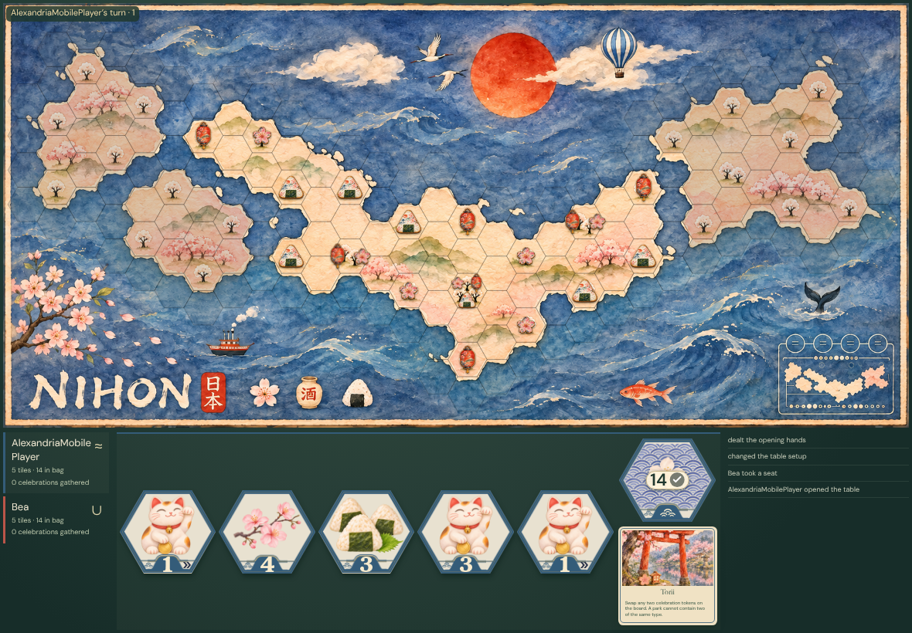

[Alex DOM evidence](https://raw.githubusercontent.com/anicolao/hanami/90ce25c5ff2930d1df294426dd921e9d068ef5d1/tests/e2e/screenshots/mobile-layout.spec.js/chromium-mobile-layout-survives-cold-loads-and-orientation-changes-on-nihon-013-alex-linux.dom.txt)

[Bea DOM evidence](https://raw.githubusercontent.com/anicolao/hanami/90ce25c5ff2930d1df294426dd921e9d068ef5d1/tests/e2e/screenshots/mobile-layout.spec.js/chromium-mobile-layout-survives-cold-loads-and-orientation-changes-on-nihon-013-bea-linux.dom.txt)

## 014. Alex: Fit every component after rotating or resizing to desktop

Viewport, scrolling, clipping and DOM assertions passed; actor and all observers captured.

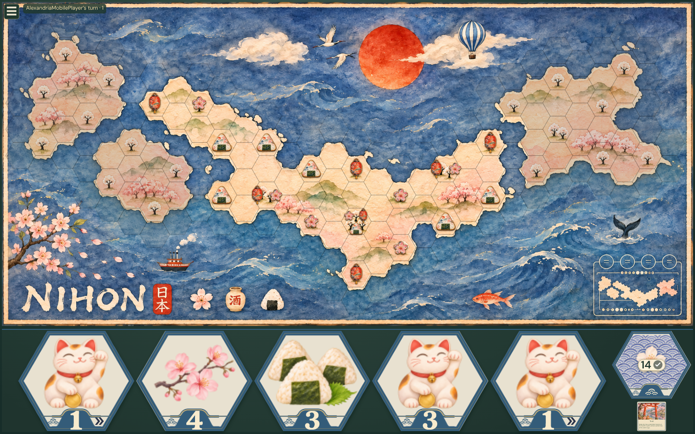

[Alex DOM evidence](https://raw.githubusercontent.com/anicolao/hanami/90ce25c5ff2930d1df294426dd921e9d068ef5d1/tests/e2e/screenshots/mobile-layout.spec.js/chromium-mobile-layout-survives-cold-loads-and-orientation-changes-on-nihon-014-alex-linux.dom.txt)

[Bea DOM evidence](https://raw.githubusercontent.com/anicolao/hanami/90ce25c5ff2930d1df294426dd921e9d068ef5d1/tests/e2e/screenshots/mobile-layout.spec.js/chromium-mobile-layout-survives-cold-loads-and-orientation-changes-on-nihon-014-bea-linux.dom.txt)

## 015. Alex: Fit every component after rotating or resizing to return to mobile landscape

Viewport, scrolling, clipping and DOM assertions passed; actor and all observers captured.

[Alex DOM evidence](https://raw.githubusercontent.com/anicolao/hanami/90ce25c5ff2930d1df294426dd921e9d068ef5d1/tests/e2e/screenshots/mobile-layout.spec.js/chromium-mobile-layout-survives-cold-loads-and-orientation-changes-on-nihon-015-alex-linux.dom.txt)

[Bea DOM evidence](https://raw.githubusercontent.com/anicolao/hanami/90ce25c5ff2930d1df294426dd921e9d068ef5d1/tests/e2e/screenshots/mobile-layout.spec.js/chromium-mobile-layout-survives-cold-loads-and-orientation-changes-on-nihon-015-bea-linux.dom.txt)

## 016. Alex: Select a real tile in the fitted vertical hand

Viewport, scrolling, clipping and DOM assertions passed; actor and all observers captured.

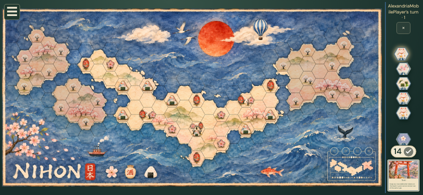

[Alex DOM evidence](https://raw.githubusercontent.com/anicolao/hanami/90ce25c5ff2930d1df294426dd921e9d068ef5d1/tests/e2e/screenshots/mobile-layout.spec.js/chromium-mobile-layout-survives-cold-loads-and-orientation-changes-on-nihon-016-alex-linux.dom.txt)

[Bea DOM evidence](https://raw.githubusercontent.com/anicolao/hanami/90ce25c5ff2930d1df294426dd921e9d068ef5d1/tests/e2e/screenshots/mobile-layout.spec.js/chromium-mobile-layout-survives-cold-loads-and-orientation-changes-on-nihon-016-bea-linux.dom.txt)

## 017. Alex: Place the tile and receive the actual event on the portrait phone

Viewport, scrolling, clipping and DOM assertions passed; actor and all observers captured.

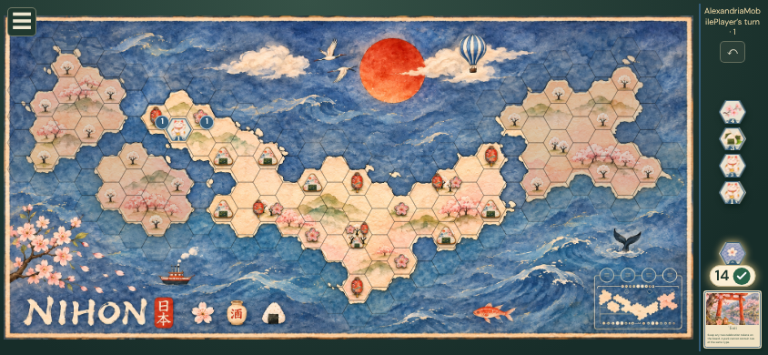

[Alex DOM evidence](https://raw.githubusercontent.com/anicolao/hanami/90ce25c5ff2930d1df294426dd921e9d068ef5d1/tests/e2e/screenshots/mobile-layout.spec.js/chromium-mobile-layout-survives-cold-loads-and-orientation-changes-on-nihon-017-alex-linux.dom.txt)

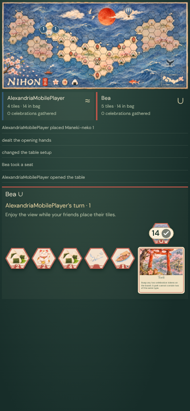

[Bea DOM evidence](https://raw.githubusercontent.com/anicolao/hanami/90ce25c5ff2930d1df294426dd921e9d068ef5d1/tests/e2e/screenshots/mobile-layout.spec.js/chromium-mobile-layout-survives-cold-loads-and-orientation-changes-on-nihon-017-bea-linux.dom.txt)

## 018. Alex: Undo from the same fitted mat

Viewport, scrolling, clipping and DOM assertions passed; actor and all observers captured.

[Alex DOM evidence](https://raw.githubusercontent.com/anicolao/hanami/90ce25c5ff2930d1df294426dd921e9d068ef5d1/tests/e2e/screenshots/mobile-layout.spec.js/chromium-mobile-layout-survives-cold-loads-and-orientation-changes-on-nihon-018-alex-linux.dom.txt)

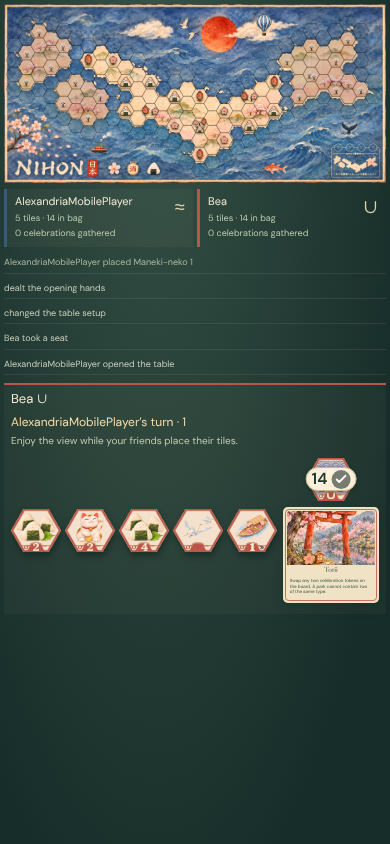

[Bea DOM evidence](https://raw.githubusercontent.com/anicolao/hanami/90ce25c5ff2930d1df294426dd921e9d068ef5d1/tests/e2e/screenshots/mobile-layout.spec.js/chromium-mobile-layout-survives-cold-loads-and-orientation-changes-on-nihon-018-bea-linux.dom.txt)
