# Adaptive landscape board and hand · Tokyo

Real UI → authenticated Firestore transaction → immutable event → deterministic replay → every observer. Zero pixel tolerance; every decoded RGBA byte and the accessible DOM are compared. No game-state injection or outcome fixtures.

## 000. Bea: Join through the real invitation

Viewport, scrolling, clipping and DOM assertions passed; actor and all observers captured.

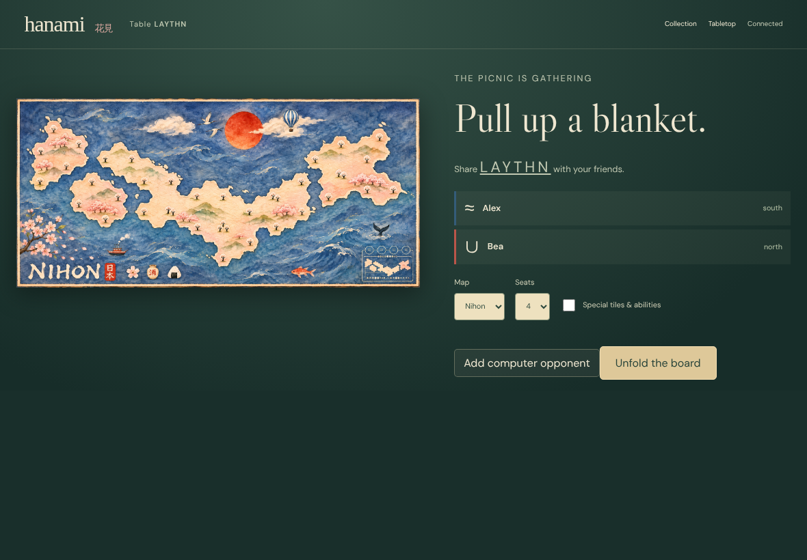

[Alex DOM evidence](../../../screenshots/adaptive-layout.spec.js/landscape-play-chooses-usable-board-and-hand-space-on-tokyo-000-alex-linux.dom.txt)

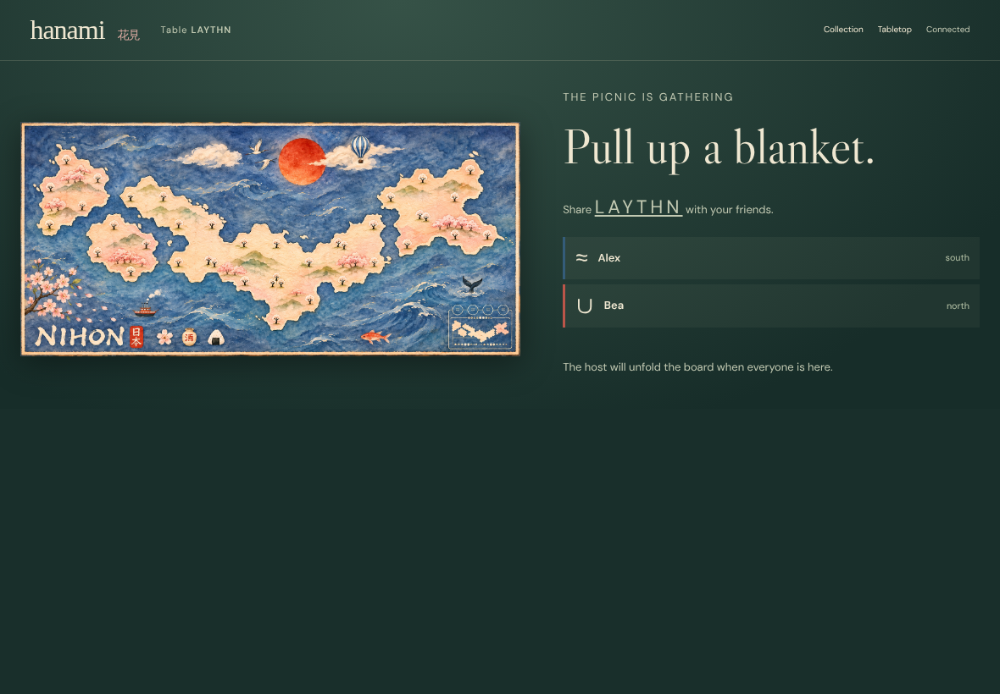

[Bea DOM evidence](../../../screenshots/adaptive-layout.spec.js/landscape-play-chooses-usable-board-and-hand-space-on-tokyo-000-bea-linux.dom.txt)

## 001. Alex: Choose the board through the normal setup control

Viewport, scrolling, clipping and DOM assertions passed; actor and all observers captured.

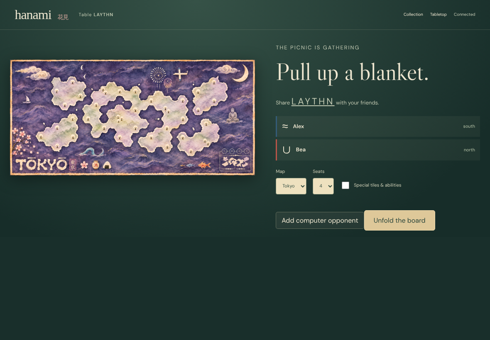

[Alex DOM evidence](../../../screenshots/adaptive-layout.spec.js/landscape-play-chooses-usable-board-and-hand-space-on-tokyo-001-alex-linux.dom.txt)

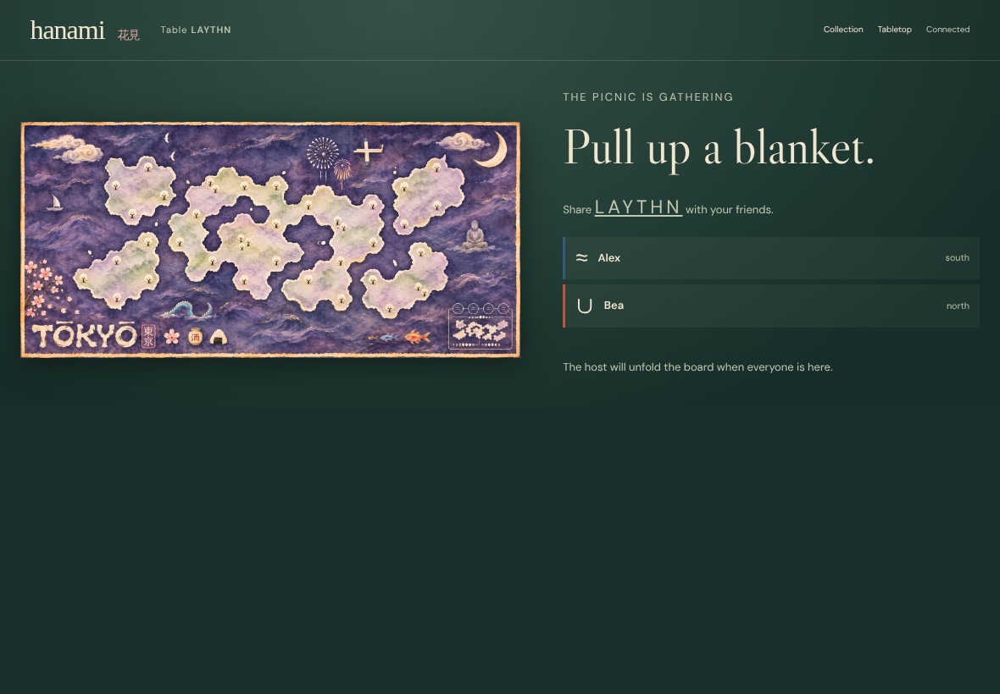

[Bea DOM evidence](../../../screenshots/adaptive-layout.spec.js/landscape-play-chooses-usable-board-and-hand-space-on-tokyo-001-bea-linux.dom.txt)

## 002. Alex: Deal actual hands

Viewport, scrolling, clipping and DOM assertions passed; actor and all observers captured.

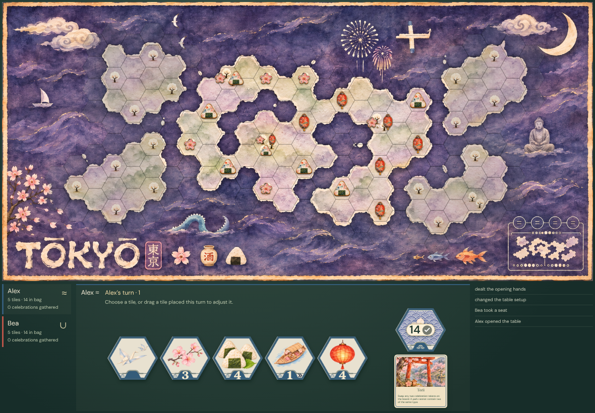

[Alex DOM evidence](../../../screenshots/adaptive-layout.spec.js/landscape-play-chooses-usable-board-and-hand-space-on-tokyo-002-alex-linux.dom.txt)

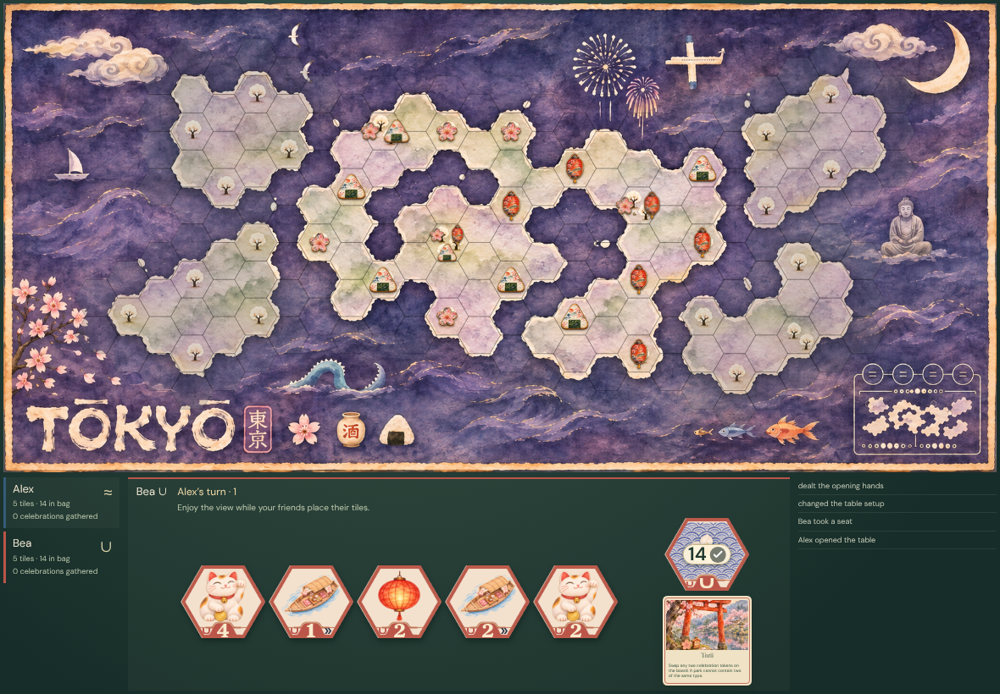

[Bea DOM evidence](../../../screenshots/adaptive-layout.spec.js/landscape-play-chooses-usable-board-and-hand-space-on-tokyo-002-bea-linux.dom.txt)

## 003. Alex: Choose the best board and hand fit on laptop

Viewport, scrolling, clipping and DOM assertions passed; actor and all observers captured.

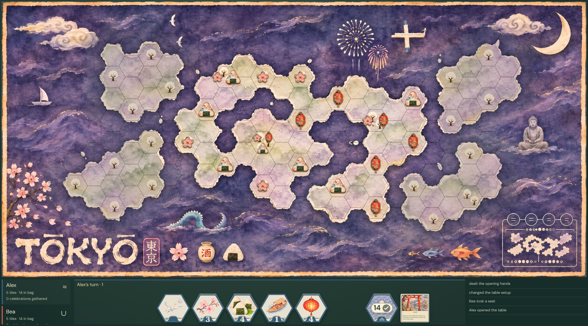

[Alex DOM evidence](../../../screenshots/adaptive-layout.spec.js/landscape-play-chooses-usable-board-and-hand-space-on-tokyo-003-alex-linux.dom.txt)

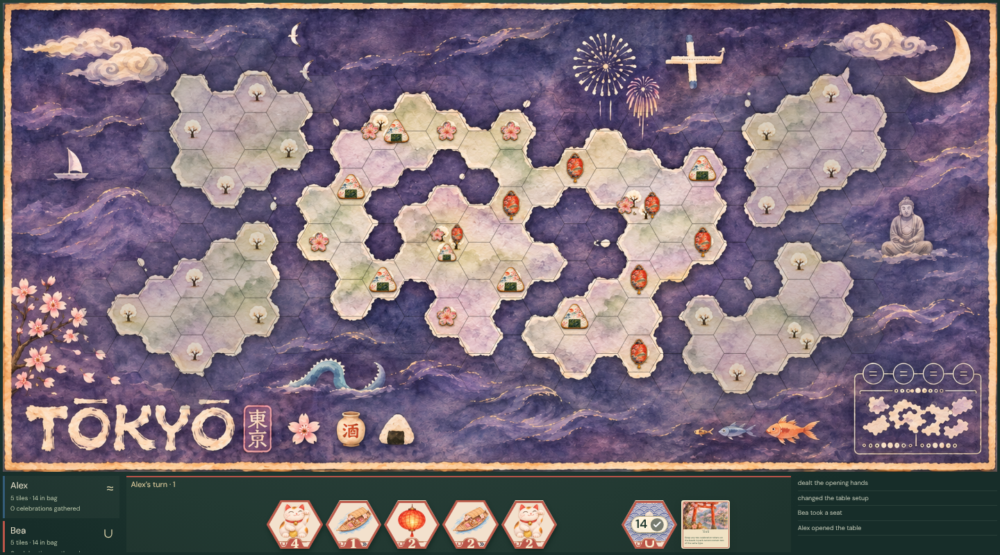

[Bea DOM evidence](../../../screenshots/adaptive-layout.spec.js/landscape-play-chooses-usable-board-and-hand-space-on-tokyo-003-bea-linux.dom.txt)

## 004. Alex: Choose the best board and hand fit on desktop

Viewport, scrolling, clipping and DOM assertions passed; actor and all observers captured.

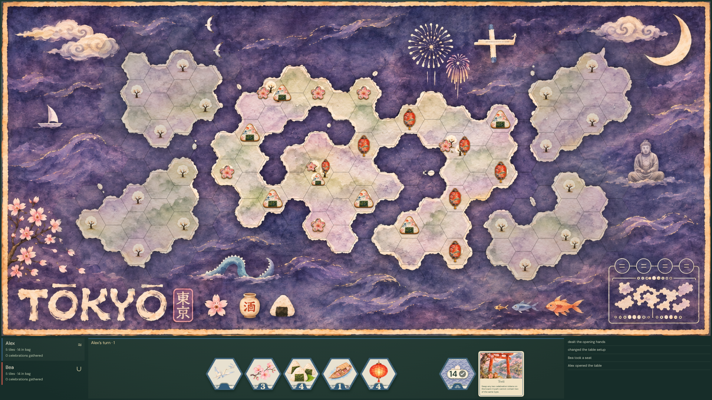

[Alex DOM evidence](../../../screenshots/adaptive-layout.spec.js/landscape-play-chooses-usable-board-and-hand-space-on-tokyo-004-alex-linux.dom.txt)

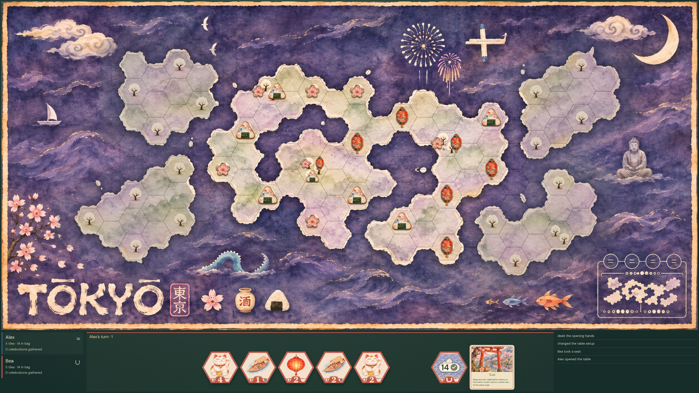

[Bea DOM evidence](../../../screenshots/adaptive-layout.spec.js/landscape-play-chooses-usable-board-and-hand-space-on-tokyo-004-bea-linux.dom.txt)

## 005. Alex: Choose the best board and hand fit on small phone

Viewport, scrolling, clipping and DOM assertions passed; actor and all observers captured.

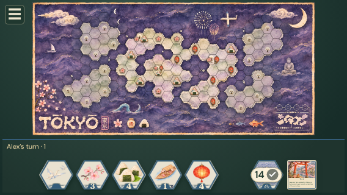

[Alex DOM evidence](../../../screenshots/adaptive-layout.spec.js/landscape-play-chooses-usable-board-and-hand-space-on-tokyo-005-alex-linux.dom.txt)

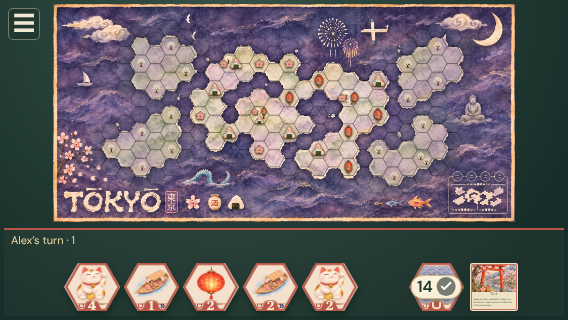

[Bea DOM evidence](../../../screenshots/adaptive-layout.spec.js/landscape-play-chooses-usable-board-and-hand-space-on-tokyo-005-bea-linux.dom.txt)

## 006. Alex: Choose the best board and hand fit on compact phone

Viewport, scrolling, clipping and DOM assertions passed; actor and all observers captured.

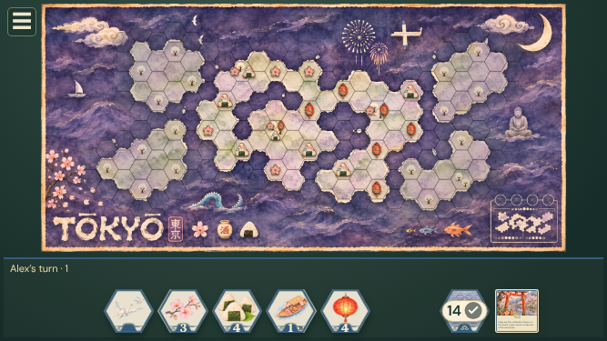

[Alex DOM evidence](../../../screenshots/adaptive-layout.spec.js/landscape-play-chooses-usable-board-and-hand-space-on-tokyo-006-alex-linux.dom.txt)

[Bea DOM evidence](../../../screenshots/adaptive-layout.spec.js/landscape-play-chooses-usable-board-and-hand-space-on-tokyo-006-bea-linux.dom.txt)

## 007. Alex: Choose the best board and hand fit on wide phone

Viewport, scrolling, clipping and DOM assertions passed; actor and all observers captured.

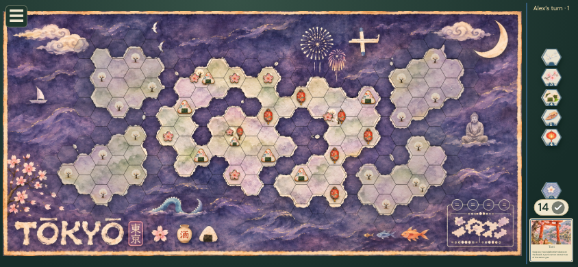

[Alex DOM evidence](../../../screenshots/adaptive-layout.spec.js/landscape-play-chooses-usable-board-and-hand-space-on-tokyo-007-alex-linux.dom.txt)

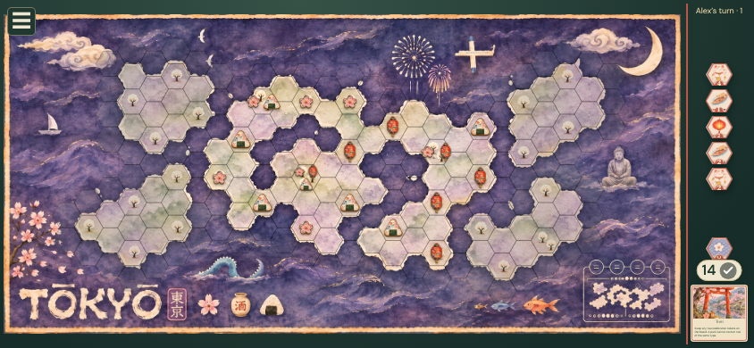

[Bea DOM evidence](../../../screenshots/adaptive-layout.spec.js/landscape-play-chooses-usable-board-and-hand-space-on-tokyo-007-bea-linux.dom.txt)

## 008. Alex: Choose the best board and hand fit on ultrawide

Viewport, scrolling, clipping and DOM assertions passed; actor and all observers captured.

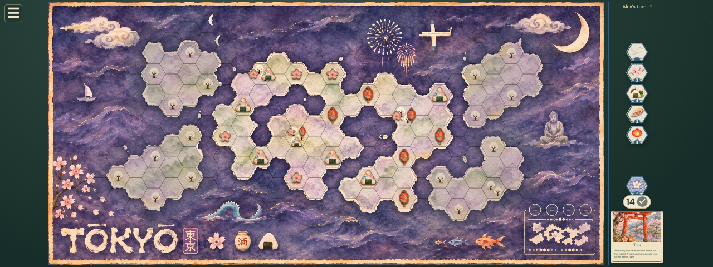

[Alex DOM evidence](../../../screenshots/adaptive-layout.spec.js/landscape-play-chooses-usable-board-and-hand-space-on-tokyo-008-alex-linux.dom.txt)

[Bea DOM evidence](../../../screenshots/adaptive-layout.spec.js/landscape-play-chooses-usable-board-and-hand-space-on-tokyo-008-bea-linux.dom.txt)

## 009. Alex: Hold a real tile beside the board

Viewport, scrolling, clipping and DOM assertions passed; actor and all observers captured.

[Alex DOM evidence](../../../screenshots/adaptive-layout.spec.js/landscape-play-chooses-usable-board-and-hand-space-on-tokyo-009-alex-linux.dom.txt)

[Bea DOM evidence](../../../screenshots/adaptive-layout.spec.js/landscape-play-chooses-usable-board-and-hand-space-on-tokyo-009-bea-linux.dom.txt)

## 010. Alex: Resize to the bottom hand without losing the choice

Viewport, scrolling, clipping and DOM assertions passed; actor and all observers captured.

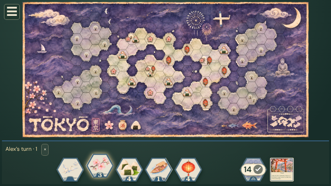

[Alex DOM evidence](../../../screenshots/adaptive-layout.spec.js/landscape-play-chooses-usable-board-and-hand-space-on-tokyo-010-alex-linux.dom.txt)

[Bea DOM evidence](../../../screenshots/adaptive-layout.spec.js/landscape-play-chooses-usable-board-and-hand-space-on-tokyo-010-bea-linux.dom.txt)

## 011. Alex: Place the selected component on its real hex

Viewport, scrolling, clipping and DOM assertions passed; actor and all observers captured.

[Alex DOM evidence](../../../screenshots/adaptive-layout.spec.js/landscape-play-chooses-usable-board-and-hand-space-on-tokyo-011-alex-linux.dom.txt)

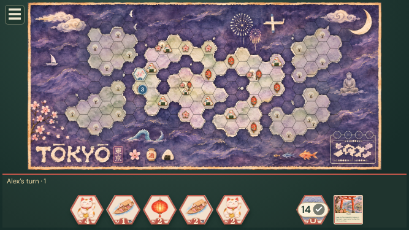

[Bea DOM evidence](../../../screenshots/adaptive-layout.spec.js/landscape-play-chooses-usable-board-and-hand-space-on-tokyo-011-bea-linux.dom.txt)

## 012. Alex: Open player information beside the compact bottom hand

Viewport, scrolling, clipping and DOM assertions passed; actor and all observers captured.

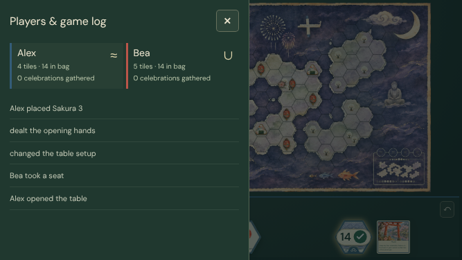

[Alex DOM evidence](../../../screenshots/adaptive-layout.spec.js/landscape-play-chooses-usable-board-and-hand-space-on-tokyo-012-alex-linux.dom.txt)

[Bea DOM evidence](../../../screenshots/adaptive-layout.spec.js/landscape-play-chooses-usable-board-and-hand-space-on-tokyo-012-bea-linux.dom.txt)

## 013. Alex: Close the drawer and return to the same mat

Viewport, scrolling, clipping and DOM assertions passed; actor and all observers captured.

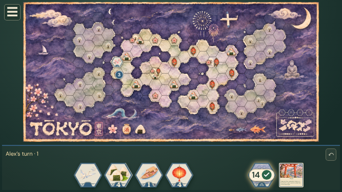

[Alex DOM evidence](../../../screenshots/adaptive-layout.spec.js/landscape-play-chooses-usable-board-and-hand-space-on-tokyo-013-alex-linux.dom.txt)

[Bea DOM evidence](../../../screenshots/adaptive-layout.spec.js/landscape-play-chooses-usable-board-and-hand-space-on-tokyo-013-bea-linux.dom.txt)

## 014. Alex: Undo the placement directly from the bottom mat

Viewport, scrolling, clipping and DOM assertions passed; actor and all observers captured.

[Alex DOM evidence](../../../screenshots/adaptive-layout.spec.js/landscape-play-chooses-usable-board-and-hand-space-on-tokyo-014-alex-linux.dom.txt)

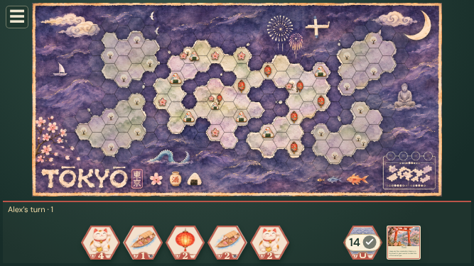

[Bea DOM evidence](../../../screenshots/adaptive-layout.spec.js/landscape-play-chooses-usable-board-and-hand-space-on-tokyo-014-bea-linux.dom.txt)
