# Four players and independently selected computer levels — complete game

Real UI → authenticated Firestore transaction → immutable event → deterministic replay → every observer. Zero pixel tolerance; every decoded RGBA byte and the accessible DOM are compared. No game-state injection or outcome fixtures.

## 000. Alex: Invite Computer

Viewport, scrolling, clipping and DOM assertions passed; actor and all observers captured.

[Alex DOM evidence](https://raw.githubusercontent.com/anicolao/hanami/c7c5f2ebd1e2aafe84c95d9a13e4e974e28b1a3a/tests/e2e/screenshots/multiplayer-levels.spec.js/four-players-choose-independent-computer-levels-and-play-through-real-victory-000-alex-linux.dom.txt)

[Bea DOM evidence](https://raw.githubusercontent.com/anicolao/hanami/c7c5f2ebd1e2aafe84c95d9a13e4e974e28b1a3a/tests/e2e/screenshots/multiplayer-levels.spec.js/four-players-choose-independent-computer-levels-and-play-through-real-victory-000-bea-linux.dom.txt)

## 001. Alex: Set Computer to medium

Viewport, scrolling, clipping and DOM assertions passed; actor and all observers captured.

[Alex DOM evidence](https://raw.githubusercontent.com/anicolao/hanami/c7c5f2ebd1e2aafe84c95d9a13e4e974e28b1a3a/tests/e2e/screenshots/multiplayer-levels.spec.js/four-players-choose-independent-computer-levels-and-play-through-real-victory-001-alex-linux.dom.txt)

[Bea DOM evidence](https://raw.githubusercontent.com/anicolao/hanami/c7c5f2ebd1e2aafe84c95d9a13e4e974e28b1a3a/tests/e2e/screenshots/multiplayer-levels.spec.js/four-players-choose-independent-computer-levels-and-play-through-real-victory-001-bea-linux.dom.txt)

## 002. Alex: Invite Computer 3

Viewport, scrolling, clipping and DOM assertions passed; actor and all observers captured.

[Alex DOM evidence](https://raw.githubusercontent.com/anicolao/hanami/c7c5f2ebd1e2aafe84c95d9a13e4e974e28b1a3a/tests/e2e/screenshots/multiplayer-levels.spec.js/four-players-choose-independent-computer-levels-and-play-through-real-victory-002-alex-linux.dom.txt)

[Bea DOM evidence](https://raw.githubusercontent.com/anicolao/hanami/c7c5f2ebd1e2aafe84c95d9a13e4e974e28b1a3a/tests/e2e/screenshots/multiplayer-levels.spec.js/four-players-choose-independent-computer-levels-and-play-through-real-victory-002-bea-linux.dom.txt)

## 003. Alex: Set Computer 3 to hard

Viewport, scrolling, clipping and DOM assertions passed; actor and all observers captured.

[Alex DOM evidence](https://raw.githubusercontent.com/anicolao/hanami/c7c5f2ebd1e2aafe84c95d9a13e4e974e28b1a3a/tests/e2e/screenshots/multiplayer-levels.spec.js/four-players-choose-independent-computer-levels-and-play-through-real-victory-003-alex-linux.dom.txt)

[Bea DOM evidence](https://raw.githubusercontent.com/anicolao/hanami/c7c5f2ebd1e2aafe84c95d9a13e4e974e28b1a3a/tests/e2e/screenshots/multiplayer-levels.spec.js/four-players-choose-independent-computer-levels-and-play-through-real-victory-003-bea-linux.dom.txt)

## 004. Bea: Bea takes the fourth seat

Viewport, scrolling, clipping and DOM assertions passed; actor and all observers captured.

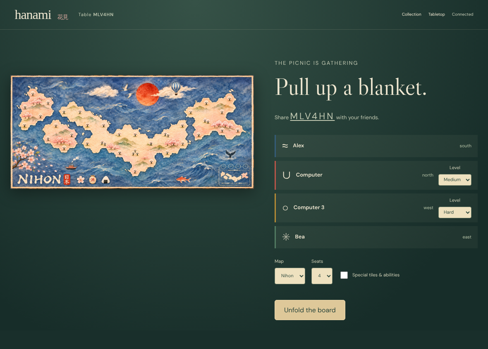

[Alex DOM evidence](https://raw.githubusercontent.com/anicolao/hanami/c7c5f2ebd1e2aafe84c95d9a13e4e974e28b1a3a/tests/e2e/screenshots/multiplayer-levels.spec.js/four-players-choose-independent-computer-levels-and-play-through-real-victory-004-alex-linux.dom.txt)

[Bea DOM evidence](https://raw.githubusercontent.com/anicolao/hanami/c7c5f2ebd1e2aafe84c95d9a13e4e974e28b1a3a/tests/e2e/screenshots/multiplayer-levels.spec.js/four-players-choose-independent-computer-levels-and-play-through-real-victory-004-bea-linux.dom.txt)

## 005. Alex: Reload and restore both computer levels from events

Viewport, scrolling, clipping and DOM assertions passed; actor and all observers captured.

[Alex DOM evidence](https://raw.githubusercontent.com/anicolao/hanami/c7c5f2ebd1e2aafe84c95d9a13e4e974e28b1a3a/tests/e2e/screenshots/multiplayer-levels.spec.js/four-players-choose-independent-computer-levels-and-play-through-real-victory-005-alex-linux.dom.txt)

[Bea DOM evidence](https://raw.githubusercontent.com/anicolao/hanami/c7c5f2ebd1e2aafe84c95d9a13e4e974e28b1a3a/tests/e2e/screenshots/multiplayer-levels.spec.js/four-players-choose-independent-computer-levels-and-play-through-real-victory-005-bea-linux.dom.txt)

## 006. Alex: Deal four real hands

Viewport, scrolling, clipping and DOM assertions passed; actor and all observers captured.

[Alex DOM evidence](https://raw.githubusercontent.com/anicolao/hanami/c7c5f2ebd1e2aafe84c95d9a13e4e974e28b1a3a/tests/e2e/screenshots/multiplayer-levels.spec.js/four-players-choose-independent-computer-levels-and-play-through-real-victory-006-alex-linux.dom.txt)

[Bea DOM evidence](https://raw.githubusercontent.com/anicolao/hanami/c7c5f2ebd1e2aafe84c95d9a13e4e974e28b1a3a/tests/e2e/screenshots/multiplayer-levels.spec.js/four-players-choose-independent-computer-levels-and-play-through-real-victory-006-bea-linux.dom.txt)

## 007. Alex: Inspect all four public collections without crowding the hand

Viewport, scrolling, clipping and DOM assertions passed; actor and all observers captured.

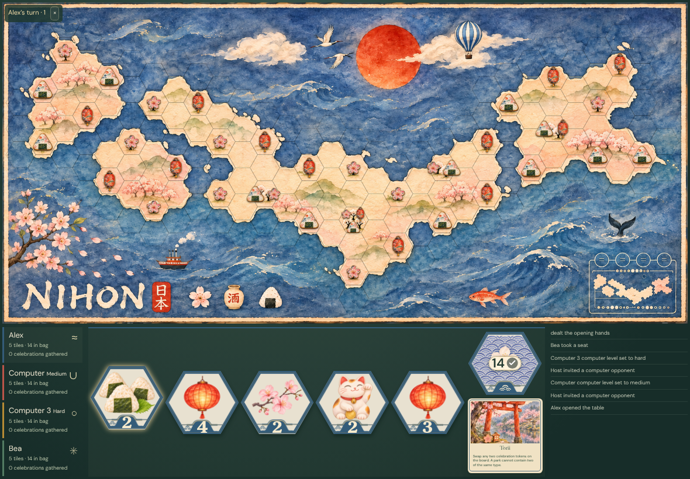

[Alex DOM evidence](https://raw.githubusercontent.com/anicolao/hanami/c7c5f2ebd1e2aafe84c95d9a13e4e974e28b1a3a/tests/e2e/screenshots/multiplayer-levels.spec.js/four-players-choose-independent-computer-levels-and-play-through-real-victory-007-alex-linux.dom.txt)

[Bea DOM evidence](https://raw.githubusercontent.com/anicolao/hanami/c7c5f2ebd1e2aafe84c95d9a13e4e974e28b1a3a/tests/e2e/screenshots/multiplayer-levels.spec.js/four-players-choose-independent-computer-levels-and-play-through-real-victory-007-bea-linux.dom.txt)

## 008. Alex: Keep four collections visible at 844 by 390

Viewport, scrolling, clipping and DOM assertions passed; actor and all observers captured.

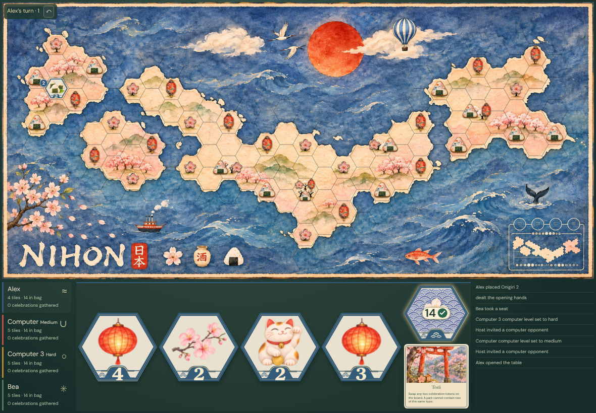

[Alex DOM evidence](https://raw.githubusercontent.com/anicolao/hanami/c7c5f2ebd1e2aafe84c95d9a13e4e974e28b1a3a/tests/e2e/screenshots/multiplayer-levels.spec.js/four-players-choose-independent-computer-levels-and-play-through-real-victory-008-alex-linux.dom.txt)

[Bea DOM evidence](https://raw.githubusercontent.com/anicolao/hanami/c7c5f2ebd1e2aafe84c95d9a13e4e974e28b1a3a/tests/e2e/screenshots/multiplayer-levels.spec.js/four-players-choose-independent-computer-levels-and-play-through-real-victory-008-bea-linux.dom.txt)

## 009. Alex: Keep four collections visible at 568 by 320

Viewport, scrolling, clipping and DOM assertions passed; actor and all observers captured.

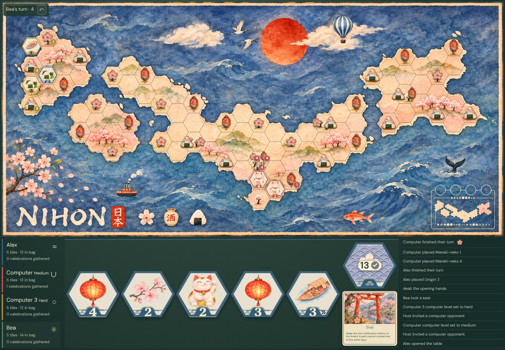

[Alex DOM evidence](https://raw.githubusercontent.com/anicolao/hanami/c7c5f2ebd1e2aafe84c95d9a13e4e974e28b1a3a/tests/e2e/screenshots/multiplayer-levels.spec.js/four-players-choose-independent-computer-levels-and-play-through-real-victory-009-alex-linux.dom.txt)

[Bea DOM evidence](https://raw.githubusercontent.com/anicolao/hanami/c7c5f2ebd1e2aafe84c95d9a13e4e974e28b1a3a/tests/e2e/screenshots/multiplayer-levels.spec.js/four-players-choose-independent-computer-levels-and-play-through-real-victory-009-bea-linux.dom.txt)

## 010. Alex: Keep four collections visible at 480 by 280

Viewport, scrolling, clipping and DOM assertions passed; actor and all observers captured.

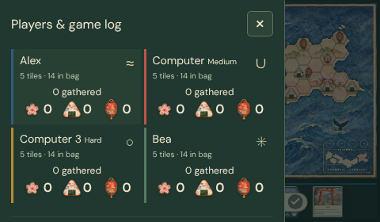

[Alex DOM evidence](https://raw.githubusercontent.com/anicolao/hanami/c7c5f2ebd1e2aafe84c95d9a13e4e974e28b1a3a/tests/e2e/screenshots/multiplayer-levels.spec.js/four-players-choose-independent-computer-levels-and-play-through-real-victory-010-alex-linux.dom.txt)

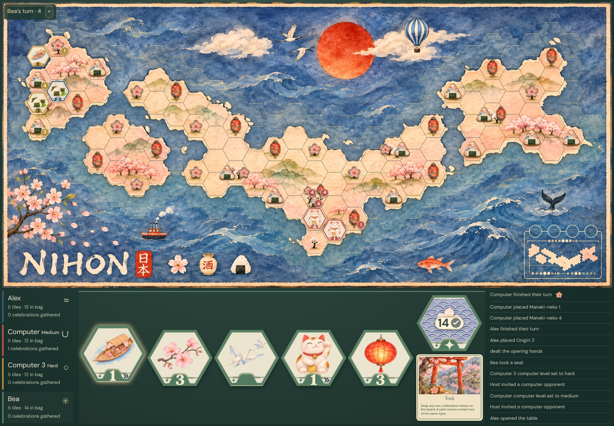

[Bea DOM evidence](https://raw.githubusercontent.com/anicolao/hanami/c7c5f2ebd1e2aafe84c95d9a13e4e974e28b1a3a/tests/e2e/screenshots/multiplayer-levels.spec.js/four-players-choose-independent-computer-levels-and-play-through-real-victory-010-bea-linux.dom.txt)

## 011. Alex: Close information and return to the original desktop hand

Viewport, scrolling, clipping and DOM assertions passed; actor and all observers captured.

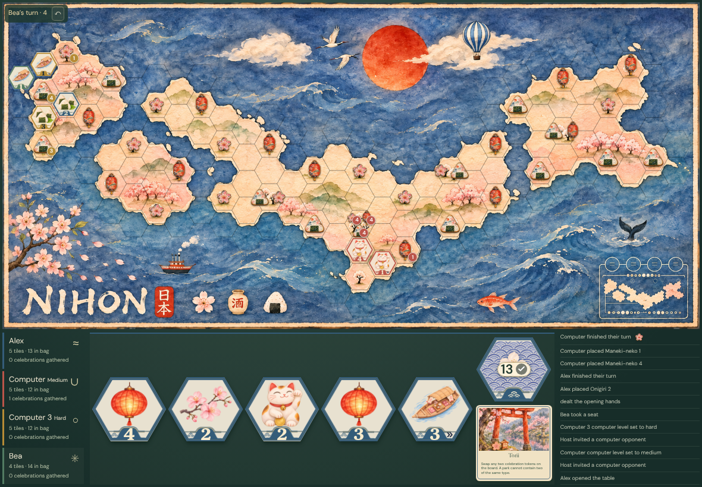

[Alex DOM evidence](https://raw.githubusercontent.com/anicolao/hanami/c7c5f2ebd1e2aafe84c95d9a13e4e974e28b1a3a/tests/e2e/screenshots/multiplayer-levels.spec.js/four-players-choose-independent-computer-levels-and-play-through-real-victory-011-alex-linux.dom.txt)

[Bea DOM evidence](https://raw.githubusercontent.com/anicolao/hanami/c7c5f2ebd1e2aafe84c95d9a13e4e974e28b1a3a/tests/e2e/screenshots/multiplayer-levels.spec.js/four-players-choose-independent-computer-levels-and-play-through-real-victory-011-bea-linux.dom.txt)

## 012. Alex: Select onigiri-2 from Alex’s real hand

Viewport, scrolling, clipping and DOM assertions passed; actor and all observers captured.

[Alex DOM evidence](https://raw.githubusercontent.com/anicolao/hanami/c7c5f2ebd1e2aafe84c95d9a13e4e974e28b1a3a/tests/e2e/screenshots/multiplayer-levels.spec.js/four-players-choose-independent-computer-levels-and-play-through-real-victory-012-alex-linux.dom.txt)

[Bea DOM evidence](https://raw.githubusercontent.com/anicolao/hanami/c7c5f2ebd1e2aafe84c95d9a13e4e974e28b1a3a/tests/e2e/screenshots/multiplayer-levels.spec.js/four-players-choose-independent-computer-levels-and-play-through-real-victory-012-bea-linux.dom.txt)

## 013. Alex: Place onigiri-2 at 2:4

Viewport, scrolling, clipping and DOM assertions passed; actor and all observers captured.

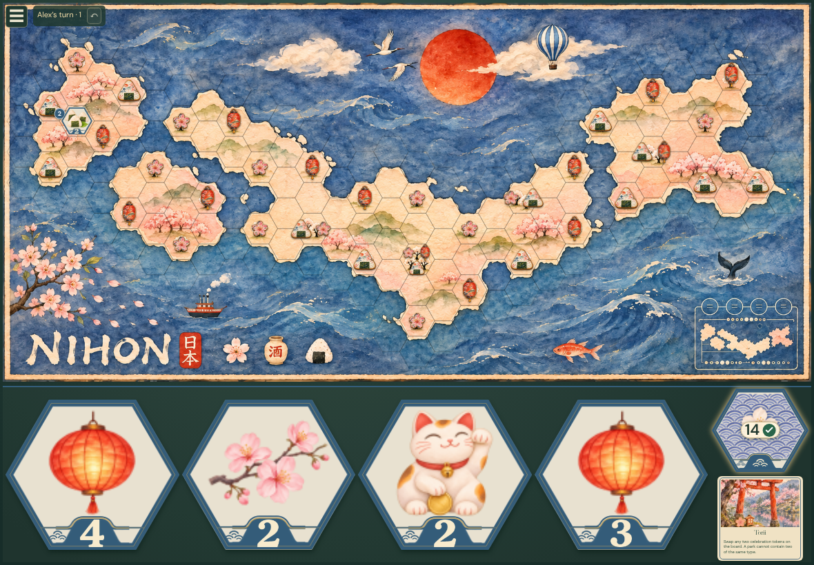

[Alex DOM evidence](https://raw.githubusercontent.com/anicolao/hanami/c7c5f2ebd1e2aafe84c95d9a13e4e974e28b1a3a/tests/e2e/screenshots/multiplayer-levels.spec.js/four-players-choose-independent-computer-levels-and-play-through-real-victory-013-alex-linux.dom.txt)

[Bea DOM evidence](https://raw.githubusercontent.com/anicolao/hanami/c7c5f2ebd1e2aafe84c95d9a13e4e974e28b1a3a/tests/e2e/screenshots/multiplayer-levels.spec.js/four-players-choose-independent-computer-levels-and-play-through-real-victory-013-bea-linux.dom.txt)

## 014. Alex: Alex refills and lets the next seats play

Viewport, scrolling, clipping and DOM assertions passed; actor and all observers captured.

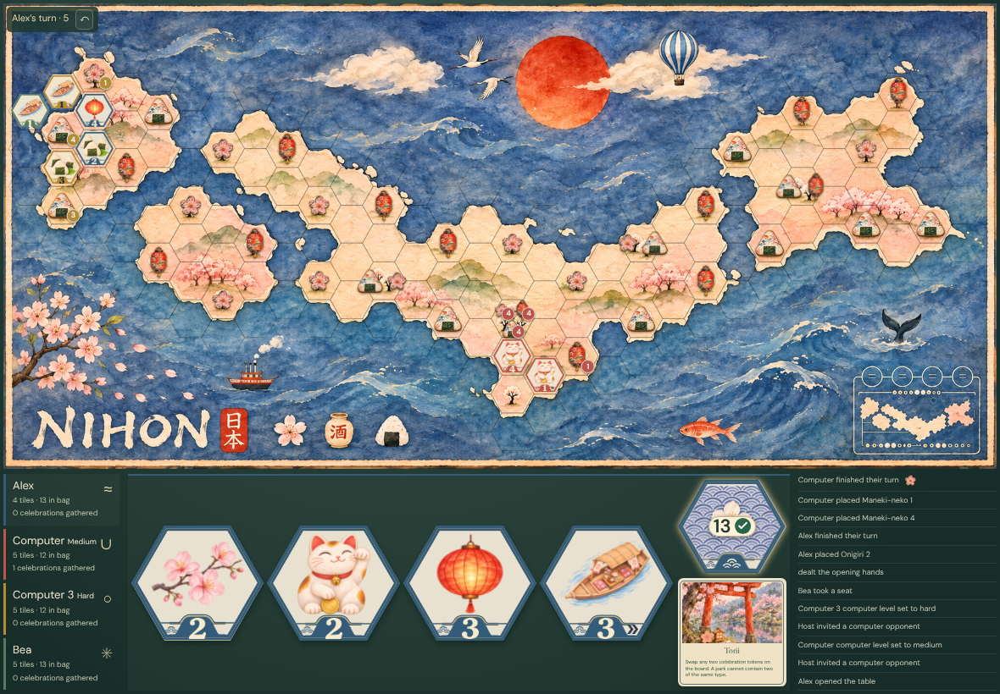

[Alex DOM evidence](https://raw.githubusercontent.com/anicolao/hanami/c7c5f2ebd1e2aafe84c95d9a13e4e974e28b1a3a/tests/e2e/screenshots/multiplayer-levels.spec.js/four-players-choose-independent-computer-levels-and-play-through-real-victory-014-alex-linux.dom.txt)

[Bea DOM evidence](https://raw.githubusercontent.com/anicolao/hanami/c7c5f2ebd1e2aafe84c95d9a13e4e974e28b1a3a/tests/e2e/screenshots/multiplayer-levels.spec.js/four-players-choose-independent-computer-levels-and-play-through-real-victory-014-bea-linux.dom.txt)

## 015. Bea: Select boat-1 from Bea’s real hand

Viewport, scrolling, clipping and DOM assertions passed; actor and all observers captured.

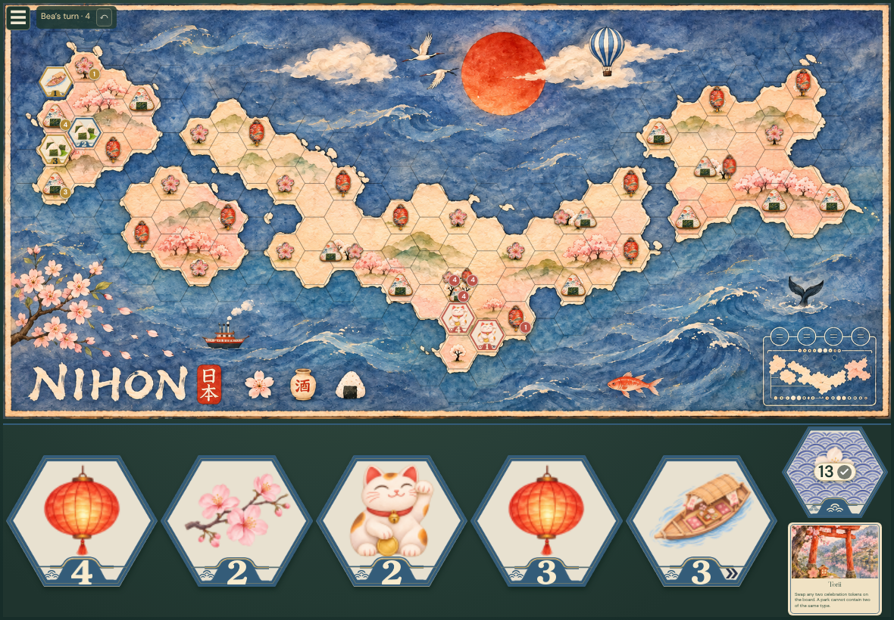

[Alex DOM evidence](https://raw.githubusercontent.com/anicolao/hanami/c7c5f2ebd1e2aafe84c95d9a13e4e974e28b1a3a/tests/e2e/screenshots/multiplayer-levels.spec.js/four-players-choose-independent-computer-levels-and-play-through-real-victory-015-alex-linux.dom.txt)

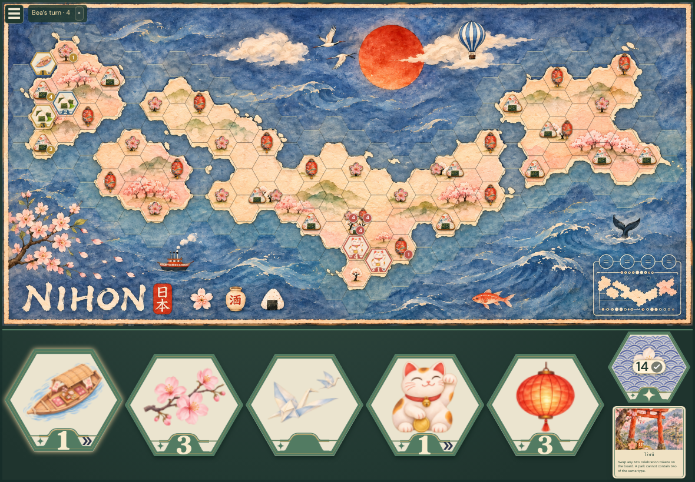

[Bea DOM evidence](https://raw.githubusercontent.com/anicolao/hanami/c7c5f2ebd1e2aafe84c95d9a13e4e974e28b1a3a/tests/e2e/screenshots/multiplayer-levels.spec.js/four-players-choose-independent-computer-levels-and-play-through-real-victory-015-bea-linux.dom.txt)

## 016. Bea: Place boat-1 at 0:3

Viewport, scrolling, clipping and DOM assertions passed; actor and all observers captured.

[Alex DOM evidence](https://raw.githubusercontent.com/anicolao/hanami/c7c5f2ebd1e2aafe84c95d9a13e4e974e28b1a3a/tests/e2e/screenshots/multiplayer-levels.spec.js/four-players-choose-independent-computer-levels-and-play-through-real-victory-016-alex-linux.dom.txt)

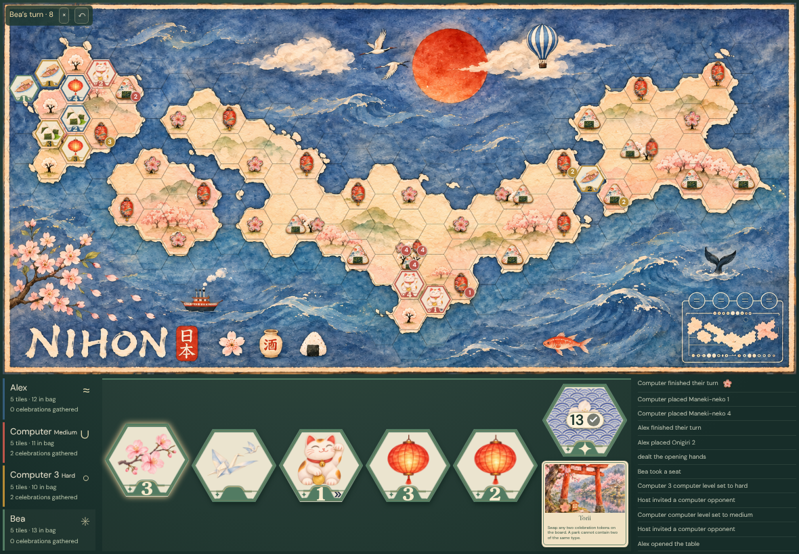

[Bea DOM evidence](https://raw.githubusercontent.com/anicolao/hanami/c7c5f2ebd1e2aafe84c95d9a13e4e974e28b1a3a/tests/e2e/screenshots/multiplayer-levels.spec.js/four-players-choose-independent-computer-levels-and-play-through-real-victory-016-bea-linux.dom.txt)

## 017. Bea: Bea refills and lets the next seats play

Viewport, scrolling, clipping and DOM assertions passed; actor and all observers captured.

[Alex DOM evidence](https://raw.githubusercontent.com/anicolao/hanami/c7c5f2ebd1e2aafe84c95d9a13e4e974e28b1a3a/tests/e2e/screenshots/multiplayer-levels.spec.js/four-players-choose-independent-computer-levels-and-play-through-real-victory-017-alex-linux.dom.txt)

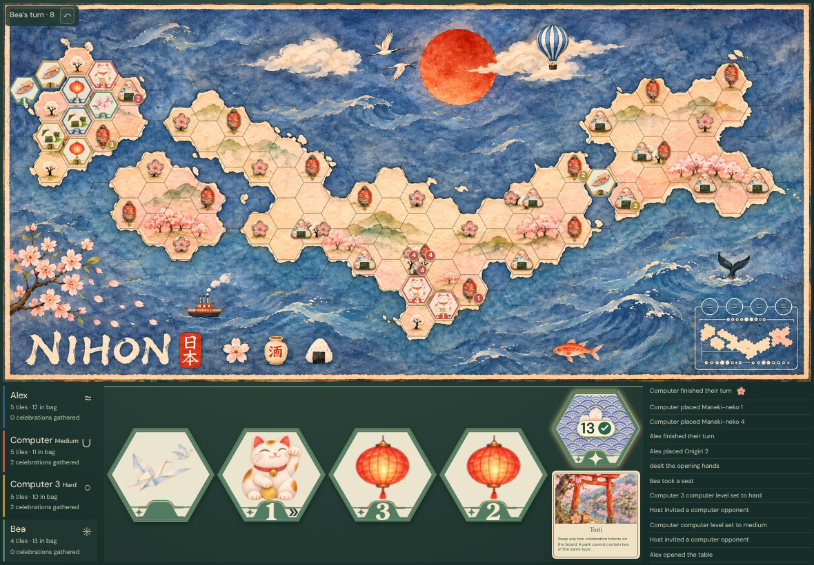

[Bea DOM evidence](https://raw.githubusercontent.com/anicolao/hanami/c7c5f2ebd1e2aafe84c95d9a13e4e974e28b1a3a/tests/e2e/screenshots/multiplayer-levels.spec.js/four-players-choose-independent-computer-levels-and-play-through-real-victory-017-bea-linux.dom.txt)

## 018. Alex: Select chochin-4 from Alex’s real hand

Viewport, scrolling, clipping and DOM assertions passed; actor and all observers captured.

[Alex DOM evidence](https://raw.githubusercontent.com/anicolao/hanami/c7c5f2ebd1e2aafe84c95d9a13e4e974e28b1a3a/tests/e2e/screenshots/multiplayer-levels.spec.js/four-players-choose-independent-computer-levels-and-play-through-real-victory-018-alex-linux.dom.txt)

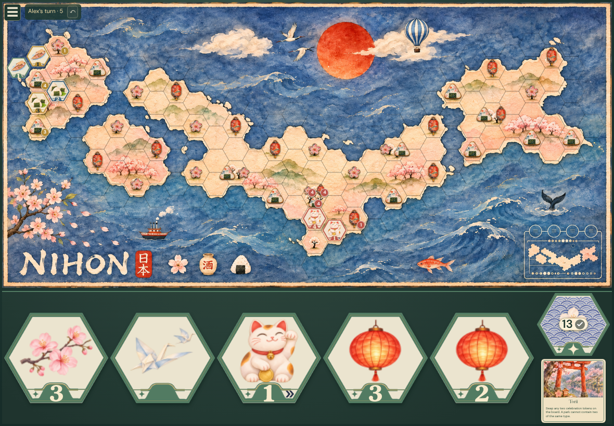

[Bea DOM evidence](https://raw.githubusercontent.com/anicolao/hanami/c7c5f2ebd1e2aafe84c95d9a13e4e974e28b1a3a/tests/e2e/screenshots/multiplayer-levels.spec.js/four-players-choose-independent-computer-levels-and-play-through-real-victory-018-bea-linux.dom.txt)

## 019. Alex: Place chochin-4 at 2:3

Viewport, scrolling, clipping and DOM assertions passed; actor and all observers captured.

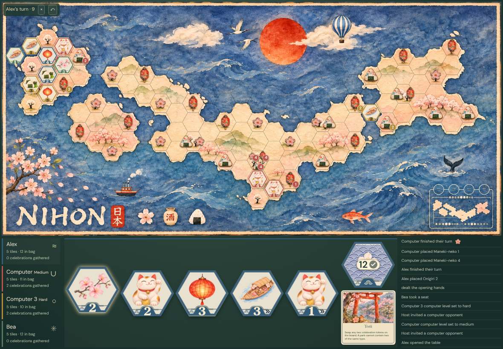

[Alex DOM evidence](https://raw.githubusercontent.com/anicolao/hanami/c7c5f2ebd1e2aafe84c95d9a13e4e974e28b1a3a/tests/e2e/screenshots/multiplayer-levels.spec.js/four-players-choose-independent-computer-levels-and-play-through-real-victory-019-alex-linux.dom.txt)

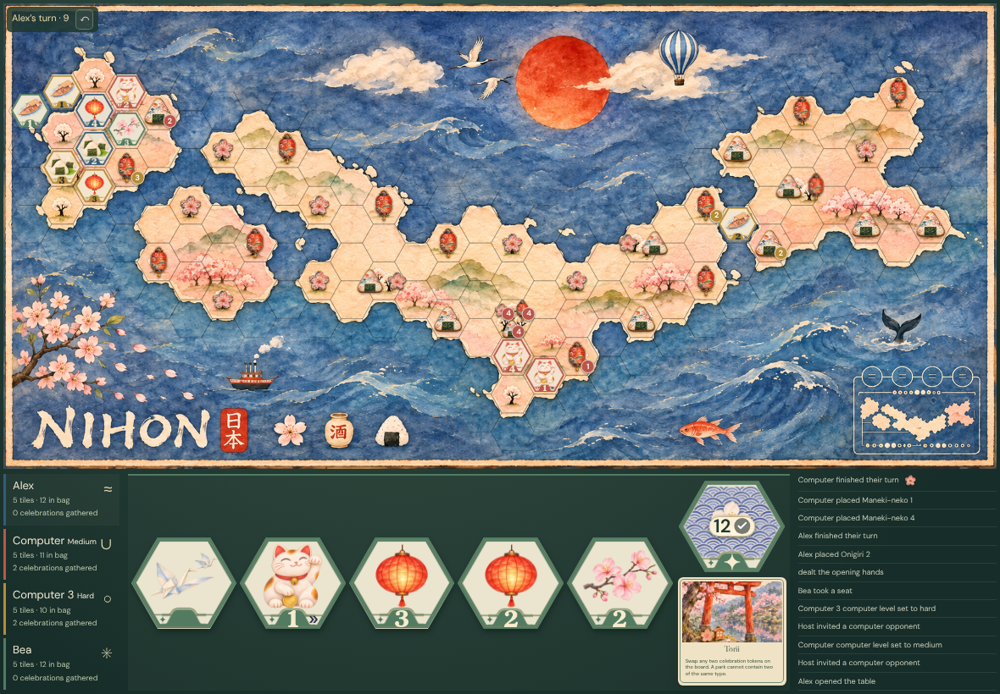

[Bea DOM evidence](https://raw.githubusercontent.com/anicolao/hanami/c7c5f2ebd1e2aafe84c95d9a13e4e974e28b1a3a/tests/e2e/screenshots/multiplayer-levels.spec.js/four-players-choose-independent-computer-levels-and-play-through-real-victory-019-bea-linux.dom.txt)

## 020. Alex: Alex refills and lets the next seats play

Viewport, scrolling, clipping and DOM assertions passed; actor and all observers captured.

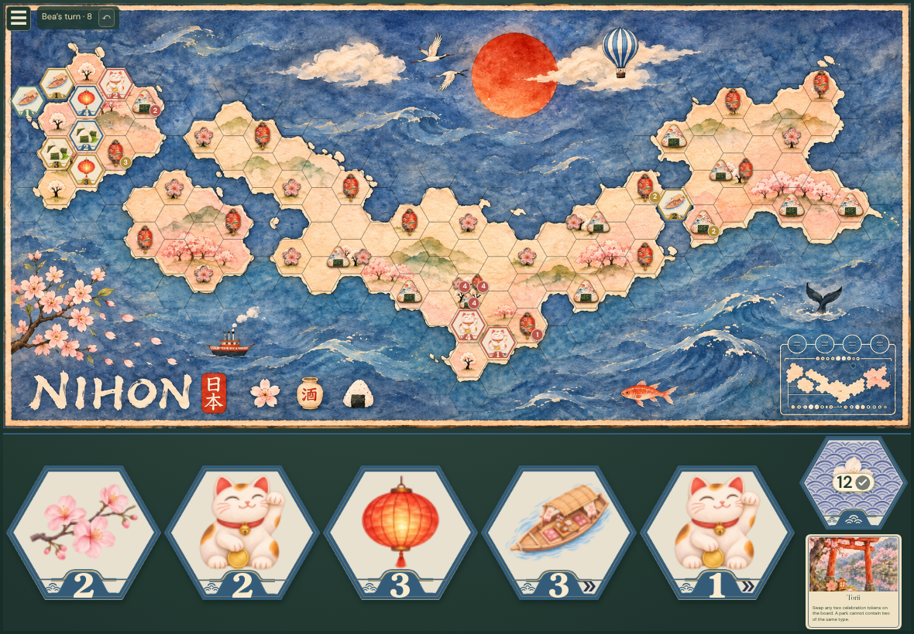

[Alex DOM evidence](https://raw.githubusercontent.com/anicolao/hanami/c7c5f2ebd1e2aafe84c95d9a13e4e974e28b1a3a/tests/e2e/screenshots/multiplayer-levels.spec.js/four-players-choose-independent-computer-levels-and-play-through-real-victory-020-alex-linux.dom.txt)

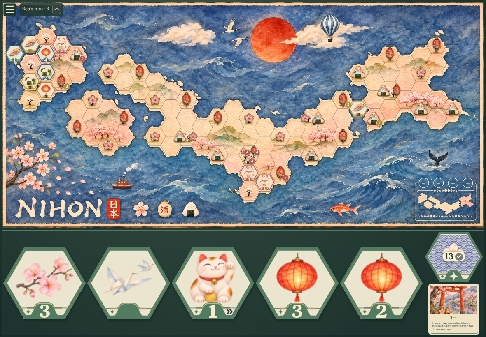

[Bea DOM evidence](https://raw.githubusercontent.com/anicolao/hanami/c7c5f2ebd1e2aafe84c95d9a13e4e974e28b1a3a/tests/e2e/screenshots/multiplayer-levels.spec.js/four-players-choose-independent-computer-levels-and-play-through-real-victory-020-bea-linux.dom.txt)

## 021. Bea: Select sakura-3 from Bea’s real hand

Viewport, scrolling, clipping and DOM assertions passed; actor and all observers captured.

[Alex DOM evidence](https://raw.githubusercontent.com/anicolao/hanami/c7c5f2ebd1e2aafe84c95d9a13e4e974e28b1a3a/tests/e2e/screenshots/multiplayer-levels.spec.js/four-players-choose-independent-computer-levels-and-play-through-real-victory-021-alex-linux.dom.txt)

[Bea DOM evidence](https://raw.githubusercontent.com/anicolao/hanami/c7c5f2ebd1e2aafe84c95d9a13e4e974e28b1a3a/tests/e2e/screenshots/multiplayer-levels.spec.js/four-players-choose-independent-computer-levels-and-play-through-real-victory-021-bea-linux.dom.txt)

## 022. Bea: Place sakura-3 at 3:3

Viewport, scrolling, clipping and DOM assertions passed; actor and all observers captured.

[Alex DOM evidence](https://raw.githubusercontent.com/anicolao/hanami/c7c5f2ebd1e2aafe84c95d9a13e4e974e28b1a3a/tests/e2e/screenshots/multiplayer-levels.spec.js/four-players-choose-independent-computer-levels-and-play-through-real-victory-022-alex-linux.dom.txt)

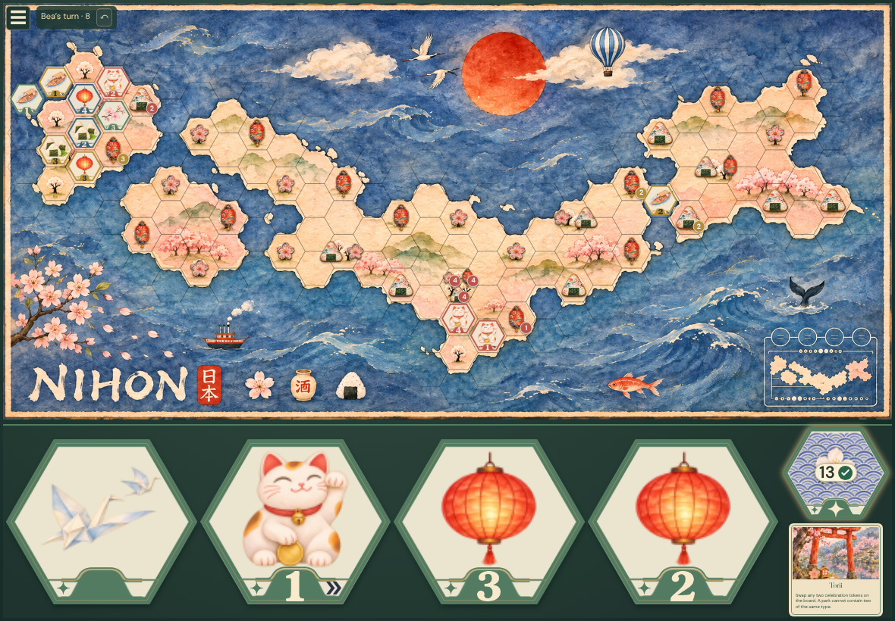

[Bea DOM evidence](https://raw.githubusercontent.com/anicolao/hanami/c7c5f2ebd1e2aafe84c95d9a13e4e974e28b1a3a/tests/e2e/screenshots/multiplayer-levels.spec.js/four-players-choose-independent-computer-levels-and-play-through-real-victory-022-bea-linux.dom.txt)

## 023. Bea: Bea refills and lets the next seats play

Viewport, scrolling, clipping and DOM assertions passed; actor and all observers captured.

[Alex DOM evidence](https://raw.githubusercontent.com/anicolao/hanami/c7c5f2ebd1e2aafe84c95d9a13e4e974e28b1a3a/tests/e2e/screenshots/multiplayer-levels.spec.js/four-players-choose-independent-computer-levels-and-play-through-real-victory-023-alex-linux.dom.txt)

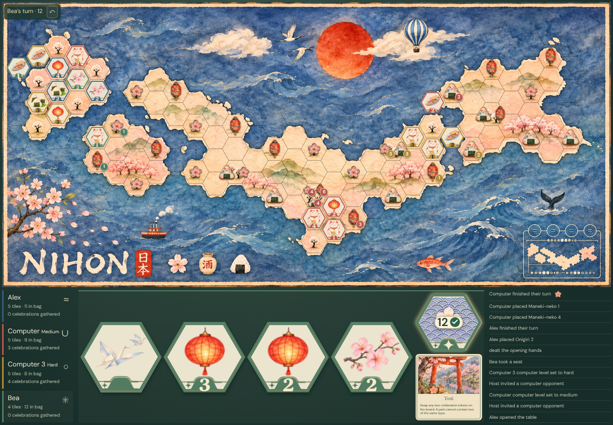

[Bea DOM evidence](https://raw.githubusercontent.com/anicolao/hanami/c7c5f2ebd1e2aafe84c95d9a13e4e974e28b1a3a/tests/e2e/screenshots/multiplayer-levels.spec.js/four-players-choose-independent-computer-levels-and-play-through-real-victory-023-bea-linux.dom.txt)

## 024. Alex: Select sakura-2 from Alex’s real hand

Viewport, scrolling, clipping and DOM assertions passed; actor and all observers captured.

[Alex DOM evidence](https://raw.githubusercontent.com/anicolao/hanami/c7c5f2ebd1e2aafe84c95d9a13e4e974e28b1a3a/tests/e2e/screenshots/multiplayer-levels.spec.js/four-players-choose-independent-computer-levels-and-play-through-real-victory-024-alex-linux.dom.txt)

[Bea DOM evidence](https://raw.githubusercontent.com/anicolao/hanami/c7c5f2ebd1e2aafe84c95d9a13e4e974e28b1a3a/tests/e2e/screenshots/multiplayer-levels.spec.js/four-players-choose-independent-computer-levels-and-play-through-real-victory-024-bea-linux.dom.txt)

## 025. Alex: Place sakura-2 at 4:4

Viewport, scrolling, clipping and DOM assertions passed; actor and all observers captured.

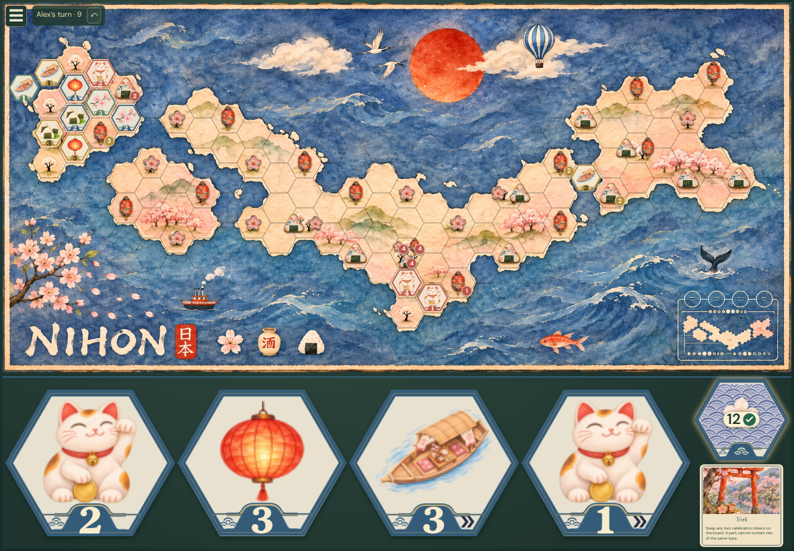

[Alex DOM evidence](https://raw.githubusercontent.com/anicolao/hanami/c7c5f2ebd1e2aafe84c95d9a13e4e974e28b1a3a/tests/e2e/screenshots/multiplayer-levels.spec.js/four-players-choose-independent-computer-levels-and-play-through-real-victory-025-alex-linux.dom.txt)

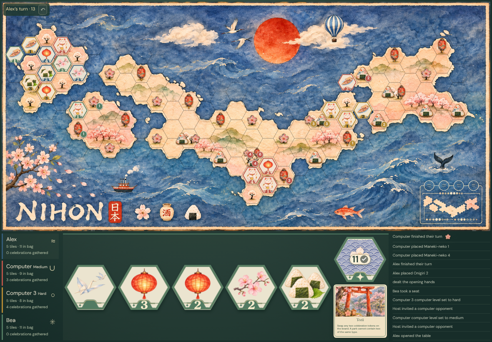

[Bea DOM evidence](https://raw.githubusercontent.com/anicolao/hanami/c7c5f2ebd1e2aafe84c95d9a13e4e974e28b1a3a/tests/e2e/screenshots/multiplayer-levels.spec.js/four-players-choose-independent-computer-levels-and-play-through-real-victory-025-bea-linux.dom.txt)

## 026. Alex: Alex refills and lets the next seats play

Viewport, scrolling, clipping and DOM assertions passed; actor and all observers captured.

[Alex DOM evidence](https://raw.githubusercontent.com/anicolao/hanami/c7c5f2ebd1e2aafe84c95d9a13e4e974e28b1a3a/tests/e2e/screenshots/multiplayer-levels.spec.js/four-players-choose-independent-computer-levels-and-play-through-real-victory-026-alex-linux.dom.txt)

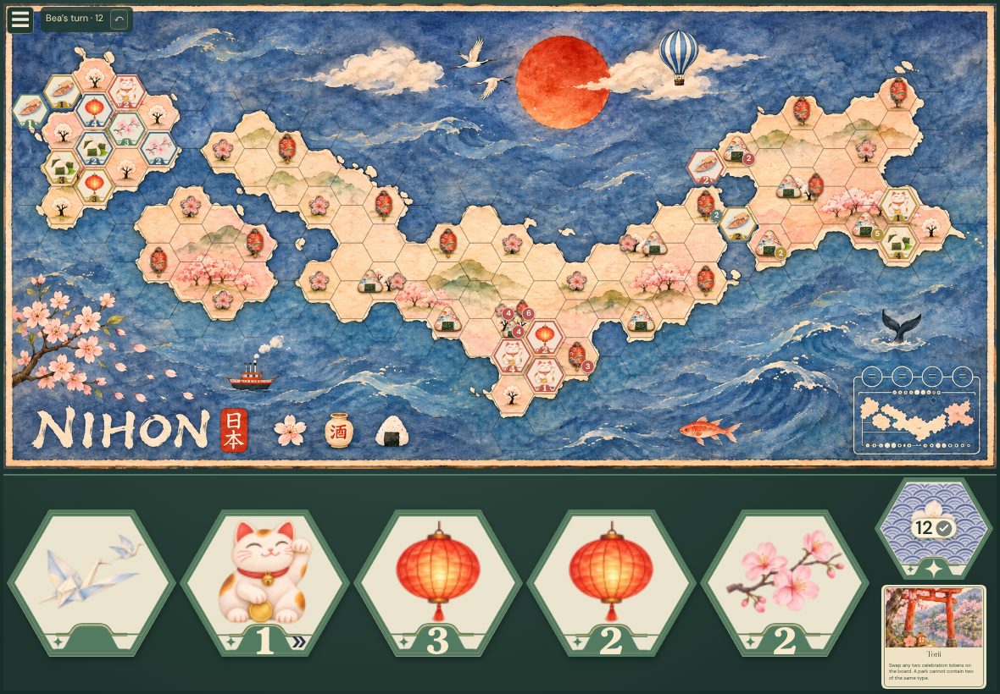

[Bea DOM evidence](https://raw.githubusercontent.com/anicolao/hanami/c7c5f2ebd1e2aafe84c95d9a13e4e974e28b1a3a/tests/e2e/screenshots/multiplayer-levels.spec.js/four-players-choose-independent-computer-levels-and-play-through-real-victory-026-bea-linux.dom.txt)

## 027. Bea: Select cat-0 from Bea’s real hand

Viewport, scrolling, clipping and DOM assertions passed; actor and all observers captured.

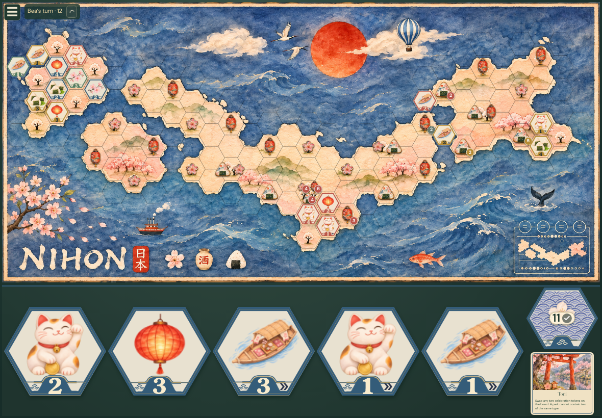

[Alex DOM evidence](https://raw.githubusercontent.com/anicolao/hanami/c7c5f2ebd1e2aafe84c95d9a13e4e974e28b1a3a/tests/e2e/screenshots/multiplayer-levels.spec.js/four-players-choose-independent-computer-levels-and-play-through-real-victory-027-alex-linux.dom.txt)

[Bea DOM evidence](https://raw.githubusercontent.com/anicolao/hanami/c7c5f2ebd1e2aafe84c95d9a13e4e974e28b1a3a/tests/e2e/screenshots/multiplayer-levels.spec.js/four-players-choose-independent-computer-levels-and-play-through-real-victory-027-bea-linux.dom.txt)

## 028. Bea: Place cat-0 at 4:6

Viewport, scrolling, clipping and DOM assertions passed; actor and all observers captured.

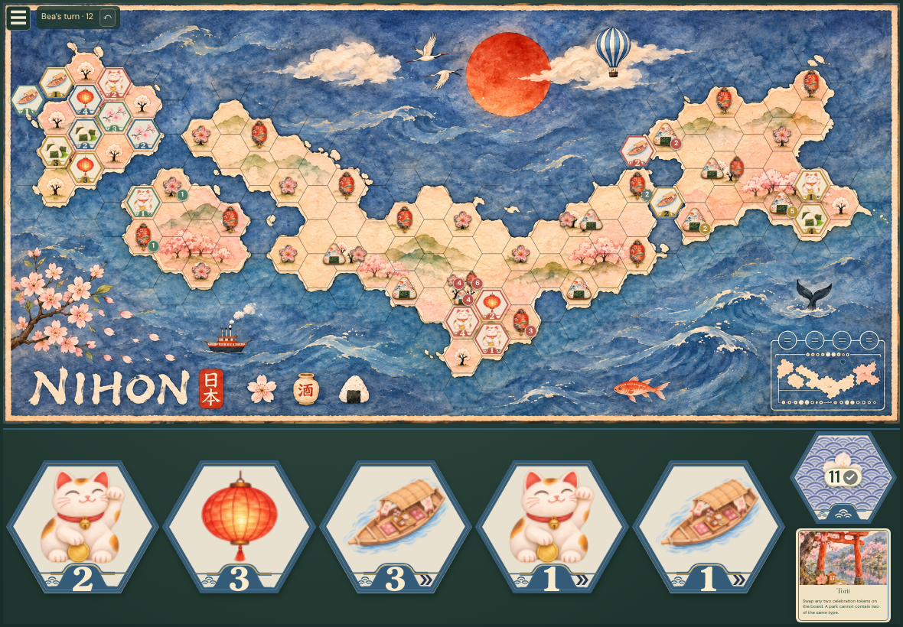

[Alex DOM evidence](https://raw.githubusercontent.com/anicolao/hanami/c7c5f2ebd1e2aafe84c95d9a13e4e974e28b1a3a/tests/e2e/screenshots/multiplayer-levels.spec.js/four-players-choose-independent-computer-levels-and-play-through-real-victory-028-alex-linux.dom.txt)

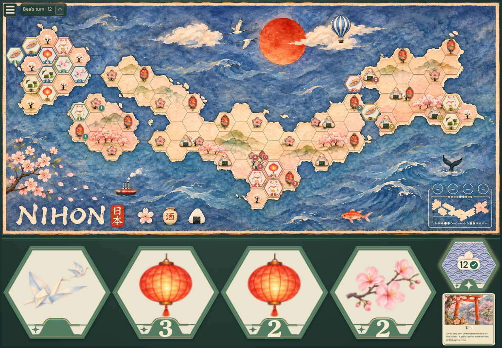

[Bea DOM evidence](https://raw.githubusercontent.com/anicolao/hanami/c7c5f2ebd1e2aafe84c95d9a13e4e974e28b1a3a/tests/e2e/screenshots/multiplayer-levels.spec.js/four-players-choose-independent-computer-levels-and-play-through-real-victory-028-bea-linux.dom.txt)

## 029. Bea: Bea refills and lets the next seats play

Viewport, scrolling, clipping and DOM assertions passed; actor and all observers captured.

[Alex DOM evidence](https://raw.githubusercontent.com/anicolao/hanami/c7c5f2ebd1e2aafe84c95d9a13e4e974e28b1a3a/tests/e2e/screenshots/multiplayer-levels.spec.js/four-players-choose-independent-computer-levels-and-play-through-real-victory-029-alex-linux.dom.txt)

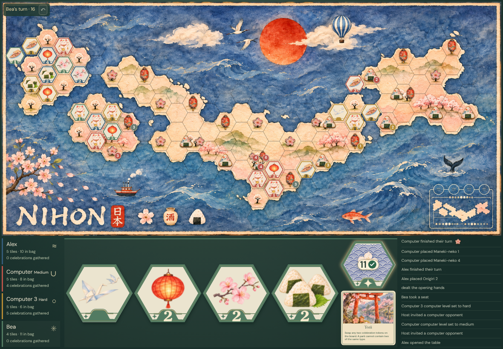

[Bea DOM evidence](https://raw.githubusercontent.com/anicolao/hanami/c7c5f2ebd1e2aafe84c95d9a13e4e974e28b1a3a/tests/e2e/screenshots/multiplayer-levels.spec.js/four-players-choose-independent-computer-levels-and-play-through-real-victory-029-bea-linux.dom.txt)

## 030. Alex: Select cat-3 from Alex’s real hand

Viewport, scrolling, clipping and DOM assertions passed; actor and all observers captured.

[Alex DOM evidence](https://raw.githubusercontent.com/anicolao/hanami/c7c5f2ebd1e2aafe84c95d9a13e4e974e28b1a3a/tests/e2e/screenshots/multiplayer-levels.spec.js/four-players-choose-independent-computer-levels-and-play-through-real-victory-030-alex-linux.dom.txt)

[Bea DOM evidence](https://raw.githubusercontent.com/anicolao/hanami/c7c5f2ebd1e2aafe84c95d9a13e4e974e28b1a3a/tests/e2e/screenshots/multiplayer-levels.spec.js/four-players-choose-independent-computer-levels-and-play-through-real-victory-030-bea-linux.dom.txt)

## 031. Alex: Place cat-3 at 5:6

Viewport, scrolling, clipping and DOM assertions passed; actor and all observers captured.

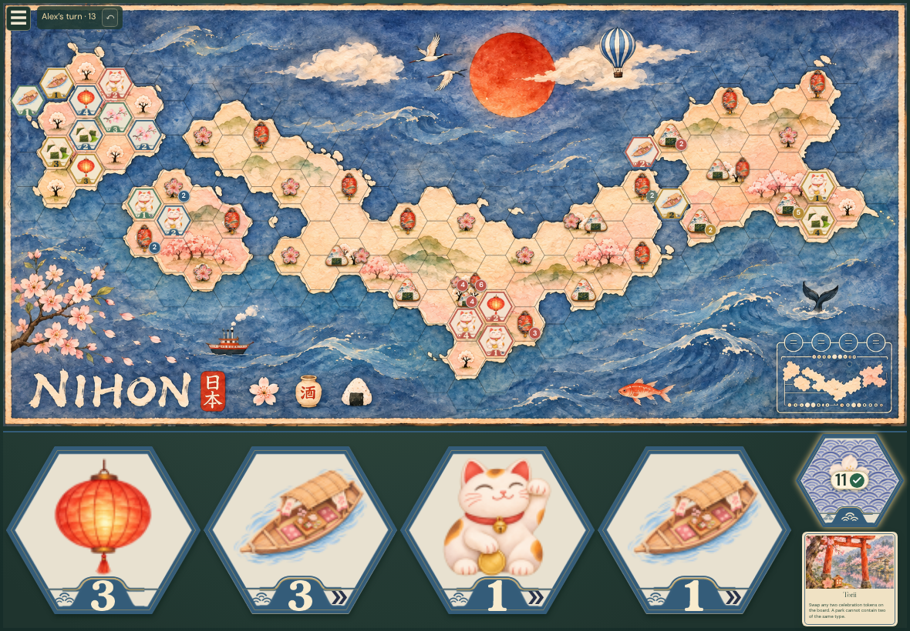

[Alex DOM evidence](https://raw.githubusercontent.com/anicolao/hanami/c7c5f2ebd1e2aafe84c95d9a13e4e974e28b1a3a/tests/e2e/screenshots/multiplayer-levels.spec.js/four-players-choose-independent-computer-levels-and-play-through-real-victory-031-alex-linux.dom.txt)

[Bea DOM evidence](https://raw.githubusercontent.com/anicolao/hanami/c7c5f2ebd1e2aafe84c95d9a13e4e974e28b1a3a/tests/e2e/screenshots/multiplayer-levels.spec.js/four-players-choose-independent-computer-levels-and-play-through-real-victory-031-bea-linux.dom.txt)

## 032. Alex: Alex refills and lets the next seats play

Viewport, scrolling, clipping and DOM assertions passed; actor and all observers captured.

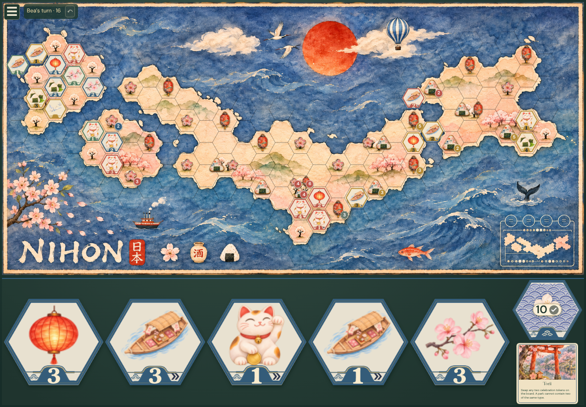

[Alex DOM evidence](https://raw.githubusercontent.com/anicolao/hanami/c7c5f2ebd1e2aafe84c95d9a13e4e974e28b1a3a/tests/e2e/screenshots/multiplayer-levels.spec.js/four-players-choose-independent-computer-levels-and-play-through-real-victory-032-alex-linux.dom.txt)

[Bea DOM evidence](https://raw.githubusercontent.com/anicolao/hanami/c7c5f2ebd1e2aafe84c95d9a13e4e974e28b1a3a/tests/e2e/screenshots/multiplayer-levels.spec.js/four-players-choose-independent-computer-levels-and-play-through-real-victory-032-bea-linux.dom.txt)

## 033. Bea: Select chochin-3 from Bea’s real hand

Viewport, scrolling, clipping and DOM assertions passed; actor and all observers captured.

[Alex DOM evidence](https://raw.githubusercontent.com/anicolao/hanami/c7c5f2ebd1e2aafe84c95d9a13e4e974e28b1a3a/tests/e2e/screenshots/multiplayer-levels.spec.js/four-players-choose-independent-computer-levels-and-play-through-real-victory-033-alex-linux.dom.txt)

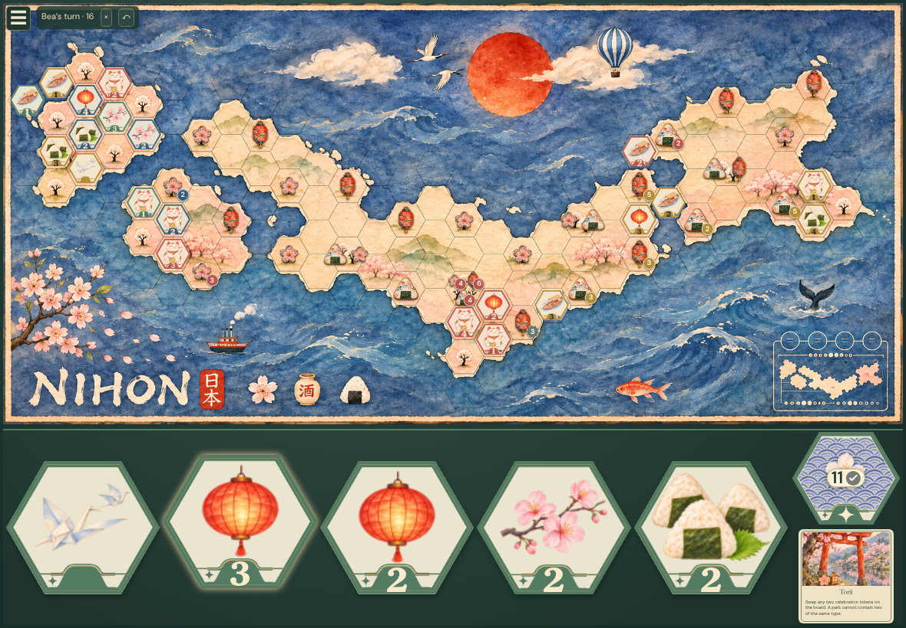

[Bea DOM evidence](https://raw.githubusercontent.com/anicolao/hanami/c7c5f2ebd1e2aafe84c95d9a13e4e974e28b1a3a/tests/e2e/screenshots/multiplayer-levels.spec.js/four-players-choose-independent-computer-levels-and-play-through-real-victory-033-bea-linux.dom.txt)

## 034. Bea: Place chochin-3 at 6:7

Viewport, scrolling, clipping and DOM assertions passed; actor and all observers captured.

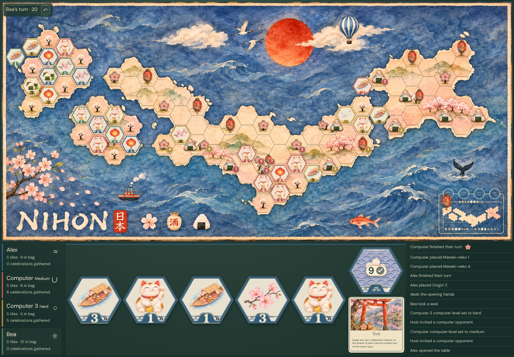

[Alex DOM evidence](https://raw.githubusercontent.com/anicolao/hanami/c7c5f2ebd1e2aafe84c95d9a13e4e974e28b1a3a/tests/e2e/screenshots/multiplayer-levels.spec.js/four-players-choose-independent-computer-levels-and-play-through-real-victory-034-alex-linux.dom.txt)

[Bea DOM evidence](https://raw.githubusercontent.com/anicolao/hanami/c7c5f2ebd1e2aafe84c95d9a13e4e974e28b1a3a/tests/e2e/screenshots/multiplayer-levels.spec.js/four-players-choose-independent-computer-levels-and-play-through-real-victory-034-bea-linux.dom.txt)

## 035. Bea: Bea refills and lets the next seats play

Viewport, scrolling, clipping and DOM assertions passed; actor and all observers captured.

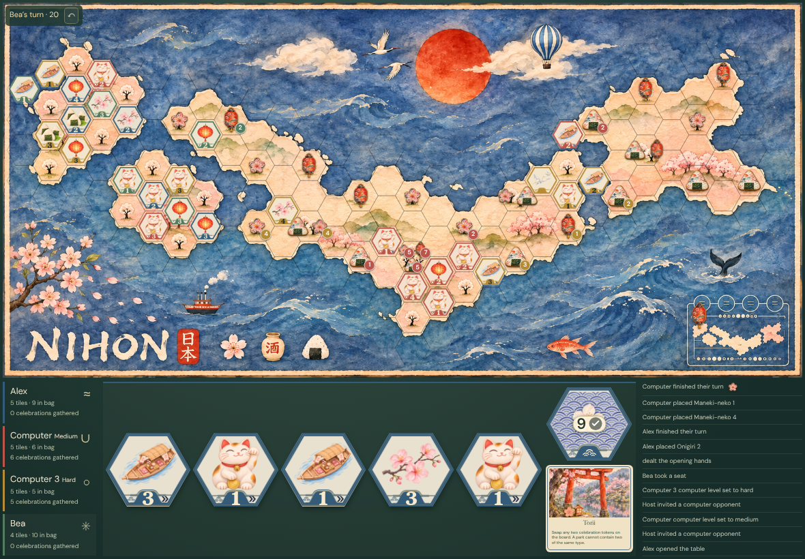

[Alex DOM evidence](https://raw.githubusercontent.com/anicolao/hanami/c7c5f2ebd1e2aafe84c95d9a13e4e974e28b1a3a/tests/e2e/screenshots/multiplayer-levels.spec.js/four-players-choose-independent-computer-levels-and-play-through-real-victory-035-alex-linux.dom.txt)

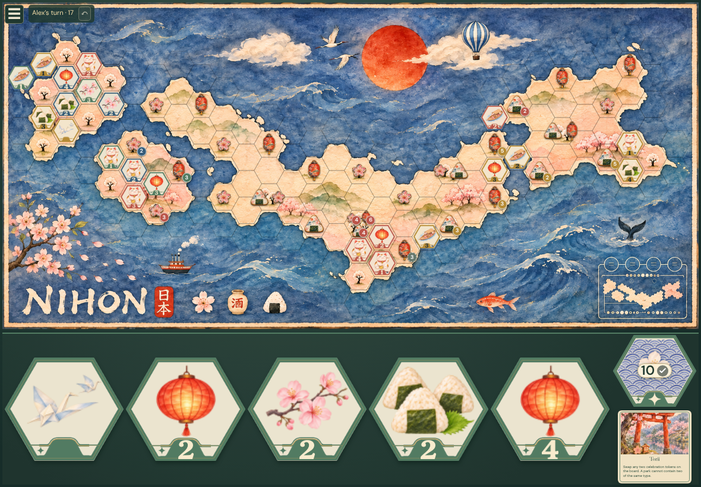

[Bea DOM evidence](https://raw.githubusercontent.com/anicolao/hanami/c7c5f2ebd1e2aafe84c95d9a13e4e974e28b1a3a/tests/e2e/screenshots/multiplayer-levels.spec.js/four-players-choose-independent-computer-levels-and-play-through-real-victory-035-bea-linux.dom.txt)

## 036. Alex: Select chochin-3 from Alex’s real hand

Viewport, scrolling, clipping and DOM assertions passed; actor and all observers captured.

[Alex DOM evidence](https://raw.githubusercontent.com/anicolao/hanami/c7c5f2ebd1e2aafe84c95d9a13e4e974e28b1a3a/tests/e2e/screenshots/multiplayer-levels.spec.js/four-players-choose-independent-computer-levels-and-play-through-real-victory-036-alex-linux.dom.txt)

[Bea DOM evidence](https://raw.githubusercontent.com/anicolao/hanami/c7c5f2ebd1e2aafe84c95d9a13e4e974e28b1a3a/tests/e2e/screenshots/multiplayer-levels.spec.js/four-players-choose-independent-computer-levels-and-play-through-real-victory-036-bea-linux.dom.txt)

## 037. Alex: Place chochin-3 at 6:6

Viewport, scrolling, clipping and DOM assertions passed; actor and all observers captured.

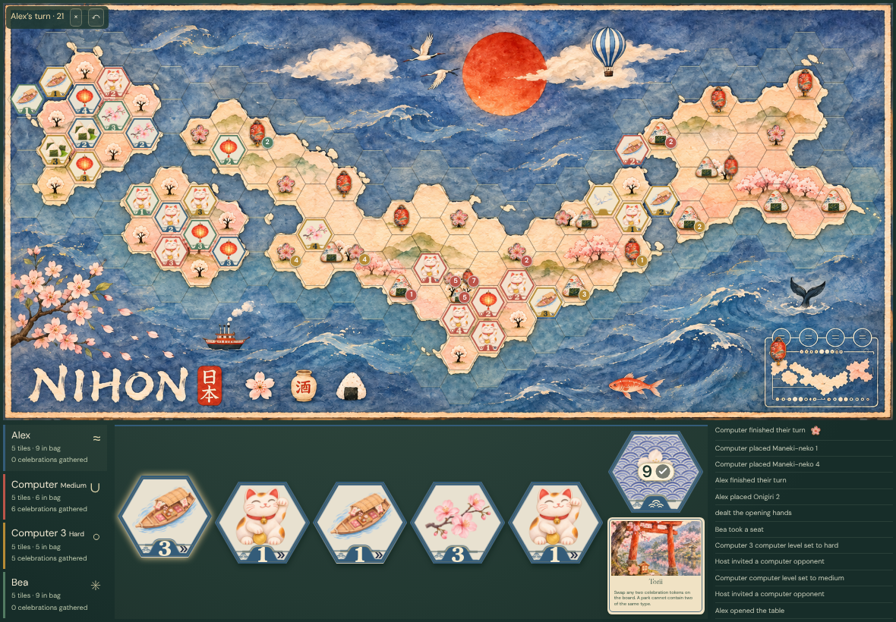

[Alex DOM evidence](https://raw.githubusercontent.com/anicolao/hanami/c7c5f2ebd1e2aafe84c95d9a13e4e974e28b1a3a/tests/e2e/screenshots/multiplayer-levels.spec.js/four-players-choose-independent-computer-levels-and-play-through-real-victory-037-alex-linux.dom.txt)

[Bea DOM evidence](https://raw.githubusercontent.com/anicolao/hanami/c7c5f2ebd1e2aafe84c95d9a13e4e974e28b1a3a/tests/e2e/screenshots/multiplayer-levels.spec.js/four-players-choose-independent-computer-levels-and-play-through-real-victory-037-bea-linux.dom.txt)

## 038. Alex: Alex refills and lets the next seats play

Viewport, scrolling, clipping and DOM assertions passed; actor and all observers captured.

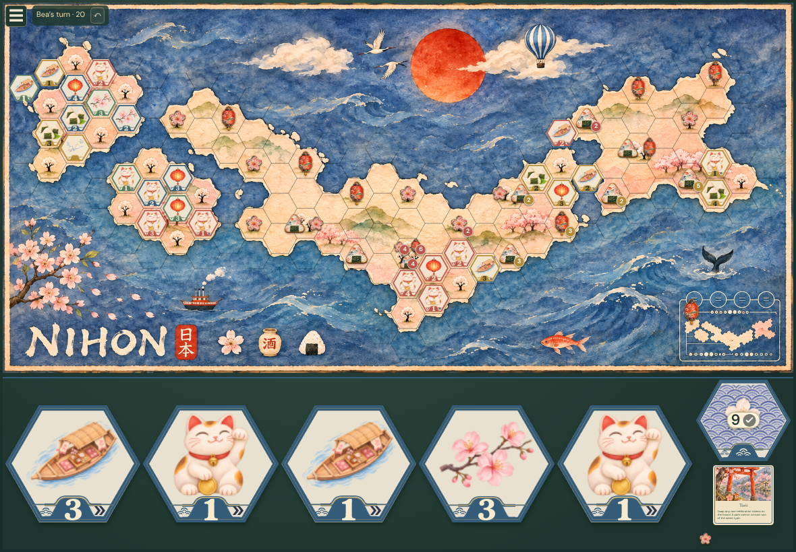

[Alex DOM evidence](https://raw.githubusercontent.com/anicolao/hanami/c7c5f2ebd1e2aafe84c95d9a13e4e974e28b1a3a/tests/e2e/screenshots/multiplayer-levels.spec.js/four-players-choose-independent-computer-levels-and-play-through-real-victory-038-alex-linux.dom.txt)

[Bea DOM evidence](https://raw.githubusercontent.com/anicolao/hanami/c7c5f2ebd1e2aafe84c95d9a13e4e974e28b1a3a/tests/e2e/screenshots/multiplayer-levels.spec.js/four-players-choose-independent-computer-levels-and-play-through-real-victory-038-bea-linux.dom.txt)

## 039. Bea: Select chochin-2 from Bea’s real hand

Viewport, scrolling, clipping and DOM assertions passed; actor and all observers captured.

[Alex DOM evidence](https://raw.githubusercontent.com/anicolao/hanami/c7c5f2ebd1e2aafe84c95d9a13e4e974e28b1a3a/tests/e2e/screenshots/multiplayer-levels.spec.js/four-players-choose-independent-computer-levels-and-play-through-real-victory-039-alex-linux.dom.txt)

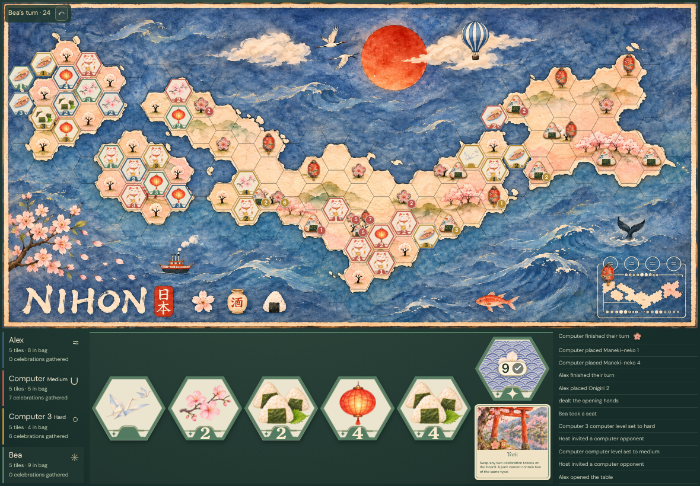

[Bea DOM evidence](https://raw.githubusercontent.com/anicolao/hanami/c7c5f2ebd1e2aafe84c95d9a13e4e974e28b1a3a/tests/e2e/screenshots/multiplayer-levels.spec.js/four-players-choose-independent-computer-levels-and-play-through-real-victory-039-bea-linux.dom.txt)

## 040. Bea: Place chochin-2 at 7:4

Viewport, scrolling, clipping and DOM assertions passed; actor and all observers captured.

[Alex DOM evidence](https://raw.githubusercontent.com/anicolao/hanami/c7c5f2ebd1e2aafe84c95d9a13e4e974e28b1a3a/tests/e2e/screenshots/multiplayer-levels.spec.js/four-players-choose-independent-computer-levels-and-play-through-real-victory-040-alex-linux.dom.txt)

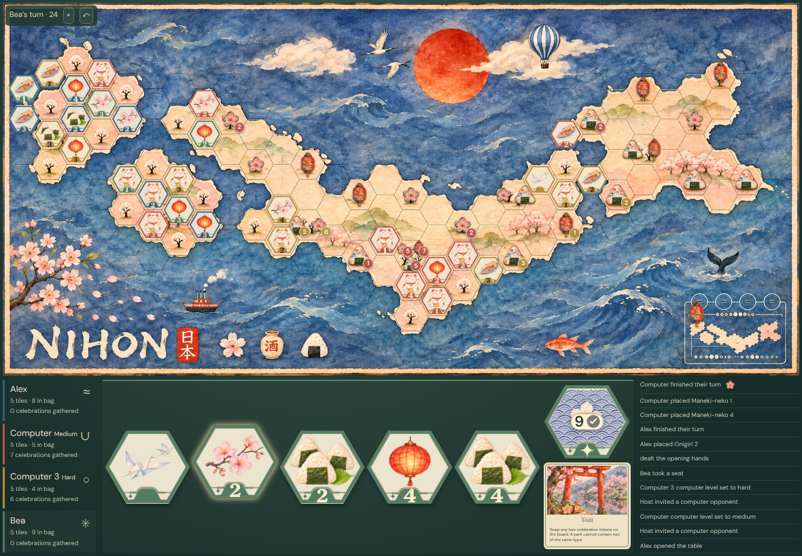

[Bea DOM evidence](https://raw.githubusercontent.com/anicolao/hanami/c7c5f2ebd1e2aafe84c95d9a13e4e974e28b1a3a/tests/e2e/screenshots/multiplayer-levels.spec.js/four-players-choose-independent-computer-levels-and-play-through-real-victory-040-bea-linux.dom.txt)

## 041. Bea: Bea refills and lets the next seats play

Viewport, scrolling, clipping and DOM assertions passed; actor and all observers captured.

[Alex DOM evidence](https://raw.githubusercontent.com/anicolao/hanami/c7c5f2ebd1e2aafe84c95d9a13e4e974e28b1a3a/tests/e2e/screenshots/multiplayer-levels.spec.js/four-players-choose-independent-computer-levels-and-play-through-real-victory-041-alex-linux.dom.txt)

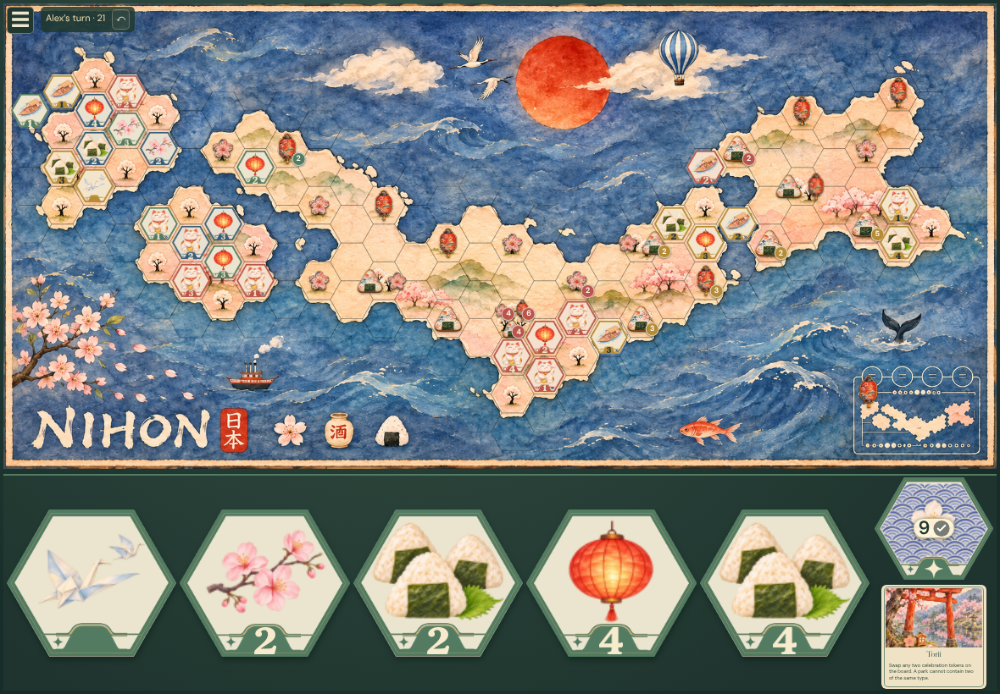

[Bea DOM evidence](https://raw.githubusercontent.com/anicolao/hanami/c7c5f2ebd1e2aafe84c95d9a13e4e974e28b1a3a/tests/e2e/screenshots/multiplayer-levels.spec.js/four-players-choose-independent-computer-levels-and-play-through-real-victory-041-bea-linux.dom.txt)

## 042. Alex: Select boat-3 from Alex’s real hand

Viewport, scrolling, clipping and DOM assertions passed; actor and all observers captured.

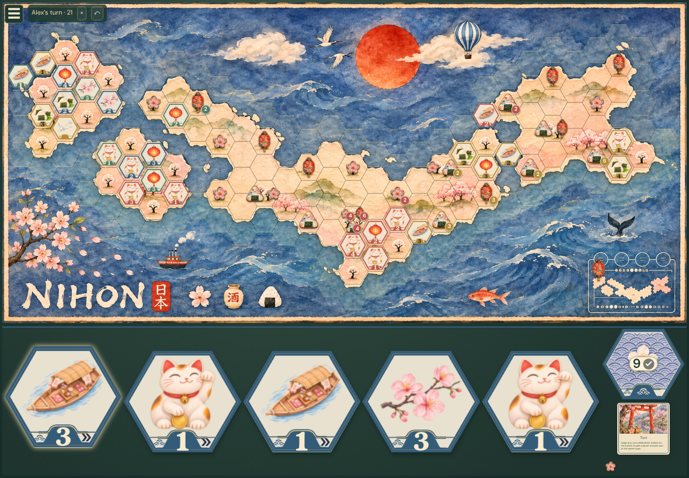

[Alex DOM evidence](https://raw.githubusercontent.com/anicolao/hanami/c7c5f2ebd1e2aafe84c95d9a13e4e974e28b1a3a/tests/e2e/screenshots/multiplayer-levels.spec.js/four-players-choose-independent-computer-levels-and-play-through-real-victory-042-alex-linux.dom.txt)

[Bea DOM evidence](https://raw.githubusercontent.com/anicolao/hanami/c7c5f2ebd1e2aafe84c95d9a13e4e974e28b1a3a/tests/e2e/screenshots/multiplayer-levels.spec.js/four-players-choose-independent-computer-levels-and-play-through-real-victory-042-bea-linux.dom.txt)

## 043. Alex: Place boat-3 at 0:4

Viewport, scrolling, clipping and DOM assertions passed; actor and all observers captured.

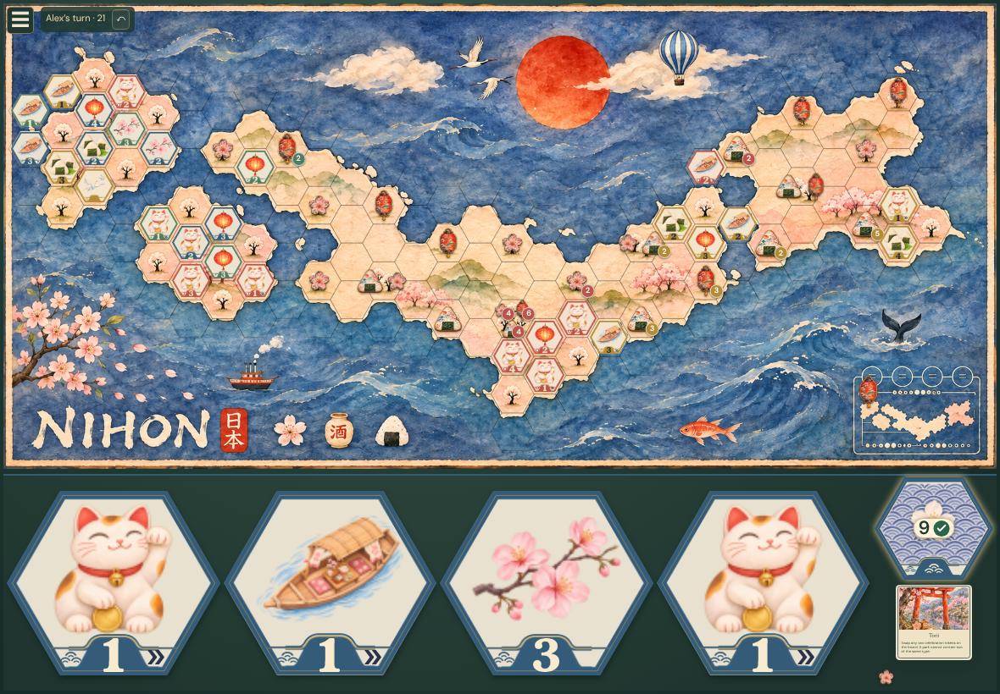

[Alex DOM evidence](https://raw.githubusercontent.com/anicolao/hanami/c7c5f2ebd1e2aafe84c95d9a13e4e974e28b1a3a/tests/e2e/screenshots/multiplayer-levels.spec.js/four-players-choose-independent-computer-levels-and-play-through-real-victory-043-alex-linux.dom.txt)

[Bea DOM evidence](https://raw.githubusercontent.com/anicolao/hanami/c7c5f2ebd1e2aafe84c95d9a13e4e974e28b1a3a/tests/e2e/screenshots/multiplayer-levels.spec.js/four-players-choose-independent-computer-levels-and-play-through-real-victory-043-bea-linux.dom.txt)

## 044. Alex: Alex refills and lets the next seats play

Viewport, scrolling, clipping and DOM assertions passed; actor and all observers captured.

[Alex DOM evidence](https://raw.githubusercontent.com/anicolao/hanami/c7c5f2ebd1e2aafe84c95d9a13e4e974e28b1a3a/tests/e2e/screenshots/multiplayer-levels.spec.js/four-players-choose-independent-computer-levels-and-play-through-real-victory-044-alex-linux.dom.txt)

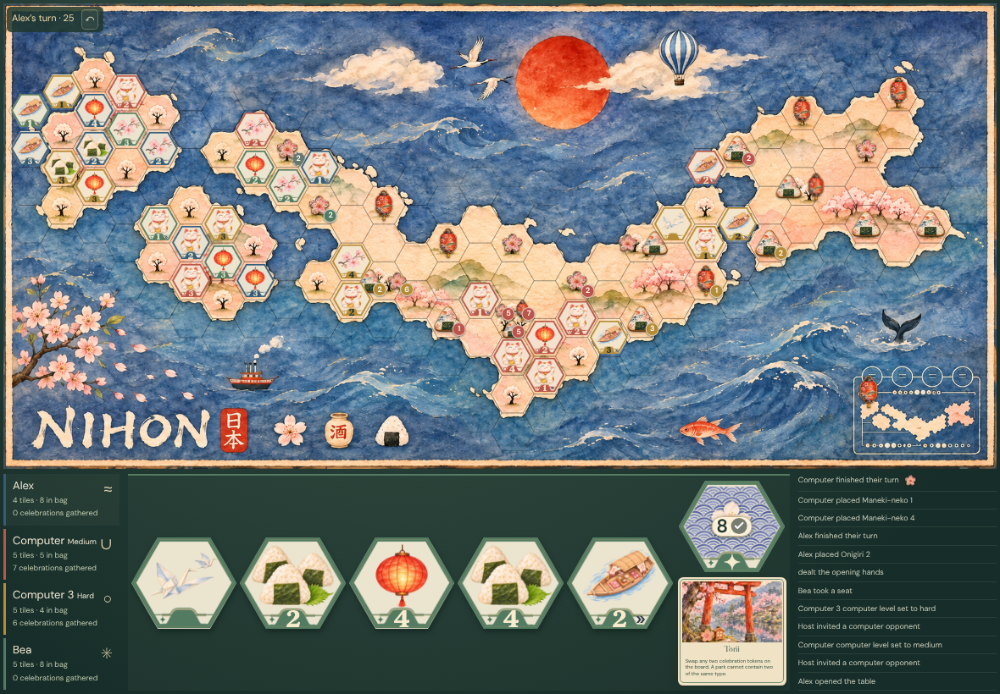

[Bea DOM evidence](https://raw.githubusercontent.com/anicolao/hanami/c7c5f2ebd1e2aafe84c95d9a13e4e974e28b1a3a/tests/e2e/screenshots/multiplayer-levels.spec.js/four-players-choose-independent-computer-levels-and-play-through-real-victory-044-bea-linux.dom.txt)

## 045. Bea: Select sakura-2 from Bea’s real hand

Viewport, scrolling, clipping and DOM assertions passed; actor and all observers captured.

[Alex DOM evidence](https://raw.githubusercontent.com/anicolao/hanami/c7c5f2ebd1e2aafe84c95d9a13e4e974e28b1a3a/tests/e2e/screenshots/multiplayer-levels.spec.js/four-players-choose-independent-computer-levels-and-play-through-real-victory-045-alex-linux.dom.txt)

[Bea DOM evidence](https://raw.githubusercontent.com/anicolao/hanami/c7c5f2ebd1e2aafe84c95d9a13e4e974e28b1a3a/tests/e2e/screenshots/multiplayer-levels.spec.js/four-players-choose-independent-computer-levels-and-play-through-real-victory-045-bea-linux.dom.txt)

## 046. Bea: Place sakura-2 at 8:5

Viewport, scrolling, clipping and DOM assertions passed; actor and all observers captured.

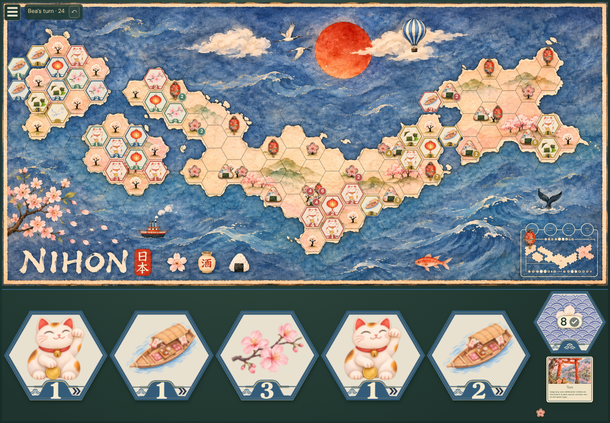

[Alex DOM evidence](https://raw.githubusercontent.com/anicolao/hanami/c7c5f2ebd1e2aafe84c95d9a13e4e974e28b1a3a/tests/e2e/screenshots/multiplayer-levels.spec.js/four-players-choose-independent-computer-levels-and-play-through-real-victory-046-alex-linux.dom.txt)

[Bea DOM evidence](https://raw.githubusercontent.com/anicolao/hanami/c7c5f2ebd1e2aafe84c95d9a13e4e974e28b1a3a/tests/e2e/screenshots/multiplayer-levels.spec.js/four-players-choose-independent-computer-levels-and-play-through-real-victory-046-bea-linux.dom.txt)

## 047. Bea: Bea refills and lets the next seats play

Viewport, scrolling, clipping and DOM assertions passed; actor and all observers captured.

[Alex DOM evidence](https://raw.githubusercontent.com/anicolao/hanami/c7c5f2ebd1e2aafe84c95d9a13e4e974e28b1a3a/tests/e2e/screenshots/multiplayer-levels.spec.js/four-players-choose-independent-computer-levels-and-play-through-real-victory-047-alex-linux.dom.txt)

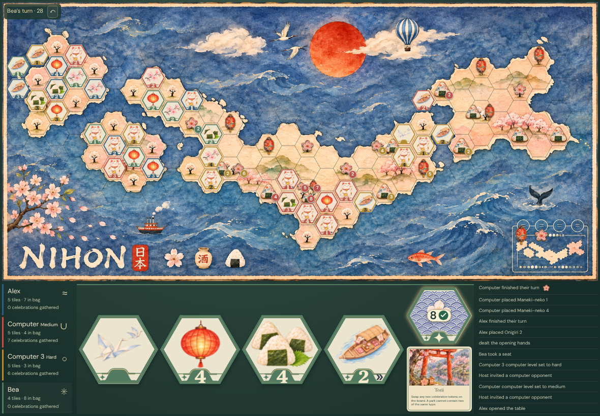

[Bea DOM evidence](https://raw.githubusercontent.com/anicolao/hanami/c7c5f2ebd1e2aafe84c95d9a13e4e974e28b1a3a/tests/e2e/screenshots/multiplayer-levels.spec.js/four-players-choose-independent-computer-levels-and-play-through-real-victory-047-bea-linux.dom.txt)

## 048. Alex: Select cat-1 from Alex’s real hand

Viewport, scrolling, clipping and DOM assertions passed; actor and all observers captured.

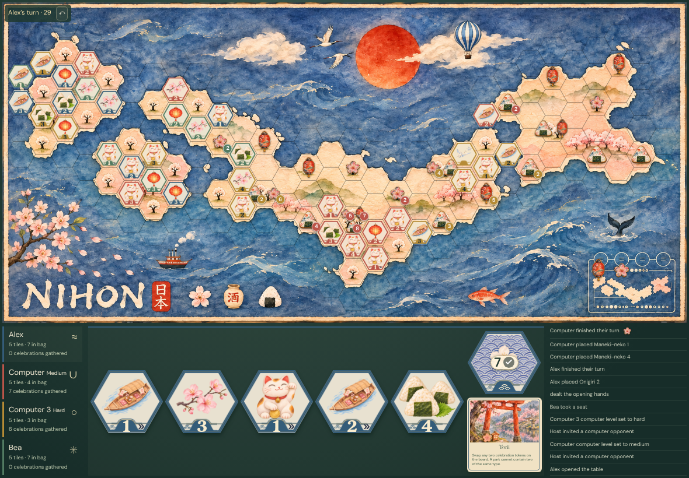

[Alex DOM evidence](https://raw.githubusercontent.com/anicolao/hanami/c7c5f2ebd1e2aafe84c95d9a13e4e974e28b1a3a/tests/e2e/screenshots/multiplayer-levels.spec.js/four-players-choose-independent-computer-levels-and-play-through-real-victory-048-alex-linux.dom.txt)

[Bea DOM evidence](https://raw.githubusercontent.com/anicolao/hanami/c7c5f2ebd1e2aafe84c95d9a13e4e974e28b1a3a/tests/e2e/screenshots/multiplayer-levels.spec.js/four-players-choose-independent-computer-levels-and-play-through-real-victory-048-bea-linux.dom.txt)

## 049. Alex: Place cat-1 at 9:4

Viewport, scrolling, clipping and DOM assertions passed; actor and all observers captured.

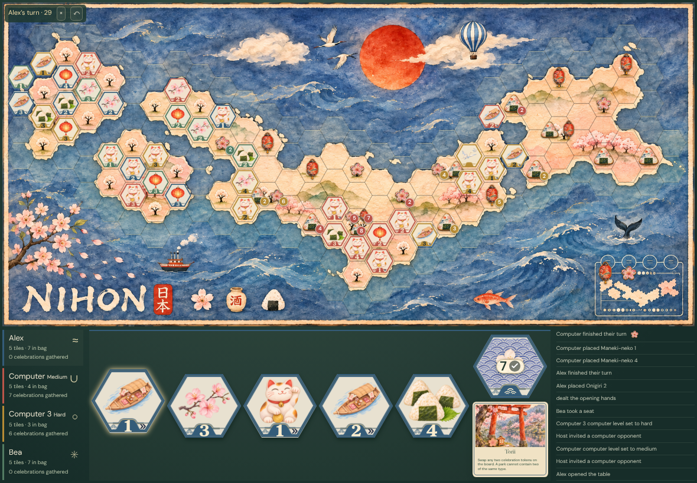

[Alex DOM evidence](https://raw.githubusercontent.com/anicolao/hanami/c7c5f2ebd1e2aafe84c95d9a13e4e974e28b1a3a/tests/e2e/screenshots/multiplayer-levels.spec.js/four-players-choose-independent-computer-levels-and-play-through-real-victory-049-alex-linux.dom.txt)

[Bea DOM evidence](https://raw.githubusercontent.com/anicolao/hanami/c7c5f2ebd1e2aafe84c95d9a13e4e974e28b1a3a/tests/e2e/screenshots/multiplayer-levels.spec.js/four-players-choose-independent-computer-levels-and-play-through-real-victory-049-bea-linux.dom.txt)

## 050. Alex: Alex refills and lets the next seats play

Viewport, scrolling, clipping and DOM assertions passed; actor and all observers captured.

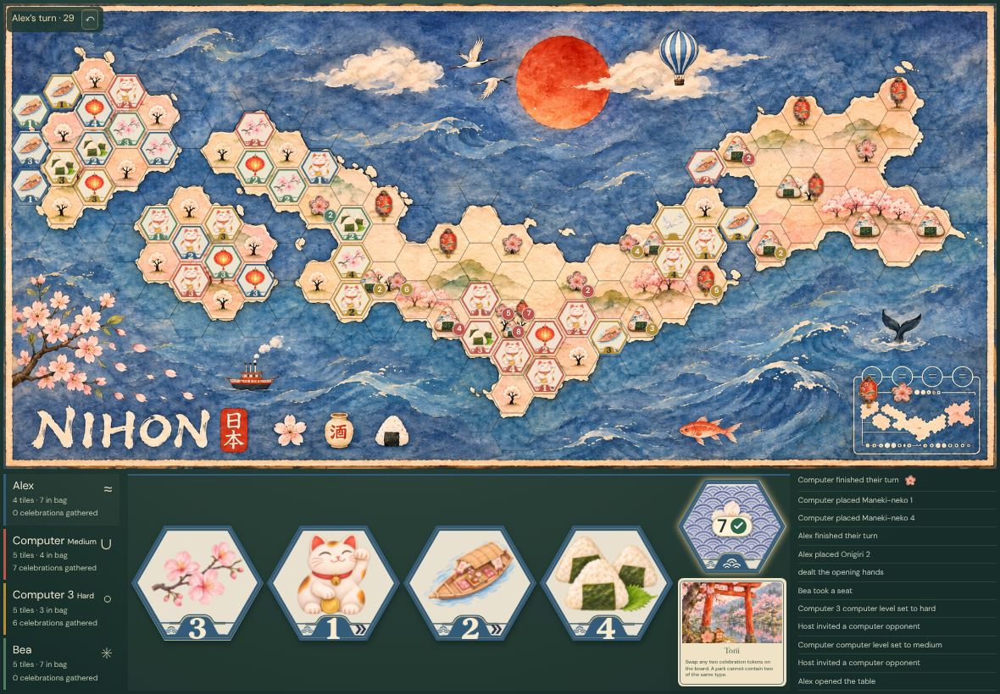

[Alex DOM evidence](https://raw.githubusercontent.com/anicolao/hanami/c7c5f2ebd1e2aafe84c95d9a13e4e974e28b1a3a/tests/e2e/screenshots/multiplayer-levels.spec.js/four-players-choose-independent-computer-levels-and-play-through-real-victory-050-alex-linux.dom.txt)

[Bea DOM evidence](https://raw.githubusercontent.com/anicolao/hanami/c7c5f2ebd1e2aafe84c95d9a13e4e974e28b1a3a/tests/e2e/screenshots/multiplayer-levels.spec.js/four-players-choose-independent-computer-levels-and-play-through-real-victory-050-bea-linux.dom.txt)

## 051. Bea: Select onigiri-2 from Bea’s real hand

Viewport, scrolling, clipping and DOM assertions passed; actor and all observers captured.

[Alex DOM evidence](https://raw.githubusercontent.com/anicolao/hanami/c7c5f2ebd1e2aafe84c95d9a13e4e974e28b1a3a/tests/e2e/screenshots/multiplayer-levels.spec.js/four-players-choose-independent-computer-levels-and-play-through-real-victory-051-alex-linux.dom.txt)

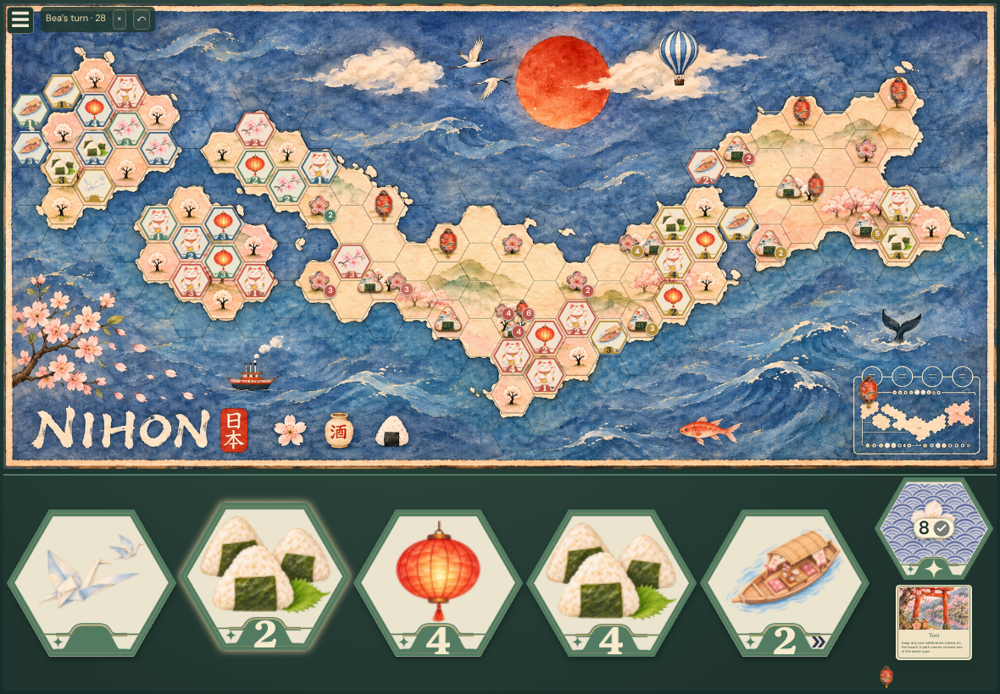

[Bea DOM evidence](https://raw.githubusercontent.com/anicolao/hanami/c7c5f2ebd1e2aafe84c95d9a13e4e974e28b1a3a/tests/e2e/screenshots/multiplayer-levels.spec.js/four-players-choose-independent-computer-levels-and-play-through-real-victory-051-bea-linux.dom.txt)

## 052. Bea: Place onigiri-2 at 10:6

Viewport, scrolling, clipping and DOM assertions passed; actor and all observers captured.

[Alex DOM evidence](https://raw.githubusercontent.com/anicolao/hanami/c7c5f2ebd1e2aafe84c95d9a13e4e974e28b1a3a/tests/e2e/screenshots/multiplayer-levels.spec.js/four-players-choose-independent-computer-levels-and-play-through-real-victory-052-alex-linux.dom.txt)

[Bea DOM evidence](https://raw.githubusercontent.com/anicolao/hanami/c7c5f2ebd1e2aafe84c95d9a13e4e974e28b1a3a/tests/e2e/screenshots/multiplayer-levels.spec.js/four-players-choose-independent-computer-levels-and-play-through-real-victory-052-bea-linux.dom.txt)

## 053. Bea: Bea refills and lets the next seats play

Viewport, scrolling, clipping and DOM assertions passed; actor and all observers captured.

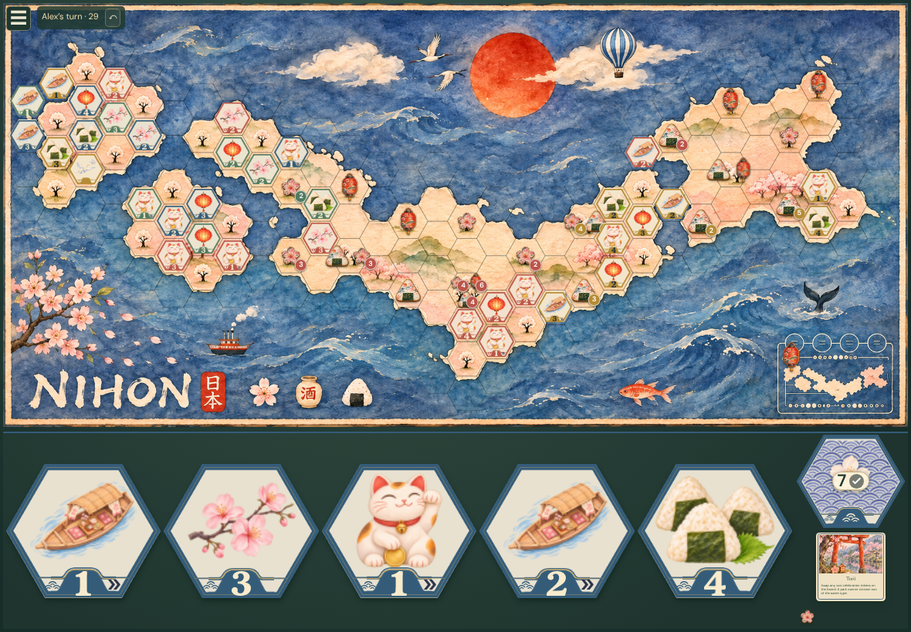

[Alex DOM evidence](https://raw.githubusercontent.com/anicolao/hanami/c7c5f2ebd1e2aafe84c95d9a13e4e974e28b1a3a/tests/e2e/screenshots/multiplayer-levels.spec.js/four-players-choose-independent-computer-levels-and-play-through-real-victory-053-alex-linux.dom.txt)

[Bea DOM evidence](https://raw.githubusercontent.com/anicolao/hanami/c7c5f2ebd1e2aafe84c95d9a13e4e974e28b1a3a/tests/e2e/screenshots/multiplayer-levels.spec.js/four-players-choose-independent-computer-levels-and-play-through-real-victory-053-bea-linux.dom.txt)

## 054. Alex: Select boat-1 from Alex’s real hand

Viewport, scrolling, clipping and DOM assertions passed; actor and all observers captured.

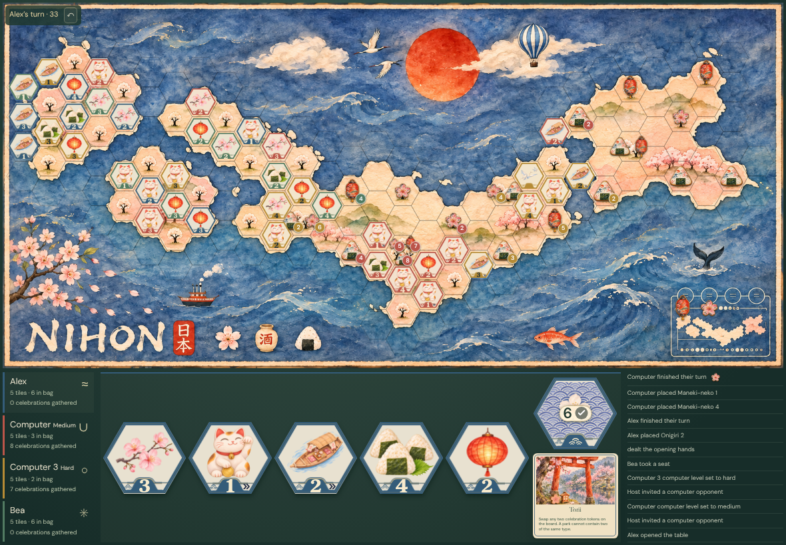

[Alex DOM evidence](https://raw.githubusercontent.com/anicolao/hanami/c7c5f2ebd1e2aafe84c95d9a13e4e974e28b1a3a/tests/e2e/screenshots/multiplayer-levels.spec.js/four-players-choose-independent-computer-levels-and-play-through-real-victory-054-alex-linux.dom.txt)

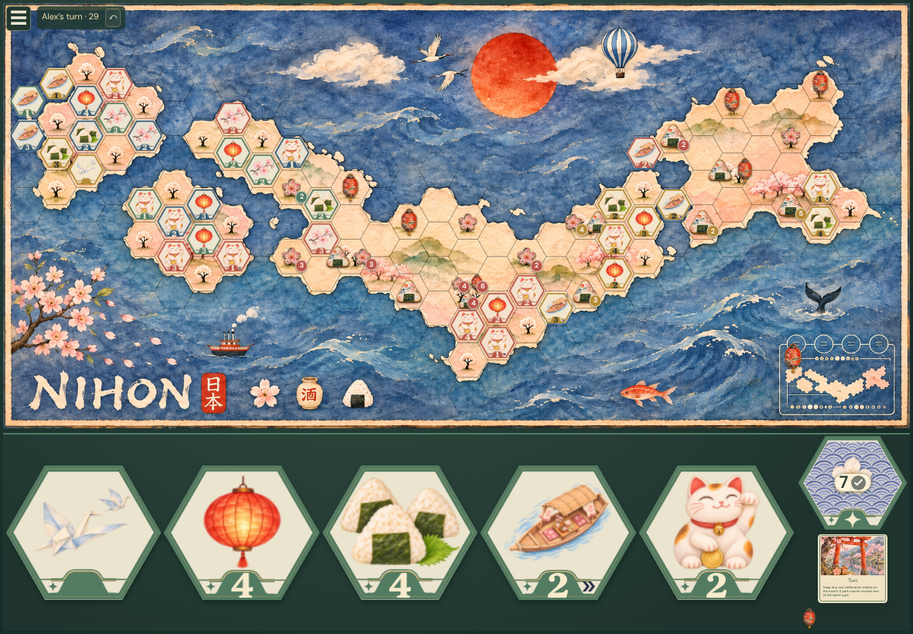

[Bea DOM evidence](https://raw.githubusercontent.com/anicolao/hanami/c7c5f2ebd1e2aafe84c95d9a13e4e974e28b1a3a/tests/e2e/screenshots/multiplayer-levels.spec.js/four-players-choose-independent-computer-levels-and-play-through-real-victory-054-bea-linux.dom.txt)

## 055. Alex: Place boat-1 at 0:5

Viewport, scrolling, clipping and DOM assertions passed; actor and all observers captured.

[Alex DOM evidence](https://raw.githubusercontent.com/anicolao/hanami/c7c5f2ebd1e2aafe84c95d9a13e4e974e28b1a3a/tests/e2e/screenshots/multiplayer-levels.spec.js/four-players-choose-independent-computer-levels-and-play-through-real-victory-055-alex-linux.dom.txt)

[Bea DOM evidence](https://raw.githubusercontent.com/anicolao/hanami/c7c5f2ebd1e2aafe84c95d9a13e4e974e28b1a3a/tests/e2e/screenshots/multiplayer-levels.spec.js/four-players-choose-independent-computer-levels-and-play-through-real-victory-055-bea-linux.dom.txt)

## 056. Alex: Alex refills and lets the next seats play

Viewport, scrolling, clipping and DOM assertions passed; actor and all observers captured.

[Alex DOM evidence](https://raw.githubusercontent.com/anicolao/hanami/c7c5f2ebd1e2aafe84c95d9a13e4e974e28b1a3a/tests/e2e/screenshots/multiplayer-levels.spec.js/four-players-choose-independent-computer-levels-and-play-through-real-victory-056-alex-linux.dom.txt)

[Bea DOM evidence](https://raw.githubusercontent.com/anicolao/hanami/c7c5f2ebd1e2aafe84c95d9a13e4e974e28b1a3a/tests/e2e/screenshots/multiplayer-levels.spec.js/four-players-choose-independent-computer-levels-and-play-through-real-victory-056-bea-linux.dom.txt)

## 057. Bea: Select chochin-4 from Bea’s real hand

Viewport, scrolling, clipping and DOM assertions passed; actor and all observers captured.

[Alex DOM evidence](https://raw.githubusercontent.com/anicolao/hanami/c7c5f2ebd1e2aafe84c95d9a13e4e974e28b1a3a/tests/e2e/screenshots/multiplayer-levels.spec.js/four-players-choose-independent-computer-levels-and-play-through-real-victory-057-alex-linux.dom.txt)

[Bea DOM evidence](https://raw.githubusercontent.com/anicolao/hanami/c7c5f2ebd1e2aafe84c95d9a13e4e974e28b1a3a/tests/e2e/screenshots/multiplayer-levels.spec.js/four-players-choose-independent-computer-levels-and-play-through-real-victory-057-bea-linux.dom.txt)

## 058. Bea: Place chochin-4 at 11:6

Viewport, scrolling, clipping and DOM assertions passed; actor and all observers captured.

[Alex DOM evidence](https://raw.githubusercontent.com/anicolao/hanami/c7c5f2ebd1e2aafe84c95d9a13e4e974e28b1a3a/tests/e2e/screenshots/multiplayer-levels.spec.js/four-players-choose-independent-computer-levels-and-play-through-real-victory-058-alex-linux.dom.txt)

[Bea DOM evidence](https://raw.githubusercontent.com/anicolao/hanami/c7c5f2ebd1e2aafe84c95d9a13e4e974e28b1a3a/tests/e2e/screenshots/multiplayer-levels.spec.js/four-players-choose-independent-computer-levels-and-play-through-real-victory-058-bea-linux.dom.txt)

## 059. Bea: Bea refills and lets the next seats play

Viewport, scrolling, clipping and DOM assertions passed; actor and all observers captured.

[Alex DOM evidence](https://raw.githubusercontent.com/anicolao/hanami/c7c5f2ebd1e2aafe84c95d9a13e4e974e28b1a3a/tests/e2e/screenshots/multiplayer-levels.spec.js/four-players-choose-independent-computer-levels-and-play-through-real-victory-059-alex-linux.dom.txt)

[Bea DOM evidence](https://raw.githubusercontent.com/anicolao/hanami/c7c5f2ebd1e2aafe84c95d9a13e4e974e28b1a3a/tests/e2e/screenshots/multiplayer-levels.spec.js/four-players-choose-independent-computer-levels-and-play-through-real-victory-059-bea-linux.dom.txt)

## 060. Alex: Select sakura-3 from Alex’s real hand

Viewport, scrolling, clipping and DOM assertions passed; actor and all observers captured.

[Alex DOM evidence](https://raw.githubusercontent.com/anicolao/hanami/c7c5f2ebd1e2aafe84c95d9a13e4e974e28b1a3a/tests/e2e/screenshots/multiplayer-levels.spec.js/four-players-choose-independent-computer-levels-and-play-through-real-victory-060-alex-linux.dom.txt)

[Bea DOM evidence](https://raw.githubusercontent.com/anicolao/hanami/c7c5f2ebd1e2aafe84c95d9a13e4e974e28b1a3a/tests/e2e/screenshots/multiplayer-levels.spec.js/four-players-choose-independent-computer-levels-and-play-through-real-victory-060-bea-linux.dom.txt)

## 061. Alex: Place sakura-3 at 12:7

Viewport, scrolling, clipping and DOM assertions passed; actor and all observers captured.

[Alex DOM evidence](https://raw.githubusercontent.com/anicolao/hanami/c7c5f2ebd1e2aafe84c95d9a13e4e974e28b1a3a/tests/e2e/screenshots/multiplayer-levels.spec.js/four-players-choose-independent-computer-levels-and-play-through-real-victory-061-alex-linux.dom.txt)

[Bea DOM evidence](https://raw.githubusercontent.com/anicolao/hanami/c7c5f2ebd1e2aafe84c95d9a13e4e974e28b1a3a/tests/e2e/screenshots/multiplayer-levels.spec.js/four-players-choose-independent-computer-levels-and-play-through-real-victory-061-bea-linux.dom.txt)

## 062. Alex: Alex refills and lets the next seats play

Viewport, scrolling, clipping and DOM assertions passed; actor and all observers captured.

[Alex DOM evidence](https://raw.githubusercontent.com/anicolao/hanami/c7c5f2ebd1e2aafe84c95d9a13e4e974e28b1a3a/tests/e2e/screenshots/multiplayer-levels.spec.js/four-players-choose-independent-computer-levels-and-play-through-real-victory-062-alex-linux.dom.txt)

[Bea DOM evidence](https://raw.githubusercontent.com/anicolao/hanami/c7c5f2ebd1e2aafe84c95d9a13e4e974e28b1a3a/tests/e2e/screenshots/multiplayer-levels.spec.js/four-players-choose-independent-computer-levels-and-play-through-real-victory-062-bea-linux.dom.txt)

## 063. Bea: Select onigiri-4 from Bea’s real hand

Viewport, scrolling, clipping and DOM assertions passed; actor and all observers captured.

[Alex DOM evidence](https://raw.githubusercontent.com/anicolao/hanami/c7c5f2ebd1e2aafe84c95d9a13e4e974e28b1a3a/tests/e2e/screenshots/multiplayer-levels.spec.js/four-players-choose-independent-computer-levels-and-play-through-real-victory-063-alex-linux.dom.txt)

[Bea DOM evidence](https://raw.githubusercontent.com/anicolao/hanami/c7c5f2ebd1e2aafe84c95d9a13e4e974e28b1a3a/tests/e2e/screenshots/multiplayer-levels.spec.js/four-players-choose-independent-computer-levels-and-play-through-real-victory-063-bea-linux.dom.txt)

## 064. Bea: Place onigiri-4 at 13:7

Viewport, scrolling, clipping and DOM assertions passed; actor and all observers captured.

[Alex DOM evidence](https://raw.githubusercontent.com/anicolao/hanami/c7c5f2ebd1e2aafe84c95d9a13e4e974e28b1a3a/tests/e2e/screenshots/multiplayer-levels.spec.js/four-players-choose-independent-computer-levels-and-play-through-real-victory-064-alex-linux.dom.txt)

[Bea DOM evidence](https://raw.githubusercontent.com/anicolao/hanami/c7c5f2ebd1e2aafe84c95d9a13e4e974e28b1a3a/tests/e2e/screenshots/multiplayer-levels.spec.js/four-players-choose-independent-computer-levels-and-play-through-real-victory-064-bea-linux.dom.txt)

## 065. Bea: Bea refills and lets the next seats play

Viewport, scrolling, clipping and DOM assertions passed; actor and all observers captured.

[Alex DOM evidence](https://raw.githubusercontent.com/anicolao/hanami/c7c5f2ebd1e2aafe84c95d9a13e4e974e28b1a3a/tests/e2e/screenshots/multiplayer-levels.spec.js/four-players-choose-independent-computer-levels-and-play-through-real-victory-065-alex-linux.dom.txt)

[Bea DOM evidence](https://raw.githubusercontent.com/anicolao/hanami/c7c5f2ebd1e2aafe84c95d9a13e4e974e28b1a3a/tests/e2e/screenshots/multiplayer-levels.spec.js/four-players-choose-independent-computer-levels-and-play-through-real-victory-065-bea-linux.dom.txt)

## 066. Alex: Select cat-0 from Alex’s real hand

Viewport, scrolling, clipping and DOM assertions passed; actor and all observers captured.

[Alex DOM evidence](https://raw.githubusercontent.com/anicolao/hanami/c7c5f2ebd1e2aafe84c95d9a13e4e974e28b1a3a/tests/e2e/screenshots/multiplayer-levels.spec.js/four-players-choose-independent-computer-levels-and-play-through-real-victory-066-alex-linux.dom.txt)

[Bea DOM evidence](https://raw.githubusercontent.com/anicolao/hanami/c7c5f2ebd1e2aafe84c95d9a13e4e974e28b1a3a/tests/e2e/screenshots/multiplayer-levels.spec.js/four-players-choose-independent-computer-levels-and-play-through-real-victory-066-bea-linux.dom.txt)

## 067. Alex: Place cat-0 at 14:8

Viewport, scrolling, clipping and DOM assertions passed; actor and all observers captured.

[Alex DOM evidence](https://raw.githubusercontent.com/anicolao/hanami/c7c5f2ebd1e2aafe84c95d9a13e4e974e28b1a3a/tests/e2e/screenshots/multiplayer-levels.spec.js/four-players-choose-independent-computer-levels-and-play-through-real-victory-067-alex-linux.dom.txt)

[Bea DOM evidence](https://raw.githubusercontent.com/anicolao/hanami/c7c5f2ebd1e2aafe84c95d9a13e4e974e28b1a3a/tests/e2e/screenshots/multiplayer-levels.spec.js/four-players-choose-independent-computer-levels-and-play-through-real-victory-067-bea-linux.dom.txt)

## 068. Alex: Alex refills and lets the next seats play

Viewport, scrolling, clipping and DOM assertions passed; actor and all observers captured.

[Alex DOM evidence](https://raw.githubusercontent.com/anicolao/hanami/c7c5f2ebd1e2aafe84c95d9a13e4e974e28b1a3a/tests/e2e/screenshots/multiplayer-levels.spec.js/four-players-choose-independent-computer-levels-and-play-through-real-victory-068-alex-linux.dom.txt)

[Bea DOM evidence](https://raw.githubusercontent.com/anicolao/hanami/c7c5f2ebd1e2aafe84c95d9a13e4e974e28b1a3a/tests/e2e/screenshots/multiplayer-levels.spec.js/four-players-choose-independent-computer-levels-and-play-through-real-victory-068-bea-linux.dom.txt)

## 069. Bea: Select boat-2 from Bea’s real hand

Viewport, scrolling, clipping and DOM assertions passed; actor and all observers captured.

[Alex DOM evidence](https://raw.githubusercontent.com/anicolao/hanami/c7c5f2ebd1e2aafe84c95d9a13e4e974e28b1a3a/tests/e2e/screenshots/multiplayer-levels.spec.js/four-players-choose-independent-computer-levels-and-play-through-real-victory-069-alex-linux.dom.txt)

[Bea DOM evidence](https://raw.githubusercontent.com/anicolao/hanami/c7c5f2ebd1e2aafe84c95d9a13e4e974e28b1a3a/tests/e2e/screenshots/multiplayer-levels.spec.js/four-players-choose-independent-computer-levels-and-play-through-real-victory-069-bea-linux.dom.txt)

## 070. Bea: Place boat-2 at 3:5

Viewport, scrolling, clipping and DOM assertions passed; actor and all observers captured.

[Alex DOM evidence](https://raw.githubusercontent.com/anicolao/hanami/c7c5f2ebd1e2aafe84c95d9a13e4e974e28b1a3a/tests/e2e/screenshots/multiplayer-levels.spec.js/four-players-choose-independent-computer-levels-and-play-through-real-victory-070-alex-linux.dom.txt)

[Bea DOM evidence](https://raw.githubusercontent.com/anicolao/hanami/c7c5f2ebd1e2aafe84c95d9a13e4e974e28b1a3a/tests/e2e/screenshots/multiplayer-levels.spec.js/four-players-choose-independent-computer-levels-and-play-through-real-victory-070-bea-linux.dom.txt)

## 071. Bea: Bea refills and lets the next seats play

Viewport, scrolling, clipping and DOM assertions passed; actor and all observers captured.

[Alex DOM evidence](https://raw.githubusercontent.com/anicolao/hanami/c7c5f2ebd1e2aafe84c95d9a13e4e974e28b1a3a/tests/e2e/screenshots/multiplayer-levels.spec.js/four-players-choose-independent-computer-levels-and-play-through-real-victory-071-alex-linux.dom.txt)

[Bea DOM evidence](https://raw.githubusercontent.com/anicolao/hanami/c7c5f2ebd1e2aafe84c95d9a13e4e974e28b1a3a/tests/e2e/screenshots/multiplayer-levels.spec.js/four-players-choose-independent-computer-levels-and-play-through-real-victory-071-bea-linux.dom.txt)

## 072. Alex: Select boat-2 from Alex’s real hand

Viewport, scrolling, clipping and DOM assertions passed; actor and all observers captured.

[Alex DOM evidence](https://raw.githubusercontent.com/anicolao/hanami/c7c5f2ebd1e2aafe84c95d9a13e4e974e28b1a3a/tests/e2e/screenshots/multiplayer-levels.spec.js/four-players-choose-independent-computer-levels-and-play-through-real-victory-072-alex-linux.dom.txt)

[Bea DOM evidence](https://raw.githubusercontent.com/anicolao/hanami/c7c5f2ebd1e2aafe84c95d9a13e4e974e28b1a3a/tests/e2e/screenshots/multiplayer-levels.spec.js/four-players-choose-independent-computer-levels-and-play-through-real-victory-072-bea-linux.dom.txt)

## 073. Alex: Place boat-2 at 4:5

Viewport, scrolling, clipping and DOM assertions passed; actor and all observers captured.

[Alex DOM evidence](https://raw.githubusercontent.com/anicolao/hanami/c7c5f2ebd1e2aafe84c95d9a13e4e974e28b1a3a/tests/e2e/screenshots/multiplayer-levels.spec.js/four-players-choose-independent-computer-levels-and-play-through-real-victory-073-alex-linux.dom.txt)

[Bea DOM evidence](https://raw.githubusercontent.com/anicolao/hanami/c7c5f2ebd1e2aafe84c95d9a13e4e974e28b1a3a/tests/e2e/screenshots/multiplayer-levels.spec.js/four-players-choose-independent-computer-levels-and-play-through-real-victory-073-bea-linux.dom.txt)

## 074. Alex: Alex refills and lets the next seats play

Viewport, scrolling, clipping and DOM assertions passed; actor and all observers captured.

[Alex DOM evidence](https://raw.githubusercontent.com/anicolao/hanami/c7c5f2ebd1e2aafe84c95d9a13e4e974e28b1a3a/tests/e2e/screenshots/multiplayer-levels.spec.js/four-players-choose-independent-computer-levels-and-play-through-real-victory-074-alex-linux.dom.txt)

[Bea DOM evidence](https://raw.githubusercontent.com/anicolao/hanami/c7c5f2ebd1e2aafe84c95d9a13e4e974e28b1a3a/tests/e2e/screenshots/multiplayer-levels.spec.js/four-players-choose-independent-computer-levels-and-play-through-real-victory-074-bea-linux.dom.txt)

## 075. Bea: Select cat-2 from Bea’s real hand

Viewport, scrolling, clipping and DOM assertions passed; actor and all observers captured.

[Alex DOM evidence](https://raw.githubusercontent.com/anicolao/hanami/c7c5f2ebd1e2aafe84c95d9a13e4e974e28b1a3a/tests/e2e/screenshots/multiplayer-levels.spec.js/four-players-choose-independent-computer-levels-and-play-through-real-victory-075-alex-linux.dom.txt)

[Bea DOM evidence](https://raw.githubusercontent.com/anicolao/hanami/c7c5f2ebd1e2aafe84c95d9a13e4e974e28b1a3a/tests/e2e/screenshots/multiplayer-levels.spec.js/four-players-choose-independent-computer-levels-and-play-through-real-victory-075-bea-linux.dom.txt)

## 076. Bea: Place cat-2 at 14:7

Viewport, scrolling, clipping and DOM assertions passed; actor and all observers captured.

[Alex DOM evidence](https://raw.githubusercontent.com/anicolao/hanami/c7c5f2ebd1e2aafe84c95d9a13e4e974e28b1a3a/tests/e2e/screenshots/multiplayer-levels.spec.js/four-players-choose-independent-computer-levels-and-play-through-real-victory-076-alex-linux.dom.txt)

[Bea DOM evidence](https://raw.githubusercontent.com/anicolao/hanami/c7c5f2ebd1e2aafe84c95d9a13e4e974e28b1a3a/tests/e2e/screenshots/multiplayer-levels.spec.js/four-players-choose-independent-computer-levels-and-play-through-real-victory-076-bea-linux.dom.txt)

## 077. Bea: Bea refills and lets the next seats play

Viewport, scrolling, clipping and DOM assertions passed; actor and all observers captured.

[Alex DOM evidence](https://raw.githubusercontent.com/anicolao/hanami/c7c5f2ebd1e2aafe84c95d9a13e4e974e28b1a3a/tests/e2e/screenshots/multiplayer-levels.spec.js/four-players-choose-independent-computer-levels-and-play-through-real-victory-077-alex-linux.dom.txt)

[Bea DOM evidence](https://raw.githubusercontent.com/anicolao/hanami/c7c5f2ebd1e2aafe84c95d9a13e4e974e28b1a3a/tests/e2e/screenshots/multiplayer-levels.spec.js/four-players-choose-independent-computer-levels-and-play-through-real-victory-077-bea-linux.dom.txt)

## 078. Alex: Select onigiri-4 from Alex’s real hand

Viewport, scrolling, clipping and DOM assertions passed; actor and all observers captured.

[Alex DOM evidence](https://raw.githubusercontent.com/anicolao/hanami/c7c5f2ebd1e2aafe84c95d9a13e4e974e28b1a3a/tests/e2e/screenshots/multiplayer-levels.spec.js/four-players-choose-independent-computer-levels-and-play-through-real-victory-078-alex-linux.dom.txt)

[Bea DOM evidence](https://raw.githubusercontent.com/anicolao/hanami/c7c5f2ebd1e2aafe84c95d9a13e4e974e28b1a3a/tests/e2e/screenshots/multiplayer-levels.spec.js/four-players-choose-independent-computer-levels-and-play-through-real-victory-078-bea-linux.dom.txt)

## 079. Alex: Place onigiri-4 at 14:6

Viewport, scrolling, clipping and DOM assertions passed; actor and all observers captured.

[Alex DOM evidence](https://raw.githubusercontent.com/anicolao/hanami/c7c5f2ebd1e2aafe84c95d9a13e4e974e28b1a3a/tests/e2e/screenshots/multiplayer-levels.spec.js/four-players-choose-independent-computer-levels-and-play-through-real-victory-079-alex-linux.dom.txt)

[Bea DOM evidence](https://raw.githubusercontent.com/anicolao/hanami/c7c5f2ebd1e2aafe84c95d9a13e4e974e28b1a3a/tests/e2e/screenshots/multiplayer-levels.spec.js/four-players-choose-independent-computer-levels-and-play-through-real-victory-079-bea-linux.dom.txt)

## 080. Alex: Alex refills and lets the next seats play

Viewport, scrolling, clipping and DOM assertions passed; actor and all observers captured.

[Alex DOM evidence](https://raw.githubusercontent.com/anicolao/hanami/c7c5f2ebd1e2aafe84c95d9a13e4e974e28b1a3a/tests/e2e/screenshots/multiplayer-levels.spec.js/four-players-choose-independent-computer-levels-and-play-through-real-victory-080-alex-linux.dom.txt)

[Bea DOM evidence](https://raw.githubusercontent.com/anicolao/hanami/c7c5f2ebd1e2aafe84c95d9a13e4e974e28b1a3a/tests/e2e/screenshots/multiplayer-levels.spec.js/four-players-choose-independent-computer-levels-and-play-through-real-victory-080-bea-linux.dom.txt)

## 081. Alex: Both clients display the event-driven victory

Viewport, scrolling, clipping and DOM assertions passed; actor and all observers captured.

[Alex DOM evidence](https://raw.githubusercontent.com/anicolao/hanami/c7c5f2ebd1e2aafe84c95d9a13e4e974e28b1a3a/tests/e2e/screenshots/multiplayer-levels.spec.js/four-players-choose-independent-computer-levels-and-play-through-real-victory-081-alex-linux.dom.txt)

[Bea DOM evidence](https://raw.githubusercontent.com/anicolao/hanami/c7c5f2ebd1e2aafe84c95d9a13e4e974e28b1a3a/tests/e2e/screenshots/multiplayer-levels.spec.js/four-players-choose-independent-computer-levels-and-play-through-real-victory-081-bea-linux.dom.txt)
