# A shared table and a private phone

Real UI → authenticated Firestore transaction → immutable event → deterministic replay → every observer. Zero pixel tolerance; every decoded RGBA byte and the complete accessible DOM are compared. No game state injection or outcome fixtures.

## 000. Table: Open a shared tabletop from its launch URL

DOM assertions passed; actor and all observers captured.

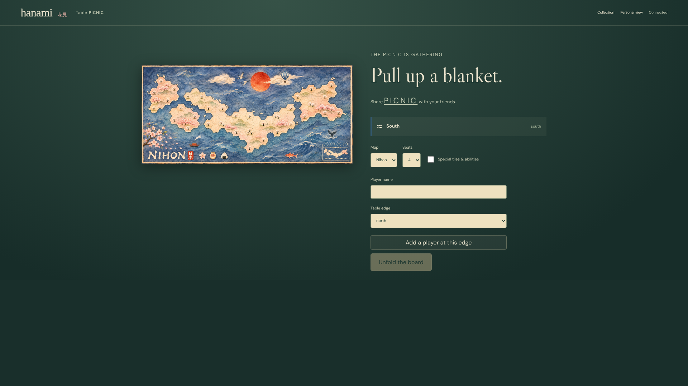

[DOM evidence](./screenshots/tabletop-launch.spec.js/000-table-linux.dom.txt)

[DOM evidence](./screenshots/tabletop-launch.spec.js/000-phone-linux.dom.txt)

## 001. Table: Name a player at the north edge

DOM assertions passed; actor and all observers captured.

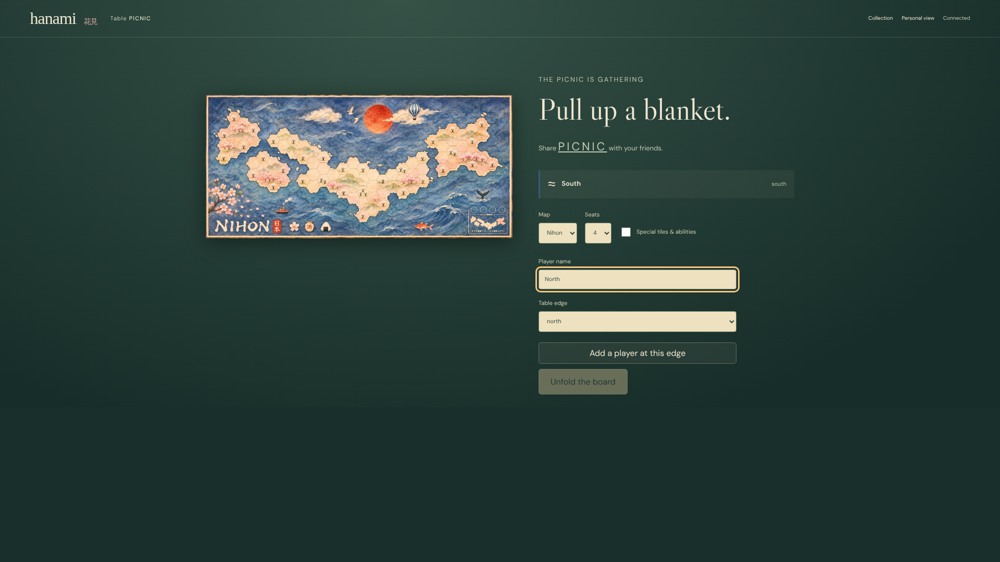

[DOM evidence](./screenshots/tabletop-launch.spec.js/001-table-linux.dom.txt)

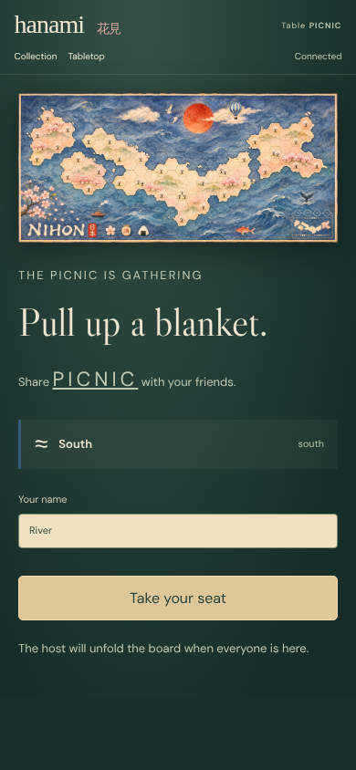

[DOM evidence](./screenshots/tabletop-launch.spec.js/001-phone-linux.dom.txt)

## 002. Table: Seat the north player by touch

DOM assertions passed; actor and all observers captured.

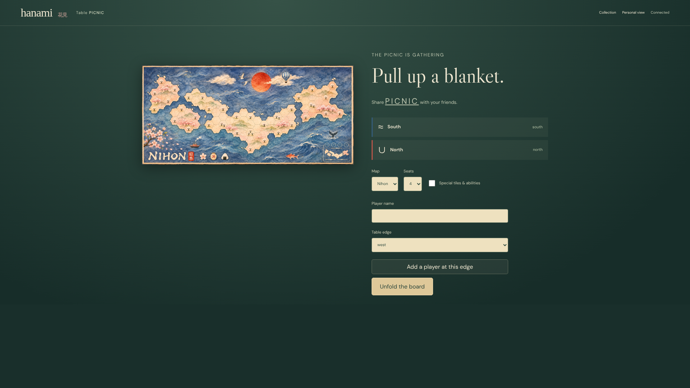

[DOM evidence](./screenshots/tabletop-launch.spec.js/002-table-linux.dom.txt)

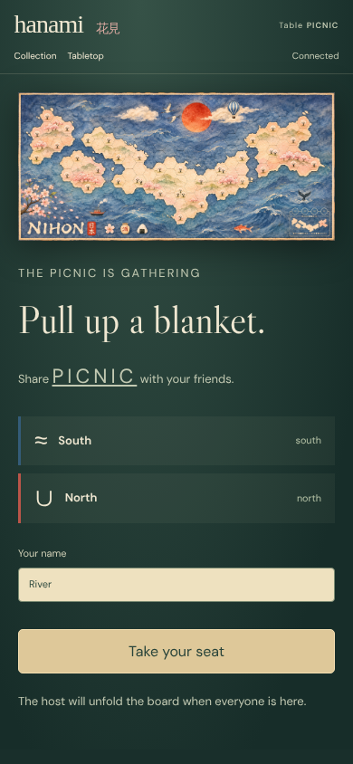

[DOM evidence](./screenshots/tabletop-launch.spec.js/002-phone-linux.dom.txt)

## 003. Phone: Join a private phone to the same table

DOM assertions passed; actor and all observers captured.

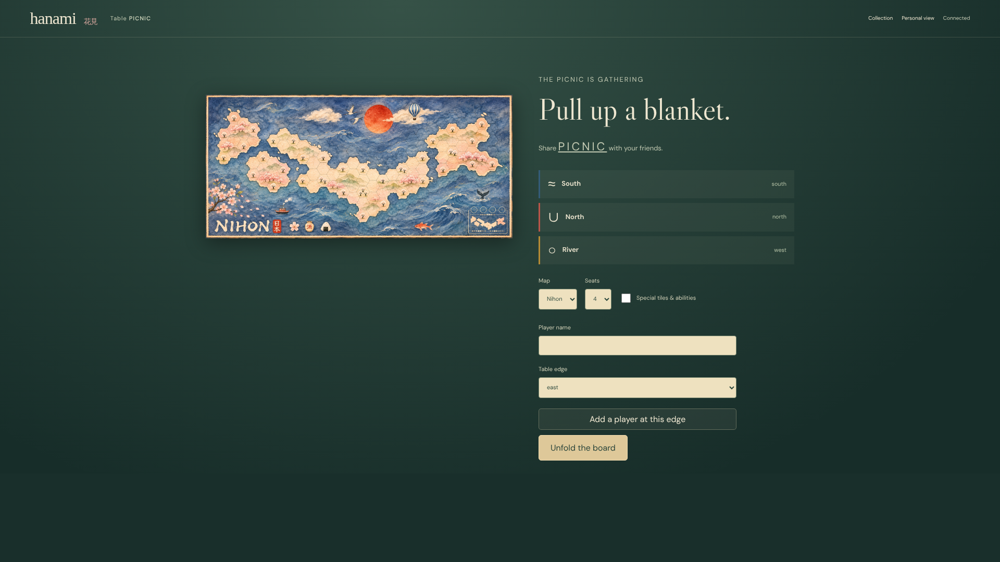

[DOM evidence](./screenshots/tabletop-launch.spec.js/003-table-linux.dom.txt)

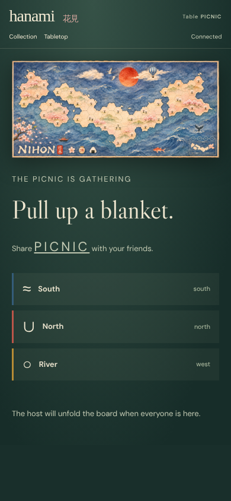

[DOM evidence](./screenshots/tabletop-launch.spec.js/003-phone-linux.dom.txt)

## 004. Table: Unfold the board for three real players

DOM assertions passed; actor and all observers captured.

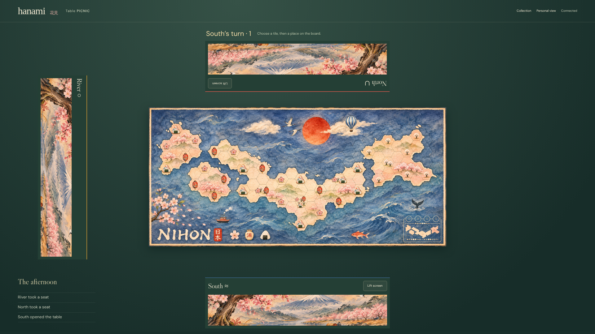

[DOM evidence](./screenshots/tabletop-launch.spec.js/004-table-linux.dom.txt)

[DOM evidence](./screenshots/tabletop-launch.spec.js/004-phone-linux.dom.txt)

## 005. Table: Lift the south privacy screen

DOM assertions passed; actor and all observers captured.

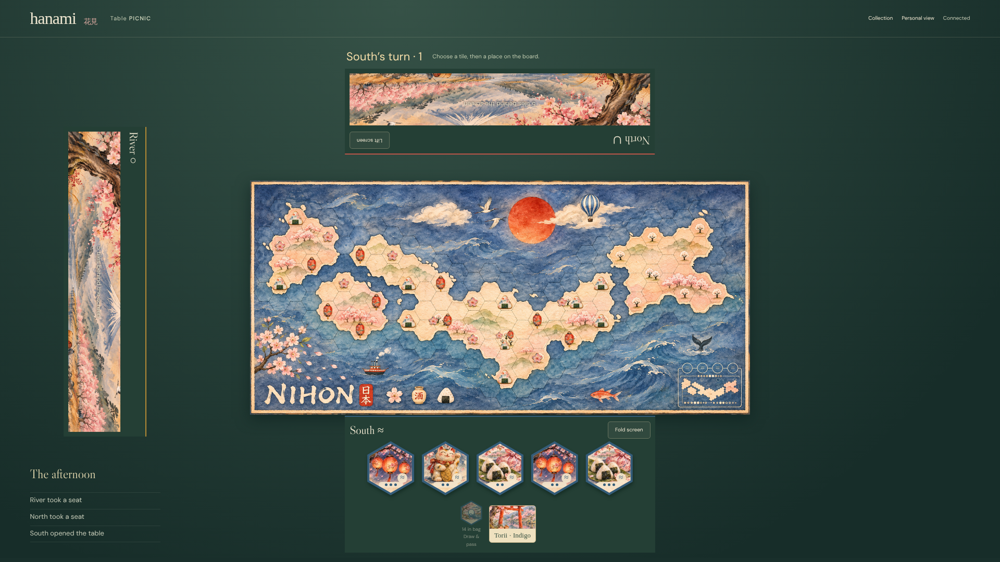

[DOM evidence](./screenshots/tabletop-launch.spec.js/005-table-linux.dom.txt)

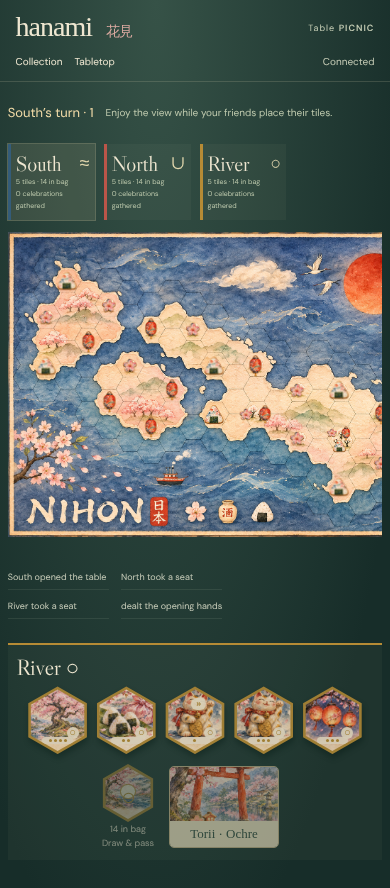

[DOM evidence](./screenshots/tabletop-launch.spec.js/005-phone-linux.dom.txt)

## 006. Table: Touch a held watercolor tile

DOM assertions passed; actor and all observers captured.

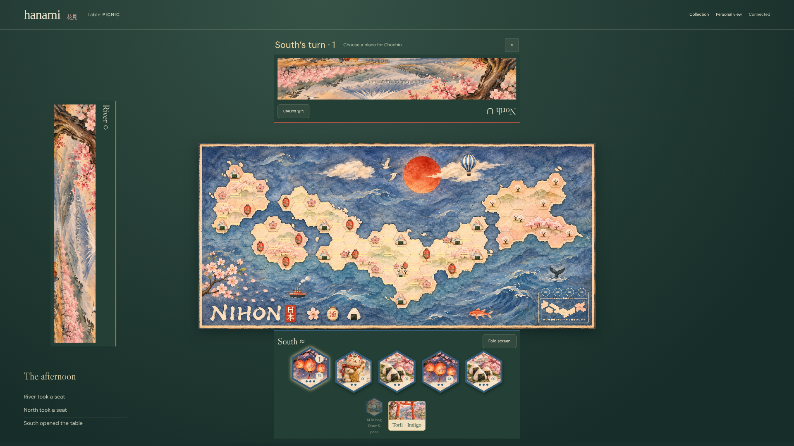

[DOM evidence](./screenshots/tabletop-launch.spec.js/006-table-linux.dom.txt)

[DOM evidence](./screenshots/tabletop-launch.spec.js/006-phone-linux.dom.txt)

## 007. Table: Place it on the shared playing field

DOM assertions passed; actor and all observers captured.

[DOM evidence](./screenshots/tabletop-launch.spec.js/007-table-linux.dom.txt)

[DOM evidence](./screenshots/tabletop-launch.spec.js/007-phone-linux.dom.txt)

## 008. Table: Draw and pass to the north edge

DOM assertions passed; actor and all observers captured.

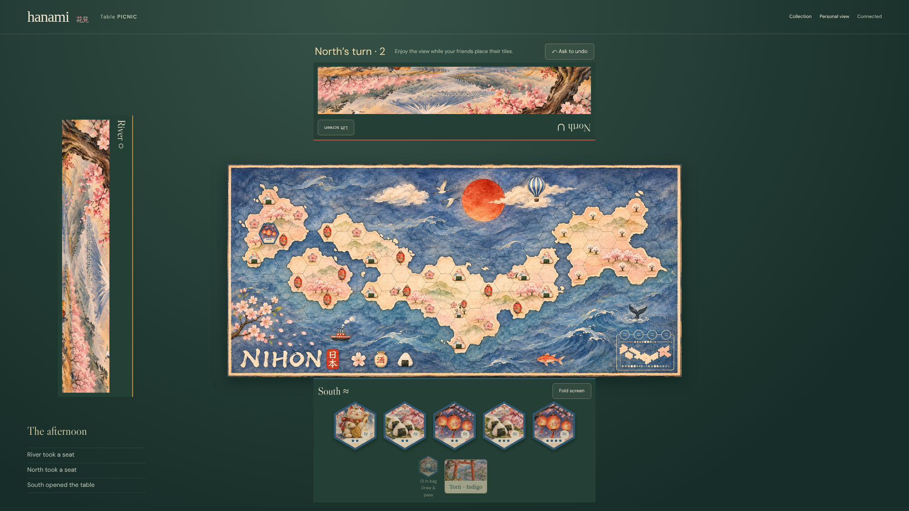

[DOM evidence](./screenshots/tabletop-launch.spec.js/008-table-linux.dom.txt)

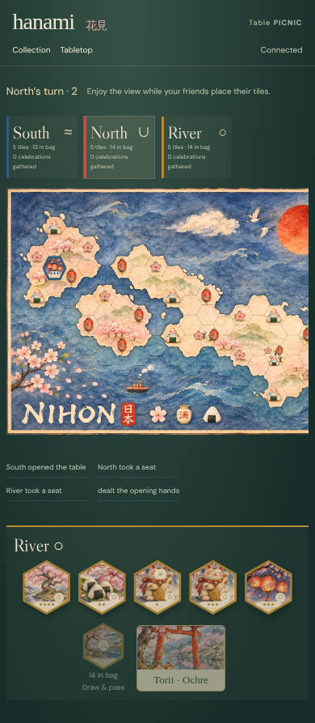

[DOM evidence](./screenshots/tabletop-launch.spec.js/008-phone-linux.dom.txt)

## 009. Table: Request undo after the south draw

DOM assertions passed; actor and all observers captured.

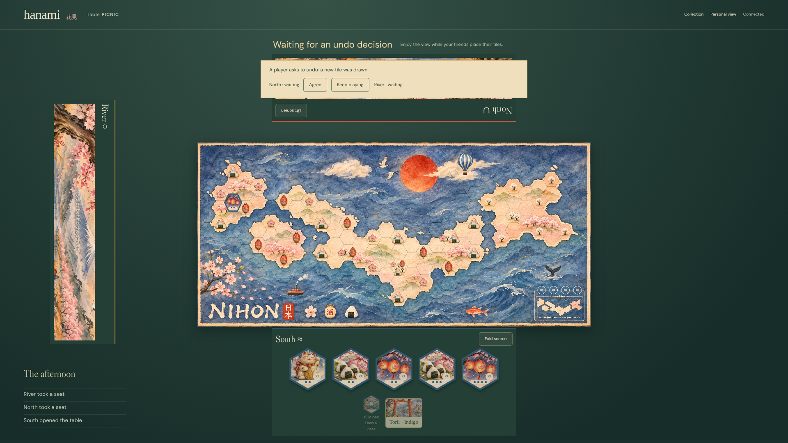

[DOM evidence](./screenshots/tabletop-launch.spec.js/009-table-linux.dom.txt)

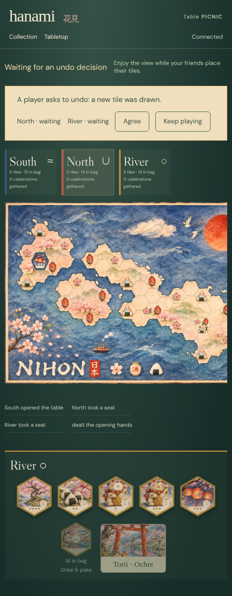

[DOM evidence](./screenshots/tabletop-launch.spec.js/009-phone-linux.dom.txt)

## 010. Table: North agrees independently on the tabletop

DOM assertions passed; actor and all observers captured.

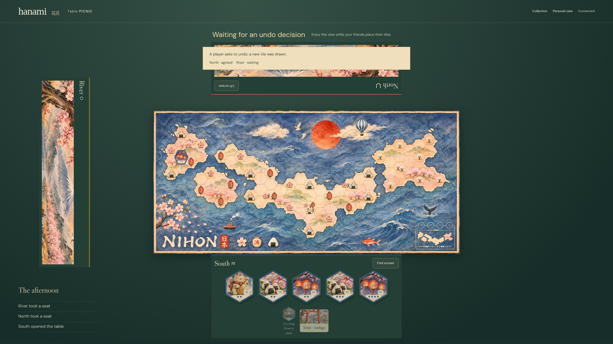

[DOM evidence](./screenshots/tabletop-launch.spec.js/010-table-linux.dom.txt)

[DOM evidence](./screenshots/tabletop-launch.spec.js/010-phone-linux.dom.txt)

## 011. Phone: The phone player supplies the final consent

DOM assertions passed; actor and all observers captured.

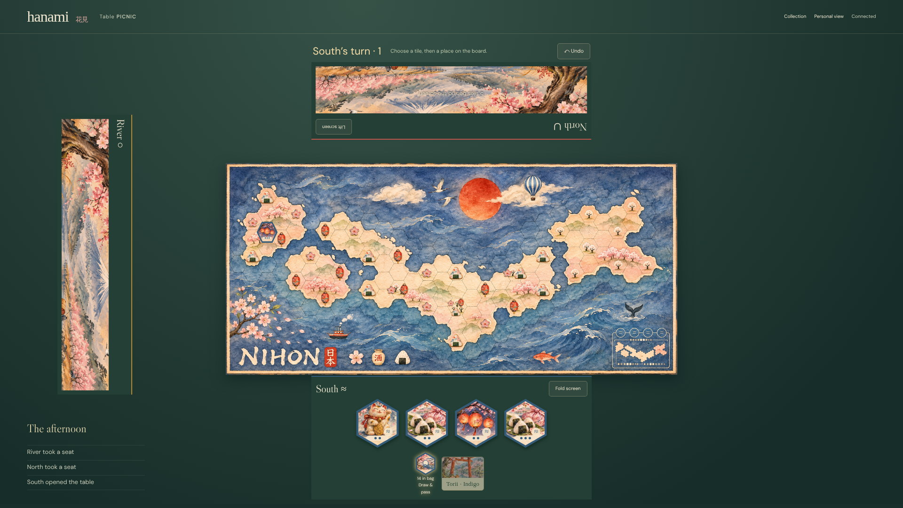

[DOM evidence](./screenshots/tabletop-launch.spec.js/011-table-linux.dom.txt)

[DOM evidence](./screenshots/tabletop-launch.spec.js/011-phone-linux.dom.txt)

## 012. Table: Fold the shared hand away again

DOM assertions passed; actor and all observers captured.

[DOM evidence](./screenshots/tabletop-launch.spec.js/012-table-linux.dom.txt)

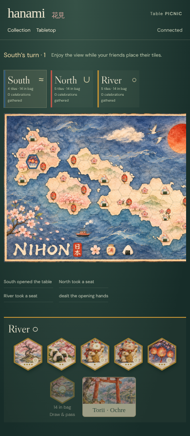

[DOM evidence](./screenshots/tabletop-launch.spec.js/012-phone-linux.dom.txt)
